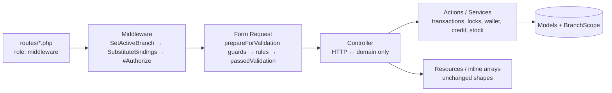
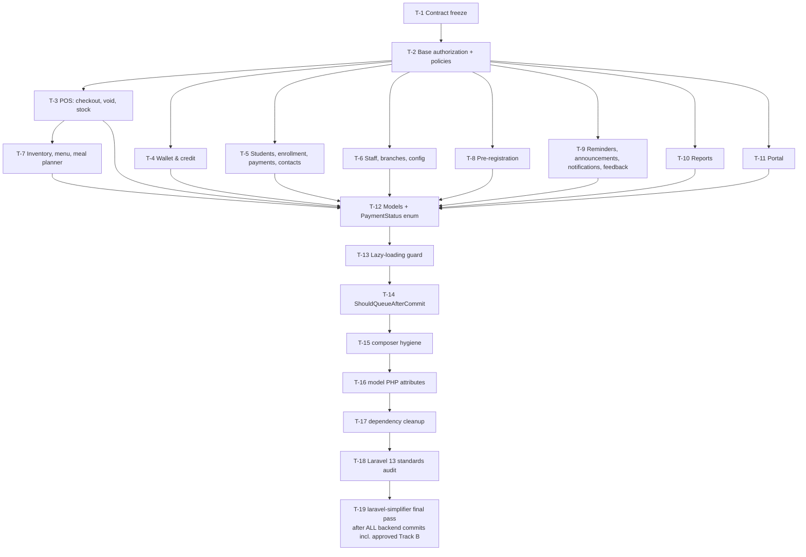

# Design Document: Spec 16, Backend Code Quality (Laravel 13)

> **Audience:** the implementer (human or LLM). Every class name, file path, method signature, rule and message below was taken from the code as of 2026-09-26. If something you find in the code contradicts this document, **stop and report it**. Do not improvise. §3 lists the behaviour-preservation hazards; read it before touching any file.

## 1. Overview

The refactor has two tracks:

- **Track A (refactor):** behaviour-neutral. It is proven neutral by contract fixtures (§4.1) that are recorded *before* any refactor and must not change.
- **Track B (defect fixes):** each item is approved separately, lands in its own commit with a failing test first, and is allowed to change only the fixtures it names (§5).

### 1.1 Decisions

| # | Decision | Status |
|---|---|---|
| Q1 | Migrate all inline validation to Form Requests | **Approved** (steering amended 2026-09-25) |
| Q2 | Track B lives in this spec, tracked and approved per item | **Approved** 2026-10-09 |
| Q3 | Delivery: **one commit per area** on a single feature branch, pushed as **one PR** (§6, §9) | **Approved** 2026-10-09 |
| Q4 | Laravel 13 model PHP attributes (`#[Table]`, `#[Fillable]`, `#[Hidden]`, `#[WithoutTimestamps]`) on all models | **Approved** 2026-10-09; task T-16 (§4.5.5) |
| Q5 | After-commit via the `ShouldQueueAfterCommit` interface on the 5 notifications and `ParentWelcomeMail`, not `after_commit => true` globally | **Approved** 2026-10-09 |
| Q6 | Remove `laravel/fortify`, `binafy/laravel-cart` and the top-level `/broadcasting/auth` route (Req 11) | **Approved** 2026-10-09, **on condition that no `/api` behaviour changes**; proven per §4.8 |
| Q7 | `WalletAlertJob` retries: `#[Tries(3)]`, `#[Backoff(10, 60)]` (Req 8.3) | **Approved** 2026-10-09 |
| Track B | Defect fixes B-01–B-05, B-07–B-16 (B-06 merged into B-05) | **Approved** 2026-10-09 |
| Track B | B-17, B-18 (cross-branch monthly amounts and feedback, found during T-1) | **Approved** 2026-10-12 |
| Track B | B-19 (inventory export crash after the `maatwebsite/excel` update, found during T-1) | **Approved** 2026-10-12 |
| Track B | B-20 (sold menu item delete 500), B-21 (portal dashboard credit badge), both found during T-1 | **Approved** 2026-10-17 |
| Track B | B-22 (pre-registration birthday shifted one day per save), B-23 (make the 403/404 bodies in `bootstrap/app.php` effective; found during T-2) | **Approved** 2026-10-17 |
| Track B | B-24 (checkout with another branch's menu item returns 500; found during T-3) | **Approved** 2026-10-17 |
| Track B | B-25 (portal spending summary repeats and skips months at month end; found during the T-16 gates) | **Approved** 2026-10-31 |
| CI | Add a MySQL 8.4 test job to `ci.yml` (task C-1, §15) | **Approved** 2026-10-12 |

### 1.2 Verified framework facts (installed `laravel/framework` v13.39.0; first verified on 13.33.0 on 2026-09-26, re-verified on 13.35.0 on 2026-10-09, on 13.37.0 on 2026-10-17 (`5b5d5e3`), on 13.38.0 on 2026-10-23 (`880d4c0`, a PHP security patch) and on 13.39.0 on 2026-10-30 (`336a826`), each after a `composer update`)

| Fact | Verified in |
|---|---|
| `#[Authorize(ability, models)]` is a **middleware** attribute; it runs before the controller method and before Form Request resolution. `SubstituteBindings` has higher priority than `Authorize`, so route models are bound first. | `Illuminate/Routing/Attributes/Controllers/Authorize.php`; `Foundation/Http/Kernel.php` L113-114 |
| `#[Scope]`, `#[UsePolicy]`, `#[Fillable]`, `#[Hidden]`, `#[Table]` exist. `#[Fillable]`/`#[Hidden]` are **merged** with the properties (`mergeFillable`/`mergeHidden`). | `Illuminate/Database/Eloquent/Attributes/*`, `Concerns/GuardsAttributes.php` L49, `HidesAttributes.php` L33 |
| `#[Tries(int)]`, `#[Backoff(int ...)]` exist | `Illuminate/Queue/Attributes/*` |
| `Exceptions::render()` and `renderable()` both call `$handler->renderable()`; they are aliases | `Illuminate/Foundation/Configuration/Exceptions.php` L49-67 |
| `FormRequest::validateResolved()` runs `prepareForValidation()` → `authorize()` → validation → `passedValidation()` | framework `ValidatesWhenResolvedTrait` |
| `ShouldQueueAfterCommit` extends `ShouldQueue` and is honoured by both `SendQueuedNotifications` (L114 on 13.38.0; L105 before) and `SendQueuedMailable` (L89 on 13.38.0; L81 on 13.37.0; L67 on 13.35.0) | `Illuminate/Contracts/Queue/ShouldQueueAfterCommit.php`, `Notifications/SendQueuedNotifications.php`, `Mail/SendQueuedMailable.php` |
| In tests, `RefreshDatabase`/`DatabaseTransactions` install `Illuminate\Foundation\Testing\DatabaseTransactionsManager`, which skips the test's wrapping transaction, so after-commit callbacks run when the application's own transaction commits | `Foundation/Testing/DatabaseTransactionsManager.php` |
| `make:request` stub generates `authorize()` returning `false` | `Foundation/Console/stubs/request.stub` L15 |
| A `JsonResource` returned directly from a controller is wrapped in `{"data": …}`. When serialised via `response()->json($resource)` or nested in an array it is **not** wrapped. | `Illuminate/Http/Resources/Json/JsonResource` (`toResponse` vs `jsonSerialize`) |
| `Handler::render()` runs `prepareException()` (which converts `AuthorizationException` → `AccessDeniedHttpException` and `ModelNotFoundException` → `NotFoundHttpException`) **before** the `renderable` callbacks, so callbacks see the converted exception, with the original as `getPrevious()` (H19, B-23) | `Foundation/Exceptions/Handler.php` L705-725, L769-785 |

## 2. Architecture



Rules of the target architecture:

1. **Route files** own role authorization (unchanged).
2. **`#[Authorize]`** owns policy authorization (replaces `$this->authorize()`).
3. **Form Requests** own input validation, input sanitising, and any guard that must run *before* validation to preserve which error wins.
4. **Controllers** unpack the validated input, call one Action/Service (or do a trivial read), and shape the response.
5. **Actions/Services** own transactions, locks, wallet/credit/stock mutations, notifications and activity logging for multi-step operations.

## 3. Behaviour-preservation hazards (read before every task)

Each hazard names the concrete sites. A task is not done until its diff has been checked against every hazard it touches.

| ID | Hazard | Rule | Known sites |
|---|---|---|---|
| H1 | **Numeric serialisation.** `decimal:2` casts serialise as **strings** (`"150.00"`); `(float)` casts serialise as **numbers** (`150` or `150.5`). The FE TypeScript often says `number` for fields that are actually strings and parses with `Number()`. | Never add or remove a `(float)` cast or change a cast. Copy each field's expression exactly. | `OrderResource` (`total`, `subtotal`, …: strings), `StudentResource.total_spent`/`credit_balance` (strings), most report controllers (floats) |
| H2 | **Enum vs string comparison.** After `status` is cast to `PaymentStatus`, PHP comparisons such as `$p->status === 'paid'` are always false, and writing the enum into a spreadsheet cell throws (`PhpSpreadsheet … Unable to bind unstringable object`). Query-builder `->where('status', 'paid')` still works. *(Corrected 2026-10-24 by the implementer's T-12 STOP: in-memory `Collection::where('status', 'paid')` keeps working on 13.38, because `EnumeratesValues::operatorForWhere` (L1159-1160) applies `enum_value()` to both sides. The table below still uses the enum there, for clarity.)* | Update every site in §4.5.2. Grep afterwards (T-12.4). | §4.5.2 |
| H3 | **`abort()` vs `response()->json()`.** `abort(422, 'x')` renders `{"message":"x"}` in production but adds `exception`/`file`/`line`/`trace` when `APP_DEBUG=true`. `response()->json(['message' => 'x'], 422)` never does. Contract fixtures are recorded with `app.debug = false` (production shape, §4.1.2), so **fixtures cannot catch a swap. This hazard is enforced by code review only.** | Keep each guard's original mechanism. When a `return response()->json(...)` guard moves out of a controller, throw `new HttpResponseException(response()->json(<same>, <same>))`. | §4.2.2, §4.3 |
| H4 | **Error precedence.** Form Requests validate before the controller body. Guards that ran *before* `validate()` would now run after, so a different error would win. | Move each pre-validation guard into `prepareForValidation()`, or move it to `#[Authorize]` if it is an authorize call (§4.2.2). | 18 methods, §4.2.2 |
| H5 | **Activity log side effects.** Eloquent `$model->update()`/`save()` on a `LogsActivity` model (`Student`, `Order`, `User`, `InventoryItem`, `PosMenuItem`) writes an activity row. Query-builder `Model::where()->update()` does not. | Never switch between the two. Keep manual `activity()` calls with identical log name, description and property keys, in the same order. | Checkout stock write (query builder, no log), void restock (Eloquent, logs), adjust (Eloquent, logs), `PosMenuItemController::toggleAvailability` (`Activity::withoutLogging`) |
| H6 | **Resource wrapping.** A `JsonResource` returned directly gets a `data` wrapper. | Only ever `response()->json($resource)` or nest it in an array. Never `return new XResource(...)`. | §4.4 |
| H7 | **Validated vs raw input.** `validated()` drops keys without a rule, including `password_confirmation` under `confirmed`, and the `website` honeypot. | The password-broker `reset()` calls keep `$request->only('email', 'password', 'password_confirmation', 'token')`; this is the only permitted non-`validated()` read. The honeypot reads `$this->filled('website')` in `prepareForValidation()`. | `Kitchen\AuthController::resetPassword`, `Portal\AuthController::resetPassword`, `Public\PreRegistrationController::store` |
| H8 | **Permissive magic-input rules.** Adding rules to previously unvalidated inputs must not reject anything accepted today. | Use `['nullable']` (plus `'sometimes'` if needed) only, and keep the original coercion (`(int)`, `integer()`, truthiness). | §4.2.3 |
| H9 | **MySQL vs SQLite.** CI runs on SQLite. | No MySQL-only SQL without an `isSqlite()`-style branch. `LIKE … ESCAPE` uses `'!'`, not a backslash (§5.9). JSON: `json_extract(...)` works on both. | Announcement read counts, B-10 |
| H10 | **Stale quantities are preserved in Track A.** Checkout computes new stock from the pre-loaded (stale) `InventoryItem` instances, including when two cart lines share an inventory item: the second write overwrites the first. | Track A reproduces this exactly. Only B-03 fixes it. | `InventoryStockService::deductForSale` |
| H11 | **Year semantics are preserved in Track A.** The `+1 for Jan–Mar` logic in reminders and the calendar-year filters in reports stay as they are in Track A. | Only B-05 changes them. | `ReminderController`, `BillingReportController`, `SubscriptionReportController` |
| H12 | **Status codes.** Keep 200 vs 201 vs 204 exactly (e.g. `StudentContactController::destroy` → 204 `null`, `StaffNotificationController::destroy` → 204, `Portal\NotificationController::destroy` → 200 with message, `BranchMonthlyAmountController::store` → 201 or 200 depending on `wasRecentlyCreated`). | Fixtures record status. | all |
| H13 | **Different limits that look like duplicates.** Kitchen student photo `max:2048` vs portal student photo `max:5120`; `per_page` caps of 50 vs 100; defaults of 15/20/25/50. | Never unify rule sets across endpoints. | §4.2 |
| H15 | **Driver-dependent aggregate types.** MySQL returns `SUM()`/`AVG()` over DECIMAL columns as **strings**; SQLite returns floats. Any response value that is an uncast aggregate therefore has a different JSON shape per driver. | Never remove an existing `(float)`/`(int)`/`round()` around an aggregate. Contract fixtures are recorded on MySQL (production engine); where SQLite differs, a `.sqlite.json` override is recorded and logged (§4.1.2). | report and dashboard controllers |
| H16 | **Carbon mutability.** `now()`/`today()` return `CarbonImmutable` here (`Date::use(CarbonImmutable::class)` in `AppServiceProvider`), but `Carbon\Carbon::create*()` returns a **mutable** instance. The month loops `while ($current->lte($end)) { … $current->addMonth(); }` in `EnrollmentService::seedMonthlyPayments` and `PaymentController::addRange` rely on mutation. With an immutable instance `addMonth()` returns a new object, `$current` never advances, and **the request loops forever**. | Never replace `Carbon::create*()`/`Carbon::createFromDate()` with `now()`, `Date::…` or `CarbonImmutable` in these loops. If a loop is touched, write `$current = $current->addMonth();`, which is correct for both mutable and immutable. T-5.1 and T-5.3 add a test that seeds June→March (10 rows) and returns. | `EnrollmentService`, `PaymentController::addRange` |
| H17 | **Form Request class attributes that change responses.** Laravel 13.35 ships `#[FailOnUnknownFields]` (rejects any input key without a rule; `FormRequest::validateNoUnknownFields`), `#[StopOnFirstFailure]` (returns only the first error), `#[ErrorBag]`, `#[RedirectTo]` and `#[RedirectToRoute]` (web redirects). Both FEs send keys that have no rule (e.g. `page` on list endpoints, verified in §13.2), and the FE shows every field error. | **Never** add these attributes to any Form Request, and never call `FormRequest::failOnUnknownFields()` globally. They look like "Laravel 13 style" but would break pages (422 on every paginated list) or change error envelopes. | all Form Requests (§4.2) |
| H18 | **Config cache during tests points tests at the real database.** `bootstrap/cache/config.php` overrides `phpunit.xml`/env. If it exists, tests boot with the local `.env` database (`laravel`), and `RefreshDatabase` can run `migrate:fresh` against it. *Observed on 2026-10-09:* a `config:cache` run concurrently with the SQLite suite made `ParentProvisioningTest` read the dev DB (301 real rows + 1). Its transaction rolled back and the data was intact. | Never run `config:cache`, `route:cache`, `event:cache` or `optimize` locally while working on this spec. Before every test run, `bootstrap/cache/` must contain only `packages.php` and `services.php`; run `vendor/bin/sail artisan config:clear` if unsure (the composer `test` script does this too). | every task |
| H19 | **403/404 message texts.** Laravel converts `AuthorizationException` and `ModelNotFoundException` into HTTP exceptions **before** `bootstrap/app.php`'s renderable runs (`Handler.php` L705-725, L769-785). So today a policy denial returns `{"message":"This action is unauthorized."}`, and a binding or `firstOrFail()` miss returns `{"message":"No query results for model [App\\Models\\X] id"}`, not the `Forbidden.`/`Not found.` the renderable intends. The fixtures record the shape only, so they cannot see the text. | Before B-23 (step 5), tests assert today's texts. From B-23 on, they assert `Forbidden.`/`Not found.`. Never change a text in Track A. | T-2, B-23 and every later 403/404 test |
| H14 | **Lazy-loading prevention.** Enabling it throws on existing lazy loads (e.g. `OrderResource` reads `student->wallet` where only `student` is eager-loaded in `TransactionController::index`). | T-13 must fix every violation the full suite surfaces, and must throw **only in `testing`**. `local` and `staging` log instead, because developers run both frontends against `APP_ENV=local`. | §4.5.4 |

## 4. Track A components

### 4.1 Contract freeze harness (Req 1)

**Files (new):**

```
tests/Support/Contract/ShapeExtractor.php      Tests\Support\Contract\ShapeExtractor
tests/Support/Contract/AssertsApiContract.php  Tests\Support\Contract\AssertsApiContract (trait)
tests/Support/Contract/ContractScenario.php    Tests\Support\Contract\ContractScenario
tests/Fixtures/contracts/*.json                one file per route × variant (gitignored, local only: §4.1.7)
tests/Feature/Contract/Kitchen/*ContractTest.php
tests/Feature/Contract/Portal/*ContractTest.php
tests/Feature/Contract/Public/*ContractTest.php
tests/Feature/Contract/RouteCoverageTest.php
tests/Feature/Contract/RoleAuthorizationMatrixTest.php
```

`tests/Support` and `tests/Fixtures` are new directories under `tests/`, not new `app/` base folders. They are covered by the existing `Tests\` PSR-4 autoload.

#### 4.1.1 Shape grammar (`ShapeExtractor::shapeOf(mixed $decodedJson, array $mapPaths = [], string $path = ''): mixed`)

| JSON value | Shape token |
|---|---|
| `null` | `"null"` |
| `true`/`false` | `"bool"` |
| number (int or float) | `"number"` (int and float are not distinguished: `json_encode(150.0)` is `150` unless `JSON_PRESERVE_ZERO_FRACTION`) |
| string matching `/^-?\d+\.\d{2}$/` | `"string:decimal2"` |
| string `Y-m-d` | `"string:date"` |
| string `Y-m-d H:i:s` | `"string:datetime"` |
| string `/^\d{4}-\d\d-\d\dT\d\d:\d\d:\d\d\.\d{6}Z$/` | `"string:iso8601_micro"` (default Eloquent/Carbon JSON) |
| string `/^\d{4}-\d\d-\d\dT\d\d:\d\d:\d\d[+-]\d\d:\d\d$/` | `"string:iso8601"` (`toIso8601String()`) |
| any other string | `"string"` |
| object | `{ key: shape }` with keys sorted (`ksort`, recursive), so key order is ignored |
| object at a path listed in `$mapPaths` (data-keyed maps such as `summary.grade_breakdown`) | `{"__map__": shape of first value}` |
| empty array | `"list:empty"` |
| non-empty list | `{"__list__": shape}` if all elements share one shape, else `{"__list_union__": [sorted unique shapes]}` |

Decimal detection runs **before** date detection. Order of checks: decimal2 → iso8601_micro → iso8601 → datetime → date → string.

#### 4.1.2 Assertion API (`AssertsApiContract` trait)

```php
protected function assertContract(
    TestResponse $response,
    string $routeKey,          // e.g. 'GET api/v1/students/{student}' — exactly as in route:list
    string $variant = 'ok',    // 'ok', 'ok-search', '422-validation', '422-end-before-start', 'other-branch', '404', … (naming rules: §4.1.4)
    array $mapPaths = [],
): void;

protected function assertFileContract(TestResponse $response, string $routeKey, string $variant = 'ok'): void;
// records ['status', 'content_type', 'disposition_pattern'] where disposition_pattern replaces
// digits with '9' (e.g. 'attachment; filename=sales-report-ant-9999-99-99-9999-99-99.xlsx').
```

- Fixture path: `tests/Fixtures/contracts/{slug}@{variant}.json`, where `slug = strtolower(method).'__'.trim(preg_replace('/[^a-z0-9{}]+/i', '_', uri), '_')`. Example: `get__api_v1_students_{student}@ok.json`.
- Fixture content: `{"status": 200, "body": <shape>}`, pretty-printed with `JSON_PRETTY_PRINT | JSON_UNESCAPED_SLASHES`.
- **Debug mode:** contract tests run with `config(['app.debug' => false])`, set in `Tests\Feature\Contract\ContractTestCase::setUp()` (below). Fixtures therefore record the **production-shaped** body (`APP_DEBUG=false` in production and in CI's `.env.example`; the local `.env.testing` has `APP_DEBUG=true`). Without this, every `abort()` variant would record `exception`/`file`/`line`/`trace` locally but not in CI.
- **Base class:** every contract test extends `Tests\Feature\Contract\ContractTestCase` (new, `abstract class ContractTestCase extends Tests\TestCase`, `use LazilyRefreshDatabase; use AssertsApiContract;`), whose `setUp()` calls, in this order:
  1. `parent::setUp()`
  2. `config(['app.debug' => false])`
  3. **the wallet clock binding** (below)
  4. `$this->scenario = ContractScenario::build($this)`
- **Wallet clock binding (decided 2026-10-12):** `bavix/laravel-wallet` stamps transactions with its own clock (`Bavix\Wallet\Internal\Service\ClockService::now()` returns `new DateTimeImmutable()`, the real wall clock), so it ignores `travelTo()`. The package registers that clock as a container singleton from its documented swap point, config key `wallet.internal.clock` (`WalletServiceProvider` L256; PSR-20 interface). `ContractTestCase::setUp()` must rebind it **before any wallet code runs**:
  ```php
  $this->app->singleton(\Bavix\Wallet\Internal\Service\ClockServiceInterface::class, fn () => new class implements \Bavix\Wallet\Internal\Service\ClockServiceInterface
  {
      public function now(): \DateTimeImmutable
      {
          return now()->toDateTimeImmutable();
      }
  });
  ```
  `now()` follows `travelTo()`, so wallet timestamps equal the frozen time. This applies to contract tests only; existing tests and production are unchanged. Do **not** publish `config/wallet.php` or change any production binding. The role matrix and route coverage tests also extend it, but override scenario building as §4.1.5 describes.
- **Driver overrides:** the primary fixture is recorded on **MySQL**, using the MySQL gate command in §11.1. **Not** `vendor/bin/sail artisan test`, which runs SQLite. When run on SQLite, the trait first looks for `{slug}@{variant}.sqlite.json` and uses it if present. The override is created only when the SQLite shape differs (H15), and every override gets a row in `contract-gaps.md` (column `proposed Track B item` = `driver divergence`). Record order: MySQL first (the MySQL gate with `-e CONTRACT_RECORD=1` added before `laravel.test`), then SQLite (the SQLite gate with `-e CONTRACT_RECORD=1 -e CONTRACT_DRIVER_OVERRIDE=1`), which writes an override **only** when the shape differs from the MySQL fixture.
- **Record mode:** when `env('CONTRACT_RECORD') === '1'`, write the fixture and `markTestIncomplete('recorded')`. Otherwise a missing fixture fails with `"No contract fixture for {slug}@{variant}; run with CONTRACT_RECORD=1 in the contract-freeze PR only."`. If the fixtures **directory** is missing (CI), the test is skipped instead (§4.1.7). A mismatch fails with `assertSame($expected, $actual)` so PHPUnit prints a diff.

#### 4.1.3 Deterministic scenario (`ContractScenario`)

`ContractScenario::build(TestCase $test, string $now = '2026-10-15 09:30:00'): self` creates, in one call, using existing factories and states. Attribute overrides on an existing factory are allowed where no state exists; adding new factory states is **not** allowed in T-1. It takes the running test case because it needs `$test->travelTo()`, `$test->seed()` and `$test->postJson()`, which are public test-case methods. It cannot be a static factory-only helper:

- **Clock:** time is frozen with `$test->travelTo(Carbon::parse($now))`. The default is school year 2026, month October; pass `'2027-01-20 09:30:00'` for the January scenarios used by B-05.
- **Branches:** A (`slug` `ant`, active) and B (active).
- **Seeders:** `$test->seed(PermissionSeeder::class)` and `$test->seed(SystemConfigurationSeeder::class)` (production always has the configuration rows; they give `{key}` = `credit_limit` and a non-empty `GET /system-configurations`).
- **Staff:** one user per role, `admin`, `manager`, `supervisor`, `cashier`, all attached to branch A. Plus one manager attached only to branch B.
- **Students in branch A:**
  - a subscription student with a wallet. Two deposits via the bavix API with **exactly** the meta keys `WalletController::topUp` writes:
    - `$student->deposit(50000, ['payment_method' => 'cash', 'reference_number' => null, 'note' => 'Contract scenario', 'performed_by' => $cashier->id])` (₱500, left voidable: used as `{transaction}` by the matrix and by the void route's `ok` variant)
    - `$student->deposit(10000, ['payment_method' => 'gcash', 'reference_number' => 'GC123456', 'note' => null, 'performed_by' => $cashier->id])` (₱100, voided by the manager, see **Wallet** below)
  - `credit_balance` 50.00 via `app(CreditLedgerService::class)->charge($student, 50.00, "order {$creditOrder->receipt_number}", $cashier)`. The service takes a description, not an order, and leaves `order_id` null by design, exactly as `CheckoutController` does, and payments: June 2026 paid, October 2026 unpaid, January 2027 unpaid, and one **voided** payment (November 2026) created as `StudentMonthlyPayment::factory()->paid()->create(['student_id' => …, 'school_month' => 'november', 'year' => 2026, 'status' => 'voided', 'voided_at' => now(), 'voided_by' => $manager->id, 'void_reason' => 'Contract scenario'])`. Use attribute overrides, not the void endpoint, so the scenario does not depend on endpoint guards
  - a non-subscription student
  - a soft-deleted student
- **Branch B records (for every `other-branch` variant):** one of each route-bound type in branch B: student, order, inventory item, menu item, announcement, feedback, pre-registration, branch monthly amount, monthly payment (of the branch-B student), student contact (of the branch-B student), and a parent linked **only** to the branch-B student.
  - **Record what happens today.** Several are not branch-protected today and will return 200: parents (B-01), branch monthly amounts (B-17) and feedback (B-18). That is expected; those Track B items change those fixtures later.
- **Contacts and parents:** `StudentContact` rows (primary and secondary, one with an email), and a `ParentUser` linked to the subscription student (`wallet_alert_threshold` 100) plus one unactivated parent.
- **Menu and inventory:** `PosMenuItem` (subscription-eligible, meal) mapped to an `InventoryItem` (quantity 100, `quantity_used` 1), one archived `InventoryItem`, a `WeeklyMealPlan` for June week 1, and one `InventoryLog` of type `manual` (so the inventory report's `discrepancy` list is not empty).
- **Orders:** cash walk-in, wallet order, credit order (`OrderFactory::credit()`), and a voided order (`voided()`), all with items and `InventoryLog` sale rows. For the wallet and credit orders, also move the wallet with `$student->withdraw($centavos)` **with no meta**, exactly as `CheckoutController` does.
- **Wallet:** a `WalletTopupVoid` created through the real endpoint, `$test->postJson('/api/v1/students/{id}/wallet/top-ups/{txId}/void', ['reason' => 'Contract scenario'])`, for the **₱100** deposit, as the manager with the branch A header. It goes through HTTP because `VoidWalletTopUpAction` does not exist yet at T-1. It works because the wallet clock binding (§4.1.2) makes the deposit "today". After the call, reset authentication (`$test->app['auth']->forgetGuards()`) so later requests choose their own actor.
- **Communication:** an `Announcement` with one notification, a `Feedback` row, `PreRegistration` rows in each status with contacts, and a `ParentPaymentReminder`.

Each contract test class uses `LazilyRefreshDatabase`, calls `ContractScenario::build()` in `setUp()`, and authenticates:
- **Staff:** `Sanctum::actingAs($user, ['staff'])` plus `withHeaders(['X-Branch-Id' => $branchA->id])` (the pattern in `tests/Feature/PosCheckoutTest.php`).
- **Parents:** `Sanctum::actingAs($parent, ['parent'], 'parents')`.

Endpoints with external HTTP (`Public\PreRegistrationController::store`) use `Http::fake(['www.google.com/recaptcha/*' => Http::response(['success' => true, 'score' => 0.9])])`. `Mail::fake()` and `Notification::fake()` apply where the endpoint sends.

Fill optional fields in the scenario wherever possible (e.g. `section`, `allergies`, `reference_number`) so fewer shapes record as `"null"`.

**Actor per route:** use the **least-privileged** role the route's `role:` group allows (cashier → supervisor → manager → admin). Routes outside any `role:` group use the cashier; portal routes use the linked parent.

**Extra `ok-*` variants are required wherever the response shape branches on input or actor:**
- `POST /pos/students/lookup`: `ok` = `type=qr` (`student`), `ok-search` = `type=search` (`students`), plus `422-not-enrolled` for a QR of a non-enrolled student
- `GET /students`: `ok-deleted` (`deleted=1`, adds `deleted_at`)
- `GET /users` and `GET /users/{user}`: `ok-as-admin` (`UserResource` adds `daily_rate` and the government ID fields for admins)
- `GET /reports/wallet/{student}/history`: `ok` = `type=topups` (the controller's `default` branch), `ok-purchases` = `type=purchases`, `ok-credit` = `type=credit`
- `GET /references/meal-planner` and `GET /portal/meal-planner`: `ok-hidden` for a week whose visibility is false (the portal returns `days: []`)

If you find another shape branch while writing a test, add the variant and list it in the T-1 commit body.

#### 4.1.4 Required variants per route

| Route kind | Variants |
|---|---|
| Every route | `ok` (2xx) |
| Routes with a Form Request / `validate()` | `422-validation` (send `{}` or one invalid field) |
| Routes with a hand-built error envelope (A-12, portal login) | one variant per envelope, e.g. `422-end-before-start`, `401-not-activated`, `401-disabled`, `422-invalid-credentials` |
| Routes with a named `abort()` business guard | one variant per guard (e.g. `422-already-voided` for `POST api/v1/pos/transactions/{order}/void`) |
| Route-model-bound routes | `other-branch`: the same request as `ok` but with a branch-B id for the bound model. It records **whatever happens today**, which is 404 for `HasBranch` models and 200 for the known gaps (parents B-01, branch monthly amounts B-17, feedback B-18) |
| File routes (6 exports, 2 photo GETs) | `assertFileContract` `ok`; photo GET also `404` (student without a photo: the `'Photo not found.'` guard) |

**Variant naming rules (authoritative):**
1. Every route has **exactly one** plain `ok` fixture: its default or most common successful request. `RouteCoverageTest` requires `@ok.json` for every route (and `@ok.sqlite.json` is only ever an additional override).
2. Additional successful shapes are `ok-<what differs>` (`ok-search`, `ok-deleted`, `ok-as-admin`, `ok-hidden`, `ok-purchases`, `ok-credit`).
3. Error variants whose status is fixed by design start with the status: `422-validation`, `422-<guard>`, `401-<case>`, `403-<case>`.
4. `other-branch` is **status-neutral** (rule above). Never name it `404-…`.
5. Plain `404` is only for an explicit not-found guard on an in-branch request (missing photo, unknown notification id, unknown `{key}`). It is optional elsewhere.
6. Names are lowercase kebab-case after the `@`, e.g. `get__api_v1_students_{student}@other-branch.json`.
7. **If a route's default request fails today** (known case: `GET api/v1/reports/inventory/export` returns 500, B-19), record what it returns as `@ok` anyway, add a `contract-gaps.md` row, and leave the fix to its Track B item, which changes that fixture. Do not skip, rename or "fix" it in T-1.

#### 4.1.5 Coverage and authorization guards

- **`RouteCoverageTest`:** iterates `Route::getRoutes()`, keeps URIs starting with `api/` whose action class is in the `App\` namespace or is a closure (the `api/health` closure is included; the two framework-owned `Illuminate\Broadcasting\BroadcastController@authenticate` routes are **explicitly excluded**, and their auth behaviour is covered by the 401 checks below and the existing channel tests), builds `"{METHOD} {uri}"` from the first non-HEAD method, converts it to a slug, and asserts `tests/Fixtures/contracts/{slug}@ok.json` exists. Failure message: `"Route {key} has no contract fixture."`. If the fixtures directory is missing (CI), the test is skipped (§4.1.7).
- **`RoleAuthorizationMatrixTest`:** for each kitchen route, reads `$route->gatherMiddleware()` and finds any `role:x|y` entry. For each role in `['admin', 'manager', 'supervisor', 'cashier']` it calls the route with scenario-resolved parameters and a `{}` body.
  - It asserts `403` when the role is not listed.
  - Otherwise it asserts the status is **not** `403`, with an explicit exceptions array for business-rule 403s. **Exactly these two entries, each with its reason as a comment:**
    - `'POST api/v1/users/{user}/deactivate' => ['admin']`: `{user}` resolves to the actor, and `UserPolicy::deactivate` denies self-deactivation.
    - `'POST api/v1/users/{user}/photo' => ['manager']`: the route is in `role:admin|manager`, but `UserPolicy::update` requires `users.manage`, which only the `admin` role has (`PermissionSeeder`). The endpoint is unused by both FEs (§13.1), so this is recorded as a finding, not a Track B item.
    - Any further mismatch is a STOP, not a new exception.
  - **Do not use a PHPUnit data provider here.** PHPUnit 12 runs data providers before the Laravel application boots, so `Route::getRoutes()` (a facade) is unavailable inside a provider. Write one test method per role (`test_admin_route_access()`, `test_manager_route_access()`, `test_supervisor_route_access()`, `test_cashier_route_access()`). Each iterates the routes at runtime, collects mismatches as `"{METHOD} {uri}: expected 403, got {status}"`, and ends with one `assertSame([], $mismatches)`, so a failure lists every offending route at once. (PHPUnit 12 also removed docblock annotations: if any new test needs a provider, use `#[DataProvider('name')]` on a `public static` method that returns literal data only.)
  - Parameter resolution is by URI:
    - `{item}` under `pos/menu-items` or `references/menu-items` → `PosMenuItem`; under `inventory` → `InventoryItem`
    - `{student}`, `{order}`, `{payment}`, `{contact}`, `{parent}`, `{user}`, `{branch}`, `{feedback}`, `{announcement}`, `{preRegistration}`, `{branchMonthlyAmount}`, `{inventoryItem}`, `{key}` = `credit_limit`, `{id}` = a notification uuid of the actor, `{transaction}` = the deposit id
  - Also asserts that every route whose gathered middleware includes `auth:parents` (this includes `POST api/v1/portal/broadcasting/auth`) returns 401 with no token and 401 with a **staff** token, and that every route whose gathered middleware includes `auth:sanctum` returns 401 with no token and 401 with a **parent** token. **Public routes are excluded**: portal `auth/login`, `auth/password/email`, `auth/password/reset`, `pre-registrations*` (until B-04), kitchen `auth/login`, `auth/password/*`, `/public/*` and `api/health`. Select routes by middleware, never by URI prefix. These use **real** tokens (`$user->createToken('t', ['staff'])->plainTextToken` sent as `Authorization: Bearer …`), not `Sanctum::actingAs`, because the property under test is Sanctum's `hasValidProvider()` check (verified in `vendor/laravel/sanctum/src/Guard.php` L130/L145).
  - Performance: the matrix does **not** use the full `ContractScenario`. It uses a minimal fixture built once per data-provider row: one branch, one user per role, and one instance of each bound model. Otherwise it would build the full scenario roughly 560 times.

#### 4.1.6 Frontend cross-check (Req 1.7)

After recording, the implementer compares each fixture with the TS interface used by the calling module. `rg -n "apiClient\.(get|post|put|patch|delete)<" lib/api` in each FE repo gives the generic type per URL; follow it to `types/*.ts` or the inline interface.

Record every mismatch in `.kiro/specs/16-backend-code-quality/contract-gaps.md` as a table with columns: `route | field | backend shape | FE type (file:line) | UI impact | proposed Track B item`.

Pre-verified entries to seed the file with:

| Route | Field | Backend | FE | Impact | Item |
|---|---|---|---|---|---|
| `GET api/v1/reports/sales` | `data[].student.full_name` | absent (raw `Student` has no `full_name`) | `SalesOrder.student.full_name: string` (`sunbites-pos/lib/api/reports.ts:89`) | Student column blank (`reports/sales/page.tsx:391`) | B-13 |
| `POST api/v1/pos/checkout` (+ void, transactions, student orders) | `order.cashier.name` | always `null` | `OrderCashier.name: string` (`types/order.ts:95`) | Receipt cashier blank (`components/pos/receipt-modal.tsx:72`) | B-07 |
| `GET api/v1/reports/sales`, `GET api/v1/reports/billing` | `cashier` / `recorder` / `student` | full models incl. `daily_rate`, `phone`, `birthday`, `qr_code` | FE reads only names/ids | PII over-exposure | B-12 |
| `GET api/v1/references/inventory` | archived rows | never returned (`InventoryItem::active()`) | `references/inventory/page.tsx:894-895` expects them for the Archived section | Unarchive unreachable | B-16 |
| many | decimal fields | `"string:decimal2"` | typed `number` | none today (UI parses) | none: document only |

#### 4.1.7 Fixture storage: local only, never committed *(decided 2026-10-12)*

- **Decision (user, 2026-10-12):** contract fixtures must not reach production. `/tests/Fixtures/contracts` is in `.gitignore`. The fixtures live only in the working tree at `~/sunbites-api`, which the spec-owner and implementer sessions share. They are never committed, pushed or deployed. **Never `git add -f` anything under `tests/Fixtures/contracts/`.**
- **Why CI needs a rule.** GitHub Actions checks out the repo without fixtures. That covers both `ci.yml` jobs (including C-1's `test-mysql`) and the test jobs in `staging.yml` and `production.yml`, which gate the deploys. Without a rule, every fixture comparison would fail and block every deploy. So:
  - `AssertsApiContract::assertMatchesContractFixture()`: when record mode is off and `! is_dir($this->contractFixturesDirectory())`, call `$this->markTestSkipped('Contract fixtures are local only (gitignored, Spec 16 design §4.1.7).')`. When the directory exists but one file is missing, it still fails with the existing message.
  - `RouteCoverageTest::test_every_api_route_has_an_ok_contract_fixture()`: the same check and message, as its first statement. `test_the_api_exposes_the_expected_number_of_routes()` reads no fixtures and runs everywhere.
  - `RoleAuthorizationMatrixTest`, `ContractScenarioTest`, `ShapeExtractorTest` and `AssertsApiContractTest` read no fixtures and run everywhere, CI included.
  - `AssertsApiContractTest::setUp()` creates its temp directory (`mkdir($this->fixturesDirectory, 0755, true)`), so `test_compare_mode_fails_with_instructions_when_the_fixture_is_missing` still tests a missing **file**. Add `test_compare_mode_skips_when_the_fixtures_directory_is_absent`:
    - remove the directory and call `assertContract()`
    - catch `PHPUnit\Framework\SkippedWithMessageException` and assert its message equals the one above, using the same try/catch pattern as `recordJson()`
    - `SkippedWithMessageException` extends `AssertionFailedError`, so do not catch `AssertionFailedError` for this
  - No workflow file changes. CI reports these tests as skipped, and deploys are unaffected.
- **Locally, a skip is a failure.** The fixtures folder exists, so the MySQL and SQLite gates (§11.1) must end with a plain `OK (N tests, M assertions)`. `OK, but some tests were skipped!` means the folder is missing or moved: STOP.
- **Fixture digest.** This replaces `git status` on fixtures, which now always prints nothing. Run the commands on the host from the repo root (no PHP, so no Sail):
  ```bash
  # count
  find tests/Fixtures/contracts -type f -name '*.json' | wc -l | tr -d ' '
  # per-file hashes (save before a Track B re-record, then diff after)
  (cd tests/Fixtures/contracts && find . -type f -name '*.json' -print0 | LC_ALL=C sort -z | xargs -0 shasum -a 256)
  # digest (one line)
  (cd tests/Fixtures/contracts && find . -type f -name '*.json' -print0 | LC_ALL=C sort -z | xargs -0 shasum -a 256) | shasum -a 256 | cut -c1-64
  ```
  - **T-1 commit body:** `Fixtures: <count> files, digest <digest> (local only, not committed)`.
  - **Every Track A commit body:** the same line. The digest must equal the previous commit's.
  - **Track B commits:**
    1. Before re-recording, save the per-file hashes to `"${TMPDIR:-/tmp}/spec16-fixtures-before.sha"`.
    2. Re-record only the listed tests.
    3. Save the hashes again to `"${TMPDIR:-/tmp}/spec16-fixtures-after.sha"` and `diff` the two files. The diff must show only the files the task lists.
    4. The commit body lists each of those files as `added`, `removed`, or `changed` (old status → new status), followed by the new count and digest.
- **Durability:** the fixtures exist on one machine only. If they are lost before Spec 16 merges, the pre-refactor baseline is gone, and re-recording would only freeze whatever the code does at that moment. A local archive outside the repo is optional and is made **only if the user asks** for one.

### 4.2 Form Requests (Req 3)

Base conventions for every new request:
- `class X extends FormRequest` (not `final`: no class in `app/` is final, and `laravel-best-practices` puts consistency first), and `authorize(): bool { return true; }`, because authorization lives in routes and `#[Authorize]`.
- `rules(): array` with `@return array<string, mixed>`.
- Messages are copied verbatim.
- Route models are read with `$this->route('student')` and typed with `/** @var Student $student */`.
- Sanitising is ported exactly: `strip_tags` after validation becomes `passedValidation()` or stays at the point of use. `sanitizeText` before validation becomes `prepareForValidation()` using `$this->merge()`. Because `sanitizeText()` lives on the base `Controller`, the request inlines `is_string($v) ? trim(strip_tags($v)) : $v`.

#### 4.2.1 Mapping (all 83 inline `validate()` call sites)

Directory: `app/Http/Requests/Kitchen/` unless noted. "=" means copy the rules verbatim from the method.

| Controller::method | Form Request | Notes |
|---|---|---|
| ActivityLogController::index | `ListActivityLogsRequest` | = |
| AnalyticsController::index | `ShowAnalyticsRequest` | = |
| AnnouncementController::store | `StoreAnnouncementRequest` | = |
| AuthController::login | `StaffLoginRequest` | controller reads `validated('email')`/`validated('password')` instead of magic props |
| AuthController::resetPassword | `ResetStaffPasswordRequest` | keep `$request->only(...)` for the broker (H7); uses the FQCN `\Illuminate\Validation\Rules\Password::defaults()` |
| AuthController::sendResetEmail | `SendStaffResetLinkRequest` | = |
| AuthController::setBranch | `SwitchBranchRequest` | = |
| BillingReportController::export | `ExportBillingReportRequest` | rules = `filterRules()` |
| BillingReportController::index | `ListBillingReportRequest extends ExportBillingReportRequest` | `parent::rules()` + `per_page`. Do **not** add `per_page` to export (H8) |
| BranchController::update | `UpdateBranchRequest` | = |
| BranchMonthlyAmountController::index | `ListBranchMonthlyAmountsRequest` | `'year' => ['nullable']`; controller keeps `$request->integer('year') ?: now()->year` |
| BranchMonthlyAmountController::store | `StoreBranchMonthlyAmountRequest` | `Rule::prohibitedIf($this->integer('days') === 0)` |
| BranchMonthlyAmountController::update | `UpdateBranchMonthlyAmountRequest` | same as above |
| CheckoutController::store | `CheckoutRequest` | = (12 rules) |
| CreditReportController::index | `ListCreditReportRequest` | = |
| DailySummaryController::index | `ShowDailySummaryRequest` | = |
| DashboardController::updateStaffStatus | `UpdateStaffStatusRequest` | = (B-01 later tightens `user_id`) |
| EnrollmentController::store | `EnrollStudentRequest` | unique rule uses `$this->input('branch_id')`. The end-before-start check goes in `passedValidation()` and throws `HttpResponseException(response()->json(['errors' => ['subscription_end_month' => ['End month must be after start month.']]], 422))`. Do **not** use `after()`, which would add `message` |
| FeedbackController::index | `ListFeedbackRequest` | = |
| FeedbackController::reply | `ReplyFeedbackRequest` | `prepareForValidation()`: `merge(['reply' => sanitize(input('reply'))])` |
| InlineReloadController::store | `InlineReloadRequest` | = |
| InventoryController::adjust | `AdjustInventoryRequest` | = ; the "Sale adjustments…" 422 stays after validation in the controller |
| InventoryController::history | `ListInventoryHistoryRequest` | = |
| InventoryController::store | `StoreInventoryItemRequest` | = |
| InventoryController::update | `UpdateInventoryItemRequest` | = |
| InventoryIngredientController::attach | `AttachIngredientRequest` | = |
| InventoryReportController::export | `ExportInventoryReportRequest` | `from`, `to` only |
| InventoryReportController::index | `ShowInventoryReportRequest` | 4 rules, independent of the export request (different sets) |
| MealPlannerController::show | `ShowMealPlanRequest` | `'month' => ['nullable'], 'week' => ['nullable']`; controller keeps `input('month', 'june')`, `(int) input('week', 1)` |
| MealPlannerController::update | `UpdateMealPlanRequest` | = ; the `app()->bound('active_branch')` 422 stays after validation |
| MealPlannerController::reset | `ResetMealPlanWeekRequest` | = |
| MealPlannerController::updateWeekVisibility | `UpdateMealPlanWeekVisibilityRequest` | = |
| ParentController::index | `ListParentsRequest` | = |
| PaymentController::addRange | `AddPaymentRangeRequest` | end-before-start in `passedValidation()` → `HttpResponseException` errors-only (same text) |
| PaymentController::record | `RecordPaymentRequest` | = |
| PaymentController::updateAmount | `UpdatePaymentAmountRequest` | `prepareForValidation()` guards (§4.2.2) |
| PaymentController::void | `VoidPaymentRequest` | `prepareForValidation()` guards (§4.2.2); the past-month 422 stays after validation |
| PosMenuItemController::store / update | `SavePosMenuItemRequest` (shared) | identical rules verified |
| PreRegistrationController::index | `ListPreRegistrationsRequest` | = |
| PreRegistrationController::update | `UpdatePreRegistrationRequest` | pending guard in `prepareForValidation()`; `strip_tags` of allergies/notes stays after validation |
| PreRegistrationController::reject | `RejectPreRegistrationRequest` | pending guard in `prepareForValidation()` |
| ReminderController::eligibleParents | `ListEligibleParentsRequest` | = + `'page' => ['nullable']`; controller keeps `$request->integer('page', 1)` |
| ReminderController::send | `SendRemindersRequest` | = |
| SalesReportController::export | `ExportSalesReportRequest` | 5 rules |
| SalesReportController::index | `ListSalesReportRequest extends ExportSalesReportRequest` | + `per_page` |
| StudentContactController::store | `StoreStudentContactRequest` | = ; the ">= 3 contacts" 422 stays after validation |
| StudentContactController::update | `UpdateStudentContactRequest` | `prepareForValidation()`: contact-belongs-to-student 404 (§4.2.2) |
| StudentController::index | `ListStudentsRequest` | permissive (§4.2.3) |
| StudentController::orders | `ListStudentOrdersRequest` | = |
| StudentController::update | `UpdateStudentRequest` | unique rule uses `$this->route('student')->branch_id`/`->id` |
| StudentController::updateStatus | `UpdateStudentStatusRequest` | copy `Rule::when(EnrollmentStatus::from($this->input('enrollment_status'))->requiresReason(), …)` **as is**, including its 500 on bad input (fixed only by B-14) |
| StudentController::updateType | `UpdateStudentTypeRequest` | = |
| StudentController::uploadPhoto | `UploadStudentPhotoRequest` | `max:2048` |
| StudentLookupController::lookup | `StudentLookupRequest` | = |
| StudentReportController::export | `ExportStudentReportRequest` | 7 rules |
| StudentReportController::index | `ListStudentReportRequest extends ExportStudentReportRequest` | + `per_page` |
| SubscriptionConfigController::update | `UpdateSubscriptionConfigRequest` | = |
| SubscriptionReportController::index | `ShowSubscriptionReportRequest` | = |
| SystemConfigurationController::update | `UpdateSystemConfigurationRequest` | `configuration(): SystemConfiguration` memoises `SystemConfiguration::where('key', $this->route('key'))->firstOrFail()`; `rules()` is the `match` on `configuration()->type` (404 still precedes 422) |
| TransactionController::index | `ListTransactionsRequest` | = |
| TransactionController::void | `VoidOrderRequest` | `#[Authorize('void', 'order')]` on the method; already-voided guard in `prepareForValidation()` |
| UserManagementController::index | `ListStaffUsersRequest` | permissive (§4.2.3) |
| UserManagementController::store | `StoreStaffUserRequest` | `...staffRules()` moves to a shared trait `App\Http\Requests\Kitchen\Concerns\StaffUserRules`; the admin-role 403 stays after validation in the controller |
| UserManagementController::update | `UpdateStaffUserRequest` | email rule `"unique:users,email,{$this->route('user')->id}"` (same string form) |
| UserManagementController::uploadPhoto | `UploadUserPhotoRequest` | `#[Authorize('update', 'user')]` |
| UserManagementController::assignBranch | `AssignUserBranchRequest` | `#[Authorize('update', 'user')]` |
| WalletController::topUp | `TopUpWalletRequest` | `strip_tags(note)` stays at the point of use |
| WalletHistoryController::index | `ListWalletHistoryRequest` | = (`per_page` max **50**, H13) |
| WalletReportController::index | `ListWalletReportRequest` | = (export has no validation; unchanged) |
| Concerns/ResolvesStudentLedger::paginatedLedgerEntries | `App\Http\Requests\StudentLedgerRequest` (shared) | trait signature becomes `paginatedLedgerEntries(StudentLedgerRequest $request, Student $student, StudentLedgerQuery $q)`; Portal controller gains `#[Authorize('view', 'student')]` in the same PR |
| **Portal** (`app/Http/Requests/Portal/`) | | |
| ActivityController::index | `ListStudentActivityRequest` | `#[Authorize('view', 'student')]` |
| AuthController::login | `ParentLoginRequest` | = |
| AuthController::forgotPassword | `ParentForgotPasswordRequest` | = |
| AuthController::resetPassword | `ResetParentPasswordRequest` | keep `$request->only(...)` (H7); `min:8` (not `Password::defaults()`, H13) |
| FeedbackController::store | `StoreFeedbackRequest` | `prepareForValidation()`: no-linked-students guard, then sanitise `message`; `Rule::in` of linked ids from `$this->user()->students()` (§4.2.2) |
| MealPlannerController::show | `ShowPortalMealPlanRequest` | = ; subscription 403 and branch 403 stay after validation |
| PreRegistrationCheckController::check | `CheckPreRegistrationRequest` | **skip if B-04 is approved** (route removed) |
| PreRegistrationController::store | `StorePortalPreRegistrationRequest` | **skip if B-04 is approved** |
| ProfileController::update | `UpdateParentProfileRequest` | = |
| ProfileController::changePassword | `ChangeParentPasswordRequest` | = ; the current-password mismatch errors-only 422 stays in the controller |
| ProfileController::uploadPhoto | `UploadParentPhotoRequest` | `max:2048` |
| SpendingSummaryController::show | `ShowSpendingSummaryRequest` | `#[Authorize('view', 'student')]` |
| StudentPhotoController::store | `UploadPortalStudentPhotoRequest` | `#[Authorize('view', 'student')]`, `max:5120` (H13) |
| WalletController::index | `ListPortalWalletRequest` | `#[Authorize('view', 'student')]` |
| WalletController::setAlert | `SetWalletAlertRequest` | `#[Authorize('view', 'student')]` |
| **Public** (`app/Http/Requests/Public/`) | | |
| PreRegistrationController::store | `StorePublicPreRegistrationRequest` | `prepareForValidation()`: honeypot, then reCAPTCHA (§4.2.2); `passedValidation()`: end-before-start errors-only 422; exposes `recaptchaScore(): ?float` |

**Complete list of the 14 existing `$this->authorize()` calls** (`rg -n '\$this->authorize\(' app/Http/Controllers`, 2026-09-26). Each becomes exactly one `#[Authorize]` attribute, with no additions and no omissions:

| Call site | Attribute |
|---|---|
| `Kitchen\TransactionController::void` | `#[Authorize('void', 'order')]` |
| `Kitchen\UserManagementController::deactivate` | `#[Authorize('deactivate', 'user')]` |
| `Kitchen\UserManagementController::reactivate` | `#[Authorize('reactivate', 'user')]` (route `->withTrashed()`, so binding resolves trashed users before `Authorize` runs) |
| `Kitchen\UserManagementController::sendResetEmail` | `#[Authorize('update', 'user')]` |
| `Kitchen\UserManagementController::uploadPhoto` | `#[Authorize('update', 'user')]` |
| `Kitchen\UserManagementController::assignBranch` | `#[Authorize('update', 'user')]` |
| `Kitchen\UserManagementController::detachBranch` | `#[Authorize('update', 'user')]` |
| `Portal\WalletController::index` | `#[Authorize('view', 'student')]` |
| `Portal\WalletController::setAlert` | `#[Authorize('view', 'student')]` |
| `Portal\StudentLedgerController::index` | `#[Authorize('view', 'student')]` |
| `Portal\StudentPhotoController::show` | `#[Authorize('view', 'student')]` |
| `Portal\StudentPhotoController::store` | `#[Authorize('view', 'student')]` |
| `Portal\SpendingSummaryController::show` | `#[Authorize('view', 'student')]` |
| `Portal\ActivityController::index` | `#[Authorize('view', 'student')]` |

`UserManagementController::update` and `::store` have **no** policy call today; they rely only on `role:` middleware. **Do not add one** (that would be a Track B change). `UserManagementController::deactivate` keeps its `abort_if(self, 403, 'You cannot deactivate your own account.')` and `abort_if(last admin, …)` after the attribute. The policy denies both cases first today as well, so precedence is unchanged.

#### 4.2.2 Pre-validation guards (H4): exact ports

| Method | Guard (verbatim today) | Port |
|---|---|---|
| `Kitchen\FeedbackController::reply` | `$request->merge(['reply' => $this->sanitizeText($request->input('reply'))])` | `ReplyFeedbackRequest::prepareForValidation()` |
| `PaymentController::updateAmount` | `abort_if($payment->student_id !== $student->id, 403);` then `abort_if($payment->isPaid() \|\| $payment->isVoided(), 422, 'Can only edit amount on unpaid payments.');` | `UpdatePaymentAmountRequest::prepareForValidation()`, same two `abort_if` calls in the same order |
| `PaymentController::void` | `abort_if($payment->student_id !== $student->id, 404);` then `abort_if(! $payment->isPaid(), 422, 'Only paid payments can be voided.');` | `VoidPaymentRequest::prepareForValidation()` |
| `Kitchen\PreRegistrationController::update` | `return response()->json(['message' => 'Only pending pre-registrations can be edited.'], 422)` when status ≠ Pending | `prepareForValidation()`: `throw new HttpResponseException(response()->json([...same...], 422))` |
| `Kitchen\PreRegistrationController::reject` | same, text `'Only pending pre-registrations can be rejected.'` | same pattern |
| `StudentContactController::update` | `$this->assertContactBelongsToStudent($contact, $student)` → `abort(404, 'Contact does not belong to this student.')` | `prepareForValidation()`: the same `abort()` call |
| `TransactionController::void` | `$this->authorize('void', $order)` then `return response()->json(['message' => 'Order is already voided.'], 422)` | `#[Authorize('void', 'order')]` + `VoidOrderRequest::prepareForValidation()` throwing `HttpResponseException` |
| `UserManagementController::uploadPhoto`, `::assignBranch` | `$this->authorize('update', $user)` | `#[Authorize('update', 'user')]` |
| `Portal\ActivityController::index`, `SpendingSummaryController::show`, `StudentPhotoController::store`, `WalletController::index`, `::setAlert`, `StudentLedgerController::index` | `$this->authorize('view', $student)` | `#[Authorize('view', 'student')]` |
| `Portal\FeedbackController::store` | ① load linked students; ② if empty → `response()->json(['message' => 'You have no linked students.'], 422)`; ③ sanitise `message` | `prepareForValidation()`: ② as `HttpResponseException`, then ③. `rules()` computes `Rule::in($this->linkedStudents()->pluck('id')->all())`, where `linkedStudents()` memoises `$this->user()->students()->get(['students.id', 'branch_id'])`. The controller reads `$request->linkedStudents()` for the branch lookup |
| `Public\PreRegistrationController::store` | ① `if ($request->filled('website'))` → `response()->json(['message' => 'Pre-registration received.'], 201)`; ② reCAPTCHA `Http::timeout(5)->asForm()->post(...)`; `ConnectionException` → `Log::warning('reCAPTCHA verification service unavailable', ['ip' => …])` + 503 `{'message': 'Verification service temporarily unavailable. Please try again shortly.'}`; failed or low score → 422 `{'message': 'Submission could not be verified. Please try again.'}` | `prepareForValidation()`: ① and ② each as `HttpResponseException` with identical bodies. ② is extracted verbatim to `App\Services\RecaptchaVerifier::verify(?string $token, string $ip): array` (returns the decoded JSON or throws `ConnectionException`). Store the score in a private property for `recaptchaScore()` |

`SystemConfigurationController::update` also looks the record up before validating; see the §4.2.1 note.

#### 4.2.3 Permissive rules for magic input (H8)

| Method | Inputs → rules | Controller reads |
|---|---|---|
| `StudentController::index` | `deleted`, `search`, `grade`, `status`, `type`, `month`, `payment_status`, `year` → each `['nullable']` | `$v = $request->validated();` then `$v['deleted'] ?? null` etc. Keep truthiness checks exactly (`if ($v['deleted'] ?? null)`, `($v['type'] ?? null) && ($v['type'] ?? null) !== 'all'`) |
| `UserManagementController::index` | `search`, `role`, `status` → `['nullable']` | same pattern |
| `Kitchen\MealPlannerController::show` | `month`, `week` → `['nullable']` | `$request->input('month', SchoolMonth::June->value)`, `(int) $request->input('week', 1)`, unchanged, as §4.2.1 says. *(Corrected 2026-10-17 during T-7: `??` would turn an empty value into `'june'`/`1`, while `input()` returns `null`/`0` today.)* |
| `BranchMonthlyAmountController::index` | `year` → `['nullable']` | `$request->integer('year') ?: now()->year` (unchanged) |
| `ReminderController::eligibleParents` | `page` → `['nullable']` | `$request->integer('page', 1)` (unchanged) |

### 4.3 Actions and Services (Req 2)

All new classes: plain `class` (not `final`, matching the 0 final classes in `app/`), constructor property promotion with `private readonly`, typed returns, docblock with purpose and cross-branch notes. Each Action has one public `execute()`. Controllers inject Actions into the method, following the `SubscriptionDowngradeController::execute` precedent.

#### 4.3.1 `App\Services\InventoryStockService`

```php
class InventoryStockService
{
    /**
     * Deduct stock for a completed checkout. Must be called inside the checkout transaction.
     * Track A: reproduces today's stale-quantity write exactly (H10): for each cart line, for each
     * mapped inventory item, newQty = max(0, (float) $invItem->quantity - $invItem->pivot->quantity_used * $qty),
     * written with InventoryItem::where('id', $invItem->id)->update(['quantity' => $newQty]) (query builder, H5),
     * then InventoryLog::create([... type Sale, quantity_change => -$deduction, stock_after => $newQty,
     * item_name_snapshot => $invItem->name, reason => 'Order #'.$order->receipt_number,
     * order_id, adjusted_by, branch_id => $branchId]).
     *
     * @param  Collection<int, PosMenuItem>  $menuItems  keyed by id, with inventoryItems loaded
     * @param  array<int, array{pos_menu_item_id: int, quantity: int}>  $cartItems
     */
    public function deductForSale(Order $order, Collection $menuItems, array $cartItems, User $by, int $branchId): void;

    /**
     * Restock a voided order from its Sale logs. Must be called inside the void transaction.
     * Track A: per log row, InventoryItem::lockForUpdate()->find($id); if found,
     * $invItem->update(['quantity' => (float) $invItem->quantity + abs((float) $log->quantity_change)]) (Eloquent, H5),
     * then an InventoryLog type Restock, reason 'Void: Order #'.$order->receipt_number, branch_id => $order->branch_id,
     * item_name_snapshot => $saleLog->item_name_snapshot.
     */
    public function restockForVoid(Order $order, User $by): void;

    /** Manual adjust. $item->update(['quantity' => $new]) (Eloquent, H5) + InventoryLog; returns [$oldQty, $change, $newQty]. */
    public function adjust(InventoryItem $item, InventoryLogType $type, float $quantity, string $direction, string $reason, User $by, int $branchId): array;

    /** Initial stock log when an item is created with quantity > 0 (reason 'Initial stock', type Restock). */
    public function recordInitialStock(InventoryItem $item, User $by, int $branchId): void;
}
```

The callers keep their `activity('inventory')` calls and response building. Only the stock and log writes move.

#### 4.3.2 `App\Actions\Pos\CheckoutAction`

```php
class CheckoutAction
{
    public function __construct(
        private readonly CreditLedgerService $creditLedger,
        private readonly InventoryStockService $stock,
    ) {}

    /** @param array<string, mixed> $input  CheckoutRequest::validated() */
    public function execute(array $input, User $cashier): Order;
}
```

`execute()` contains, **in this order and verbatim**, everything from today's `CheckoutController::store`:

1. The walk-in guards. They `return response()->json(..., 422)` today and become `HttpResponseException` with the same bodies:
   - `'Walk-in customers cannot use the student wallet.'`
   - `'Walk-in customers cannot use the subscription payment method.'`
2. The menu load.
3. The inventory-mapping pre-check (`HttpResponseException`, 422, `'One or more items are not configured for inventory tracking. Please contact your administrator.'`).
4. The stock pre-check (`HttpResponseException`, 422, `"{$invItem->name} is out of stock."`).
5. Subtotal.
6. Discount authorization, **only when** `! empty($input['discount_type']) && ! empty($input['discount_value'])` (as today): `abort(403, 'Only admin and manager roles can apply discounts.')` unless `$cashier->hasAnyRole(['admin', 'manager'])`. A cashier checking out without a discount must never hit this check.
7. Discount and total.
8. `strip_tags` on notes.
9. `DB::transaction(...)` with the identical `abort(422, ...)` messages:
   - `'Student is not enrolled and cannot make purchases.'`
   - `'This payment method is only available for subscription students.'`
   - `'Item "…" is not eligible for subscription payment.'`
   - `"Daily {$category} limit of {$limit} reached for this student."`
   - `'Insufficient wallet balance.'`
   - `'Credit limit exceeded.'`

   Inside the transaction, in this order: receipt number, credit charge / withdraw, `Order::create`, items, `$this->stock->deductForSale(...)`, loyalty points, `$order->update(['points_earned' => ...])`.
10. After the transaction:
    - `$order->load(['items', 'student.wallet', 'cashier'])`
    - `WalletAlertJob::dispatch(...)`, only for wallet orders with a student
    - `activity('pos')` `'pos.order_created'`
    - `activity('pos')` `'pos.discount_applied'`, only if discount > 0

The controller becomes:

```php
public function store(CheckoutRequest $request, CheckoutAction $checkout): JsonResponse
{
    $order = $checkout->execute($request->validated(), $request->user());

    return response()->json(['message' => 'Order created successfully.', 'order' => new OrderResource($order)], 201);
}
```

The walk-in checks read `$input['student_id']` exactly as today (`empty(...)`). The cash `amount_tendered` check reads `$input['payment_method'] === 'cash'` (string compare, as today).

#### 4.3.3 `App\Actions\Pos\VoidOrderAction`

`execute(Order $order, User $voidedBy, string $reason): Order` moves today's `TransactionController::void` transaction verbatim:
- `$order->update([...Voided...])`
- lock the student
- wallet refund of `total - credit_amount` with meta `['source' => 'void_refund', 'order_id', 'receipt_number', 'voided_by']`
- `$this->creditLedger->void(...)` when `is_credit`
- `$this->stock->restockForVoid(...)`
- the loyalty recompute

Then, after the transaction, the `activity('pos')` `'pos.order_voided'` call and `$order->load(['items', 'student', 'cashier'])`. The already-voided guard lives in `VoidOrderRequest` (§4.2.2), and the policy lives in `#[Authorize]`.

#### 4.3.4 `App\Actions\Wallet\VoidWalletTopUpAction`

`execute(Student $student, int $transactionId, User $performer, string $reason): WalletTopupVoid`. It moves `WalletController::voidTopUp` from line `$walletId = …` to the `activity('wallet')` `'wallet.topup_voided'` call **verbatim**, including:
- the four `abort_if` guards and their texts (404 `'Top-up transaction not found.'` ×2, 422 `'This top-up has already been voided.'` ×2, 403 self-void text, 403 outside-today text)
- the in-transaction re-check
- `DB::table('transactions')` reads/updates
- `performed_by ?? cashier_id` meta resolution

The controller keeps the `int|string $transaction` parameter and its explanatory comment, casts to int, calls the action, `$student->refresh()->load('wallet')`, and builds the same 5-key response.

#### 4.3.5 `App\Actions\PreRegistrations\ApprovePreRegistrationAction`

`execute(PreRegistration $preRegistration, User $approver): Student`. It moves the transaction body verbatim:
- lock
- 404 `'Pre-registration not found.'`
- pending 422
- the two duplicate 422s
- `EnrollmentService::enroll`
- contacts: copy all, provision **only primary with email**
- status update
- `activity('pre_registrations')` `'pre-registration.approved'`

Every `auth()->id()`/`auth()->user()` becomes `$approver->id`/`$approver`; they are the same user.

After the transaction it queues `PreRegistrationApprovedMail` (primary email, else first contact's email). The controller's up-front pending check (`return response()->json(..., 422)`) stays in the controller before calling the action.

#### 4.3.6 `App\Actions\Students\EnrollStudentAction`

`execute(array $validated, ?UploadedFile $photo, User $enrolledBy): Student`. It moves the `EnrollmentController::store` transaction:
- photo store to `photos/students` on the `private` disk
- `EnrollmentService::enroll`
- contacts with `is_primary => $index === 0`
- provision **every** contact with an email
- `activity('students')` `'students.enrolled'` with `student_type` and `branch`

Do **not** merge this with §4.3.5. Their contact and provisioning rules differ on purpose. The response and `subscription_period` label stay in the controller.

#### 4.3.7 `App\Services\PaymentReminderService`

Moves all private helpers and the enrichment from `ReminderController` verbatim:

```php
public function parentsWithUnpaidPayments(Branch $branch, ?string $search = null, ?string $schoolMonth = null, ?int $schoolYear = null): Builder;
/** @return Collection<int, array{school_month: string, year: int}> */
public function unpaidPeriods(ParentUser $parent): Collection;
public function dueDate(SchoolMonth $schoolMonth, int $year): Carbon;
public function bellCount(Branch $branch): int;
/** @return Collection<int, array<string, mixed>> the enriched rows incl. the private _all_sent/_none_sent keys */
public function eligibleParents(Branch $branch, array $filters): Collection;
/** @return array{sent: int, skipped: int, skipped_names: list<string>} */
public function send(Branch $branch, array $parentIds, bool $force, User $sender): array;
```

The controller keeps the status filter `match`, the removal of the `_all_sent`/`_none_sent` keys, and the manual pagination with the 4-key `meta`.

`send()` applies Req 7.4: one `ParentPaymentReminder::where('branch_id', …)->whereIn('parent_user_id', $parents->pluck('id'))->get()->groupBy('parent_user_id')` before the loop. Per parent, `->get($id, collect())->keyBy(fn ($r) => $r->school_month.'_'.$r->school_year)` replaces the per-parent query. The `+1` year logic is preserved (H11).

#### 4.3.8 Not extracted (stay in controllers)

- `topUp`
- inline reload
- credit settle/waive, which already delegate to `CreditLedgerService`
- `SubscriptionDowngradeController`, which already uses an action
- all report `index`/`export` methods (query building only; see §4.6)

### 4.4 Resources (Req 5)

Only these six. Each `toArray()` copies the current array **character for character**, including casts and `?->`.

| Resource | Replaces | Keys (exact) |
|---|---|---|
| `App\Http\Resources\NotificationResource` (wraps `DatabaseNotification`) | `Portal\NotificationController::index` and `StaffNotificationController::index` map | `id`, `type`, `data`, `read_at`, `created_at` |
| `InventoryItemResource` | `InventoryController::formatItem` | `id`, `name`, `quantity`, `unit`, `restock_threshold`, `overstock_threshold`, `cost_per_unit`, `is_archived`, `status`, `has_inventory_mapping` (keeps `relationLoaded('menuItems')` logic) |
| `InventoryLogResource` | `InventoryController::formatLog` + `InventoryReportController` logs map (identical, verified) | `id`, `item_name_snapshot`, `type` (`->value`), `type_label`, `quantity_change`, `stock_after`, `reason`, `adjusted_by` (`?->full_name`), `order_id`, `created_at` |
| `PosMenuItemResource` | `PosMenuItemController::formatItem` + `resolveInventoryStatus` | `id`, `name`, `price`, `category` (`->value`), `is_available`, `sort_order`, `has_inventory_mapping`, `inventory_status`, `is_subscription_item` |
| `InventoryIngredientResource` | `InventoryIngredientController` index + attach map | `inventory_item_id`, `name`, `unit`, `quantity_used` (`pivot`) |
| `CreditLedgerEntryResource` | `CreditController::entryPayload` | `id` (`"credit-{id}"`), `date`, `type`, `amount` (`(float)`), `payment_method`, `reference_number`, `note` |

Serialisation (H6):
- `response()->json(InventoryItemResource::collection($items))`
- `response()->json(new InventoryItemResource($item), 201)`
- in arrays: `'data' => InventoryLogResource::collection($paginated->items())`

Pass `->items()` (a plain array) to `::collection()`, **never** the paginator: a paginator input makes a collection returned directly add `links`/`meta`. Nesting prevents that too, but keep it uniform.

### 4.5 Models (Req 4)

#### 4.5.1 `App\Enums\PaymentStatus`

```php
enum PaymentStatus: string
{
    case Paid = 'paid';
    case Unpaid = 'unpaid';
    case Voided = 'voided';

    public function label(): string
    {
        return match ($this) {
            self::Paid => 'Paid',
            self::Unpaid => 'Unpaid',
            self::Voided => 'Voided',
        };
    }
}
```

`StudentMonthlyPayment::casts()` gains `'status' => PaymentStatus::class`. Then:
- `isPaid()` → `$this->status === PaymentStatus::Paid`
- `isUnpaid()` → `$this->status === PaymentStatus::Unpaid`
- `isVoided()` → `$this->status === PaymentStatus::Voided`

#### 4.5.2 Sites that MUST change with the cast (H2), verified by grep on 2026-09-26

| File:line | Today | Change to |
|---|---|---|
| `Models/StudentMonthlyPayment.php:57/62/67` | `=== 'paid'` etc. | enum compare (above) |
| `Http/Controllers/Kitchen/BillingReportController.php:77` | `$payments->where('status', 'paid')` (collection) | `->where('status', PaymentStatus::Paid)` (not required on 13.38, see H2; kept for clarity) |
| `…BillingReportController.php:78` | `->where('status', 'unpaid')` (collection) | `PaymentStatus::Unpaid` |
| `Http/Controllers/Kitchen/SubscriptionReportController.php:88` | `$payment->status === 'paid' => 'paid'` | `$payment->status === PaymentStatus::Paid => 'paid'` (output stays a string) |
| `Actions/DowngradeStudentSubscriptionAction.php:18/19` | `$p->status === 'unpaid'` / `'paid'` | enum compare |
| `Exports/BillingReportExport.php:51` | `$payment->status` written to a cell | `$payment->status->value` |
| `tests/Feature/EnrollmentTest.php:106` | `$p->status === 'unpaid'` | `$p->status === PaymentStatus::Unpaid`. This is the **only** test edit allowed by this change: a model-level assertion, not an HTTP contract |

Safe as is (query builder or JSON output; no change needed, listed so the implementer doesn't touch them):
- query-builder `where('status', …)` in `BillingReportController` L39/40/120/121, `StudentReportController` L165, `SubscriptionReportController` L47/123/128, `AnalyticsController` L295 (raw `DB::table`), `ReminderController` L180/312/318, `Portal\StudentPaymentHistoryController` L26
- string writes such as `'status' => 'paid'` in `PaymentController`/`EnrollmentService` (the cast accepts strings)
- JSON outputs `'status' => $p->status` (a backed enum `json_encode`s to its value)
- `StudentReportController` `'status' => $payment?->status ?? 'no_record'`

After the change, run `rg -n "status (===|!==|==) '(paid|unpaid|voided)'|where\('status', '(paid|unpaid|voided)'\)" app` and confirm every hit is either query-builder or in the "safe" list.

#### 4.5.3 Other model changes

- `InventoryItem`:
  ```php
  #[Scope] protected function active(Builder $query): void { $query->where('is_archived', false); }
  #[Scope] protected function archived(Builder $query): void { $query->where('is_archived', true); }
  ```
  Call sites (`InventoryController:17`, `InventoryReportController:30/119`) are unchanged.
- `PreRegistration`: `protected function fullName(): Attribute { return Attribute::make(get: fn (): string => "{$this->first_name} {$this->last_name}"); }`. Note that `PreRegistration::toArray()` (used by `show`) does **not** include `full_name` today, because it is not in `$appends`. Keep it that way.
- `ParentPaymentReminder`: `protected function casts(): array { return ['sent_at' => 'datetime', 'send_count' => 'integer']; }`
- `EnrollmentService:54`: `'enrollment_status' => EnrollmentStatus::Enrolled`
- `#[UsePolicy(OrderPolicy::class)]` on `Order`, `#[UsePolicy(UserPolicy::class)]` on `User`, `#[UsePolicy(ParentStudentPolicy::class)]` on `Student`. Remove the four `Gate::policy()` lines. Delete `app/Policies/ReportPolicy.php` and `app/Policies/StudentPolicy.php` (0 references; confirm with `rg -n "ReportPolicy|StudentPolicy" app routes tests` before deleting; test references block the deletion and must be reported).
- Base `Controller` gains `use AuthorizesRequests;`. Remove the per-controller `use AuthorizesRequests;` lines. Keep the trait on the base even after `#[Authorize]` adoption; it costs nothing.

#### 4.5.4 Lazy-loading guard (T-13)

In `AppServiceProvider::configureDefaults()`:

```php
Model::preventLazyLoading(! $this->app->isProduction());

// Throw only in the test suite. `local` (developers running the POS/portal against the
// local API) and `staging` log instead, so an untested lazy load never breaks a page.
if (! $this->app->environment('testing')) {
    Model::handleLazyLoadingViolationUsing(function (Model $model, string $relation): void {
        Log::warning('Lazy loading violation', ['model' => $model::class, 'relation' => $relation]);
    });
}
```

Run the full suite, then fix each violation with `with()`/`loadMissing()` at the query site. Never add `$with` to models, which would change serialisation. Known one: `TransactionController::index` must load `student.wallet` (`OrderResource` reads `student->wallet`).

Adding eager loads does not change output, because the same data is read. Fixtures prove it.

#### 4.5.5 Laravel 13 model PHP attributes (T-16, Q4 approved)

Verified in 13.35 (`Model::initializeModelAttributes`, `GuardsAttributes::initializeGuardsAttributes`, `HidesAttributes`, `HasTimestamps::initializeHasTimestamps`): the attributes are resolved per instance at initialisation and **merged** with any property. Moving a value from a property to an attribute is therefore behaviour-identical.

| Today | Becomes | Models |
|---|---|---|
| `protected $table = 'x';` | `#[Table('x')]` | `Feedback` (`feedbacks`), `ParentUser` (`parents`), `MealPlannerWeekVisibility` (`meal_planner_week_visibility`) |
| `protected $fillable = [...]` | `#[Fillable([...])]` (same order) | every model that declares `$fillable` |
| `protected $hidden = [...]` | `#[Hidden([...])]` | `User`, `ParentUser` |
| `public $timestamps = false;` | `#[WithoutTimestamps]` | `CreditTransaction`, `InventoryLog`, `WalletTopupVoid` |
| missing `/** @use HasFactory<XFactory> */` | add it | `Branch`, `CreditTransaction`, `PreRegistration`, `PreRegistrationContact`, `WalletTopupVoid` (5). *(Corrected 2026-10-30 at the implementer's T-16 STOP: `Announcement` uses `HasFactory`, but no `AnnouncementFactory` exists and nothing calls `Announcement::factory()`, so it gets no docblock and its trait stays as is.)* |
| relation methods with a bare return type (52) | add the generic docblock, e.g. `/** @return BelongsTo<Branch, $this> */`, `/** @return HasMany<Order, $this> */`, `/** @return BelongsToMany<ParentUser, $this> */` | all models |

**Stays as is (no attribute equivalent, or package API):**
- `public const UPDATED_AT = null;` (`Feedback`), `public const CREATED_AT = null;` (`MealPlannerWeekVisibility`)
- `protected $recordEvents` (spatie/activitylog API) on `Order`, `Student`
- `casts()` methods
- `HasBranch` trait boot logic (`#[ScopedBy]` cannot express the `creating` hook)
- `getDefaultGuardName()` on `User`

**Required test** (`tests/Unit/ModelAttributesTest.php`): write it **before** converting. For every model in `app/Models/`, assert `getTable()`, `getFillable()` (exact array, same order), `getHidden()`, `usesTimestamps()`, `getKeyName()` and `getCasts()` equal a literal snapshot taken from the current code. The test must pass before and after the conversion.

### 4.6 Query de-duplication and performance (Req 7)

- **`SalesReportController`:** private `filteredOrders(int $branchId, array $v, string $dateFrom, string $dateTo): Builder` returns the `withoutBranch()->where(branch)->where(Completed)->whereBetween(...)->when(...)×3` chain. `index` uses it twice (list and summary); `export` once. `with(...)`, `latest()` and `selectRaw` are applied by the callers exactly as today.
- **Inventory logs:** `InventoryLog` gains
  ```php
  #[Scope] protected function forActiveItemsInBranch(Builder $query, int $branchId): void
  {
      $query->join('inventory_items', 'inventory_logs.inventory_item_id', '=', 'inventory_items.id')
          ->where('inventory_items.branch_id', $branchId)
          ->where('inventory_items.is_archived', false)
          ->select('inventory_logs.*');
  }
  ```
  It is used by `InventoryController::history`, `InventoryReportController::index` and `::export`. `buildDiscrepancySection` does **not** filter `is_archived`, so leave it alone.
- **Announcement read counts:**
  ```php
  $readCounts = DB::table('notifications')
      ->selectRaw("json_extract(data, '$.announcement_id') AS announcement_id, COUNT(*) AS total")
      ->whereIn(DB::raw("json_extract(data, '$.announcement_id')"), $ids)
      ->whereNotNull('read_at')
      ->groupBy('announcement_id')
      ->pluck('total', 'announcement_id');
  ```
  Then `(int) ($readCounts[$announcement->id] ?? 0)`. No `type` filter, matching today.
- **Announcement recipients:** `$model = recipient_type === 'parents' ? ParentUser::class : User::class;` then `$model::whereIn('id', $notifications->pluck('notifiable_id'))->get()->keyBy('id')`. Soft-deleted rows stay excluded, as with `find()`. The `'Unknown'` fallback is kept.
- **Credit debounce:** `$parent->notifications()->where('type', CreditChargedNotification::class)->whereDate('created_at', now()->toDateString())->where('data->student_id', $locked->id)->exists()`. `data->student_id` compiles on both MySQL and SQLite; the value is written as an int by `CreditChargedNotification::toDatabase()`.
- **Query-count tests:** `DB::enableQueryLog()` around the request for N=1 and N=5 announcements, notifications or parents; assert `count(DB::getQueryLog())` is equal for both.

### 4.7 Notifications (Req 8)

- Each of the five notification classes changes `implements ShouldBroadcast, ShouldQueue` to `implements ShouldBroadcast, ShouldQueueAfterCommit` (`use Illuminate\Contracts\Queue\ShouldQueueAfterCommit;`, removing the now-unused `ShouldQueue` import). No constructor change.
- `ParentWelcomeMail` changes `implements ShouldQueue` to `implements ShouldQueueAfterCommit`. That covers all four call sites (`ParentProvisioningService::provision`, `EnableParentAction::execute`, `StudentContactController::resendActivation`, `ParentController::resendActivation`) without touching them. Outside a transaction it dispatches immediately, as today.
- The interface is used instead of calling `afterCommit()`, because it does not depend on the `Queueable` trait staying on the class (a later cleanup, including T-19, could remove a trait that looks unused).
- `PreRegistrationApprovedMail`/`RejectedMail`/`ReceivedMail` and the wallet-alert, feedback-reply and reset mails are queued outside transactions, so they need no change.

Tests use `RefreshDatabase`/`LazilyRefreshDatabase`, which run after-commit callbacks when the application transaction commits (Laravel's test-transaction-aware mode, §1.2). `Notification::fake()` and `Mail::fake()` record at call time, so existing tests keep passing unchanged.

**The new after-commit tests must not use `Queue::fake()`, `Notification::fake()` or `Mail::fake()`.** Verified in 13.35: `QueueFake` has no after-commit handling and records pushes immediately, so a rollback test using fakes would fail even when the code is correct. Only the real `SyncQueue` (`QUEUE_CONNECTION=sync` in `phpunit.xml`) defers via `db.transactions` (`Queue/SyncQueue.php` L197). Use real side effects instead:
- **Notifications** *(corrected 2026-10-30 after the implementer's T-14 STOP)*:
  - **What to assert:** use `Event::fake([\Illuminate\Notifications\Events\NotificationSent::class])` and nothing else, then assert `NotificationSent` was not dispatched after a rolled-back transaction, and was dispatched after a committed one. Events are not rolled back.
  - **Why not the `notifications` table:** with `QUEUE_CONNECTION=sync`, a notification sent *without* after-commit runs inside the open transaction, so its database row rolls back with it. A row count of 0 therefore passes both before and after the change.
  - **Which notification to drive:** use one without an existing after-commit flag, for example `AnnouncementNotification` via `$parent->notify()` or `PaymentReminderService::send`.
    - `CreditChargedNotification` and `CreditSettledNotification` already set `$this->afterCommit = true;` in their constructors (Spec 14), so `CreditLedgerService::charge` defers already.
    - Keep the `charge` rollback/commit tests anyway, as pins that are green before and after.
    - Keep those constructors unchanged: "no constructor change" still holds, and the redundant flag is harmless.
- **Mail:** `Event::fake([\Illuminate\Mail\Events\MessageSending::class])`, which fakes only that event so mail still flows through the `array` mailer. Then `Event::assertNotDispatched(MessageSending::class)` after a rolled-back enrollment, and `assertDispatched` after a committed one.

### 4.8 Dependency and surface cleanup (T-17, Q6 approved on condition "must not affect the API")

**Evidence gathered 2026-10-09:**

| Item | Usage today | API impact |
|---|---|---|
| `laravel/fortify` 1.41 | No class in `app/`, `routes/`, `bootstrap/`, `database/` references it. Only `config/fortify.php` and the unused helper `Tests\TestCase::skipUnlessFortifyHas()` (0 callers, plus its `use Laravel\Fortify\Features;` import). `User` has no `TwoFactorAuthenticatable` trait. Staff password reset is implemented in `Kitchen\AuthController` with the `Password` broker, and the reset link points at the POS (`StaffResetPasswordMail` → `config('app.pos_url')`). | Fortify registers **web** routes only (`/login`, `/logout`, `/forgot-password`, `/reset-password`, `/user/*`, `/two-factor-challenge`, `/email/verify/*`), none under `/api`, none called by either FE (§13.1) |
| `binafy/laravel-cart` 2.1 | 0 references. Its migrations are publish-only (`publishesMigrations`); no `carts`/`cart_items` tables exist (checked via Boost `database-query`) | none |
| top-level `GET/POST /broadcasting/auth` | Registered by `withRouting(channels: …)` → `withBroadcasting()` → `Broadcast::routes()` (`Foundation/Configuration/ApplicationBuilder.php` L128-139). Both FEs authenticate Echo against `/api/v1/broadcasting/auth` and `/api/v1/portal/broadcasting/auth` (`components/providers/echo-provider.tsx:37`), which are explicit routes in the kitchen/portal route files | none, but `routes/channels.php` **must still be loaded**, because the channel callbacks live there |

**Steps (one commit, `chore(deps): remove fortify, laravel-cart and default broadcast route`):**
1. **Add tests first** (none exist today; `rg "broadcasting/auth|Broadcast::" tests` returns nothing). `tests/Feature/Foundation/BroadcastChannelAuthTest.php`:
   - set `config(['broadcasting.default' => 'reverb', 'broadcasting.connections.reverb.key' => 'k', 'broadcasting.connections.reverb.secret' => 's', 'broadcasting.connections.reverb.app_id' => 'a'])`
   - then `require base_path('routes/channels.php');` *(added 2026-10-31)*. `phpunit.xml` sets `BROADCAST_CONNECTION=null`, and `routes/channels.php` runs at boot, so `Broadcast::channel()` (via `BroadcastManager::__call` → `driver()`) registers the callbacks on the null broadcaster. After the switch, `Broadcast::auth()` resolves a fresh reverb broadcaster with no channels and returns 403 for every channel. Use plain `require`, as in step 4, so the second load is not skipped.
   - a staff user (real token, Bearer header) posting `socket_id=1.1&channel_name=private-staff.{own id}` to `/api/v1/broadcasting/auth` → 200 with an `auth` key; `private-staff.{other id}` → 403
   - the same for a parent on `/api/v1/portal/broadcasting/auth` with `private-parents.{id}`

   These must pass **before** step 4 and again after it.
2. `vendor/bin/sail composer remove laravel/fortify binafy/laravel-cart`.
3. Delete `config/fortify.php`; delete `skipUnlessFortifyHas()` and its `use Laravel\Fortify\Features;` import from `tests/TestCase.php` (permitted test edit; 0 callers). Keep the 2FA-columns migration (no schema changes in this spec).
4. In `bootstrap/app.php`, remove the `channels: __DIR__.'/../routes/channels.php',` argument. In `AppServiceProvider::boot()` add `require base_path('routes/channels.php');` with a docblock explaining that the channel callbacks are loaded without registering Laravel's default top-level `/broadcasting/auth` route, because the API registers its own authenticated auth routes.
5. Run `vendor/bin/sail artisan boost:update` (it also runs from composer's `post-update-cmd`) so the `fortify-development` skill and any Fortify guidelines are dropped from `.claude/skills`/`CLAUDE.md`/`AGENTS.md`. Review that diff; keep only the Fortify-related removals.

**Proof that the API is unaffected** (all required in the commit):
- `vendor/bin/sail artisan route:list --path=api --except-vendor --json` is byte-identical before and after (165 routes, or 163 if B-04 already landed)
- the contract suite passes with the fixture digest unchanged (§4.1.7)
- the full suite passes on MySQL and SQLite
- `BroadcastChannelAuthTest` passes
- `route:list --only-vendor` no longer lists the Fortify routes or the top-level `broadcasting/auth`

## 5. Track B designs

Each subsection gives the behaviour before and after, the fixtures it changes, and the verified FE impact.

### 5.1 B-01: Cross-branch access

- **`Kitchen\ParentController`:** add `private function ensureVisibleInActiveBranch(ParentUser $parent): void` that throws `(new ModelNotFoundException)->setModel(ParentUser::class)` unless `$parent->students()->withTrashed()->where('students.branch_id', app('active_branch')->id)->exists()`. Call it first in `show`, `resendActivation`, `disable`, `enable`, `destroy`, `restore`.
  - Use `withTrashed` on students so a parent whose child was soft-deleted is still manageable.
  - Rendered as `{"message":"Not found."}` by `bootstrap/app.php`.
- **`InventoryController::unarchive`:** replace `InventoryItem::withoutBranch()` with `InventoryItem::query()`.
- **`UpdateStaffStatusRequest`:** `'user_id' => ['required', Rule::exists('branch_user', 'user_id')->where('branch_id', app('active_branch')->id)]`. This gives a 422 validation error.
- **Fixtures:** the `other-branch` variants recorded in T-1 for the parent routes, `PATCH references/inventory/{item}/unarchive` and `POST dashboard/staff-status` change from today's 200 to 404 (staff-status: 422). No new variants. List each changed fixture in the commit body.
- **Existing tests (named Arrange-only edits, decided 2026-10-23 after the implementer's STOP):** 10 existing tests created parents or staff with no link to the active branch, so B-01's rule fails them in Arrange. Fix the setup only; every assertion stays as it is.
  - `tests/Feature/Kitchen/ParentAccountManagementTest.php`: link the parent to a student in `$this->branch` through a private helper in that file. This applies to the 8 failing tests:
    - `test_admin_can_disable_an_active_parent`, `test_admin_can_enable_a_disabled_parent` and `test_enabling_an_already_enabled_parent_is_idempotent`
    - `test_admin_can_soft_delete_a_parent`, `test_admin_can_restore_a_soft_deleted_parent` and `test_show_returns_is_disabled_and_deleted_at_fields`
    - `test_show_resolves_soft_deleted_parent` and `test_disabling_an_already_disabled_parent_is_idempotent`
    - also `test_restoring_a_non_deleted_parent_returns_404`, so that it tests the not-trashed `abort(404)` path again rather than the B-01 guard
  - `tests/Feature/Reports/DashboardTest.php`: attach `$staffUser` to `$this->branch` (`branch_user`), as other tests do, in `test_staff_status_upsert_creates_record` and `test_staff_status_upsert_updates_existing_record`.
  - **Why this is not a behaviour change:** the POS can only reach these records through lists that are already branch-scoped. `GET /parents` shows only parents with a child in the active branch, and the dashboard `staff_roster` comes from `$branch->users()`. Admins who use `access.any_branch` without a `branch_user` row are not in the roster, so the POS never sends them. A parent with no linked students at all is already hidden from the list, and B-01 makes it unreachable by id too.
- **FE impact:** none. The POS only lists parents, inventory and roster users from the active branch (`references/parents`, `references/inventory`, dashboard roster).

### 5.2 B-02: Branch required

New `App\Http\Middleware\EnsureActiveBranch` (alias `branch.required` in `bootstrap/app.php`). If `! app()->bound('active_branch')`, it returns `response()->json(['message' => 'No active branch selected. Please set a branch first.'], 422)`. The text reuses the existing `MealPlannerController` message.

In `routes/kitchen-api.php`, add `'branch.required'` to the authenticated group's middleware, and `->withoutMiddleware('branch.required')` on exactly these routes, which the POS calls before a branch is chosen or which are not branch data:

```
POST broadcasting/auth · POST auth/logout · GET auth/user · POST auth/branch
GET branches · PUT branches/{branch} · POST branches/{branch}/toggle
GET system-configurations · PUT system-configurations/{key}
GET/POST users · GET/PUT users/{user} · POST users/{user}/{deactivate,reactivate,reset-password,photo,branches} · DELETE users/{user}/branches/{branch}
GET/POST/PATCH/DELETE staff/notifications*
```

- **Verified:** the POS `(auth)/branch/page.tsx` calls `GET /branches` and `POST /auth/branch` without a branch. `(kitchen)/layout.tsx` and `(pos)/layout.tsx` redirect to `/branch` when `activeBranch` is null, so every other call carries `X-Branch-Id` (`lib/api/client.ts:36`).
- Remove the now-dead `if (! app()->bound('active_branch'))` blocks in `MealPlannerController` (3×). `FeedbackController::index`/`ParentController::index` `if (app()->bound(...))` become unconditional.
- **Middleware order:** append `'branch.required'` **after** `auth:sanctum` and `ability:staff` in the group, so an unauthenticated request still gets 401, not 422. The role matrix 401 checks enforce this.
- **Fixtures:** new `422-no-branch` variant on one representative route per controller.
- **Existing tests (pre-authorised named edits, decided 2026-10-23):** an existing test may fail only because one of its requests to a **non-allowlisted** kitchen route is sent without `X-Branch-Id`. In that case, add the header to that request, or to the file's existing request helper, with the test's existing branch. The assertions stay unchanged. List every such edit in the commit body.
  - **STOP instead** if an existing test is *about* behaviour without a branch: for example, it expects 200 or data with no header, or it asserts the old `MealPlannerController` 422. Also STOP if an allowlisted route starts failing.
- **FE impact:** none if the verification above holds. The POS client already handles this exact 422 (`lib/api/client.ts:51-53` checks `status === 422` and a message that includes "No active branch"). **Deploy to staging and smoke-test login → branch select → dashboard before production.**

### 5.3 B-03: Stock race

Inside the `CheckoutAction` transaction, before `deductForSale`, run `InventoryItem::withoutBranch()->whereIn('id', array_keys($deductions))->orderBy('id')->lockForUpdate()->get()->keyBy('id')`.
- `withoutBranch` is justified: the ids came from branch-scoped menu items, and ingredient attach enforces the same branch.
- Re-check `quantity - units < 0` against the locked rows and `abort(422, "{$name} is out of stock.")`.
- Deduct from the **locked, aggregated** quantity: one write per inventory item using the summed `$deductions[$id]`, which also fixes the same-order double-line lost update (H10).
- Log rows stay one per cart line × mapping, as today, with `stock_after` equal to the running quantity after each line.

`restockForVoid` locks all involved items in one ordered query first. `adjust` does `InventoryItem::lockForUpdate()->find($item->id)` inside `DB::transaction` and updates via Eloquent (H5).

- **Fixtures:** none change.
- **FE impact:** none.
- **Tests:** two cart lines sharing an inventory item deduct both; stock can't go negative across two sequential checkouts at the boundary; `InventoryLog.stock_after` values are correct.

### 5.4 B-04: Remove unused portal pre-registration routes

Delete from `routes/portal-api.php` the two `throttle` groups: `POST /pre-registrations/check` and `POST /pre-registrations`. Delete `app/Http/Controllers/Portal/PreRegistrationController.php`, `app/Http/Controllers/Portal/PreRegistrationCheckController.php`, and their tests `tests/Feature/Portal/PreRegistrationStoreTest.php` and `tests/Feature/Portal/PreRegistrationCheckTest.php`. Deleting tests requires this item's approval (testing rule 5).

- `StudentDuplicateService` stays; it is still used by the Kitchen controller.
- **Verified:** there are no FE callers: `rg "portal/pre-registrations" ~/sunbites-portal ~/sunbites-pos` returns nothing, and the portal `lib/api/pre-registration.ts:8` uses `/public/pre-registrations`.
- **FE impact:** none.
- If B-04 is rejected: apply reCAPTCHA via `StorePublicPreRegistrationRequest`'s verifier to the portal store instead.

### 5.5 B-05: School year (B-06 merged here)

Add to `App\Enums\SchoolMonth`:

```php
/** Calendar year in which this month falls for the school year starting in June of $schoolYearStart. */
public function calendarYearFor(int $schoolYearStart): int
{
    return $this->toMonthNumber() >= 6 ? $schoolYearStart : $schoolYearStart + 1;
}

/** @return list<string> */
public static function firstHalfValues(): array  // June–December
/** @return list<string> */
public static function secondHalfValues(): array // January–March
```

1. **`PaymentReminderService`:**
   - `unpaidPeriods`: `Carbon::create($p->year, $monthNum, 1)`, with no `+1`.
   - `dueDate`: `Carbon::create($year, $monthNumber, 1)->endOfMonth()`.
   - The overdue check: same, no `+1`.
2. **`school_year` filter** (reminders), **`year` param** (`/reports/billing` index and export, `/reports/subscription`): these mean *school-year start*.
   - With a month: filter `year = $month->calendarYearFor($sy)`.
   - Without a month (billing "All months"): `where(fn ($q) => $q->where(fn ($a) => $a->whereIn('school_month', SchoolMonth::firstHalfValues())->where('year', $sy))->orWhere(fn ($b) => $b->whereIn('school_month', SchoolMonth::secondHalfValues())->where('year', $sy + 1)))`.
   - **Subscription report:** orders use `whereYear('orders.created_at', $calendarYear)`, and the response `subscription_monthly_status.year` becomes the calendar year. Verified that the POS does not read it (`reports/subscription/page.tsx` only reads `.categories`).
3. The billing default `year` stays `now()->month >= 6 ? now()->year : now()->year - 1`, which is now correct as a school year.
4. The billing export filename keeps `{$year}` (school year).

- **Scope note:** in `eligibleParents`, the `school_month`/`school_year` filters apply to the `whereHas` that selects parents (as today). The eager-loaded `monthlyPayments` used to build `unpaid_periods` are **not** filtered by them today, and this item does not change that.
- **Existing test that must change (permitted edit, this item only):** `tests/Feature/Reports/BillingReportTest.php::test_default_school_month_and_year_filters_to_current_school_period` seeds `'year' => now()->month >= 6 ? now()->year : now()->year - 1` for the **current** month. That encodes the buggy convention, so the test fails in January–March after the fix. Change both seeds to `'year' => now()->year` (calendar year, which is what `EnrollmentService` writes), and add `$this->travelTo('2027-01-20')` and `$this->travelTo('2026-10-15')` variants so the test no longer depends on the month it runs in. Several other billing and subscription tests use the real clock (`now()`); they are safe for June-seeded data and are not edited.
- **Spec 16 tests that pinned the old convention (permitted edits, decided 2026-10-23):** T-9's `tests/Feature/Kitchen/PaymentReminderServiceTest.php` froze H11's `+1` behaviour on purpose, and B-05 reverses it. Payment `year` is now always the calendar year, as `EnrollmentService` writes it. Clock: 2026-10-15.
  - `test_unpaid_periods_leave_out_months_that_have_not_started`: seed `['january', 2027]` instead of `['january', 2026]`. January 2027 has not started, so it is still excluded. The assertion stays unchanged.
  - `test_due_date_is_the_month_end_with_january_to_march_in_the_next_calendar_year`: call `dueDate(SchoolMonth::January, 2027)`. The expected `['2026-06-30', '2027-01-31']` stays unchanged. Rename the test to `test_due_date_is_the_end_of_the_payment_month`, because the old name describes the removed `+1`.
  - Any other existing test that fails after B-05 is a STOP.
- **Fixtures:** none change. Shapes are identical, only values change.
- **FE impact:** positive and requires no FE change. Jan–Mar rows appear in billing, subscription and reminders; reminder notification due dates shift to the correct year. Row `year` values stay calendar years (`{row.school_month} {row.year}` in the billing and reminders pages shows e.g. "january 2027").
- **Tests** (`travelTo('2027-01-20')`):
  - A January unpaid payment (year 2027) appears in bell-count, eligible-parents (with and without `school_year=2026`) and send.
  - The due date is `2027-01-31`.
  - Billing `year=2026&school_month=january` returns it.
  - The subscription report `year=2026&month=january` counts January 2027 orders.
  - All existing June tests stay green.

### 5.6 B-07: Receipt cashier name

`OrderResource`: `'name' => $this->cashier->full_name`.

- **Fixtures:** 4 files change, each only in `cashier.name`, from `"null"` to `"string"`: `post__api_v1_pos_checkout@ok`, `post__api_v1_pos_checkout@ok-wallet`, `post__api_v1_pos_transactions_{order}_void@ok` and `get__api_v1_pos_transactions@ok`. *(Corrected 2026-10-17 after B-07: `GET students/{student}/orders` loads only `items`, so it has no `cashier` key and does not change.)*
- **FE impact:** the receipt shows the cashier name, which was blank before.

### 5.7 B-08: Portal login disclosure

New order in `Portal\AuthController::login`:
1. Not found → 422 `Invalid credentials.`
2. Not activated → 401 `account_not_activated` (kept first: unactivated parents have `password = null`)
3. `! Hash::check` → 422 `Invalid credentials.`
4. Disabled → 401 `account_disabled`

- **Fixtures:** the `401-disabled` variant is now recorded with the correct password; add a `422-disabled-wrong-password`.
- **FE impact:** none. `(auth)/login/page.tsx:45` special-cases only `account_not_activated`; disabled users still see the server `message` toast when their password is right.

### 5.8 B-09: Atomic writes

Wrap in `DB::transaction()`:
- `Kitchen\PreRegistrationController::update`: the `update` plus the contacts `delete`/`createMany`.
- `Public\PreRegistrationController::store`: `create` + `contacts()->createMany` + `load`.

`Mail::…->queue()` and the staff notifications stay **after** the transaction.

- **Fixtures:** none.
- **FE impact:** none.

### 5.9 B-10: LIKE wildcards

A macro in `AppServiceProvider::boot()`:

```php
Builder::macro('whereContainsLiteral', function (string $column, string $term, string $boolean = 'and') {
    $escaped = str_replace(['!', '%', '_'], ['!!', '!%', '!_'], $term);
    return $this->whereRaw("{$column} LIKE ? ESCAPE '!'", ["%{$escaped}%"], $boolean);
});
```

Register it on both `Illuminate\Database\Query\Builder` and `Illuminate\Database\Eloquent\Builder` through the query builder. Column names are literals from code, never input.

Apply it to the search clauses in:
- `TransactionController::index`
- `StudentLookupController::lookupBySearch`
- `SubscriptionReportController`
- `WalletHistoryController` (items and users)
- `ActivityLogController`
- `CreditReportController` (both)
- `StudentReportController::applySearch`
- `UserManagementController::index`
- `StudentController::index` (replacing its backslash escaping, which does not work on SQLite)

The `lower(...) like ?` searches (`ParentController`, `FeedbackController`, `PreRegistrationController`, `ReminderController`, `BillingReportController`) get the same escaping via `whereRaw("lower(col) LIKE ? ESCAPE '!'", …)`.

- **Multi-column searches (decided 2026-10-23 after the implementer's STOP; reconciles §5.9 with §14.1 S3):** six listed sites became `whereAny([...], 'like', $pattern)` under S3, and `whereAny` cannot add `ESCAPE`. Register a second macro next to the first, in the same place, which reuses the first:
  ```php
  Builder::macro('whereAnyContainsLiteral', function (array $columns, string $term, string $boolean = 'and') {
      return $this->where(function ($query) use ($columns, $term) {
          foreach ($columns as $column) {
              $query->whereContainsLiteral($column, $term, 'or');
          }
      }, boolean: $boolean);
  });
  ```
  - It produces the same nested `( … OR … )` group as `whereAny`, plus `ESCAPE '!'`. Laravel drops the leading `or` inside a nested group.
  - The six sites become one-liners, which keeps the spirit of S3:
    - `TransactionController::index` (inside `whereHas('student')`)
    - `StudentLookupController::lookupBySearch`
    - `SubscriptionReportController`
    - `WalletHistoryController::topups` (users)
    - `UserManagementController::index`
    - `StudentController::index`, whose backslash escaping is removed
  - Each becomes `->whereAnyContainsLiteral([...same columns...], $term)`.
- **Single-column and OR-chain sites** use `whereContainsLiteral` directly, keeping their current column order and `and`/`or` structure:
  - `WalletHistoryController` items
  - `ActivityLogController`
  - `CreditReportController` (the `CONCAT(...)` expression and `student_number`)
  - `StudentReportController::applySearch`
- **The five `lower(col) like ?` sites:**
  - Use `whereContainsLiteral('lower(col)', $loweredTerm)`, which produces exactly the SQL above.
  - **Keep each site's existing lowering call** (`strtolower` or `mb_strtolower`, whichever it uses today) and only add the escaping.
- **Out of scope:** `WalletHistoryController`'s `transactions.meta like "%\"performed_by\":{$userId}%"`. Its value is an integer id from code, not search input.
- **Tests** (failing first, both drivers):
  - One test per changed site, added to that site's existing feature test file, or a new file in the same domain folder if none exists.
  - Each test: a `50%` search must not match `500`, an `a_b` search must not match `axb`, and a normal search still matches. That last check guards against breaking ordinary search.
  - These are additions only; no existing test changes. If an existing test fails, STOP.
- **Fixtures:** none.
- **FE impact:** searches containing `%` or `_` now match literally.

### 5.10 B-11: Analytics credit limit

`AnalyticsController:442`: `(float) SystemConfiguration::getValue('credit_limit', config('sunbites.credit_limit', 300))`.

- **FE impact:** the "near limit" count respects System Settings.

### 5.11 B-12 and B-13: Report row shapes

- **`SalesReportController::index`** `data`:
  ```php
  collect($orders->items())->map(fn (Order $o) => [
      ...$o->attributesToArray(),
      'items' => $o->items->toArray(),
      'student' => $o->student ? [
          'id' => ..., 'first_name' => ..., 'last_name' => ..., 'full_name' => ...,
          'student_number' => ..., 'grade_level' => ..., 'section' => ...,
      ] : null,
      'cashier' => $o->cashier ? ['id', 'first_name', 'last_name', 'full_name'] : null,
  ])
  ```
- **`BillingReportController::index`** `data`: `[...$p->attributesToArray(), 'student' => <same 7 keys> | null, 'recorder' => ['id', 'first_name', 'last_name', 'full_name'] | null]`. Drop the `append('full_name')` loop.

`attributesToArray()` applies the same casts and date format as `toArray()`, so the order and payment columns are unchanged.

- **Verified FE reads:**
  - Sales: `cashier.first_name`/`last_name`, `student.full_name`, `items`, and order columns (`reports/sales/page.tsx`, `SalesOrder` in `lib/api/reports.ts:85`).
  - Billing: `student.full_name`/`grade_level`/`section`/`student_number`, `recorder.first_name`/`last_name`, and payment columns (`reports/billing/page.tsx`).
- **Extra evidence (2026-10-09):** `User` has `two_factor_secret`, `two_factor_recovery_codes` and `two_factor_confirmed_at` columns (Fortify migration) that are **not** in `$hidden`, so the raw `cashier`/`recorder` serialisation also emits them (null today). The reduced shapes remove them.
- **Fixtures:** the sales and billing `ok` fixtures change (keys removed from the nested `student`/`cashier`/`recorder`, `full_name` added to sales `student`).
- **FE impact:** the sales student column now shows names. No field the FE reads is removed.

### 5.12 B-14: Status update 500

`UpdateStudentStatusRequest`: `EnrollmentStatus::tryFrom((string) $this->input('enrollment_status'))?->requiresReason() ?? false`.

- **Fixtures:** new `422-missing-status` variant.
- **FE impact:** none.

### 5.13 B-15: Portal payment-history 403 body

Replace the `abort_unless(..., 403, 'You do not have access to this student.')` with `#[Authorize('view', 'student')]`.

- **Fixture:** none. The `403` variant keeps the shape `{"message": "string"}`; only the text changes, from `You do not have access to this student.` to `Forbidden.` (once B-23 has landed, H19). The B-15 test asserts the exact text.
- **FE impact:** none. `payment-history-tab.tsx:31` shows a fixed "Failed to load payment history." on any error.

### 5.14 B-16: Archived inventory in POS references

- **Before:** `GET /api/v1/references/inventory` and `GET /api/v1/pos/inventory` both route to `InventoryController::index`, which returns `InventoryItem::active()` only.
- **After:** add `InventoryController::indexForManagement()`, routed from `GET /references/inventory` in `routes/kitchen-api.php` (same middleware group). It returns `InventoryItem::query()->with('menuItems')->orderBy('name')->get()`, which is branch-scoped and includes archived items, serialised with the same `InventoryItemResource` collection as `index`. `GET /pos/inventory` keeps `index` (active only).
- **Contract:** the row shape is identical; only archived rows are added. `RouteCoverageTest` is unaffected (same route, different action). Update the matrix test if it keys on the action.
- **FE impact (verified 2026-10-09):**
  - `app/(kitchen)/references/inventory/page.tsx:894-895` starts showing the Archived section that was always empty, so Unarchive (L923-931) becomes reachable.
  - `components/pos/menu-mgmt-tab.tsx:442` and `app/(kitchen)/reports/inventory/page.tsx:539` already filter `!is_archived`, so they are unaffected.
  - `components/pos/inventory-tab.tsx:300` uses `/pos/inventory`, so it is unaffected.
- Do B-01's unarchive fix (drop `withoutBranch()`) first or in the same PR, because B-16 makes the unarchive endpoint reachable from the UI.
- **Existing tests (named edits, decided 2026-10-23 after the implementer's STOP):** `tests/Feature/InventoryTest.php` checks the "active list" through `GET /references/inventory`, which B-16 deliberately changes to include archived items. Change one line in each test's Act, from `GET /api/v1/references/inventory` to `GET /api/v1/pos/inventory` (the active-only list after B-16), and leave the assertions unchanged:
  - `test_archive_item_hides_from_active_list`: its `assertNotContains` would otherwise fail
  - `test_unarchive_item_shows_in_active_list`: its list assertion would otherwise pass whether or not unarchive worked
- **Fixtures:** none changed. The scenario's archived row has the same shape as the active rows.

### 5.15 B-17 *(approved 2026-10-12)*: Cross-branch branch monthly amounts

- **Defect:** `BranchMonthlyAmount` has no `HasBranch` trait, and `BranchMonthlyAmountController::update`/`destroy` (route group `role:admin|manager|supervisor`) do not check the branch. Staff in branch A can change or delete branch B's monthly fee overrides by id.
- **Fix:** throw `(new ModelNotFoundException)->setModel(BranchMonthlyAmount::class)` unless `$branchMonthlyAmount->branch_id === app('active_branch')->id`. Since B-23 this renders 404 `{"message":"Not found."}`.
  - **`update`:** *(placement clarified 2026-10-23)* put the check in `UpdateBranchMonthlyAmountRequest::prepareForValidation()`, reading the record with `$this->route('branchMonthlyAmount')`. That way 404 wins over 422 for another branch's record sent with an invalid body (H4), the same as B-18.
  - **`destroy`:** has no Form Request, so the check is the first statement of `BranchMonthlyAmountController::destroy()`.
  - **Tests:** a branch-A supervisor gets 404 on `PUT` and on `DELETE` of a branch-B row, and the row is unchanged or not deleted. Also, `PUT` with an invalid body on a branch-B row still gets 404, not 422.
- **Fixtures:** the `other-branch` variants recorded in T-1 change from 200 to 404.
- **FE impact:** none. The POS edits only rows from `GET /branch-monthly-amounts`, which is filtered by the active branch.

### 5.16 B-18 *(approved 2026-10-12)*: Cross-branch feedback reply and mark-read

- **Defect:** `Feedback` has no `HasBranch` trait, and `Kitchen\FeedbackController::reply`/`markRead` do not check the branch. Staff in branch A can reply to (and email) a parent who sent feedback to branch B, or mark it read.
- **Fix:** in `reply` and `markRead`, the same `ModelNotFoundException` guard on `$feedback->branch_id === app('active_branch')->id`. For `reply`, run it in `ReplyFeedbackRequest::prepareForValidation()` **before** sanitising, so 404 wins over 422 (H4).
- **Fixtures:** the `other-branch` variants recorded in T-1 change from 200 to 404.
- **FE impact:** none. The POS feedback page lists only the active branch's feedback (`FeedbackController::index` filters by `branch_id`).

### 5.17 B-19 *(approved 2026-10-12)*: Inventory report export crashes (500)

- **Defect:** `GET /api/v1/reports/inventory/export` returns 500 for every request. In the installed `maatwebsite/excel` 4.x-dev (`0509858`), `Excel::download()` requires `Maatwebsite\Excel\Concerns\Export` (`vendor/maatwebsite/excel/src/Excel.php` `download(Export $export, …)`). `App\Exports\InventoryReportExport` implements only `WithMultipleSheets`, which does not extend `Export`. Every other export implements `FromCollection`, which does.
- **When it broke:** the package moved from `a9a16f1` (commit `0faee70`, Spec 15) to `0509858` in the Laravel 13.32 bump (`4353663`) on this branch. Production was last deployed on 2026-08-05, before that bump, so production most likely still works. **The branch would break it on deploy.** No existing test downloads a successful export.
- **Fix:** `class InventoryReportExport implements Export, WithMultipleSheets` (add `use Maatwebsite\Excel\Concerns\Export;`). `Export` is an empty marker interface, and `Writer::export()` already iterates `sheets()` for `WithMultipleSheets` (`Writer.php` L46-55).
- **Test** (failing first; real download, **no `Excel::fake()`**, because the fake does not apply the `Export` type check):
  - as a manager with the branch header, `GET /api/v1/reports/inventory/export` returns 200
  - `Content-Disposition` contains `inventory-report-{slug}-`
  - `PhpOffice\PhpSpreadsheet\IOFactory::load($response->baseResponse->getFile()->getPathname())->getSheetCount()` is `2`
- **Fixtures:** `get__api_v1_reports_inventory_export@ok.json` changes from the recorded 500 to 200 with the xlsx content type.
- **FE impact:** positive. The POS Inventory report's Export button (`app/(kitchen)/reports/inventory/page.tsx:275`, `exportReport("reports/inventory")`) works again.

### 5.18 B-20 *(approved 2026-10-17)*: Deleting a sold menu item crashes (500)

- **Defect:** `DELETE /api/v1/pos/menu-items/{item}` (`role:admin|manager`) calls `$item->delete()` with no check. `order_items.pos_menu_item_id` is a foreign key with no `ON DELETE` rule (`database/migrations/2026_05_24_075958_create_order_items_table.php` L14), and `PosMenuItem` has no `SoftDeletes`. Deleting any item that was ever sold therefore throws `SQLSTATE[23000] … order_items_pos_menu_item_id_foreign` and returns 500 (`{"message":"Server Error"}` in production). Found during T-1 (`contract-gaps.md`). The ingredient pivot cascades (`2026_05_31_152853_create_pos_menu_item_inventory_table.php` L12), so unsold items delete fine.
- **Fix** (the same pattern as `InventoryController::destroy` L131-134):
  1. Add a relation to `PosMenuItem`, after `inventoryItems()`:
     ```php
     /** @return HasMany<OrderItem, $this> */
     public function orderItems(): HasMany
     {
         return $this->hasMany(OrderItem::class, 'pos_menu_item_id');
     }
     ```
     It carries the S10 generic docblock now, so T-16's relation count (§14.1 S10) does not change. Import `Illuminate\Database\Eloquent\Relations\HasMany`.
  2. Make this the first statement of `PosMenuItemController::destroy()`:
     ```php
     if ($item->orderItems()->exists()) {
         return response()->json(['message' => 'This menu item has sales history and cannot be deleted. Mark it as unavailable instead.'], 422);
     }
     ```
     Use `response()->json`, not `abort()` (H3), to match the sibling guard. Nothing is deleted, so no activity row is written.
- **Not chosen:**
  - soft deletes (a migration, plus `withTrashed()` in every menu, report and order-item query)
  - cascading the FK (it would delete sales history)
- **Race:** an order placed between the check and the delete still hits the FK, which protects the data. The window is milliseconds and the route is admin/manager only. Accepted.
- **Test** (failing first; new file `tests/Feature/PosMenuItemDeleteTest.php`, with the same auth setup as `tests/Feature/PosMenuItemTest.php`):
  - A manager deletes a menu item that has one `OrderItem`. `OrderItemFactory` hardcodes `pos_menu_item_id => 1`, so pass `['pos_menu_item_id' => $item->id]`. Expect 422 with the exact message, the row still exists, and no `deleted` activity row has it as subject.
  - A manager deletes a menu item with no order lines. Expect 200 `{"message":"Menu item deleted."}` and the row is gone. This already passes; it guards the unchanged path.
- **Fixtures:** new variant `delete__api_v1_pos_menu_items_{item}@422-has-sales.json`, which deletes the scenario's sold menu item. The `ok` fixture is unchanged.
- **FE impact:** positive, with no FE change. `sunbites-pos/components/pos/menu-mgmt-tab.tsx:497-498` shows `err.message` in a toast, so staff see the message instead of "Server Error". The availability toggle reads "Available"/"Unavailable" (L366), which matches the message.

### 5.19 B-21 *(approved 2026-10-17)*: Portal dashboard never shows credit owed

- **Defect:** the portal dashboard card shows a "Credit owed" badge when `student.credit_balance > 0` and formats it with `formatPHP(student.credit_balance)` (`sunbites-portal/app/(portal)/dashboard/page.tsx:78-90`, typed at `types/portal.ts:34`, added in Spec 14). `Portal\DashboardController::index` (L28-38) never sends `credit_balance`, so the value is `undefined` and the badge never shows. Found during T-1 (`contract-gaps.md`).
- **Fix:** add one key to each `students[]` item, right after `wallet_balance`:
  ```php
  'credit_balance' => (float) $student->credit_balance,
  ```
  - It is cast with `(float)` because the column is cast to `decimal:2`, which serialises as a string (H1), and the FE passes the value to `formatPHP(amount: number)`. This matches `GET /portal/students`, which already sends `credit_balance` as a number.
  - `$parent->students()` already selects every column, so the query does not change.
- **Additive only:** no key is removed or renamed. The POS does not call this route.
- **Test** (failing first; new file `tests/Feature/Portal/DashboardCreditBalanceTest.php`, with the same parent auth as `tests/Feature/Portal/PortalCreditTest.php`):
  - A parent linked to a student with `credit_balance` 37.50 (factory attribute; `StudentFactory` defaults it to 0) gets `assertJsonPath('students.0.credit_balance', 37.5)`.
  - A student with no credit gets `assertJsonPath('students.0.credit_balance', 0)`. That is the integer `0`: Laravel's JSON encoder drops `.0`, and `assertJsonPath` uses `assertSame`.
- **Fixtures:** `get__api_v1_portal_dashboard@ok.json` gains `"credit_balance": "number"` in `students[]`.
- **FE impact:** positive, with no FE change. The badge appears for students who owe credit. §13.3 smoke test: the portal dashboard for a parent whose student owes credit.

### 5.20 B-22 *(approved 2026-10-17)*: Pre-registration birthday shown blank, and moved back one day on every save

- **Defect:**
  - `PreRegistration` casts `birthday` as `date` (L50). `Kitchen\PreRegistrationController::show` and `update` return `$preRegistration->toArray()`, which serialises the date as a UTC timestamp.
  - The app timezone is `Asia/Manila` (`config/app.php` L74 default; `.env.example` does not set it), so 14 Feb 2016 is served as `2016-02-13T16:00:00.000000Z`. The T-1 fixtures show `T00:00:00` only because `phpunit.xml` sets `APP_TIMEZONE=UTC`.
  - **Read:** the POS edit page binds the value to `<Input type="date">` (`sunbites-pos/app/(kitchen)/pre-registrations/[id]/page.tsx:193, 497-500`), which cannot show an ISO timestamp, so the field is blank.
  - **Write (data corruption):** the POS save sends every field back (`handleSave`, L296-302), including the untouched timestamp. The rule `'birthday' => ['sometimes', 'date', 'before:today']` accepts it, and the `date` cast stores `2016-02-13 16:00:00`, so the DATE column keeps `2016-02-13`. **Every save of the edit form moves the birthday back one day**, and approval copies it to the student (`toEnrollmentData()` L114).
  - Verified by the spec owner with tinker (no database writes) in `Asia/Manila`: served `2016-02-13T16:00:00.000000Z`, stored `2016-02-13 16:00:00`.
  - `PreRegistration` has no activity log, so records that were already affected cannot be found automatically.
- **Fix:** change the cast to `'birthday' => 'date:Y-m-d'`.
  - Serialisation becomes `"2016-02-14"`.
  - `$this->birthday` is still a Carbon instance, so `toEnrollmentData()` and every other PHP use is unchanged.
  - The POS then sends back `"2016-02-14"`, which is stored correctly.
- **Not chosen:** a frontend-only fix. `slice(0, 10)` gives the wrong day in Manila, and formatting in local time depends on the browser's timezone while every other consumer still gets the shifted value.
- **Affected responses:** run `grep -l '"birthday": "string:iso8601_micro"' tests/Fixtures/contracts/*.json`.
  - These four fixtures change `data.birthday` from `string:iso8601_micro` to `string:date` (the §4.1.1 token for a `Y-m-d` value): `get__api_v1_pre_registrations_{preRegistration}@ok`, `…@other-branch`, `patch__api_v1_pre_registrations_{preRegistration}@ok` and `…@other-branch`.
  - After the fix, the only matches left are `get__api_v1_reports_billing@ok.json` and `get__api_v1_reports_sales@ok.json`. Those are `Student`/`User` birthdays, which B-12 removes.
- **Test** (failing first; new file `tests/Feature/Kitchen/PreRegistrationBirthdayTest.php`):
  - **Timezone setup:** in `setUp()`, after `parent::setUp()`, call `config(['app.timezone' => 'Asia/Manila'])` and `date_default_timezone_set('Asia/Manila')`. In `tearDown()`, call `date_default_timezone_set('UTC')` before `parent::tearDown()`, so later tests keep `phpunit.xml`'s UTC.
  - `GET /pre-registrations/{id}` for a birthday of `2016-02-14` returns `data.birthday === "2016-02-14"`.
  - **Round trip:** PATCH with the `birthday` value from `show` plus a changed `first_name`, and the stored birthday stays `2016-02-14` (`$preRegistration->fresh()->birthday->toDateString()`).
  - Before the fix, both fail: the first gets `2016-02-13T16:00:00.000000Z`, and the second stores `2016-02-13`.
- **FE impact:** positive, with no FE change. The POS date input shows the birthday, and saving keeps it. The POS has no other use of a pre-registration birthday.
- **Later tasks:** T-12 (the `PreRegistration` accessor) and T-16 (model attributes) must keep `'birthday' => 'date:Y-m-d'`. The B-22 fixtures (`string:date`, not `string:iso8601_micro`) catch a revert.

### 5.21 B-23 *(approved 2026-10-17)*: Make the API's 403/404 bodies match `bootstrap/app.php`

- **Defect** (found by the implementer during T-2, verified by the spec owner in the framework source):
  - `bootstrap/app.php` L55-61 intends 403 `{"message":"Forbidden."}` for `AuthorizationException` and 404 `{"message":"Not found."}` for `ModelNotFoundException`. **Neither branch ever runs.**
  - `Foundation\Exceptions\Handler::render()` (L705-725) calls `prepareException()` **before** `renderViaCallbacks()`. `prepareException()` (L769-785) turns `ModelNotFoundException` into `NotFoundHttpException` (L773) and `AuthorizationException` into `AccessDeniedHttpException` (L777), each with the original as its `previous`. The renderable receives the converted exception, so its `instanceof` checks fail.
  - **Bodies today** (`app.debug=false`, production):
    - policy or `#[Authorize]` denial: 403 `{"message":"This action is unauthorized."}`
    - route-binding or `firstOrFail()` miss: 404 `{"message":"No query results for model [App\\Models\\Student] 4"}`, which **discloses internal class names and record ids** to any client
  - The 401 and 422 branches work, because those exceptions are not converted.
- **Fix:** in the `bootstrap/app.php` renderable, replace the two dead branches with:
  ```php
  if ($e instanceof AccessDeniedHttpException && $e->getPrevious() instanceof AuthorizationException) {
      return response()->json(['message' => 'Forbidden.'], 403);
  }

  if ($e instanceof NotFoundHttpException && $e->getPrevious() instanceof ModelNotFoundException) {
      return response()->json(['message' => 'Not found.'], 404);
  }
  ```
  Import `Symfony\Component\HttpKernel\Exception\AccessDeniedHttpException` and `Symfony\Component\HttpKernel\Exception\NotFoundHttpException`. Keep the `AuthorizationException` and `ModelNotFoundException` imports, which the `getPrevious()` checks still use.
  - Matching on `getPrevious()` keeps every other 403/404 exactly as it is today:
    - `abort(403|404, 'text')` has no previous exception, so it still returns its own text: `UserManagementController` L54/L98, `StudentContactController` L151, `Portal\MealPlannerController` L27, `CheckoutController` L305
    - a bare `abort(404)` is unchanged (`ParentController` L145, `AnnouncementController` L101)
    - the spatie `role:` middleware 403 (`User does not have the right roles.`) is unchanged; it is not a converted `AuthorizationException`
    - unknown URLs and enum-binding misses are unchanged (their previous is not `ModelNotFoundException`)
  - No policy returns `Response::deny('…')` with custom text (`grep -rn "deny(" app/Policies` finds nothing), so no custom denial message is lost.
- **Test** (failing first; new file `tests/Feature/ApiExceptionRenderingTest.php`; `config(['app.debug' => false])` in `setUp()`; every assertion uses `assertExactJson`):
  - a policy denial (an unlinked parent on `GET /portal/students/{student}/wallet`) returns 403 `{"message":"Forbidden."}`
  - a route-binding miss (`GET /students/999999` as a manager with the branch header) returns 404 `{"message":"Not found."}`
  - unchanged: a manager assigning the admin role returns 403 `{"message":"Only an admin may assign the admin role."}`
  - unchanged: a contact that belongs to another student returns 404 `{"message":"Contact does not belong to this student."}`
  - unchanged: a cashier on a `role:admin|manager` route returns 403 `{"message":"User does not have the right roles."}`
- **Named edit to an existing test:** `tests/Feature/Kitchen/AuthorizeAttributeTest.php` (from T-2) expects today's `{"message":"This action is unauthorized."}`. Change its expected body to `{"message":"Forbidden."}`. No other existing test asserts either text.
- **Fixtures:** none change. They record the shape `{"message": "string"}`, not the text.
- **FE impact:** the text changes, nothing else. Where a screen shows the API message for a denied or missing record, it now shows "Forbidden." or "Not found." instead of "This action is unauthorized." or "No query results for model […]". No FE code compares these texts: in a grep of both FEs, the only hit is a POS test mock (`waive-credit-dialog.test.tsx:112`), which already uses "Forbidden.".
- **Slot:** step 5, right after T-2 and before B-15. B-01, B-15, B-17, B-18 and T-6.3 state `Forbidden.`/`Not found.`, which is true only once B-23 has landed. If B-23 is not approved, the spec owner rewrites those texts before B-15 starts.

### 5.22 B-24 *(approved 2026-10-17)*: Checkout with another branch's menu item crashes (500)

- **Defect** (found by the implementer during T-3, verified by the spec owner):
  - `CheckoutRequest` validates `'items.*.pos_menu_item_id' => ['required', 'exists:pos_menu_items,id']`, which is not branch-scoped. `CheckoutAction` then loads `PosMenuItem::with('inventoryItems')->findMany($menuItemIds)`, which **is** branch-scoped (`HasBranch`).
  - An id from another branch therefore passes validation, is missing from `$menuItems`, and `$menuItems[$cartItem['pos_menu_item_id']]` throws "Undefined array key". The result is 500 `{"message":"Server Error"}`. No order or stock row is written, because it fails before the transaction.
  - **Realistic path:** the POS cart (`sunbites-pos/lib/store/cart.ts`, in-memory Zustand) survives a branch switch (`components/branch-cache-sync.tsx` resets only the query cache). A multi-branch admin or manager who fills a cart, switches branch and checks out gets the 500. Spec 17 F-3 clears the cart on a branch switch. This item makes the API answer correctly anyway.
  - `student_id` from another branch is already safe: `Student::lockForUpdate()->findOrFail()` is branch-scoped and returns 404 `{"message":"Not found."}` (B-23). It is unchanged.
- **Fix:** in `CheckoutAction::execute()`, immediately after the menu load (design §4.3.2 step 2) and before the inventory-mapping pre-check:
  ```php
  if ($menuItems->count() !== $menuItemIds->count()) {
      throw new HttpResponseException(response()->json([
          'message' => 'One or more items are not available in this branch. Clear the cart and add them again.',
      ], 422));
  }
  ```
  `$menuItemIds` is already `->unique()->values()`, so the counts compare like with like. This mirrors the sibling pre-checks (an `HttpResponseException` with a message, not a validation error), because the POS toast shows `err.message` (`components/pos/cart-panel.tsx:197`). A validation error would only show "Validation failed.".
- **Test** (failing first; add to `tests/Feature/Kitchen/CheckoutActionTest.php`, which T-3 created):
  - a branch-A cashier checks out a branch-B menu item: 422 `assertExactJson(['message' => 'One or more items are not available in this branch. Clear the cart and add them again.'])`, with no `orders` row and no `inventory_logs` row (`assertDatabaseCount`)
  - before the fix it returns 500
- **Fixtures:** new variant `post__api_v1_pos_checkout@422-other-branch-item.json`. No existing fixture changes.
- **FE impact:** positive, with no FE change needed. The POS toast shows the message instead of "Server Error".
- **Slot:** HANDOFF §6 step 10, right after T-4. It depends only on T-3, which created `CheckoutAction`.

### 5.23 B-25 *(approved 2026-10-31)*: Portal spending summary repeats and skips months at month end

- **Defect** (found by the spec owner in the T-16 gate run on 2026-10-31, confirmed in tinker):
  - `Portal\SpendingSummaryController::show` L42 builds each chart month with `now()->subMonths($i)`. Carbon's `subMonths()` overflows when the target month has fewer days than today's date: on 2026-10-31, "Sep 31" becomes Oct 1 and "Jun 31" becomes Jul 1. The six `monthly` keys come out as `2026-05, 2026-07, 2026-07, 2026-08, 2026-10, 2026-10`: June and September are missing, and July and October each appear twice with that month's total.
  - L56 `$lastMonth = now()->subMonth()` gives October on 2026-10-31, so `last_month_total` equals `this_month_total`.
  - L28 `$chartFrom = now()->subMonths($months - 1)->startOfMonth()` overflows the same way: on 2026-07-31 with 6 months, "Feb 31" becomes Mar 3, so the query starts at March 1 and the oldest chart month loses its orders.
  - Affected days: the 29th–31st, whenever a target month is shorter. `SpendingSummaryControllerTest::test_missing_months_are_filled_with_zero` fails on 2026-10-31 on both drivers ("actual size 4 matches expected size 5") and passes on other days.
  - The other month loops (`Kitchen\PaymentController`, `Kitchen\AnalyticsController::monthPeriods()`, `EnrollmentService`) start from day 1 of a month and cannot overflow. They are unchanged.
- **Fix** (exactly these three lines in `SpendingSummaryController`; nothing else):
  - L28: `$chartFrom = now()->subMonthsNoOverflow($months - 1)->startOfMonth();`
  - L42: `$date = now()->subMonthsNoOverflow($i);`
  - L56: `$lastMonth = now()->subMonthNoOverflow();`

  On days that do not overflow, every value is identical to today's.
- **Tests** (failing first; add to `tests/Feature/Portal/SpendingSummaryControllerTest.php`; create orders with the file's existing pattern: `Order::factory()->for($this->student)->create([...])` with `branch_id`, `PaymentMethod::Wallet`, `OrderStatus::Completed`, `total`, `voided_at => null` and `created_at`):
  1. `test_monthly_lists_six_consecutive_months_at_month_end`: `$this->travelTo('2026-10-31 12:00:00')` (the suite's existing string form), then `array_column($monthly, 'month')` is exactly `['2026-05', '2026-06', '2026-07', '2026-08', '2026-09', '2026-10']` (`assertSame`).
  2. `test_last_month_total_is_the_previous_calendar_month_at_month_end`: travel to 2026-10-31 12:00; orders of 100 on 2026-10-15 and 250 on 2026-09-15; `this_month_total` is 100 and `last_month_total` is 250.
  3. `test_oldest_chart_month_keeps_its_orders_at_month_end`: travel to 2026-07-31 12:00; an order of 80 on 2026-02-10; `monthly.0.month` is `2026-02` and `monthly.0.total` is 80. This covers L28: with only L42 fixed, the total is 0.

  All three fail before the fix. `test_missing_months_are_filled_with_zero` then passes on every date.
- **Named existing-test edit** *(decided 2026-10-31 after the implementer's STOP)*: `test_last_month_total_covers_previous_calendar_month` L159, Arrange only: `'created_at' => now()->subMonth()` becomes `now()->subMonthNoOverflow()`. The assertion (`last_month_total` 400) stays. Its Arrange had the same overflow as the controller, so on 2026-10-31 the order landed on Oct 1, and the test passed only because the old L56 overflowed to the same month. After the fix it fails (0, expected 400) on overflow dates. On every other date the edit changes nothing. Every other existing test stays unchanged.
- **Fixtures:** none. The spending-summary fixtures record types only (`month: string`, `total: number`).
- **FE impact:** positive, with no FE change needed. The portal chart shows six distinct months, and "last month" shows the previous month's total.
- **Slot:** HANDOFF §6 step 41, right after T-17. T-18 and T-19 become steps 42 and 43, so the T-19 simplifier pass covers it.

## 6. Delivery plan (Q3: one commit per area, one PR)

All work happens on the **current branch, `bump-laravel-13-latest`** (decided 2026-10-09: no new branch), following `.claude/agents/git-workflow.md`'s commit conventions:
- **Branch:** `bump-laravel-13-latest`; start commit **`3454977`** (`<spec16-start-sha>`). Never commit on `main`.
- **First commit:** the spec, steering update and Pint rule (`docs(spec16): …`), then T-1 onward.
- **One commit per task group** (T-1 … T-19, C-1) and **one commit per approved Track B item**. Commit subjects follow `type(scope): description` (imperative, < 72 chars), for example:
  - `test(contract): freeze API response shapes for all 165 routes` (T-1)
  - `refactor(pos): extract checkout, void and stock services` (T-3)
  - `chore(deps): remove fortify and laravel-cart` (T-17)
  - `fix(reports): B-12 stop exposing staff PII in sales and billing rows`
- **No `Co-Authored-By`, `Signed-off-by` or any AI attribution** in commits or the PR (project rule in `git-workflow.md`; it overrides any default attribution).
- **The PR:** after the last commit (T-19), the AI stops. **The user pushes `bump-laravel-13-latest`, opens the single PR** to `staging`, reviews and merges. The AI never pushes unless asked, and never creates or merges PRs.
- **Merge method:** `git-workflow.md` says feature→staging PRs are squash-merged. A squash collapses the per-area commits, so a single area could no longer be reverted after merge. **For this PR, merge with "Create a merge commit" or "Rebase and merge"** so each area stays individually revertible. *(Decision for the user at merge time.)*
- **Staging:** pushing to `staging` deploys (`staging.yml`). After the PR merges into `staging`, run the full §13.3 smoke checklist (all rows) on staging before releasing `staging` → `main`.

Commit order on the branch: **the authoritative, numbered order is `HANDOFF.md` §6** (43 commits after the spec commits). The graph below shows the Track A dependencies only. Notably, B-02 is placed after T-7 and T-9 (not right after T-6) because it removes branch checks in `MealPlannerController` that T-7's design still describes.



Track B items run after the Track A task they depend on (listed per item in `tasks.md`), in any order.

Track B commits are placed after the Track A commit they depend on (listed per item in `tasks.md`). If approved, B-04 should come before T-11 (Portal), so the portal pre-registration Form Requests are never written (T-11.4 becomes N/A).

## 7. Integration points

- **Routes:** unchanged in Track A (165 API routes). B-04 removes 2, and B-02 adds a middleware alias.
- **Contracts:** the fixtures in `tests/Fixtures/contracts/` are the API contract for the duration of Spec 16. They are local only and not in git (§4.1.7), so the PR description lists every fixture change with its FE impact instead.
- **Depends on:** `CreditLedgerService` (unchanged API), `EnrollmentService`, `ParentProvisioningService`, `StudentLedgerQuery`/`LedgerEntryFormatter` (unchanged), bavix wallet `deposit`/`withdraw`.

## 8. Security considerations

- Track A cannot widen access: this is proven by `RoleAuthorizationMatrixTest` and the portal 401 checks (§4.1.5).
- `#[Authorize]` runs after `auth:*` and `SubstituteBindings` (§1.2), keeping `Gate` user resolution identical to `$this->authorize()`.
- B-01, B-02, B-04, B-08 and B-12 reduce exposure.
- No secrets or PII are added to logs. The lazy-loading log records only the class and relation names.
- `whereContainsLiteral` interpolates only code-defined column names.

## 9. Migration and rollout

- There are no schema or data migrations.
- Each **commit** is independently revertible (one commit per area, §6). Keep it that way by merging the PR without squashing.
- After the single PR merges to `staging` (auto-deploy via `staging.yml` → Laravel Cloud), run the complete §13.3 checklist before promoting `staging` → `main`.
- B-02 additionally needs the login → branch → dashboard smoke test.
- **Rollback:** before merge, `git revert <commit>` on the branch. After merge, revert the specific area's commit on `staging` (requires a non-squash merge), or revert the merge commit for everything. Fixtures are not in git (§4.1.7). Reverting a Track A commit leaves them valid. After reverting a Track B commit, re-record only the fixtures that item listed, then check the per-file hash diff.

## 10. Error handling

- All envelopes are unchanged (hazards H3, H4, H12).
- New code paths throw only `HttpResponseException` (for ported `response()->json` guards), `abort()` (for ported `abort` guards), `ModelNotFoundException` (B-01), or `ValidationException` via Form Requests.
- No new exception classes and no `app/Exceptions/` directory.

### 11.1 Test gate commands (authoritative; verified 2026-10-09)

Use **exactly** these two commands for every full-suite or narrow run in this spec. Append a path and/or `--filter=name` for narrow runs.

**MySQL gate** (production engine; Sail's MySQL `testing` schema, created by Sail's `create-testing-database.sh`):

```bash
docker compose exec -T -u sail -e DB_CONNECTION=mysql -e DB_HOST=mysql -e DB_DATABASE=testing -e DB_USERNAME="$(grep -E '^DB_USERNAME=' .env | cut -d= -f2-)" -e DB_PASSWORD="$(grep -E '^DB_PASSWORD=' .env | cut -d= -f2-)" laravel.test php vendor/bin/phpunit
```

**SQLite gate** (CI's driver; in-memory):

```bash
docker compose exec -T -u sail -e DB_CONNECTION=sqlite -e DB_DATABASE=:memory: laravel.test php vendor/bin/phpunit
```

Verified on 2026-10-09:
- **MySQL gate:** 951/951 OK. The `testing` schema gained 47 tables, and the dev `laravel` database was untouched.
- **SQLite gate:** 951/951 OK. The gitignored `testing` file in the repo root was not touched, which proves the in-memory database was used.

**Do not use `vendor/bin/sail artisan test` as a gate.** It does **not** run on MySQL. Collision's `TestCommand::clearEnv()` (`vendor/nunomaduro/collision/src/Adapters/Laravel/Commands/TestCommand.php` L340) clears every variable named in `.env`, including `-e DB_*` overrides. The process then loads the local, gitignored `.env.testing` (`DB_CONNECTION=sqlite`, `APP_DEBUG=true`), so it runs on SQLite against the gitignored `testing` file in the repo root. Calling PHPUnit directly avoids `clearEnv()`. Dotenv is immutable, so the `-e` values win over `.env.testing`.

**Credentials:** the MySQL gate reads `DB_USERNAME`/`DB_PASSWORD` from `.env` at run time. Never print them, never write them into files or commits, and never edit `.env`.

**Never** point tests at the `laravel` (dev) database (H18).

**Skipped tests:** locally, both gates must report no skipped tests. A skip means the contract fixtures folder is missing (§4.1.7): STOP.

## 11. Testing strategy

- **Contract suite** (§4.1): shapes, coverage, role matrix, portal 401s.
- **Per-extraction feature tests:** each Action/Service in §4.3 gets a direct test class:
  - `tests/Feature/Kitchen/CheckoutActionTest.php`
  - `VoidOrderActionTest.php`
  - `InventoryStockServiceTest.php`
  - `VoidWalletTopUpActionTest.php`
  - `ApprovePreRegistrationActionTest.php`
  - `EnrollStudentActionTest.php`
  - `PaymentReminderServiceTest.php`

  Each covers the happy path and every `abort` path listed for that class.
- **Form Request precedence tests:** for each §4.2.2 row, a test sends a request that violates both the guard and a validation rule, and asserts the guard's response wins.
- **Query-count tests** (§4.6).
- **After-commit test** (§4.7).
- **Track B:** a failing test first, per §5.
- Every commit runs the full suite with **both** gate commands in §11.1 (MySQL and SQLite), plus `vendor/bin/sail bin pint --dirty --format agent`.
- Existing tests are never edited except the single line in §4.5.2 and the deletions in B-04.

## 12. Mandatory tooling and final simplification (Req 12, non-negotiable)

### 12.1 Skills per task

| When | Skill | What to do |
|---|---|---|
| Every task that writes or changes PHP | `laravel-best-practices` (`.claude/skills/laravel-best-practices/SKILL.md`) | Read the index, then every mapped rule file. Minimum per task type: Form Requests → `rules/validation.md`; controllers/resources/middleware/`#[Authorize]` → `rules/routing.md`, `rules/security.md`; Actions/Services → `rules/architecture.md`; models/enums/scopes/casts → `rules/eloquent.md`; query changes/N+1 → `rules/db-performance.md`, `rules/advanced-queries.md`; notifications/mail → `rules/events-notifications.md`, `rules/mail.md`, `rules/queue-jobs.md`; `composer.json` → `rules/config.md`; outbound HTTP (`RecaptchaVerifier`, T-8.3) → `rules/http-client.md`; error envelopes → `rules/error-handling.md`; naming/style → `rules/style.md` |
| Every task that writes or changes tests | `testing-best-practices` | Coverage, naming, structure and assertions for the new tests |
| Tasks touching `app/Exports/` (T-10.x, T-12.3) | `laravel-excel` | Export behaviour and `Excel::fake()` usage |
| Tasks touching roles or `role:` middleware (T-1.6, T-2, B-01, B-02) | `laravel-permission-development` | Spatie role and guard semantics (roles are seeded on guard `web`; `User::getDefaultGuardName()`) |
| T-17.1 | `fortify-development` | Fortify route and feature removal |
| Tasks touching `LogsActivity`, `activity()` or activity rows (H5): T-9, T-11, T-12, T-14, T-16, and any Track B item that writes activity | `activitylog-development` | Added by Boost with 13.38.0 (`880d4c0`); `CLAUDE.md` now says to activate it for any activity-log work |

The skill's own first rule, *"Consistency First: the best choice is the one the codebase already uses"*, agrees with this spec. Where a skill rule would change behaviour protected by §3 (e.g. unifying rule sets, H13), §3 wins, and the PR notes the conflict.

### 12.2 Laravel Boost tools per task

Boost runs through Sail (`.mcp.json`: `vendor/bin/sail artisan boost:mcp`). Start the task with `vendor/bin/sail up -d` and confirm the `laravel-boost` MCP server is connected. If it is not, stop and fix it before continuing (Req 12.4).

| Tool | Mandatory use |
|---|---|
| `application-info` *(removed in Boost 2.10.4; since 2026-10-30 use `vendor/bin/sail artisan --version`, `vendor/bin/sail php -r 'echo PHP_VERSION;'` and `vendor/bin/sail artisan config:show database.default` (plus `vendor/bin/sail composer show <package>` when a step depends on a package version))* | Once per task group (commit), at the start: confirm Laravel 13.35.x (or a later 13.x; if later, re-verify every row of §1.2 against `vendor/` before coding) and the package versions this design assumes |
| `search-docs` | **Before** writing code that uses any framework or package API: Form Request hooks (`prepareForValidation`, `passedValidation`), `#[Authorize]`, `#[Scope]`, `#[UsePolicy]`, `#[Tries]`/`#[Backoff]`, `JsonResource` serialisation, enum casts, `ShouldQueueAfterCommit`, `preventLazyLoading`/`handleLazyLoadingViolationUsing`, `lockForUpdate`, Sanctum tokens, Spatie roles, maatwebsite exports. Scope with `packages` and use several broad queries (Boost guidelines) |
| `database-schema` | Before any change to models, casts or enums (T-12), and before writing raw or JSON queries (§4.6, B-05, B-10), to confirm column names and types (e.g. `notifications.data` type, `student_monthly_payments.status`, `year`) |
| `database-query` (read-only) | To confirm real value sets before introducing enums (e.g. `SELECT DISTINCT status FROM student_monthly_payments` returns only `paid`/`unpaid`/`voided`), and to verify B-05 year conventions on local data |
| `last-error`, `read-log-entries` | When a test or request fails unexpectedly, before changing code |
| `get-absolute-url` | Before sharing any local URL (e.g. for the B-02 staging smoke-test notes) |

A `search-docs` result that contradicts §1.2 means stop and report it, as with any design drift. Record every query and the section relied on in the **Tooling log** (Req 12.5): one short block per commit in the PR description, headed by the commit subject.

### 12.3 Final `laravel-simplifier` pass (task T-19)

Agent: `laravel:laravel-simplifier` (installed via the Laravel plugin). Its default behaviour conflicts with this spec in three places, so it runs **once**, after all backend tasks are merged, with the fenced prompt below. It is not run after each task.

1. Run on `bump-laravel-13-latest`, after the T-18 commit and after every approved Track B commit.
2. Build the scope: `git diff --name-only --diff-filter=d <spec16-start-sha>..HEAD -- app routes bootstrap config | grep '\.php$'`. `<spec16-start-sha>` is `3454977`; record it in the T-1 commit body. `--diff-filter=d` leaves out the files Spec 16 deleted (5 at `acf337e`, including `config/fortify.php`). Only PHP files in that list are in scope; tests and fixtures are **out of scope**. At `acf337e` the list has 197 files.
   - **Batches (added 2026-10-31):** 197 files are too many for one agent run. Invoke the agent **sequentially, never in parallel**, in four batches, using the list sorted with `LC_ALL=C sort`: (a) `app/Http/Requests/Kitchen/` up to and including `SavePosMenuItemRequest.php` (35 files), (b) the other 35 `Kitchen` requests plus `Portal/`, `Public/` and `StudentLedgerRequest.php` (50), (c) `app/Http/Controllers` (54), (d) everything else (58). Each batch gets the same prompt with its own list. Review each batch's changes before starting the next. Make one commit at the end.
3. Invoke the agent with this prompt, verbatim, with the file list appended:

   > Review and simplify ONLY these files, which were changed by Spec 16: <file list>. Read `.kiro/specs/16-backend-code-quality/design.md` §3 (hazards H1–H19) and §14 (Laravel 13 standards, including the rejected list in §14.3 and the attribute inventory in §14.5) first; every hazard is a hard constraint. Do NOT: make classes `final`, add `declare(strict_types=1)`, use PHP 8.4+ syntax (`composer.json` requires `^8.3`), or convert `Carbon::create*()` month loops to `now()`/immutable dates (H16); create custom exception classes or an `app/Exceptions/` directory (spec Req 2.7); merge or "consolidate" validation rule sets, Form Requests or Resources across endpoints (H13); add, remove or change any `(float)`/`(int)`/`round()` cast (H1, H15); change any `abort()` into `response()->json()` or the reverse (H3); move guards out of `prepareForValidation()` (H4); switch between Eloquent `update()` and query-builder `update()` (H5); return a `JsonResource` directly from a controller (H6); replace `$request->only(...)` in the password-reset controllers (H7); tighten any permissive rule (H8); change any response key, message text, status code, activity-log name or property; change `subMonthsNoOverflow()`/`subMonthNoOverflow()` back to `subMonths()`/`subMonth()` (B-25); run `phpunit`, `artisan test` or any command that writes to the database (the implementer runs the gates); remove docblocks that explain cross-branch (`withoutBranch`) reasons, or the comment on `WalletController::voidTopUp`'s `int|string` parameter. Do simplify: naming, nesting, dead code, redundant local variables, import order, nested ternaries into `match`, and duplicated private helpers *within* one class. For every change, state the file and a one-line reason. For every rule of yours you chose NOT to apply because of the constraints above, list it as "rejected: <hazard id>".

4. Run the full verification gate: both databases, fixture digest unchanged (§4.1.7), role matrix, Pint.
5. Revert any single change that fails the gate; don't debug the simplifier's output. List the reverted items in the PR.
6. Commit as `refactor(spec16): apply laravel-simplifier pass`. The commit body and PR description list the agent's applied changes, the rejected list and the gate results.

## 13. Frontend integration (verified 2026-10-09 against `~/sunbites-pos` and `~/sunbites-portal`)

### 13.1 Method

1. Every `apiClient.*` and `fetch(` call in both apps (excluding tests) was mapped to a backend route.
   - **Calls to a missing backend route:** none.
   - **Backend routes no FE page calls:**
     - `GET portal/students/{student}/ledger` (Spec 14; the portal never calls it)
     - `POST users/{user}/photo`, `POST users/{user}/branches`, `DELETE users/{user}/branches/{branch}` (the POS sends `branch_ids` and photos through `POST/PUT users`)
     - `POST auth/password/email` (the POS has no forgot-password page)
     - `POST portal/pre-registrations` and `POST portal/pre-registrations/check` (B-04)
     - `GET api/health`

     None of these is removed by this spec except B-04. They are listed so nobody "fixes" them by accident.
   - **Calls with a computed URL:**
     - student photos: `fetch(student.photo_url, { headers })` with `Authorization` and `X-Branch-Id`, at `students/[id]/page.tsx:2560` and `students/page.tsx:431/627/1138`
     - portal photos: `lib/api/portal.ts:43/75/93`
     - report exports: `lib/api/reports.ts:16`, `apiClient.download` → `client.ts:84`, which sends `X-Branch-Id`
     - kiosk: `lib/api/kiosk.ts:6` (`/public/kiosk/lookup`)
2. For every spec change, the consuming page and the exact field it reads were opened and checked (§13.2).
3. The Laravel `composer update` (13.33.0 → 13.35.0, `brick/math` 0.20 → 1.0 used by the wallet) was checked by running the full backend suite: **951/951 passing on MySQL on 2026-10-09**. No API code changed in those commits.

### 13.2 Change → frontend consumer matrix

**Track A (no shape changes; enforced by contract fixtures, §4.1):**

| Spec change | Endpoints | FE consumers (file:line) | Field/behaviour the FE depends on | Result |
|---|---|---|---|---|
| Form Requests (rules verbatim) | 83 methods (§4.2.1) | all `lib/api/*.ts` | `ApiError` parsing of `{message, errors}` in `lib/api/client.ts` (both apps) | Same envelope (`ValidationException` → `bootstrap/app.php`). Safe |
| Permissive magic-input rules (§4.2.3) | `GET /students`, `GET /users`, `GET /references/meal-planner`, `GET /branch-monthly-amounts`, `GET /reminders/eligible-parents` | POS `students/page.tsx:1385-1393` (`type, page, search, grade, status, month, year, payment_status`, plus `deleted`), `references/users/page.tsx:152-157` (`search, role, status, page`), `lib/api/meal-planner.ts:12-14` (`month` lowercase, `week`), `lib/api/students.ts:180-181` (`year`), `reminders/page.tsx:176-181` (`search, status, school_month, school_year`) | Every value is accepted by `['nullable']`; `page` is read by the paginator, not `validated()` | Safe |
| Pre-validation guards (§4.2.2) | 18 methods | POS void, payments, contacts, pre-reg, feedback; portal feedback | Error `message` text shown in toasts | Same message wins (precedence tests). Safe |
| `#[Authorize]` (14 calls) | user mgmt, void, portal student routes | POS users pages, transactions void; portal wallet/activity/photo/spending | 403 → `{"message":"This action is unauthorized."}` today (H19); `Forbidden.` after B-23 | Same body as the old `$this->authorize()`. Safe |
| Resources (§4.4) | notifications ×2, inventory items/logs, menu items, ingredients, credit settle/waive | POS `notification-bell.tsx`, `references/inventory/page.tsx`, `menu-mgmt-tab.tsx`, `inventory-tab.tsx`, credit dialogs; portal `notification-bell.tsx`, `notifications/page.tsx` | keys and types incl. `data`, `read_at`, `created_at`, `status`, `inventory_status` | Copied 1:1, serialised without a `data` wrapper (H6). Safe |
| `PaymentStatus` enum cast | `/students/{student}/payments*`, `/students`, `/reports/billing`, `/reports/students`, `/reports/subscription`, reminders, portal payment-history | POS `MonthlyPayment.status` (`'paid'\|'unpaid'\|'voided'`), billing page `row.status`; portal `payment-history-tab.tsx`, `payment-history-timeline.tsx` | the status string | A backed enum JSON-encodes to the same string. Safe |
| `AuthorizesRequests`, `#[UsePolicy]`, scopes, accessors | n/a | n/a | n/a | No response change. Safe |
| N+1 fixes (§4.6) | `/announcements`, `/announcements/{a}`, `/reminders/send`, credit charge | POS `announcements/page.tsx`, `announcements/[id]/page.tsx` (`read_count`, `recipients[].name`/`read_at`), `reminders/page.tsx` (`sent`, `skipped`, `skipped_names`) | values | Same values (query-count and fixture tests). Safe |
| Lazy-loading guard (§4.5.4) | all | all pages on **local** and **staging** | n/a | Logs only outside `testing`, so no page can break. Safe |
| `ShouldQueueAfterCommit` (§4.7) | credit charge/settle/waive, announcements, reminders, pre-reg, enrollment welcome mail | POS `notification-bell.tsx`, portal `notification-bell.tsx`, Echo `components/providers/echo-provider.tsx` (both) | real-time events arrive | Events are sent after commit instead of possibly before, so there is no visible change except never seeing a notification for a rolled-back write. Safe |
| `composer.json` hygiene | n/a | n/a | n/a | Safe |

**Track B (deliberate behaviour changes):**

| Item | Endpoints | FE consumers (file:line) | Result for the user |
|---|---|---|---|
| B-01 | `references/parents/{parent}*`, `references/inventory/{item}/unarchive`, `dashboard/staff-status` | POS `references/parents/page.tsx:221` (the only route into the detail page, from the branch-scoped list); `references/inventory/page.tsx:923` (unarchive); dashboard roster → `lib/api/reports.ts:338-341` (`user_id` from the branch roster) | No visible change: every FE path already uses same-branch ids. Only crafted cross-branch requests now get 404/422 |
| B-02 | all kitchen routes except the allowlist (§5.2) | POS `(kitchen)/layout.tsx:31-32` and `(pos)/layout.tsx:28-29` redirect to `/branch` without `activeBranch`; `lib/api/client.ts:36` and `:84` send `X-Branch-Id`; photo fetches send it; `(auth)/branch/page.tsx:24-42` calls only `GET /branches` and `POST /auth/branch` (allowlisted); Echo calls `POST /broadcasting/auth` (allowlisted) | No visible change on normal flows. **Edge:** if an admin deactivates the branch they are currently in, later calls return 422 "No active branch selected. Please set a branch first." instead of today's mix of 500s and unscoped data; the toast tells them what to do. Staging smoke test required |
| B-03 | `pos/checkout`, `pos/transactions/{order}/void`, `pos/inventory/{item}/adjust` | POS checkout, void dialog, inventory tab | Stock values become correct. No shape change |
| B-04 | removes `portal/pre-registrations`, `portal/pre-registrations/check` | none: portal uses `lib/api/pre-registration.ts:8` (`/public/pre-registrations`) only | None |
| B-05 | `reminders/*`, `reports/billing(+export)`, `reports/subscription` | POS `reports/billing/page.tsx:85-87,154,163-171` (sends school-year start), `reports/subscription/page.tsx:71-74,126,135`, `reminders/page.tsx:58-66,180`; portal `components/notification-item.tsx:128-130`, `components/notification-bell.tsx:150-157`, `notifications/page.tsx:187-194` (render `school_month school_year` and `due_date`); portal `payment-history-timeline.tsx:24-29` already treats `year` as calendar | January–March rows appear where the page asked for them. Reminder due dates are correct (e.g. `2027-01-31`, not `2028-01-31`). Row `year` values are unchanged (calendar), and `subscription_monthly_status.year` is not read by the POS (`subscription/page.tsx:315` reads only `.categories`). No FE change |
| B-07 | order responses | POS `components/pos/receipt-modal.tsx:69-72`; type `types/order.ts:93-96` | The receipt shows the cashier's name (blank today) |
| B-08 | `portal/auth/login` | portal `(auth)/login/page.tsx:45` special-cases only `account_not_activated`, which is kept | A disabled parent with a wrong password sees "Invalid credentials." instead of the disabled message. Activation flow unchanged |
| B-09 | pre-registration update/store | POS pre-reg detail; portal pre-register | No shape change |
| B-10 | search endpoints (§5.9) | every search box | `%` and `_` in a search box match literally |
| B-11 | `reports/analytics` | POS `components/analytics/section-credits.tsx` | The near-limit count respects System Settings |
| B-12/B-13 | `reports/sales`, `reports/billing` | POS `reports/sales/page.tsx:387,391` and `SalesOrder` `lib/api/reports.ts:85-95`; `reports/billing/page.tsx` reads `row.student.{full_name, grade_level, section, student_number}`, `row.recorder.{first_name, last_name}`, `row.{id, amount, recorded_at, school_month, status, year}` | The sales student column shows names (blank today). No field the FE reads is removed |
| B-14 | `students/{student}/status` | POS `students/[id]/page.tsx:821-822`, `students/page.tsx:329-330` always send `enrollment_status` | None (only malformed requests change from 500 to 422) |
| B-15 | `portal/students/{student}/payment-history` 403 | portal `payment-history-tab.tsx:31` shows a fixed message | None |
| B-16 | `references/inventory` | §5.14 | The Archived section and Unarchive start working |

### 13.3 Staging smoke checklist per task (run before promoting to production)

Log in to staging POS (`staging-pos.sunbites.com.ph`) and portal (`portal-staging.sunbites.com.ph`). After the single PR is merged into `staging` (auto-deployed), click through **every** row below (the PR contains all tasks) and confirm each page loads and the listed action works. Record the result as a PR comment before promoting to `main`. While developing, the same rows can be checked locally (POS `localhost:3000`, portal `localhost:3001` against Sail) per task.

| Task | POS pages | Portal pages |
|---|---|---|
| T-2 | References → Users (deactivate/reactivate, reset password); POS → Transactions → Void | Students → wallet, activity, spending, photo |
| T-3 | POS checkout (cash, wallet, wallet+credit, subscription, discount as manager), receipt; Transactions list + void; inline reload | n/a |
| T-4 | Student → wallet top-up, void top-up, settle credit, waive credit (admin); Reports → Wallet history | Student → wallet |
| T-5 | Enrollment (subscription + non-subscription); Students list (filters, deleted tab); Student detail (edit, photo, status, type, payments record/toggle/void/amount/range, contacts) | n/a |
| T-6 | Login, branch select, reset password page; References → Users (create/edit); Branches; System Settings; Subscription Config; branch monthly amounts | n/a |
| T-7 | References → Inventory (create/edit/adjust/archive/history/logs); Menu management (items, ingredients); Meal planner (edit/reset/visibility) | Meal plan |
| T-8 | Pre-registrations list/detail/edit/approve/reject/reactivate | Public pre-register form |
| T-9 | Reminders (list, filters, send, parent detail); Announcements (list/create/detail); notification bell; Dashboard staff status; References → Feedback reply; References → Parents | Notifications page and bell; Feedback |
| T-10 | Reports: sales, students, billing, subscription, wallet, credits, daily summary, inventory, activity, analytics, plus each export | n/a |
| T-11 | n/a | Login (incl. unactivated parent prompt), forgot/reset password, dashboard, students (all tabs), wallet alert, feedback, profile (edit, photo, password), meal plan, notifications |
| T-12 to T-15 | Student payments tab; Billing report + export; Reports → Inventory | Payment history |
| T-16 to T-19 | The union of all rows above (cross-cutting changes) | The union of all rows above |
| B-items | The pages in their §13.2 row | The pages in their §13.2 row |

## 14. Laravel 13 and PHP standards alignment (final check, 2026-10-09)

A full scan of `app/` against Laravel 13.35 idioms, the project's `laravel-best-practices` skill (`rules/style.md`, `eloquent.md`, `validation.md`, `architecture.md`), the Boost PHP guidelines in `CLAUDE.md`, and Pint (`preset: laravel`, enforced in CI with `pint --test`).

### 14.1 Adopted (Track A, behaviour-identical; applied inside the listed task's commit)

| # | Laravel 13 / PHP standard | Sites today (verified with `rg`) | Change | Task | Why it is behaviour-identical |
|---|---|---|---|---|---|
| S1 | `Rule::enum()` instead of `new Enum()` | 9: `MealPlannerController` L60, L63, L97, L125; `InventoryReportController` L24; `InventoryController` L83, L192; `PosMenuItemController` L32, L46 | `Rule::enum(X::class)` in the new Form Requests | T-7, T-10 | `Rule::enum()` returns `new Enum($type)` |
| S2 | `Rule::in()` for config-driven lists | 5 × `'in:'.implode(',', config('sunbites.grade_levels'))`: `Kitchen\PreRegistrationController` L130, `StudentController` L110, `EnrollmentController` L61, `Public\PreRegistrationController` L54, `Portal\PreRegistrationController` L27 (removed by B-04) | `Rule::in(config('sunbites.grade_levels'))` | T-5, T-8 | Same membership check and message; `Rule::in` quotes values, and none contain commas. Literal string rules such as `'in:cash,gcash'` stay strings |
| S3 | `whereAny()` for "match any column" searches | 6 grouped OR chains: `StudentController::index` L34-37, `StudentLookupController::lookupBySearch` L63-66, `TransactionController::index` L48-51 (inside `whereHas`), `SubscriptionReportController` L38-41, `UserManagementController::index` L27-30, `WalletHistoryController::topups` L107-108 (top-level `User::where…orWhere`) | `->whereAny(['first_name', 'last_name', 'student_number'], 'like', $pattern)` (the columns of that site) with the **same** `$pattern` string, including `StudentController`'s existing backslash escaping | T-3.5, T-5.2, T-6.2, T-4.4, T-10.3 | `whereAny` wraps the columns in one nested `(… OR …)` group (verified in `Query\Builder::whereAny`, 13.35), the same grouping Eloquent applies to these chains today. `StudentReportController::applySearch` (has `orWhereRaw(CONCAT…)`) and `CreditReportController` (`DB::raw` CONCAT) stay as they are |
| S4 | `private readonly` promoted dependencies | 8 non-readonly vs 20 readonly: `CheckoutController` L29, `WalletController` L17, `TransactionController` L25, `CreditController` L16, `Kitchen\StudentLedgerController` L18-19, `Portal\StudentLedgerController` L27-28 | add `readonly` | T-3, T-4 | Container injection is unchanged |
| S5 | Typed class constants (PHP 8.3; `composer.json` requires `^8.3`) | `MealPlannerController::DEFAULT_WEEK` | `private const array DEFAULT_WEEK = [...]` | T-7.4 | Type annotation only. `Feedback::UPDATED_AT` and `MealPlannerWeekVisibility::CREATED_AT` override framework constants and stay untyped |
| S6 | Inject the user instead of the `auth()` helper in controllers | `Kitchen\PreRegistrationController` L224, L231, L236 (move to `ApprovePreRegistrationAction` as `$approver`), L273, L304 (`reject`/`reactivate` → `$request->user()`) | as stated | T-8 | Same authenticated user. `AuthEventSubscriber`'s `request()->ip()` stays (event subscribers receive no request) |
| S7 | Import classes instead of inline FQCN | `Kitchen\AuthController` L125 `\Illuminate\Validation\Rules\Password::defaults()` | `use Illuminate\Validation\Rules\Password as PasswordRule;` (avoids clashing with the `Password` facade already imported) | T-6.1 | Same class |
| S8 | Laravel 13 attributes | model attributes (§4.5.5), `#[Scope]`, `#[UsePolicy]`, `#[Authorize]`, `#[Tries]`/`#[Backoff]`, `ShouldQueueAfterCommit` | as designed | T-2, T-12, T-14, T-16 | see each section |
| S9 | `casts()` method and `Attribute::make()` everywhere | 1 `$casts` property, 1 legacy accessor | §4.5.3 | T-12 | Same casts and accessor |
| S10 | Generic docblocks for static analysis | 6 models missing `@use HasFactory<…>`, 52 relations without `@return Relation<Model, $this>` | §4.5.5 | T-16 | Docblocks only |

### 14.2 Already aligned (verified; no change)

- **Commands:** artisan commands use `#[Signature]`/`#[Description]`.
- **Mail:** every mailable uses `Envelope`/`Content`; none uses legacy `build()`.
- **Dates and request input:** `now()` is used instead of `Carbon::now()` (0 occurrences); typed request accessors (`$request->integer()`, `->boolean()`) are used.
- **Bootstrap and scheduling:** `bootstrap/app.php` uses the Laravel 11+ `Application::configure()` structure; scheduling uses the `Schedule` facade in `routes/console.php`.
- **Configuration defaults:** `Date::use(CarbonImmutable::class)`, `DB::prohibitDestructiveCommands()` and `Password::defaults()` are set in `AppServiceProvider`.
- **Enums:** string-backed with TitleCase cases.
- **Style:** Pint passes in CI.

### 14.3 Considered and rejected (with reason)

| Idea | Why not |
|---|---|
| `whereLike()` instead of `whereRaw('lower(col) like ?')` | Equivalence depends on column collation (local tables are `utf8mb4_unicode_ci`, but production collation is not verified), and B-10 rewrites these searches with literal escaping anyway |
| `final` classes | 0 final classes in `app/`; the skill's first rule is consistency |
| `declare(strict_types=1)` | Not Laravel convention; changes scalar coercion at call sites (behaviour risk) |
| PHP 8.4/8.5 syntax (property hooks, asymmetric visibility, `\|>` pipe, `new X()->m()`, `array_find`) | `composer.json` requires `php: ^8.3`; using 8.4+ syntax would fatally error on an 8.3 runtime. It needs a constraint bump to `^8.5` (CI and Sail already run 8.5; Laravel Cloud runtime not verified), which is a separate approval |
| Controller `#[Middleware]` for roles, `#[CurrentUser]` everywhere, `JsonApiResource` | §2 rules / Req 6.1, 9.4, 5.5 |
| `toResource()` / `#[UseResource]` | Convention-based resolution adds indirection to 4 call sites with no benefit; explicit `new XResource()` stays |
| Invokable single-action controllers, `Route::controller()` groups | Changes route definitions (route files are the audited source of truth) for no behaviour gain |
| `Number::format()`/`currency()` in `KioskLookupController` | Would change the kiosk's formatted strings |
| Converting `Carbon::create*()` to `now()`/`Date::` | H16 (mutability; infinite loop risk) |

### 14.4 Final audit (task T-18)

After T-17, run each command below. The expected result is **0 hits** unless an allowed exception is listed. Paste the output into the T-18 commit body.

```bash
rg -n 'new Enum\(' app                                   # 0
rg -n "'in:'\.implode" app                               # 0
rg -n '\$this->authorize\(' app                          # 0
rg -n 'protected \$casts\b|function get[A-Z]\w*Attribute\(|function scope[A-Z]' app/Models   # 0
rg -n 'protected \$(table|fillable|hidden)\b|public \$timestamps' app/Models                   # 0
rg -n -P 'private (?!readonly)[A-Z]\w+ \$' app/Http app/Actions app/Services                    # 0
rg -n 'auth\(\)->' app/Http                               # 0
rg -n '\\Illuminate\\' app | rg -v ':use '                 # 0 inline FQCNs
rg -n '\$request->validate\(' app                         # 0
rg -n '\$request->all\(\)' app                            # 0
rg -n 'use AuthorizesRequests' app/Http/Controllers | rg -v 'Controllers/Controller.php'   # 0
rg -n 'final class|declare\(strict_types' app             # 0 (rejected, §14.3)
for f in app/Models/*.php; do grep -q HasFactory "$f" && ! grep -q '@use HasFactory<' "$f" && echo "$f"; done   # only app/Models/Announcement.php (allowed exception below)
vendor/bin/sail bin pint --format agent                 # reports no changes (CI runs pint --test)
```

Any unexpected hit is fixed in the T-18 commit, behaviour-identically. If it cannot be fixed that way, list it as an exception with its reason.

**Allowed exception (recorded 2026-10-31):** the `HasFactory` loop prints `app/Models/Announcement.php`. `AnnouncementFactory` does not exist and nothing calls `Announcement::factory()`, so T-16 left `use HasBranch, HasFactory;` without a docblock (option A, spec `cf1d607`). List it in the T-18 commit body as this exception, and do not add a factory or a docblock. Pre-checked by the spec owner on `4f45193`: every other command above returns 0 hits, and `rg -n sanitizeText app` shows only the definition in `Controller.php`.

### 14.5 Complete Laravel 13.35 attribute inventory

*Re-checked on 13.38.0 (2026-10-23): no attribute class was added after 13.35.0. Every class under `Illuminate/**/Attributes/` is in the table below.*

Source: every class under `vendor/laravel/framework/src/Illuminate/**/Attributes/` in the installed 13.35.0 (listed 2026-10-09). The article *"PHP Attributes in Laravel 13: A Comprehensive Guide"* (msaied.com) was cross-checked. It covers the Eloquent model attributes (`Fillable`, `Guarded`, `Unguarded`, `Hidden`, `Visible`, `Appends`, `Touches`, `Table`, `Connection`) and the queue attributes (`Tries`, `Timeout`, `Backoff`), states that attributes are optional and that properties remain supported, and is fully consistent with the table below. Each attribute's applicability was verified with `rg` against `app/`, `database/factories` and `tests/`.

**Use only what this table says. Do not add any attribute marked N/A or Forbidden.**

| Area | Attribute | Status in Spec 16 | Evidence / reason |
|---|---|---|---|
| Eloquent | `#[Table]` | **Adopt** (T-16) | 3 models declare `$table` |
| Eloquent | `#[Fillable]` | **Adopt** (T-16) | 24 models declare `$fillable` |
| Eloquent | `#[Hidden]` | **Adopt** (T-16) | `User`, `ParentUser` |
| Eloquent | `#[WithoutTimestamps]` | **Adopt** (T-16) | `CreditTransaction`, `InventoryLog`, `WalletTopupVoid` |
| Eloquent | `#[Scope]` | **Adopt** (T-12) | `InventoryItem` `scopeActive`/`scopeArchived`; new `InventoryLog::forActiveItemsInBranch` |
| Eloquent | `#[UsePolicy]` | **Adopt** (T-2) | `Order`, `User`, `Student` |
| Eloquent | `#[Guarded]`, `#[Unguarded]`, `#[Visible]`, `#[Appends]`, `#[Touches]`, `#[Connection]`, `#[DateFormat]`, `#[WithoutIncrementing]`, `#[RouteKey]`, `#[CollectedBy]`, `#[UseEloquentBuilder]`, `#[Refreshes]` | N/A | 0 models declare `$guarded`, `$visible`, `$appends`, `$touches`, `$connection`, `$dateFormat`, `$incrementing`, `$primaryKey`/`$keyType`, `getRouteKeyName()`, `newCollection()`, `newEloquentBuilder()` or refresh columns |
| Eloquent | `#[ObservedBy]` | N/A (keep) | `SystemConfiguration::booted()` uses a `static::updated` closure (documented Laravel pattern). An observer would add a new class for one line |
| Eloquent | `#[ScopedBy]`, `#[Boot]`, `#[Initialize]` | N/A (keep) | `HasBranch::bootHasBranch()` registers the scope **and** a `creating` hook; `ScopedBy` cannot express the hook, and the `boot{Trait}` naming convention remains supported |
| Eloquent | `#[UseFactory]` | N/A | every model's factory resolves by convention (`Database\Factories\{Model}Factory`) |
| Eloquent | `#[UseResource]`, `#[UseResourceCollection]` | Rejected (§14.3) | explicit `new XResource()` stays |
| Factories | `#[UseModel]` | N/A | 0 factories declare `protected $model` |
| Queue | `#[Tries]`, `#[Backoff]` | **Adopt** (T-14.3, Q7) | `WalletAlertJob` |
| Queue | `#[Timeout]`, `#[MaxExceptions]`, `#[FailOnTimeout]`, `#[Queue]`, `#[Connection]`, `#[Delay]`, `#[DebounceFor]`, `#[UniqueFor]`, `#[DeleteWhenMissingModels]`, `#[WithoutRelations]`, `#[CountCrashesAsExceptions]` | N/A | no job, mailable or notification sets these properties today; adding any would change queue behaviour (not requested) |
| Queue (contract) | `ShouldQueueAfterCommit` (interface, not an attribute) | **Adopt** (T-14, Q5) | 5 notifications + `ParentWelcomeMail` |
| Console | `#[Signature]`, `#[Description]` | Already used | all 3 commands |
| Console | `#[Aliases]`, `#[Help]`, `#[Hidden]`, `#[Usage]` | N/A | no command needs them |
| Controllers | `#[Authorize]` | **Adopt** (T-2) | the 14 `$this->authorize()` calls |
| Controllers | `#[Middleware]`, `#[WithoutMiddleware]` | Rejected | route files stay the source of truth for middleware (Req 6.1); B-02's exemptions use the route-file `->withoutMiddleware()` method instead |
| Form Requests | `#[FailOnUnknownFields]`, `#[StopOnFirstFailure]`, `#[ErrorBag]`, `#[RedirectTo]`, `#[RedirectToRoute]` | **Forbidden** | hazard H17 |
| Container | `#[CurrentUser]` | Allowed only in new Action signatures (Req 9.4) | not adopted wholesale |
| Container | `#[Auth]`, `#[Authenticated]`, `#[Bind]`, `#[BindWhen]`, `#[Cache]`, `#[Config]`, `#[Context]`, `#[DB]`, `#[Database]`, `#[Give]`, `#[Log]`, `#[RequestAttribute]`, `#[RouteParameter]`, `#[Scoped]`, `#[Singleton]`, `#[Storage]`, `#[Tag]` | N/A | no manual container bindings exist (`AppServiceProvider` has none). Services and Actions resolve by autowiring, and replacing `Storage::disk('private')` facade calls with injected disks is churn with no behaviour gain |
| Resources | `#[Collects]`, `#[PreserveKeys]` | N/A | no `ResourceCollection` subclass declares `$collects`/`$preserveKeys` |
| Testing (Laravel) | `#[Seed]`, `#[Seeder]`, `#[SetUp]`, `#[TearDown]` | Not used | all 80 existing seeding calls are `$this->seed(PermissionSeeder::class)` in `setUp()`. `#[Seed]`/`#[Seeder]` seed during migration (`CanConfigureMigrationCommands`), not per test, so new tests follow the existing `setUp()` pattern for consistency |
| Testing (Laravel) | `#[UnitTest]` | N/A | pure unit tests already extend `PHPUnit\Framework\TestCase` (e.g. `tests/Unit/CreditEnumsTest.php`) |
| Testing (PHPUnit 12) | `#[DataProvider]`, `#[Test]`, `#[Group]`, … | Use only if needed | 0 docblock annotations exist (PHPUnit 12 removed them). Tests are named `test_*`, so `#[Test]` is not needed. Providers must be static and literal (§4.1.5) |

**Unit test base classes in this spec:**
- **Pure logic, no framework:** `ShapeExtractorTest`, `PaymentStatusTest`, the `WalletAlertJob` attribute reflection test. These extend `PHPUnit\Framework\TestCase`.
- **Needs the container, config, Gate or models:** `ModelAttributesTest`, `PolicyResolutionTest`, the lazy-loading handler test, contract tests. These extend `Tests\TestCase`.

### 14.6 Verified baseline before implementation (2026-10-09, HEAD `b8f82b1`)

| Check | Command | Result |
|---|---|---|
| Framework version | `vendor/laravel/framework/src/Illuminate/Foundation/Application.php` | 13.35.0 |
| Test suite, MySQL | MySQL gate (§11.1) | 951/951 OK (`testing` schema; first genuine MySQL run, 2026-10-09) |
| Test suite, SQLite (CI driver) | SQLite gate (§11.1) | 951/951 OK (in-memory) |
| Test suite, `vendor/bin/sail artisan test` | *not a gate*: runs SQLite on the gitignored `testing` file via `.env.testing` | 951/951 passed (no deprecations with `--display-deprecations`) |
| Code style | `vendor/bin/sail bin pint --test` (read-only) | passed |
| Dependency advisories | `vendor/bin/sail composer audit` | no advisories |
| Deploy caching | `vendor/bin/sail artisan config:cache` + `route:cache`, then `optimize:clear` | both succeed (closures in `routes/api.php`/`web.php` serialise). Caches were cleared afterwards (H18) |
| API routes | `vendor/bin/sail artisan route:list --path=api --except-vendor` | 165 |

Every Track A commit must leave this table unchanged, except the route count after B-04 (163).

## 15. MySQL test job in CI (task C-1, Req 14)

**Why:** every existing test run (local `artisan test` and CI) uses SQLite, but production runs MySQL 8.4. Driver-specific regressions (H15 aggregate types, JSON functions, collation) are invisible to CI today.

**Change:** add the job below to `.github/workflows/ci.yml` under `jobs:`, **after** the existing `test` job, which stays byte-identical. The two jobs run in parallel on every PR to `staging` or `main`.

```yaml
  test-mysql:
    name: Run Tests (MySQL 8.4)
    runs-on: ubuntu-latest

    services:
      mysql:
        image: mysql:8.4
        env:
          MYSQL_DATABASE: testing
          MYSQL_ROOT_PASSWORD: password
        ports:
          - 3306:3306
        options: >-
          --health-cmd="mysqladmin ping -h 127.0.0.1 -ppassword"
          --health-interval=10s
          --health-timeout=5s
          --health-retries=10

    steps:
      - name: Checkout code
        uses: actions/checkout@v4

      - name: Setup PHP
        uses: shivammathur/setup-php@2.32.0
        with:
          php-version: '8.5'
          extensions: mbstring, pdo, pdo_mysql
          coverage: none

      - name: Install dependencies
        run: composer install --no-interaction --prefer-dist --optimize-autoloader --ignore-platform-reqs

      - name: Copy env
        run: cp .env.example .env

      - name: Generate app key
        run: php artisan key:generate

      # Call PHPUnit directly: `php artisan test` (Collision) clears variables
      # named in .env, which would silently switch the run back to SQLite.
      - name: Run tests on MySQL
        run: vendor/bin/phpunit
        env:
          DB_CONNECTION: mysql
          DB_HOST: 127.0.0.1
          DB_PORT: 3306
          DB_DATABASE: testing
          DB_USERNAME: root
          DB_PASSWORD: password
```

**Why each line is safe and correct:**
- **`services.mysql`:** GitHub starts a throwaway MySQL 8.4 container for this job only and deletes it when the job ends. `password` exists only inside that container; it is not a secret and not used anywhere else.
- **`cp .env.example .env`:** gives `APP_DEBUG=false` and `DB_CONNECTION=sqlite`. The job's `env:` values override `.env` because Dotenv is immutable. There is no `.env.testing` in CI.
- **Contract tests:** CI has no fixtures (they are gitignored), so the fixture comparisons and the route-coverage fixture check are skipped in this job, as in the `test` job (§4.1.7). The role matrix, the scenario tests and the harness unit tests still run.
- **`vendor/bin/phpunit`:** `php artisan test` would clear the `DB_*` variables (Collision `clearEnv()`, §11.1) and silently run SQLite.
- **No Pint step:** the existing `test` job already runs `pint --test`.
- **No secrets, no deploy:** `staging.yml` and `production.yml` are unchanged. Their deploy jobs still use only the Laravel Cloud token.

**Verification in the C-1 commit:**
1. The job's YAML parses: `ruby -ryaml -e 'YAML.load_file(".github/workflows/ci.yml"); puts "ok"'` prints `ok`.
2. The existing `test` job is unchanged: `git diff HEAD~1 -- .github/workflows/ci.yml` shows only added lines after the `test` job.
3. The job's command is equivalent to the local MySQL gate (§11.1), and the MySQL gate passes, including the T-1 contract suite.
4. The implementer **cannot** run GitHub Actions. The first real run happens when the user opens the PR. The user confirms both jobs are green on the PR page.
