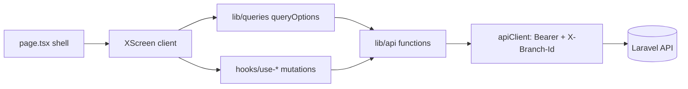
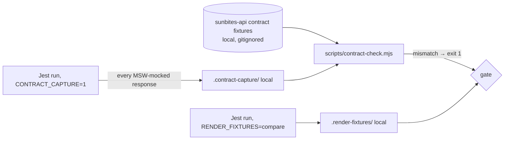

# Design Document: Spec 17, Frontend Code Quality and Backend Compliance

Every fact in this document was checked on 2026-10-31 and audited again on 2026-11-07. In that audit the riskiest parts of this design were **built and run on throwaway clones of both apps**, not just read (§1.4). Sources:
- **Code:** `~/sunbites-pos` (branch `bump-latest-upgrade-pos`) and `~/sunbites-portal` (branch `bump-latest-upgrade-portal`), both with the uncommitted 2026-10-31 upgrade.
- **Framework docs:** the docs bundled with Next 16.4.3 (`node_modules/next/dist/docs/`).
- **Package APIs:** the installed `.d.ts`/`.js` files of Zod 4.6.7, Zustand 5.0.16, TanStack Query 5.105 and `@types/react` 19.3.
- **Backend:** the latest `~/sunbites-api`, checked by calling the running Laravel app directly (§4.10). No snapshot of it is kept. Never copy a commit from this document into a decision: read it from the backend repo.

Where this document says "verified", that check was run, not assumed.

## 1. Overview

This spec changes two Next.js apps and no backend file. The work runs in four PRs per app (Q3):

```
PR 1  Upgrade + green baseline        (Req 1)          bump-latest-upgrade-{pos,portal}
PR 2  Track B1: contract fixes        (Req 3, F-1..F-3) fix/spec17-contract-fixes
PR 3  Track A: refactor + compliance  (Req 2, 4–12)     refactor/spec17-code-quality
PR 4  Track B2: other fixes           (Req 14, F-4+)    fix/spec17-track-b2
```

**Track A must prove nothing changed.** It has three layers of proof:

1. **Characterization tests** (§6.1). Jest, React Testing Library and MSW pin what each screen shows, sends and does. They are written against unchanged code, before the refactor.
2. **Render fixtures** (§6.2). The normalised HTML of each recorded state is stored locally (gitignored) and compared byte for byte after each refactor commit.
3. **The local contract check** (§4.3). It proves the data those tests feed the screens is what the backend actually sends.

### 1.1 Decisions

| # | Decision | Source |
|---|---|---|
| Q1–Q8 | As approved in requirements (React Compiler on; 400-line limit; four PRs; `undici` fixed; Spec 16-style relay; render fixtures; former Spec 17 merged; read-only final review) | user, 2026-10-31 |
| D-1 | Contract check = **capture** every MSW-mocked response during the normal Jest run (`CONTRACT_CAPTURE=1`), then **compare** each against its backend fixture with a Node script. Comparison rule: "mock ⊑ fixture" (§4.3) | this design |
| D-2 | Render fixtures use `document.body.innerHTML` (dialogs and sheets render in portals outside the test container), normalised as in §6.2 | this design |
| D-3 | Query definitions live in `lib/queries/{domain}.ts` (key factory + `queryOptions()` factories). Mutations used by 2+ screens live in `hooks/use-{verb}-{noun}.ts`; single-use mutations stay in their screen | this design |
| D-4 | Role checks go through one capability map, `lib/permissions.ts`. Each capability names the backend route(s) whose `role:` middleware it mirrors | this design |
| D-5 | `undici` goes from `^5.29.0` to `^6.29.1` in the Jest polyfill (no new dependency). The fallback, only if MSW breaks on 6.x, is a 20-line custom Jest environment exposing Node's native `fetch` family | this design (Q4 spike) |
| D-6 | React Compiler config is `reactCompiler: { environment: { enablePreserveExistingMemoizationGuarantees: true } }`. The Next docs say to set this explicitly because defaults differ between versions; `true` keeps today's memo semantics | this design |
| D-7 | Error screens use Next 16.4's `error.tsx` props `{ error: unknown; retry: () => void }`. `retry` became stable in 16.3; the older `reset` still exists but the docs prefer `retry` | Next docs `error.md` |
| D-8 | `page.tsx` shells are typed with the global `PageProps<'/route'>` helper. `type-check` runs `next typegen` first, so the helper exists in CI | Next docs `page.md`, `next typegen` |
| D-9 | The contract check finds a response's route by matching segments against the routes Laravel lists (`route:list --json`, read on every run), not by comparing slugs. Slugs lose the `/`, so `/students/5/nonexistent` would match `students_{student}` | §1.4, run on both apps |
| D-10 | Render fixtures pin the clock with Jest's `fakeTimers` config, which applies before any module loads. A `beforeEach` pin is too late: mocks that call `new Date()` at import leak the real time into fixtures | §1.4, run on both apps |
| D-11 | The React Compiler is proved with the same test suite run through `babel-jest` (`COMPILED_TESTS=1`), compiling source files only. This replaces "Jest can't exercise it" | §1.4, run on both apps |
| D-12 | The backend isn't pinned to a commit, and no snapshot of it is kept. Before every step the implementer records the backend commit and Laravel version and checks what the step touches by calling Laravel directly. The contract suite re-runs whenever backend code moves | user, 2026-11-07 and 2026-11-08 (§4.10) |
| D-13 | The pre-production smoke runs on the **local full stack**, because no staging API exists (§20). Deploy-order rules are stated against production, not `staging` | steering, 2026-11-07 |

### 1.2 Verified framework and package facts

| Fact | Where verified |
|---|---|
| `next/jest` does not apply the React Compiler, so a normal `jest` run tests uncompiled code. `COMPILED_TESTS=1` runs the same tests compiled (§12) | `node_modules/next/dist/build/jest/jest.js` has no `reactCompiler` reference; compiled output confirmed: `const $ = (0, _compilerRuntime.c)(4)` |
| `next build` type-checks test files, because `tsconfig.json` includes them. A test that passes a removed prop fails the **build**, so tests and shells change in one commit | Run on the POS clone: exit 1 until the 3 dynamic-route tests were updated |
| `route:list --json` shows roles as `Spatie\\Permission\\Middleware\\RoleMiddleware:admin\|manager`, never as `role:` | `route:list --json` |
| `"1500.00".toLocaleString("en-PH", { minimumFractionDigits: 2 })` returns `"1500.00"`: `String.prototype.toLocaleString` ignores options. This is the F-2 and F-5 bug | Run in Node |
| Laravel's `boolean` rule accepts `true`, `false`, `0`, `1`, `"0"`, `"1"`, and **not** the string `"true"`. `apiClient` sends query values with `String(v)`, so a boolean filter must send `1` or `0` | `ValidatesAttributes::validateBoolean` |
| `reactCompiler` is a stable top-level option. It needs devDependency `babel-plugin-react-compiler` (latest `1.0.0`) and can be opted out per component with `"use no memo"` | Next docs `reactCompiler.md` |
| `error.tsx` gets `error: unknown` and `retry()`. It does not wrap the `layout.tsx` of its own segment. `global-error.tsx` must render its own `<html>`/`<body>` and import its own styles | Next docs `error.md` |
| `PageProps<'/blog/[slug]'>` is global after `next dev`, `next build` or `next typegen`. Static routes resolve `params` to `{}` | Next docs `page.md` |
| `z.string().email(p)` is `this.check(core._email(ZodEmail, p))`, and `z.email(p)` is `core._email(ZodEmail, p)`: **the same check**. `err.flatten(m)` is `core.flattenError(err, m)`: **the same output** as `z.flattenError(err)` | `zod/v4/classic/schemas.js:256,363`, `errors.js:35` |
| Zod marks `.flatten()`, `z.string().email()` and the `message` param as deprecated. `superRefine` and `ctx.addIssue({ message })` are not deprecated | `zod/v4/classic/errors.d.ts:11`, `schemas.d.ts:113`, `core/api.d.ts:9` |
| Zustand persist exposes `hasHydrated()`, `onHydrate()` and `onFinishHydration()` (returns an unsubscribe function) | `zustand/middleware/persist.d.ts:83-86` |
| `queryOptions` is exported by `@tanstack/react-query` 5.105 | `build/modern/queryOptions.d.ts` |
| `undici@6.29.1`: `engines.node >=18.17`, **no dependencies**. `undici@5` depends on the vulnerable `@fastify/busboy`; `7.x` needs Node ≥20.18.1 and `8.x` needs Node ≥22.19, while CI runs Node 20 | `npm view` |
| `eslint-plugin-react-hooks` 7.1.1 already runs the compiler rules (`purity`, `refs`, `immutability`, `set-state-in-effect`, …), and both apps pass them | `npm ls`, `npm run lint` |
| Hosting is Vercel. PR CI (`pr.yml`) runs `npm ci`, `type-check`, `lint` and `test -- --ci --passWithNoTests` on Node 20, but **no build** | `.github/workflows/*.yml` (both) |
| **The API's staging environment was removed on 2026-11-07.** `staging` is still a branch in all 3 repos (flow: PR branch → `staging` → `main`), but there is no staging API. Measured: `api-staging` no connection; `pos-staging` 404; `portal-staging` responds, with no API behind it; production API 200 | `.kiro/steering/tech.md`, `curl` |
| The local stack is the only place to run the full product before production. `http://api.sunbites.test` answers, and `config/cors.php` allows `localhost:3000` and `3001`. Both apps' `.env.local` already point there | `curl` with an `Origin` header |
| Tests set `NEXT_PUBLIC_API_URL = "http://localhost:8000"` (no `/api/v1`). Production values include `/api/v1` (tech steering) | `jest.setup.ts` |
| MSW runs with `onUnhandledRequest: "error"`. `__tests__/test-utils.tsx` renders a `<Toaster />` inside the providers | `jest.setup.ts`, `test-utils.tsx` |

### 1.3 Baselines (recorded 2026-10-31)

| Item | POS | Portal |
|---|---|---|
| Tests | 325: `feedback.test.tsx` fails every run, `settle-credit-dialog.test.tsx` fails on and off (Req 1.4; causes H12, H21) | 102, all passing |
| Lint warnings | 7 | 1 |
| Coverage (loaded files only) | 82.85% lines | 84.97% lines |
| Files no test loads | 80 (73 in `app/`+`components/`, 7 in `hooks/`+`lib/`) | 26 (23 + 3) |
| `npm audit --omit=dev` (2026-11-07) | 0 high/critical (4 moderate, 2 low, listed for the user with PR 1) | same |
| Backend | the latest; each commit body records it (§4.10) | same |

### 1.4 What was actually run (2026-11-07)

On throwaway clones of both apps, against the backend at `6c800be` (Laravel 13.40.0). The clones were deleted afterwards and no app repo changed.

| Claim | How it was tested | Result |
|---|---|---|
| The backend still matches its fixtures | `tests/Feature/Contract` on Laravel 13.40, SQLite | **484 tests pass**, digest unchanged |
| Calling Laravel directly works and leaves nothing behind (2026-11-08) | §4.10.3's commands: a supervisor and a parent on list routes, a manager and an admin on an admin-only route, then the dev database counted | **200, 200, 403, 200 as expected.** No user, role link, branch link, token or activity row remained. Contract suite re-run: 484 pass |
| PR 1 task 1.2 and all of PR 2 work as written (2026-11-08) | Rehearsed on GitHub's `staging` of each app (POS `4141382`, portal `1063c4c`) plus the uncommitted PR 1 upgrade, in detached worktrees outside the repos (since removed). Each fix was written from this design alone, red first, then green | **All pass:** POS 340/340 three runs plus `TZ=UTC`, portal 108/108 likewise; `tsc` 0, lint unchanged, `next build` succeeds. Task 1.2 re-proven (15/15 solo). **Five gaps found and fixed in this design:** one-line F-16 type and the task 1.2 helper weren't Prettier-clean (§22 Prettier rule); F-1's red list missed test 3; F-1's tests collided with the shared "Rice" fixture (Appendix D.1); F-4's export key spans two lines (§5.5); F-4 and F-5 share a test file, so it's split between tasks 2.4 and 2.5. Also: the faked-clock sweep tests nothing before task 3.3 (`HANDOFF.md` §5.3). Exact test code: §5.6 and Appendix D |
| Every frontend call has a route | TypeScript AST over both apps against `route:list` | **148 of 148**. 17 routes have no parsed caller, all explained (§4.6) |
| Response types match | TypeScript checker against every `@ok` fixture | 147 typed calls compared, **78 mismatches**, register in Appendix B.1 |
| Requests match | AST against Form Requests. Tool validated: it re-found F-1 on its own. Reverse check: required fields never sent, validated by sabotaging its input | **5 real mismatches** (F-1 plus 4 new), Appendix B.2. **No required field missing** across 77 routes |
| Roles match | Every UI gate against `RoleMiddleware` | **4 shown-then-rejected, 6 hidden-but-allowed**, plus 1 reachable only by URL and 2 nav links that bounce, Appendix B.3 |
| The page shell pattern is safe | Converted 38 POS and 9 portal pages, then typegen, type-check, build, tests, render compare | **0 type errors, builds pass, route tables identical**, same test results, **rendered HTML byte-identical** apart from the known flake |
| Shells are safe on a real server | `next start`, requested every route type | **All 200, 0 server errors** |
| **Nothing changes in a real browser** | `compare.mjs` (Appendix C.6): headless Chrome with a temporary profile, the original build against the converted one (shells, auth hook, React Compiler, undici). A fake API served bodies generated from the backend fixtures. It loaded every route of both apps signed in and signed out, POS at desktop size and the portal at desktop and phone size, clicked every tab, and signed in through each app's real login form | **69 screens: 0 screenshots differ, URLs and console errors identical on all.** HTML identical on 68; the 69th differs only inside Google's reCAPTCHA frame URL (port and a random token), which the tool now ignores. Built CSS byte-identical. The tool was proved able to fail: one class changed on purpose in the converted portal, and it reported both screens |
| Every crash those screens showed | The same exceptions appeared in both builds, so they're in today's code. Each stack was traced | **Real: F-16** (`EnrollmentStatusBadge`, on every page that shows it) **and F-17** (hydration error on pre-registration). The rest came only from the fake API's `"Sample …"` strings: every map they hit covers all of its backend enum's values |
| `useAuthHydrated` | Applied to the 3 layouts; `renderToString` then `hydrateRoot` | Empty server HTML, **no hydration mismatch**, children appear |
| The contract check works | Built it, ran it over both suites | **Works.** First run: 31 POS and 12 portal real findings, all classified in Appendix B.6 |
| Render fixtures are stable | All 427 tests captured twice, 62 s apart, and with generated ids shifted | **0 differences** after the §6.2 normaliser and clock pin (only the settle flake). As first designed, 9 tests differed |
| A screen can't crash on a backend enum value | Every unguarded `map[value]` lookup in both apps against `app/Enums` | **10 lookups, 1 real crash:** F-16, live on production |
| Tests aren't month-dependent | Whole suite pinned to Jan 15, Apr 15, May 15, Jun 1, Dec 31, Mar 31 and Feb 29 | **0 new failures** |
| `undici` 6.29.1 | Installed, ran the suites on Node 26 and Node 20 | **Works**; full `npm audit` 0 high, 0 critical |
| Node 20 (CI) | Tests and `next build` on v20.20.2 | **Pass** in both apps |
| React Compiler | Installed, built with D-6's config, compile report, whole suite compiled | **Builds, route tables identical.** POS 282 functions compiled, 3 not; portal 80 compiled, 2 not. Compiled tests 323 of 325 POS, 102 of 102 portal, same known failures, **0 render differences** |
| The settle-credit flake | Probe of `document.activeElement`, then the fix | Cause proven (H21). Failed 8 of 12 before, **passed 15 of 15** after |
| F-4 and F-5 | Failing test, then the §5.5 edits | **Red, then green**, 0 type errors |

**Not run, and why it matters:** file splits (§8), helper and component merges (§9), the query layer (§10), the Zod swaps (§11) and the `createPortal` and echo store changes (§7.3). Those rely on the same proofs above, which is why every one of those commits must pass the render compare. Logged-in screens were only exercised against fixture-shaped data from a fake API, never the real backend, and dialogs weren't opened in the browser run. Printing, the camera, QR scanners, Safari and live Reverb events aren't covered by any automated proof, so they're on the full-stack smoke list (§20).

## 2. Architecture

### 2.1 Target structure (per app; new items in bold)

```
app/
  (group)/route/
    page.tsx                  ← Server Component shell: await params → <XScreen/> (§7)
    _components/              ← route-private Client Components (§8)
      x-screen.tsx            ← the screen: hooks, state, data
    **error.tsx**             ← per route group (FB-02, Track B2)
  **error.tsx**, **global-error.tsx**  (FB-02)
components/
  {domain}/                   ← components shared by 2+ routes (§9)
  **error-screen.tsx**        ← FB-02
  ui/                         ← shadcn-generated; not edited (H20)
hooks/
  **use-{verb}-{noun}.ts**    ← mutations shared by 2+ screens (§10)
lib/
  api/                        ← unchanged role: typed endpoint functions
  **queries/{domain}.ts**     ← key factories + queryOptions (§10)
  **validation/{domain}.ts**  ← Zod schemas (POS gains the folder; §11)
  **format.ts**               ← POS: peso/date helpers (portal already has it; §9)
  **permissions.ts**          ← POS: capability → roles map (§4.7)
  store/                      ← Zustand; + **use-auth-hydrated.ts** (§7.2)
__tests__/
  **render-fixture.ts**       ← §6.2
  **clock.ts**                ← DO_NOT_FAKE for tests that fix the date (H10)
  **contract/**               ← capture listener, exceptions.json (§4.3)
scripts/
  **contract-check.mjs**      ← §4.3
```

### 2.2 Runtime data flow (unchanged by Track A)



### 2.3 Verification flow (new)



## 3. Behaviour-preservation hazards (read before every Track A task)

| ID | Hazard | Rule |
|---|---|---|
| H1 | **Decimal strings.** The API sends money and quantities as `"135.00"` (`string:decimal2`). Many types say `number` while the code converts with `Number()`/`parseFloat` | Change a type only when the runtime result is identical (§4.5). Never remove a conversion |
| H2 | **Query key values.** Invalidation uses prefix matching. `["students"]` matches `["students", "subscription"]` but never `["student", 5]` | Keys keep their exact values, including the inconsistent roots (§10.2) |
| H3 | **Copy.** Toasts, labels, placeholders, empty and error texts, `&apos;` and `…` | Copy every string byte for byte |
| H4 | **Element ids differ between copies.** The two `WalletTopUpModal`s use `detail-topup-amount` vs `topup-amount` | Merged components take an id prefix prop. Render fixtures catch any slip |
| H5 | **Generated ids** (Base UI `base-ui-_r_s_`, React `useId`) shift when the render order changes | Normalised in render fixtures (§6.2). Never assert them in tests |
| H6 | **Effect timing.** Replacing an effect with derived state removes an intermediate render | Tests assert the settled UI (`findBy…`, `waitFor`), never an intermediate frame |
| H7 | **Full-page redirect.** `lib/api/client.ts:56` sets `window.location.href = "/branch"`. The full reload drops all in-memory state (query cache, cart) | Keep the full reload. Single-line lint disable with the reason (Req 9.4) |
| H8 | **Auth gates render nothing until the session is restored.** Server HTML is empty for gated groups | `useAuthHydrated()` returns `false` on the server and during hydration (§7.2) |
| H9 | **Server page shells** cannot use hooks or browser APIs, and async shells can't be rendered by React Testing Library | Shells only await `params` and render the screen. Tests render the screen component (an allowed import change, Req 4.3) |
| H10 | **Dates.** `toLocaleDateString("en-PH")`, school-year helpers and "today" depend on the clock and time zone | A test that needs a fixed date calls `jest.useFakeTimers({ now, doNotFake: DO_NOT_FAKE })` from `__tests__/clock.ts`, which fakes **only `Date`**. Plain `jest.useFakeTimers()` hangs `user-event`, `waitFor` and MSW. Use noon UTC timestamps. Render fixtures pin the clock in `jest.config.ts` (D-10) and run with `TZ=Asia/Manila` |
| H11 | **Zod error text and unions.** The portal email field is `z.union([z.string().email(…).max(150), z.literal("")])` | Swap APIs one for one (§11.1). Tests pin every shown message |
| H12 | **sonner in tests** (2.0.8) renders the toast text twice in jsdom (the feedback test failure) | `(await screen.findAllByText("Reply sent."))[0]`, verified passing 3 of 3 runs. This is a test-only concern (Req 1.4) |
| H13 | **Invalidation sets.** Each mutation's set of invalidated keys is behaviour | Identical in Track A. Only FB-03/FB-04.x change it, in Track B2 |
| H14 | **A normal Jest run doesn't exercise the React Compiler** (§1.2) | The compiler commit is proved by `COMPILED_TESTS=1` with render compare, plus build, lint, the compile report and the full-stack smoke (§12). A component the compiler can't handle gets `"use no memo"`, never a rewrite |
| H15 | **Authorised photo fetch** sends `Authorization`, `X-Branch-Id` and `Accept: image/*`, and revokes object URLs on cleanup | The shared function keeps all three headers. Callers keep the revoke (§9.3) |
| H16 | **Cross-app copies** (notification bell and item, api client, auth store) | Never import across repos. Each app keeps its own copy (Out of Scope) |
| H17 | **Print CSS depends on markup:** `#qr-print-root`, `[data-qr-card]`, `.no-print`, `.flex.h-screen` in `globals.css` | Keep these ids, attributes and classes exactly |
| H18 | **`onUnhandledRequest: "error"`** | Every request a new test triggers needs a handler. Never relax it to `"warn"` |
| H19 | **Role gates.** 74 `roles.includes(...)` expressions in the POS | `can()` must return the same boolean for every role and every multi-role user (§4.7) |
| H20 | **`components/ui/*` is shadcn-generated** | Not edited or merged in Track A. The portal's `dropdown-menu.tsx` coverage stays out of scope |
| H21 | **Dialogs move focus just after they open.** Base UI focuses the first tabbable element a moment after mount. A test that types straight away loses keystrokes: `user.type(amount, "40")` leaves `4`, because focus jumped to a button. This is the settle-credit flake, and every new dialog test would hit it. No real user can type inside that window | Before typing in a dialog: `await waitFor(() => expect(document.activeElement).not.toBe(document.body));` |
| H22 | **`NEXT_PUBLIC_API_URL` must not be set for Jest.** `handlers.ts` reads it at import, before `jest.setup.ts` assigns it, so an exported value breaks about 100 tests with unhandled-request errors | Set it only on the `next build` command line, never with `export`. Before debugging a mass failure, run `echo "$NEXT_PUBLIC_API_URL"` |
| H23 | **Jest treats a path argument as a regex**, so `npx jest "app/(kitchen)/students/[id]/x.test.tsx"` finds no tests and exits 1 | Always `npx jest --runTestsByPath "<path>"` |
| H24 | **`next build` type-checks tests** (§1.2) | A shell change and the test edits it forces go in the same commit |
| H25 | **Money from the API is a string at runtime even when the type says `number`** (F-5). A merged `formatPeso` keeps today's output, including today's missing separator | Track A never adds `Number()` to a value that reaches `formatPeso`. Characterization mocks use decimal strings, so fixtures record what users really see. F-5 changes it, in Track B |
| H26 | **Local type names inside a `jest.mock` factory.** `babel-plugin-jest-hoist`, used only by the compiled run, rejects them | Name them `Mock…`. `enrollment.test.tsx` needs `TriggerMeta` → `MockTriggerMeta` and `CtxValue` → `MockCtxValue` (task 7) |
| H27 | **Tailwind v4 scans every file git doesn't ignore,** tests and config included, and treats any matching word as a class. The word `transform` in `jest.config.ts` added an unused `.transform` rule to the portal's CSS. Un-ignored `.render-fixtures/` HTML would add many | Add `.render-fixtures/` and `.contract-capture/` to `.gitignore` **before** creating them. An added rule is harmless, because no element depends on it. A removed or changed rule means a class string changed: `css-diff.cjs` (Appendix C.5) fails on that (§7.1) |
| H28 | **A TypeScript union can hide a value the backend really sends.** `Record<Union, …>` compiles, and `map[value].x` then throws at runtime. With no error screen, that takes down the whole page (F-16) | Take enum values from `app/Enums/*`, never the FE union. When `app/Enums` changes, check that every lookup keyed by that enum has an entry for each value |

## 4. Backend compliance (Req 2)

### 4.1 Sources of truth

| Question | Read this | Never this |
|---|---|---|
| Response status and shape | `~/sunbites-api/tests/Fixtures/contracts/{slug}@{variant}.json` | the FE type, an MSW mock, memory |
| Enum **values** (fixtures record `"string"`, not the values) | The backend enum or model accessor, e.g. `InventoryItem::status` → `OK`/`LOW`/`OUT`/`OVER`, `app/Enums/*` | a FE union |
| Path and method | `vendor/bin/sail artisan route:list --path=api --except-vendor --json` (run from `~/sunbites-api`) | the FE `lib/api` path |
| Query and body keys, allowed values | The Form Request named on the controller method (`app/Http/Requests/{Kitchen,Portal,Public}/…`) | the FE form schema |
| Roles allowed | `RoleMiddleware:` in the `middleware` array of `route:list --json`, or call the route as the role (§4.10.3) | the FE gate |
| Error bodies | `bootstrap/app.php` renderables; `abort()` texts in controllers and actions; Spec 16 Req 1.3 non-standard envelopes | — |

The backend is read-only for this spec, and it moves often. A fixture is only evidence while the backend's contract suite still passes against it. §4.10 says when to run that suite, and how to check an endpoint by calling Laravel directly.

### 4.2 Reading a fixture

- **File name.** `{slug}@{variant}.json`, where `slug = lowercase(method) + "__" + uri.replace(/[^a-z0-9{}]+/gi, "_")` trimmed of `_`, and `uri` is as `route:list` prints it. Example: `GET api/v1/portal/students/{student}/wallet` → `get__api_v1_portal_students_{student}_wallet@ok.json`. Source: `tests/Support/Contract/AssertsApiContract.php:60`.
- **Variants.** `ok` (the success case), plus error variants such as `422-validation`, `403`, `404`, `other-branch`, `422-no-branch`.
- **Content.**
  - JSON bodies: `{ "status": <int>, "body": <shape> }`.
  - File responses: status, `Content-Type` and the filename pattern.
- **Shape tokens** (Spec 16 design §4.1.1):

  | Token | Meaning |
  |---|---|
  | `"null"`, `"bool"`, `"number"` | as named (int and float are not distinguished) |
  | `"string:decimal2"` | `/^-?\d+\.\d{2}$/` |
  | `"string:date"` | `Y-m-d` |
  | `"string:datetime"` | `Y-m-d H:i:s` |
  | `"string:iso8601_micro"` | `…T…\.\d{6}Z` |
  | `"string:iso8601"` | `…T…±hh:mm` |
  | `"string"` | any other string |
  | `{ key: shape }` | object; keys sorted, so key order is ignored |
  | `{"__map__": s}` | an object keyed by data, not by fixed names |
  | `"list:empty"` | an empty list |
  | `{"__list__": s}` / `{"__list_union__": [s…]}` | a list whose elements share one shape / have several shapes |

### 4.3 Local contract check (Req 2.4, 2.5)

#### 4.3.1 Capture

Appendix C.1 is the verified implementation. Copy it to `__tests__/contract/capture.ts` and import it from `jest.setup.ts`. It does nothing unless `process.env.CONTRACT_CAPTURE === "1"`. When on:

- It registers `server.events.on("response:mocked", ({ request, response }) => …)` (MSW 2 life-cycle events).
- For each JSON response, it writes `{ method, url, status, test, body }` to `.contract-capture/<jest-worker-id>.jsonl`.
- It covers both `__tests__/mocks/handlers.ts` and per-test `server.use(...)` overrides, because the event fires for every mocked response.
- Non-JSON responses (blobs, files) record `{ method, url, status, test, nonJson, contentType }`.
- MSW doesn't await the listener, so a test can end before the body is read. `afterAll` awaits the pending writes. Without this, responses go missing.
- The directory is emptied at the start of each capture run (a Jest `globalSetup`, only when the flag is set).

#### 4.3.2 Compare (`scripts/contract-check.mjs`, plain Node, no dependencies)

Appendix C.2 is the verified implementation. Copy it to `scripts/contract-check.mjs`.

1. **Inputs.**
   - Backend: `SUNBITES_API`, default `../sunbites-api`.
   - Fixtures: `SUNBITES_CONTRACT_FIXTURES`, default `<backend>/tests/Fixtures/contracts`.
   - Routes: read from Laravel on every run, with `vendor/bin/sail artisan route:list --path=api --except-vendor --json` in the backend folder. No routes file is kept. If Sail isn't running, it prints `contract check: could not read the routes from Laravel. Start Sail in …` and exits 1.
   - Fixtures missing with `CI=true`: print `skipped: contract fixtures are local only (Spec 16 §4.1.7)` and exit 0.
   - Fixtures missing locally: print the same message and **exit 1**, because locally a skip is a failure.
2. **Find the route (D-9).** Take `"api/v1" + new URL(url).pathname`, split on `/`, and match it segment by segment against `routes.json` for the same method. A `{param}` matches any one segment. The route with the most literal segments wins. No match is finding **K1**.
3. **Find the fixture.** The route's slug is §4.2's rule applied to its `uri`.
   - Status 2xx: the slug's `@ok*` fixtures with a 2xx status and a body.
   - Status 4xx: the variants whose recorded `status` equals the captured status.
   - No variant for 401, 403, 404, 422 or 429: these are generic and fixtures don't list them for every route, so the body only has to carry `message` or `errors`. Otherwise **K2**.
   - No variant for any other 4xx: **K2**.
   - Status ≥ 500 or non-JSON: skipped. Tests simulate server failures, which fixtures don't record.
4. **Compare shapes**, mock ⊑ fixture. Compute the mock's shape with the JavaScript port of `ShapeExtractor` (same tokens, same check order: decimal2 → iso8601_micro → iso8601 → datetime → date → string), compare against each candidate, pass if any matches, and report the closest one.

   | Mock | Fixture | Result | Fails the check? |
   |---|---|---|---|
   | same token | same token | ok | |
   | object key | key absent | **K3** extra key the API never sends | yes |
   | object key absent | key present | ok (subset; `satisfies` in §4.4 forces declared keys) | |
   | `"number"` | `"string:decimal2"` | **K5** decimal sent as number (H1, H25) | yes |
   | `"string"` or a different string token | `"string:<format>"` | **K6** wrong string format | yes |
   | any other type difference | | **K-type** | yes |
   | `"null"` | any non-null token | **K4** | note only |
   | non-null token | `"null"` | **K7** | note only |
   | any list element | `"list:empty"` | **K8** | note only |
   | `"list:empty"` | any list | ok | |
   | `{__list__: s}` | `__list__ f` / `__list_union__ [f…]` | `s ⊑ f` / `s ⊑` some `fᵢ` | |
   | object | `{__map__: f}` | every value ⊑ `f` | |

   **K4, K7 and K8 are notes because a fixture holds one sample.** It can't prove a field is never null, or show an element of an empty list. On the first run they were 93 of the 136 findings, and failing on them would have forced 93 hand-written exceptions. Nullability is checked by `satisfies` against the FE type (§4.4) and by Appendix B.1.
5. **Exceptions.** `__tests__/contract/exceptions.json` is committed. Each entry is `{ "fixture", "path", "kind", "reason", "backendRef" }`. `fixture` is the slug, or `slug@variant`. `backendRef` is a `file:line` in `~/sunbites-api`, or `null` only for a test-only route. Any failing finding without an exception exits 1. An exception that no longer matches a finding also exits 1, so the list can't go stale.
6. **Output.** One line per failure, then a summary: `contract check: 406 responses, 31 failing, 87 nullability or sample notes, 0 exceptions`.

#### 4.3.3 npm scripts (both apps)

```json
"test:contract": "CONTRACT_CAPTURE=1 jest --silent && node scripts/contract-check.mjs"
```

`.contract-capture/` goes into `.gitignore`.

#### 4.3.4 First run

Measured on 2026-11-07: **POS 31 failing and 87 notes, portal 12 failing and 6 notes.** Appendix B.6 classifies all 43 failures, so task 4.2 doesn't have to judge them from scratch. Each one is resolved in one of three ways:
- **Fix the mock data** (Track A): only when no existing test assertion has to change.
- **Add an exception with its `backendRef`:** the notification payloads and the `/probe` test route, listed in B.6.
- **Record it as an F-item** (Track B): where fixing a mock would break an existing assertion, that test was pinning wrong data, so stop and report it.

#### 4.3.5 What the check does not prove

The check covers response **shape** only. It does not cover:
- **Enum values:** read the backend (§4.1).
- **Request keys:** §4.6 audit.
- **Roles:** §4.7.

#### 4.3.6 Backend line

Every commit body carries `Backend: <branch> <sha>, Laravel <version>`, taken just before committing (§4.10.1).

### 4.4 Typed MSW data (Req 2.5)

Every JSON body in `__tests__/mocks/handlers.ts` and in per-test `server.use` is typed with the frontend response type, using `satisfies`:

```ts
http.get(`${API}/portal/students/:id/wallet`, () =>
  HttpResponse.json({ balance: 1000, credit_balance: 0, data: [...], meta: {...} } satisfies WalletData),
);
```

Existing fixtures declared with a type annotation (`export const posMenuItemsFixture: PosMenuItem[] = …`) already comply. `satisfies` is a compile-time check only, and changes no test behaviour.

### 4.5 Compliance register (Req 2.8)

Appendix B is the register. It was generated on 2026-11-07 by audit scripts (removed on 2026-11-08, §4.10.5), and replaces the hand-made `contract-gaps.md` §2 list, which had wrongly recorded two visible bugs as "no effect" (F-5). Task 4.3 confirms each row against the current backend, by reading the code and calling the endpoint (§4.10.3), and adds what the audit couldn't see. Resolution rules:

| Situation | Resolution | Track |
|---|---|---|
| The FE type is wrong, the code already converts the value or never reads the field (e.g. `total_revenue: string` but `parseFloat` is used) | Correct the type, and let `tsc` find the readers: a reader it flags is checked by hand. Type-check must pass with no runtime edit except an explicit conversion the type forces where the code relied on implicit coercion with identical output | A |
| Correcting the type exposes wrong output (e.g. F-2's `toLocaleString` on a string) | F-item (F-4, F-5, …), failing test first | B2 |
| A Spec 16 Track B backend fix already makes the response match the existing FE type (B-07, B-13, B-16, B-21, B-22) | No FE change. Mark the row "resolved by Spec 16 B-xx" and add it to the deploy-dependency list (§4.9) | — |
| Only the backend can fix it | "Found, not fixed" as a proposed backend item (Req 2.11) | — |

### 4.6 Request compliance audit (Req 2.3)

**Done on 2026-11-07; results in Appendix B.2.** Task 4.3 confirms each row against the current Form Request and traces the one opaque call by hand (`preRegistrationApi.update`, whose payload is built field by field).

- **Paths:** all 148 `apiClient` calls with a literal path match a route. The 5 report exports use a computed path, and all 5 exist.
- **Routes with no caller,** so nobody "fixes" them by accident: `GET api/health`, `POST auth/password/email`, `GET portal/students/{student}/ledger`, `POST portal/profile/photo`, `POST users/{user}/photo`, `POST users/{user}/branches`, `DELETE users/{user}/branches/{branch}`. Student photos and the kiosk go through raw `fetch` (`students/[id]/page.tsx:2560`, `students/page.tsx:431/627/1138`, `lib/api/students.ts:217`, `lib/api/kiosk.ts:5`, portal `lib/api/portal.ts:46/78/96`).
- **Values:** every fixed-value rule the frontends reach was compared with the values they send, including F-1's `type` (`restock`, `waste`, `manual`, `sale`, all in `InventoryLogType`). No mismatch.

The characterization tests (§6.1) assert the query parameters and bodies each screen sends, so a mismatch fixed later is pinned by a test.

**Tightened rules (Spec 16 B-26, B-27).** Fixtures record responses, so the digest can't show this kind of change. Every sender already sends the new type, so neither app needs a change.

| Backend rule | Sender | What it sends |
|---|---|---|
| `CheckoutRequest` `student_id`: `nullable, integer` | POS `components/pos/cart-panel.tsx:223` | `student?.id`, a number (`post__api_v1_pos_students_lookup@ok.json`), omitted for walk-ins |
| `CheckoutRequest` `items.*.pos_menu_item_id`: `integer` | POS `components/pos/cart-panel.tsx:226` | `CartItem.id`, a number (`get__api_v1_pos_menu_items@ok.json`) |
| `InlineReloadRequest` `student_id`: `integer` | POS `components/pos/insufficient-funds-modal.tsx:50` | `student.id`, a number |
| `EnrollStudentRequest` `branch_id`: `integer` | POS `app/(kitchen)/enrollment/page.tsx:401` | a number (`z.number`) |
| `UpdateStaffStatusRequest` `user_id`: `integer` | POS `app/(kitchen)/dashboard/page.tsx:167`, through `lib/api/reports.ts:340` | `staff.id`, a number (`get__api_v1_dashboard@ok.json`, `staff_roster`) |
| `StorePublicPreRegistrationRequest` `branch_id`: `integer` | Portal `components/pre-registration/pre-registration-form.tsx:248` | a number (`z.number().min(1)`) |
| `ResetStaffPasswordRequest` `token`: `string` | POS `app/(auth)/reset-password/page.tsx:43` | a string from the URL |
| `StaffUserRules` `role`: `string` | POS `references/users/create/page.tsx:180`, `references/users/[id]/page.tsx:306` | a string (`z.string`) |

### 4.7 Role gates and `lib/permissions.ts` (Req 2.6)

The POS has 74 `roles.includes(...)` expressions in about 30 files. Nav filtering lives in `components/navigation/app-nav-sheet.tsx`, not in `lib/navigation.ts`. The matrix is in Appendix B.3, and task 6.5 moves the gates to one map:

```ts
// lib/permissions.ts
import type { AuthUser } from "@/types/auth";

type Role = "admin" | "manager" | "supervisor" | "cashier";

/**
 * What each role may do in the POS UI. Each entry mirrors the `role:` middleware of the
 * backend route(s) named beside it (`route:list --json`), so the UI never offers what the API refuses.
 */
const CAPABILITIES = {
  // PATCH api/v1/students/{student}/payments/{payment}: role:admin|manager
  "students.toggle-payment": ["admin", "manager"],
  // POST api/v1/students/{student}/credit/waive: role:admin
  "students.waive-credit": ["admin"],
  // …one entry per row of Appendix B.3, spelled exactly as that table spells it
} as const satisfies Record<string, readonly Role[]>;

export type Capability = keyof typeof CAPABILITIES;

export function can(user: Pick<AuthUser, "roles"> | null | undefined, capability: Capability): boolean {
  return user?.roles.some((role) => (CAPABILITIES[capability] as readonly string[]).includes(role)) ?? false;
}
```

- **Track A (task 6.5):** each gate keeps today's role list exactly (H19), even where it disagrees with the backend. A unit test asserts `can()` for every capability × every role, plus one multi-role user.
- **A mismatch with the backend** (in either direction, Req 2.6) is recorded in Appendix B §B.3 and changes only as an approved F-item in Track B2, where the visible change belongs.
- **Not role gates:** the cashier redirect in `(kitchen)/layout.tsx` and `lib/auth-utils.ts` decides routing, not a permission. They move into `can()` only as `"pos.cashier-only"` with identical logic.

### 4.8 Error bodies (Req 2.7)

| Backend body | FE handling today | Gap |
|---|---|---|
| 422 `{ message, errors }` | `apiClient` throws the body as `ApiError`, and forms read `errors` | — |
| 422 `{ errors }` with **no `message`** (enrollment subscription range, payment `addRange`, public pre-registration, portal change-password) | `ApiError.message` is typed `string` (POS `types/auth.ts:17`, portal `:13`). Callers do `err.message ?? "…"` | Type says required; backend can omit it. Task 4.3 checks each caller: type → `message?: string` (A) where every reader already falls back, otherwise an F-item |
| 401 `{"message":"Unauthenticated."}` | client logs out, throws "Session expired. Please log in again." | — |
| 403 `{"message":"Forbidden."}` / role middleware `"User does not have the right roles."` | shown via `err.message` toasts | — |
| 404 `{"message":"Not found."}` | shown via toasts / screen error states | — |
| 422 `{"message":"No active branch selected. Please set a branch first."}` | POS client clears branch, full reload to `/branch` (H7) | — |
| portal login 403 `{ message, error: "account_not_activated" \| "account_disabled" }` | portal `ApiError.error?: string` | Narrow to the two literals (A) |

### 4.9 Deploy dependency on Spec 16 (Req 2.10)

On 2026-11-07, Spec 16's branch `bump-laravel-13-latest` was not on GitHub and had no PR, so **production** still runs the pre-Spec 16 API, and no staging API exists any more. The rule is therefore about production: a frontend change that relies on a Spec 16 response must not be deployed to production before Spec 16 is. PR 1 and PR 2 don't depend on it: F-1 to F-5 and F-16 match the API both before and after it. PR 3 may: see the "lands" column, where "Spec 16 first" means deployed to production first. The API deploys only through its `production.yml`, by hand, and the frontends through theirs, also by hand, so the user controls the order.

Every Spec 16 Track B item, checked against both frontends. Items B-01 to B-16 are from Spec 16 §13.2; the rest were checked on 2026-11-07.

| Item | Effect on the frontends | FE change | Lands |
|---|---|---|---|
| B-01, B-17, B-18 cross-branch blocks | none on normal flows: every FE path uses same-branch ids | none | any time |
| B-02 `X-Branch-Id` required | none on normal flows. A deactivated current branch returns 422; `client.ts:53` matches `"No active branch"`, and `EnsureActiveBranch` sends `No active branch selected…`, so the redirect still fires | none | any time |
| B-03, B-09 locking, atomic writes | no shape change | none | any time |
| B-04 removes `portal/pre-registrations*` | none: the portal uses `/public/pre-registrations` | none | any time |
| B-05 year params | January to March rows appear; due dates correct | none | any time |
| B-07 receipt cashier name | receipt shows the cashier | none (type already `string`) | Spec 16 first |
| B-08 portal login | a disabled parent with a wrong password sees "Invalid credentials." | none | any time |
| B-10 literal wildcards | `%` and `_` match literally in search boxes | none | any time |
| B-11 credit limit | near-limit count follows System Settings | none | any time |
| B-12, B-13 report rows | sales student column fills; fewer PII keys | type trims (task 4.4) | Spec 16 first |
| B-14, B-15 | none on normal flows | none | any time |
| B-16 archived inventory | Archived section fills, Unarchive reachable | none | Spec 16 first |
| B-19 inventory export | Export stops failing | none | Spec 16 first |
| B-20 menu delete with sales | 422 instead of 500; `menu-mgmt-tab.tsx:498` already shows `err.message` | none | any time |
| B-21 `credit_balance` | portal dashboard "Credit owed" badge | none | Spec 16 first |
| B-22 birthday `Y-m-d` | POS pre-registration edit shows the birthday | none | Spec 16 first |
| B-23 `Forbidden.` / `Not found.` | toast text changes; no FE code or test depends on the old text (searched both apps) | none | any time |
| B-24 other-branch menu items | 422 at checkout; `cart-panel.tsx:197` shows `err.message`. F-3 stops it happening from a branch switch | none | any time |
| B-25 spending summary | no month overflow | none | any time |
| B-26, B-27 list input | §4.6 | none | any time |
| any type correction that matches a post-Spec 16 shape | | task 4.4 | PR 3 or later, Spec 16 first |

**Local testing already sees the post-Spec 16 API,** because Sail runs that branch. So a screen can look right locally and still be wrong in production until Spec 16 is deployed. The Spec 16 first rows are the ones to watch.

### 4.10 Always align to the latest backend (Req 2.12–2.15; user, 2026-11-07 and 2026-11-08)

During this spec's drafting the backend moved 10 commits in one day, including a Laravel upgrade (13.39 to 13.40) and an input-handling refactor. **No snapshot of the backend is kept. The running Laravel app is checked directly** (user, 2026-11-08). A fixture is only evidence while the backend's contract suite still passes against it.

#### 4.10.1 Before every step

From `~/sunbites-api`:

```bash
git branch --show-current; git rev-parse --short HEAD
vendor/bin/sail artisan --version
git status --short -- app routes bootstrap config database/migrations composer.lock
```

- The first three values give the commit body's line: `Backend: <branch> <sha>, Laravel <version>`.
- **`git status` lists a file:** another session is changing the backend. Stop and report. Don't check against code nobody has committed.
- **The sha differs from your previous commit's `Backend:` line:** run `git log --oneline <previous sha>..HEAD -- app routes bootstrap config database/migrations composer.lock`. If it lists commits, run the contract suite (§4.10.2), then follow §4.10.5 before continuing.

#### 4.10.2 Contract suite

```bash
cd ~/sunbites-api && docker compose exec -T -u sail -e DB_CONNECTION=sqlite -e DB_DATABASE=:memory: laravel.test php vendor/bin/phpunit tests/Feature/Contract --no-progress
```

It calls every API route on the latest code and fails if a fixture no longer describes the response. On 2026-11-08: `OK (484 tests, 1013 assertions)` in 45 seconds.
- `docker compose exec` is used instead of `vendor/bin/sail` because Sail can't pass the two `-e` overrides.
- SQLite in memory can't disturb the shared MySQL test schema, so it's safe while another session runs the MySQL gate.
- It never writes fixtures. Only `CONTRACT_RECORD=1` does, and that is never used in this spec.
- **A failure means the fixtures are no longer evidence:** stop and report.

#### 4.10.3 Calling an endpoint directly

Before writing code that reads a response or sends a request, call the endpoint on the local Laravel app. Compare the real JSON with the frontend type and the MSW data.

The call runs inside a database transaction that is rolled back. The dev database has no staff user with a role, so the call makes a throwaway one. Verified on 2026-11-08: afterwards no user, role link, branch link, token or activity row remained.

**Staff route.** Change the role (`admin`, `manager`, `supervisor`, `cashier`) and the path:

```bash
cd ~/sunbites-api && vendor/bin/sail artisan tinker --execute '
DB::beginTransaction();
try {
    $branch = App\Models\Branch::first();
    $user = App\Models\User::factory()->create();
    $user->assignRole("supervisor");
    $user->branches()->attach($branch);
    $token = $user->createToken("spec17-check", ["staff"])->plainTextToken;
    $response = app(Illuminate\Contracts\Http\Kernel::class)->handle(Illuminate\Http\Request::create("/api/v1/students?per_page=1", "GET", server: ["HTTP_ACCEPT" => "application/json", "HTTP_AUTHORIZATION" => "Bearer ".$token, "HTTP_X_BRANCH_ID" => (string) $branch->id]));
    echo $response->getStatusCode(), PHP_EOL, $response->getContent(), PHP_EOL;
} finally {
    DB::rollBack();
}'
```

**Parent route.** The path starts with `/api/v1/portal/`. A real seeded parent signs in, so no user is created, and there is no branch header:

```bash
cd ~/sunbites-api && vendor/bin/sail artisan tinker --execute '
DB::beginTransaction();
try {
    $parent = App\Models\ParentUser::whereHas("students")->first();
    $token = $parent->createToken("spec17-check", ["parent"])->plainTextToken;
    $response = app(Illuminate\Contracts\Http\Kernel::class)->handle(Illuminate\Http\Request::create("/api/v1/portal/students", "GET", server: ["HTTP_ACCEPT" => "application/json", "HTTP_AUTHORIZATION" => "Bearer ".$token]));
    echo $response->getStatusCode(), PHP_EOL, $response->getContent(), PHP_EOL;
} finally {
    DB::rollBack();
}'
```

For a route with a student id, use one of that parent's students: `$parent->students()->first()->id`.

**Rules:**
- **GET only.** Never call a write route (POST, PUT, PATCH, DELETE) this way. It can send mail or store files, and the rollback doesn't undo either. For a write route, the response is its fixture (recorded by the backend's own test calling that route) and the request is its Form Request.
- **Roles.** Call as the lowest role that should pass and the highest that shouldn't. A refusal is 403 with `User does not have the right roles.` Verified: on `GET /system-configurations` (admin only) a manager gets 403 and an admin gets 200.
- **Error bodies.** Local `APP_DEBUG=true` adds `exception`, `file`, `line` and `trace`. Production doesn't send those, so compare only `message` and `errors`.
- **One row proves little.** The dev data is seeded (2 branches, 300 students, 231 parents). A `null` field or an empty list in one response doesn't show the field is always null or the list always empty: pick a row that has the value, and read the API Resource class.
- **Cite it** in the commit body: `Verified: GET /api/v1/students as supervisor, 200`.

#### 4.10.4 Routes and roles

They come straight from Laravel: `vendor/bin/sail artisan route:list --path=api --except-vendor --json`. Roles appear in each route's `middleware` array as `Spatie\Permission\Middleware\RoleMiddleware:admin|manager`. The contract check and the browser gate run this command themselves on every run (Appendix C.2, C.6), so they always use the latest routes.

#### 4.10.5 When the backend changed

When §4.10.1's `git log` lists commits:
1. Read each one. A change to a response, request rule, route, role or enum that a screen depends on goes in the report.
2. The spec owner updates this design and Appendix B. A visible effect becomes a proposed F-item for the user.
3. When `app/Enums` changed, check that every frontend lookup keyed by that enum has an entry for each value (H28).
4. Continue only when the spec owner says so.

**A Laravel or dependency upgrade** shows as `composer.lock` in that log, and the version in the `Backend:` line changes. It follows the same path, and the release notes are also read for changes to validation, responses or serialization.

**When Spec 16 merges,** the branch name in the `Backend:` line changes. That's expected, and the commits it brings follow the same path.

**Appendix B** was generated on 2026-11-07 against backend `6c800be` (Laravel 13.40.0), by audit scripts that were removed on 2026-11-08. Its rows are findings at that commit. Task 4.3 confirms each one against the current backend, by reading the code and calling the endpoint (§4.10.3).

## 5. Contract fixes F-1, F-2, F-3 (Req 3; Track B1, PR 2)

This section carries the former Spec 17 design (commit `6a333e8`, verified 2026-10-17). It was re-verified on 2026-10-31:
- The fixture `get__api_v1_reports_inventory@ok.json` still returns top-level `discrepancy`, `items`, `logs` and `summary`. `summary` includes `total_items`; `logs.meta` is `current_page`, `last_page`, `per_page` and `total`; `items[].status` is `string` (uppercase per `InventoryItem::status`).
- `get__api_v1_portal_students_{student}_wallet@ok.json` still sends `data[].amount` as `string:decimal2`.
- The FE lines below are unchanged since 2026-10-17.

### 5.1 F-1: POS inventory report

**What is wrong** (verified 2026-10-31):

| File:line | Today | Problem |
|---|---|---|
| `lib/api/reports.ts:163` | `InventoryReportStatus = "out" \| "low" \| "ok" \| "over"` | lowercase; the API sends uppercase |
| `lib/api/reports.ts:381` | `data: InventoryReportRow[]` | the API key is `items` |
| `lib/api/reports.ts:382-386` | `summary` without `total_items` | incomplete (harmless) |
| `app/(kitchen)/reports/inventory/page.tsx:236` | `const rows = data?.data ?? [];` | always `[]` |
| `page.tsx` `STATUS_BADGE_MAP` / `STATUS_LABEL_MAP` | keyed `out`/`low`/`ok`/`over` | no match, so the badge is blank |
| `page.tsx` `STATUS_FILTERS` | values `ok`/`low`/`out`/`over` | the filter never matches |
| `page.tsx:395-396` | `row.status === "out"` / `"low"` | the colour never applies |
| `page.tsx:228` | sends `log_type` | the API reads `type` |
| `page.tsx:230` | sends `history_page` | the API reads `page` (`paginate(25)`) |

**Change** (exactly these edits; nothing else in the file):

1. `lib/api/reports.ts`:
   - `import type { InventoryStatus } from "@/types/inventory";` and `export type InventoryReportStatus = InventoryStatus;`. `types/inventory.ts:1` already defines `"OK" | "LOW" | "OUT" | "OVER"`.
   - In the inventory response type, change `data:` to `items:` and add `total_items: number` to `summary`.
2. `page.tsx`:
   - `const rows = data?.items ?? [];`
   - Uppercase the keys of both maps and the `STATUS_FILTERS` values. Labels and classes stay the same.
   - Use `row.status === "OUT"` / `"LOW"`.
   - In the history query, `log_type:` becomes `type:` and `history_page:` becomes `page:`. Leave `include_logs`/`include_discrepancy` alone (ignored by the API).
3. Do **not** change `app/(kitchen)/dashboard/page.tsx`. Its widget reads `GET /dashboard`, which sends lowercase `out`/`low` (`DashboardController`).
4. `npm run type-check` flags any leftover lowercase comparison.

**Test.** New file `app/(kitchen)/reports/inventory/page.test.tsx`, modelled on `reports/credits/page.test.tsx` (same `next/navigation` mock, same native-`<select>` mock of `@/components/ui/select`, manager user, custom `render`). The MSW body follows the fixture: `items` with `Rice LOW`, `Eggs OUT`, `Oil OK`; `logs: { data: [], meta: { current_page: 1, last_page: 1, per_page: 25, total: 0 } }`; `discrepancy: []`. Seven tests:
1. lists the three items;
2. shows the `LOW ⚠` / `OUT ✕` badges;
3. the "Low" filter leaves only Rice, and "All Status" restores all three;
4. `items: []` shows "No inventory data found.";
5. a 500 response shows "Failed to load inventory data. Please try again.";
6. "Waste" plus Apply sends `type=waste` and no `log_type`;
7. with `last_page: 2`, Next sends `page=2` and no `history_page`.

Tests 1, 2, 3, 6 and 7 fail before the fix, and 4 and 5 pass. Test 3 fails too because it needs rows, and before the fix none render. The exact file is in Appendix D.1. Its `beforeEach` serves an empty list for `GET /references/inventory`: the shared handler's "Rice" otherwise also appears in the History item dropdown, and `getByText("Rice")` throws after the fix.

### 5.2 F-2: Portal wallet amounts

**What is wrong:** `types/portal.ts:85` types `amount: number`, and the fixture says `string:decimal2`. `wallet-tab.tsx:51` calls `formatPHP(tx.amount)`, and `String.prototype.toLocaleString` ignores the options, so `"1500.00"` displays as `PHP 1500.00`. `wallet-tab.tsx:37` `tx.amount >= 0` works only through coercion. The existing test mocks `amount: 500`.

**Change:**
- `types/portal.ts` `Transaction.amount: string`, with the docblock "Decimal string from the wallet, e.g. "1500.00" or "-150.00". Convert with Number() before maths or formatting."
- In `TransactionRow`, `const amount = Number(tx.amount); const isCredit = amount >= 0;` and render `formatPHP(amount)`.
- `formatPHP` and its other callers are unchanged. They receive numbers per the fixtures.

**Test** (update `wallet-tab.test.tsx`):
- The mock amount becomes `"1500.00"`, and a withdrawal `"-150.00"` is added (`meta.total: 2`).
- The assertion `/\+PHP 500\.00/i` becomes `/\+PHP 1,500\.00/`, and a new assertion checks the withdrawal shows `PHP -150.00`.
- Other tests in the file are unchanged.

### 5.3 F-3: Clear the POS cart on a branch switch

**What is wrong:** `lib/store/cart.ts` is in memory (not persisted) and survives client navigation. `components/branch-cache-sync.tsx` resets the query cache on a branch change, but not the cart. Checkout then sends the old branch's item ids (422 after Spec 16 B-24).

**Change:** inside the existing `if (previousBranchId.current !== null && previousBranchId.current !== branchId)` block, call `useCartStore.getState().clearCart();` before the `clear()`/`resetQueries()` branch. Import it from `@/lib/store/cart` and add "also clears the POS cart" to the docblock.

**Test** (extend `components/branch-cache-sync.test.tsx`):
- A → B empties the cart.
- B → null empties the cart.
- null → B leaves it unchanged.
- The top-level `beforeEach` calls `useCartStore.getState().clearCart()` (`components/pos/cart-panel.test.tsx:65` does the same in its `afterEach`). The existing three tests are unchanged.
- The exact additions are in Appendix D.2. Before the fix, the two emptying tests fail and the null → B test passes.

### 5.4 Full-stack smoke (PR 2; how to run it: §20)

- **POS:** Reports → Inventory. The snapshot lists items with badges, and the status filter narrows the list. The History type filter narrows the log, and Next shows other rows when there are more than 25.
- **Portal:** a ₱1,000+ top-up shows `+PHP 1,000.00`, and purchases are red with a minus sign.
- **POS:** a multi-branch manager adds items, switches branch and returns to the POS: the cart is empty.
- **POS (F-4):** Reports → Sales. Choosing Walk-in, then Students, in Customer changes the rows, and the export follows the same choice.
- **POS (F-5):** Reports → Sales and Reports → Billing. An amount of ₱1,000 or more shows a thousands separator, for example `₱1,500.00`.
- **Portal (F-16):** unenroll a student in the POS, log in as their parent, and open the dashboard, Students and that student's page. Each shows the child with a grey Unenrolled badge instead of crashing.

### 5.5 F-4 and F-5 (**approved 2026-11-08**; PR 2)

Found on 2026-11-07. Both ran red then green on a clone, with 0 type errors. Neither depends on Spec 16 or Track A, so under Q3 they belong in PR 2.

**F-4: the Sales report Customer filter does nothing.** The page sends `customer_type`; `ExportSalesReportRequest` reads `is_walk_in`, so `validated()` drops it. The dropdown and the export both ignore the choice.

In `app/(kitchen)/reports/sales/page.tsx`, in both the `params` object and the `exportReport` call, replace `customer_type: customerType !== "all" ? customerType : undefined` with:

```ts
is_walk_in: customerType === "all" ? undefined : customerType === "walk_in" ? 1 : 0,
```

It must be `1` or `0`: `apiClient` sends `String(v)`, and Laravel's `boolean` rule rejects `"true"` (§1.2). In the `exportReport` call, the old key is split over two lines (`customer_type:` and then `customerType !== "all" ? customerType : undefined,`), so replace both lines with the single line above. Both `GET reports/sales` and its export read `is_walk_in`: `ListSalesReportRequest` extends `ExportSalesReportRequest`, and both reach `SalesReportController::filteredOrders` (checked 2026-11-08). `reports/sales/page.tsx` is one of the 10 POS files Prettier doesn't format (§22), so don't run Prettier on it.

**F-5: Sales and Billing report money has no thousands separator.** `order.total`, `order.discount_amount` and `row.amount` are decimal strings at runtime (`get__api_v1_reports_sales@ok.json`, `get__api_v1_reports_billing@ok.json`), so `formatPeso` shows `₱1500.00` instead of `₱1,500.00`. `contract-gaps.md` wrongly says these have no effect.

- `lib/api/reports.ts`: in `SalesOrder`, `items[].price`, `discount_amount` and `total` become `string`. In `BillingPayment`, `amount` becomes `string`.
- `reports/sales/page.tsx`: `Number(order.discount_amount) > 0`, `formatPeso(Number(order.discount_amount))`, `formatPeso(Number(order.total))`.
- `reports/billing/page.tsx`: `formatPeso(Number(row.amount))`.

**Test.** New file `app/(kitchen)/reports/sales/page.test.tsx`, modelled on `reports/credits/page.test.tsx`. A billing case goes in a new `reports/billing/page.test.tsx`. The exact files are in Appendix D.3 and D.4.
- Use values no summary card shows: a test using `₱1,500.00` passed **before** the fix, because the summary card shows that text. `discount_amount: "1250.00"` and `total: "2750.50"` with small summary numbers, asserting `-₱1,250.00` and `₱2,750.50`.
- Choosing Walk-In sends `is_walk_in=1`, Registered sends `0`, All Customers sends neither, and `customer_type` is never sent.

### 5.6 F-16: an unenrolled child crashes the portal (**approved 2026-11-08**; PR 2)

**The bug.** `components/enrollment-status-badge.tsx` does `const config = statusConfig[status]` and then reads `config.className`, and `statusConfig` has no `unenrolled` entry. The type `StudentSummary["enrollment_status"]` lists only 4 values, so TypeScript can't see the gap.

**Proof, 2026-11-07:**
- Backend: a throwaway test with a parent linked to an unenrolled student. `GET portal/dashboard` and `GET portal/students` both return `"unenrolled"`. `ParentUser::students()` has no filter.
- POS: staff can choose it (`students/page.tsx:1598`, `<SelectItem value="unenrolled">`).
- Portal: the unchanged dashboard renders with an `enrolled` child, and throws `Cannot read properties of undefined (reading 'className')` with an `unenrolled` one.
- Production: the same code is on `main` in all three repos, and neither app has an `error.tsx`.

**Change** (portal):
- `types/portal.ts`, in `StudentSummary`: replace the `enrollment_status` line with these two lines, exactly as Prettier formats them. The one-line form passes the tests but fails `npm run format:check`:
  ```ts
    enrollment_status:
      "enrolled" | "paused" | "unenrolled" | "graduated" | "banned";
  ```
- `components/enrollment-status-badge.tsx`: add this entry to `statusConfig`, between `paused` and `graduated`. It's the label and neutral colours the POS uses (`students/page.tsx:77`):
  ```ts
    unenrolled: {
      label: "Unenrolled",
      className: "bg-muted text-muted-foreground",
    },
  ```

**Test** (failing first). Write both, then run them before changing any code. Expected red: the two `unenrolled` cases fail with `TypeError: Cannot read properties of undefined (reading 'className')`, and `npm run type-check` fails with TS2820 on the new test file until `types/portal.ts` changes. Any other failure means stop and report.

1. New file `components/enrollment-status-badge.test.tsx`, one case per value of the backend's `App\Enums\EnrollmentStatus`, each showing its `label()` (`ucfirst`):
   ```tsx
   import { render, screen } from "@/__tests__/test-utils";
   import { EnrollmentStatusBadge } from "./enrollment-status-badge";

   import type { StudentSummary } from "@/types/portal";

   // Every case of the backend's App\Enums\EnrollmentStatus, with its label().
   const backendStatuses: [StudentSummary["enrollment_status"], string][] = [
     ["enrolled", "Enrolled"],
     ["paused", "Paused"],
     ["unenrolled", "Unenrolled"],
     ["banned", "Banned"],
     ["graduated", "Graduated"],
   ];

   describe("EnrollmentStatusBadge", () => {
     it.each(backendStatuses)("shows the label for %s", (status, label) => {
       render(<EnrollmentStatusBadge status={status} />);

       expect(screen.getByText(label)).toBeInTheDocument();
     });
   });
   ```
2. In `app/(portal)/students/page.test.tsx`, add this test as the last one inside `describe("StudentsPage")`. It uses the file's existing `studentFixture`, `server`, `http`, `HttpResponse` and `API`; change nothing else in the file:
   ```tsx
     it("shows an unenrolled student instead of crashing", async () => {
       server.use(
         http.get(`${API}/portal/students`, () =>
           HttpResponse.json({
             data: [{ ...studentFixture, enrollment_status: "unenrolled" }],
           }),
         ),
       );
       render(<StudentsPage />);
       expect(await screen.findByText("Juan Dela Cruz")).toBeInTheDocument();
       expect(screen.getByText("Unenrolled")).toBeInTheDocument();
     });
   ```

The dashboard has no page test on `staging`, and the Students page renders the same badge. Only the badge reads `enrollment_status`: the dashboard, the Students list and the student header (`students/[id]/_components/student-header.tsx:129`) all render it, so this one fix covers all three. On 2026-11-08 the portal suite went from 102 tests to 108.

**Proven on 2026-11-08** by a trial fix (user: "fix it"):
- **Backend, checked directly (§4.10.3):** with a parent's child set to `unenrolled` inside a rolled-back transaction, `GET portal/dashboard` and `GET portal/students` both return 200 with `"unenrolled"`. There is no student detail endpoint: the detail page takes the student from the list, so its header crashed too.
- **Tests:** both new tests failed before the fix with the production error, `Cannot read properties of undefined (reading 'className')`, and passed after it. Full suite 108/108 three runs in a row, `tsc` 0 errors, ESLint clean, `next build` succeeds.
- **PR 2 rehearsal, 2026-11-08:** on GitHub's portal `staging` (`1063c4c`, the same code as `main`) plus the uncommitted PR 1 upgrade (Next 16.4.3, React 19.3.1), task 2.3 (F-2, §5.2) and then task 2.6 were applied from this design's text alone. Each red step failed as written, and each fix made it pass. Afterwards: 108/108 three runs in a row, 108/108 with `TZ=UTC`, `tsc` 0, ESLint clean, `npm run format:check` clean, `next build` succeeds. This rehearsal found that the one-line type wasn't Prettier-clean; the change above now gives the formatted form.

**Delivery: PR 2, with no separate hotfix** (user, 2026-11-08: "we are going to fix this on one PR"). Task 2.6 makes the change test-first on the portal's PR 2 branch, next to F-2, so its commit carries that step's `Backend:` line. The trial fix was commit `81c204e` on the local portal branch `hotfix/portal-unenrolled-child-crash`. It was never pushed and isn't shipped: don't push, merge or cherry-pick it. F-16 reaches production with PR 2.

**Open for the user:** whether parents should see an unenrolled child at all. This fix keeps today's data and only stops the crash. Hiding them would be a backend change.

**Full-stack smoke:** §5.4, the F-16 line.

## 6. Behaviour freeze (Req 4)

### 6.1 Characterization tests

One test file per screen, next to it (`app/(group)/route/x.test.tsx`, as today), following `.claude/rules/testing.md`:
- the custom `render` from `@/__tests__/test-utils`;
- queries by role, label or text;
- MSW at the network boundary, with data shaped like the fixtures (§4.4);
- no snapshot tests.

Every characterization test file covers:

| Area | Minimum |
|---|---|
| States | loading (skeleton visible), empty, failed (the screen's own error text), loaded |
| Requests | for each query and mutation: method, path, query params (`new URL(request.url).searchParams`) and body (`await request.json()`) |
| Actions | each button, dialog and form: toast text, dialog open/close, navigation (`next/navigation` mock), and which requests are sent again afterwards (count MSW hits per path) |
| Roles | for POS screens with gates, one test per distinct role outcome (§4.7) |
| Enum values | every value in the **backend** enum, not the frontend type, for any `map[value]` lookup (H28). A value that crashes the unchanged screen: stop and report it as an F-item, because Track A can't pin a crash |
| Render fixtures | `expectRenderFixture("<state-name>")` at each settled state above (§6.2) |

The clock and time zone follow H10. Typing in a dialog follows H21. Money in mocks follows H25. Characterization tests land in their own commit (`test(<area>): characterize … before refactor`) and must pass on unchanged code.

### 6.2 Render fixtures (Q6, Req 4.4)

**Helper.** Appendix C.3 is the verified implementation. Copy it to `__tests__/render-fixture.ts`. It exports `expectRenderFixture(name)`, which does nothing unless `RENDER_FIXTURES` is `record` or `compare`.

- **Path.** `.render-fixtures/<test file path relative to the app root>/<name>.html`. Names must be unique within a test file. Because the path includes the test file, **Track A never moves or renames a test file that has fixtures**, even when its screen moves to `_components/`.
- **Modes:**
  - `record`: write, overwriting.
  - `compare`: read and `expect(actual).toBe(stored)`, so Jest prints a diff. A missing fixture fails with "record it in the characterization commit".
  - unset: nothing. Normal runs and CI are unaffected.
- **Normalisation, in order.** Each rule below exists because a run on identical code differed without it:
  1. Remove `data-starting-style` and `data-ending-style`. Base UI sets them for one animation frame, so whether a test catches them is timing.
  2. Set `data-rootownerid` to `owner`. Its value is a generated id.
  3. Remove `transition: none` from inline `style`, and remove `style` if that leaves it empty. Floating UI sets it briefly while positioning.
  4. Collect every `id` attribute value in document order and map it to `id-1…n`. Replace the same values wherever they appear in `for`, `aria-labelledby`, `aria-describedby`, `aria-controls`, `aria-owns`, `aria-activedescendant` and `headers` (space-separated lists), and in `href="#…"`.
  5. Replace `blob:` URLs with `blob:URL`.
  6. Nothing else. Classes, other attributes, attribute order and whitespace stay exact, because they are what "looks the same" means.
- **Scope.** `document.body.innerHTML`, which includes portals (dialogs, sheets, popovers) and the sonner live region.
- **Clock (D-10).** `jest.config.ts` adds this to the `config` object. It applies before any module loads and fakes only `Date`:
  ```ts
  ...(process.env.RENDER_FIXTURES || process.env.TEST_CLOCK
    ? {
        fakeTimers: {
          enableGlobally: true,
          now: Date.parse(process.env.TEST_CLOCK ?? "2026-08-15T04:00:00Z"),
          doNotFake: [
            "hrtime", "nextTick", "performance", "queueMicrotask", "requestAnimationFrame",
            "cancelAnimationFrame", "requestIdleCallback", "cancelIdleCallback", "setImmediate",
            "clearImmediate", "setInterval", "clearInterval", "setTimeout", "clearTimeout",
          ],
        },
      }
    : {}),
  ```
  `__tests__/clock.ts` exports the same list as `DO_NOT_FAKE` (H10). Keep them as two literals: importing a TypeScript file from `jest.config.ts` failed to load.
- **Commands:**
  ```bash
  TZ=Asia/Manila RENDER_FIXTURES=record  npx jest --runTestsByPath "<file>"   # characterization commits only
  TZ=Asia/Manila RENDER_FIXTURES=compare npx jest                             # every Track A refactor commit
  ```
- **Digest.** Same idea as Spec 16 §4.1.7, run from the app root:
  ```bash
  find .render-fixtures -type f | wc -l | tr -d ' '
  (cd .render-fixtures && find . -type f -print0 | LC_ALL=C sort -z | xargs -0 shasum -a 256) | shasum -a 256 | cut -c1-64
  ```
  - Characterization commits record `Render fixtures: <count>, digest <d>`.
  - Refactor commits must show the same digest as the previous commit, because fixtures are never re-recorded in a refactor commit.
- **Ignore.** `.render-fixtures/` goes into `.gitignore`. The fixtures exist on one machine, shared by the spec-owner and implementer sessions. If they are lost mid-spec, re-record from the last characterization commit's code using `git worktree`, never from refactored code and never with `git stash`.

### 6.3 Coverage (Req 4.5)

`jest.config.ts` gains:

```ts
collectCoverageFrom: [
  "app/**/*.{ts,tsx}", "components/**/*.{ts,tsx}", "hooks/**/*.{ts,tsx}", "lib/**/*.{ts,tsx}",
  "!**/*.test.{ts,tsx}", "!**/*.d.ts", "!components/ui/**",
],
```

- **Thresholds.** Counting all files lowers the measured numbers, so task 3.3 re-baselines the thresholds once to the new measurement, rounded down to the integer. From then on they are only raised. Task 8.2 sets them to the final measured values.
- The portal has no `hooks/` folder. The glob simply matches nothing there.

### 6.4 Untested files

Appendix A lists the 80 POS and 26 portal files no test loaded on 2026-10-31. Each belongs to one characterization task (tasks.md task 5), which must load it. `loading.tsx` skeletons are covered by rendering them once in their route's test file. Layouts and providers are covered by the layout tests (§7.2).

## 7. Route shells and layouts (Req 5)

### 7.1 `page.tsx` shells

Static route:

```tsx
// app/(kitchen)/reports/sales/page.tsx
import { SalesReportScreen } from "./_components/sales-report-screen";

export default function SalesReportPage() {
  return <SalesReportScreen />;
}
```

Dynamic route:

```tsx
// app/(kitchen)/students/[id]/page.tsx
import { StudentDetailScreen } from "./_components/student-detail-screen";

export default async function StudentDetailPage({ params }: PageProps<"/students/[id]">) {
  const { id } = await params;
  return <StudentDetailScreen rawId={id} />;
}
```

- **Rules:**
  - The screen file carries `"use client"`.
  - The shell imports nothing else.
  - Existing in-file names stay; the screen is the former default export, renamed `XScreen`.
- **POS student detail (Req 5.2):** `StudentDetailScreen` runs `parsePositiveInt(rawId)` exactly as today, and the `useParams()` fallback is deleted. Its tests render `<StudentDetailScreen rawId="5" />` instead of the page with a `params` object. That is an allowed render-target change (Req 4.3), and the assertions are unchanged.
- **`type-check` script:** `"next typegen && tsc --noEmit"` in both apps, so `PageProps` exists in CI (D-8).
- **Scope:** the 38 POS and 9 portal pages that start with `"use client"`. These 6 are already server components and **stay as they are**: POS `app/page.tsx`, `app/(pos)/page.tsx`; portal `app/page.tsx`, `app/(public)/pre-register/page.tsx` (it exports `metadata`), `app/(auth)/reset-password/page.tsx`, `app/(auth)/activate/page.tsx`.
- **Moving the file changes relative imports.** `./_components/x` becomes `./x`, `./y` becomes `../y`, and `../z` becomes `../../z`. POS and portal have 4 such imports each. `type-check` finds any you miss.
- **Files:** `<route>/_components/<kebab-name>-screen.tsx`, from the route's last static segment plus `detail` for a dynamic route (for example `student-detail-screen.tsx`, `create-user-screen.tsx`). The export is the former default function's name with `Page` replaced by `Screen`.

**The 7 dynamic routes** read their params 3 different ways today. All of them end up the same way:

| Route | Today | Screen prop | Screen change |
|---|---|---|---|
| POS `students/[id]` | `params` plain prop plus `useParams()` fallback | `rawId` | delete `routerParams` and the fallback; `parsePositiveInt(rawId)` stays |
| POS `references/parents/[id]` | `const { id: rawId } = useParams<{ id: string }>()` | `rawId` | delete that line; `parsePositiveInt(rawId)` stays |
| POS `pre-registrations/[id]` | `const params = useParams(); Number(params.id)` | `rawId` | delete `params`; `Number(rawId)` |
| POS `references/users/[id]` | `const params = useParams(); Number(params.id)` | `rawId` | delete `params`; `Number(rawId)` |
| POS `announcements/[id]` | `const { id } = use(params)` | `id` | delete `use(params)`. `id` stays a string, because it's in the `["announcement", id]` query key (H2) |
| POS `reminders/[parentId]` | `const { parentId } = use(params)`; its local `interface PageProps` shadows the global one, so delete it | `parentId` | delete `use(params)` |
| Portal `students/[id]` | already a thin wrapper around `StudentDetailShell` | none | no screen file: the shell renders `<StudentDetailShell studentId={Number(id)} />` directly |

**Tests that change with the shell (H24), in the same commit:**
- Static routes: nothing. `render(<Page />)` still works, because a synchronous shell just returns the screen.
- `student-detail.test.tsx`, `user-detail.test.tsx` and `parent-detail.test.tsx`: import the screen instead of `./page`, and render `<StudentDetailScreen rawId="1" />`, `<UserDetailScreen rawId="1" />` and `<ParentDetailScreen rawId="1" />`. That is 40 identical `render(...)` lines. On the clone, no assertion needed to change. `tasks.md` task 6.1 lists any other dynamic-route test the app has by then.
- The leftover `useParams` line in those tests' `next/navigation` mock stays. It's harmless, and removing it isn't needed.

**Two checks only a real build can do:**
- **Route table.** Save the `Route (app)` table from `next build` before the commit and compare after. It must be identical: a route flipping between `○` and `ƒ` is a behaviour change. It was identical on the clone in both apps.
- **Server smoke.** Run `next start` on an unused port and request every route, including `students/5` and `students/abc`. Each must return the same status as before, with no server error in the log. Stop only the process you started, by its PID. Never `pkill`, which could kill the user's dev servers or another session's.

**Two checks jsdom can't do, before handing over PR 3.** Build the PR's base in a `git worktree`, and use `NEXT_PUBLIC_API_URL=http://localhost:3921/api/v1` for both builds.

Save Appendix C.5 and C.6 into one folder outside all three repos, for example `~/spec17-gates/`.

1. **CSS.** `node ~/spec17-gates/css-diff.cjs <base>/.next/static .next/static`. Exit 1 means a rule was removed or changed, so a class string changed somewhere (H27). Rules that were only added are reported and allowed.
2. **Real Chrome.** Sail must be up in `~/sunbites-api`, because `serve.sh` reads the routes from Laravel. From `~/spec17-gates/`: start `serve.sh <work dir> <pos base> <pos changed> <portal base> <portal changed>` and keep its PID, then run `node compare.mjs <work dir>`, then stop that PID. It uses a temporary Chrome profile, and a fake API that generates responses from the backend fixtures. It loads every route of both apps, clicks every tab, and compares URL, normalised HTML and console errors. A difference gets a slower second look, to rule out animations. Exit 1 means a screen really differs. A `LOOK` line means same HTML but different pixels, usually a running animation, so open the two screenshots.

These two catch different things. The browser check catches a class changed on an element, and CSS catches a rule that vanished. Both were tested by changing one class on purpose: the browser check failed as it should.

### 7.2 Auth layouts: `useAuthHydrated()`

Today `(kitchen)`, `(pos)` and portal `(portal)` layouts do `useEffect(() => startTransition(() => setMounted(true)), [])` and render `null` until mounted. The replacement:

```ts
// lib/store/use-auth-hydrated.ts
import { useSyncExternalStore } from "react";

import { useAuthStore } from "@/lib/store/auth";

/** True once the persisted session has been read from sessionStorage; always false on the server and during hydration. */
export function useAuthHydrated(): boolean {
  return useSyncExternalStore(
    (onChange) => useAuthStore.persist.onFinishHydration(onChange),
    () => useAuthStore.persist.hasHydrated(),
    () => false,
  );
}
```

- **The layout:** `const hydrated = useAuthHydrated();`, the `mounted` state and its effect are deleted, and the redirect effect checks `if (!hydrated) return;`.
- **Server and hydration render:** React uses the server snapshot (`false`), so the server HTML and the first client render are `null`, as today (H8). With `sessionStorage`, persist hydrates synchronously when the store is created, so the next render shows the children.
- **One difference, accepted as behaviour-neutral:** when a layout mounts on a client navigation (for example, `/branch` → `/dashboard`), the children now render in the first frame instead of after a blank frame. The settled UI is identical, and render fixtures compare the settled state.
- **Why this is safe on the server:** on the server `createJSONStorage` finds no `sessionStorage`, so `useAuthStore.persist` is undefined. `useSyncExternalStore` only calls `getServerSnapshot` there, so the two closures that touch `persist` never run. Verified with `renderToString` then `hydrateRoot`: empty server HTML, no hydration mismatch, then the children.
- **Tests (layout characterization).** None exists today, so task 5.6 adds them:
  - no token redirects to `/login`;
  - no branch redirects to `/branch`;
  - a cashier in `(kitchen)` redirects to `/pos`;
  - otherwise the children render.

### 7.3 Other effect workarounds (Req 9.3)

| Site | Today | Replacement |
|---|---|---|
| POS `students/page.tsx:836-846` (QR print root) | effect creates `div#qr-print-root`, appends it to `<body>`, `startTransition(setPrintRoot)` | `open && createPortal(<div id="qr-print-root">{cardGrid}</div>, document.body)`. React owns the same element (H17). The render fixture proves identical DOM |
| Portal `wallet-tab.tsx:83-87` (alert input) | effect copies `data.wallet_alert_threshold` into `alertInput` while not editing | derive: `const alertValue = alertEditing ? alertDraft : String(data?.wallet_alert_threshold ?? "")`; starting an edit seeds `alertDraft` from the current value |
| Both `echo-provider.tsx:46` (`setEcho` in effect + disable) | effect creates `Echo`, sets it in state, disconnects on cleanup | a small module store (`lib/echo-store.ts`: `connect(token)`, `disconnect()`, `subscribe`, `getSnapshot`). The effect calls `connect`/`disconnect` only, and consumers read through `useSyncExternalStore`. Channel names and auth headers are unchanged |
| POS `reminders/page.tsx:349` | `startTransition` in an `onChange` handler | **unchanged** (correct use) |

## 8. File splits (Req 6)

- **Limit:** 400 lines for any non-test file outside `components/ui/` (Q2). Today 28 files exceed it (requirements FA-03).
- **Placement:**
  - used by one route → `app/(group)/route/_components/kebab-name.tsx`;
  - used by 2+ routes → `components/{domain}/kebab-name.tsx` (domains: `students`, `reports`, `pos`, `inventory`, `users`, `parents`, `notifications`, `pre-registrations`, `analytics`, `shared`).
- **Method:**
  1. Move one inline component or helper at a time, **verbatim**: same JSX, same strings, same class names.
  2. Export it by name.
  3. Add a props interface above it (most already have one).
  4. Change nothing else in that commit.
- **Order within a split task:** the screen component first (§7.1), then dialogs, tabs and tables, then helpers. Helpers that are also duplicated elsewhere wait for §9.
- **The largest file, `students/[id]/page.tsx` (3,276 lines), has 15 inline components today.** They map to `_components/`:
  - `info-row.tsx`, `detail-skeleton.tsx`, `edit-profile-form.tsx`
  - `wallet-top-up-modal.tsx` (merged in §9)
  - `downgrade-confirm-dialog.tsx`, `change-type-dialog.tsx`
  - `status-picker-dialog.tsx` (merged in §9)
  - `add-subscription-period-dialog.tsx`, `edit-amount-dialog.tsx`, `contact-form-modal.tsx`, `portal-status-badge.tsx`, `contacts-tab.tsx`, `void-payment-dialog.tsx`, `payment-tab.tsx`, `order-history-tab.tsx`
  - `camera-modal.tsx`
  - `student-detail-screen.tsx` (the former default export)

  `_components/` already holds `wallet-tab.tsx` and the three credit dialogs.
- **Size check (both apps):**
  ```bash
  find app components hooks lib -name '*.ts*' ! -name '*.test.*' ! -path 'components/ui/*' -exec wc -l {} + | grep -v ' total$' | awk '$1>400'
  ```
  It must print nothing at the end of Track A.

## 9. One copy per helper and component (Req 7)

### 9.1 Helpers

The POS gets `lib/format.ts`. The portal already has one; its `groupByDate` pair moves into `lib/relative-time.ts` or `lib/format.ts`.

| Helper (POS) | Copies | Canonical form | Notes |
|---|---|---|---|
| `formatPeso` | 8 | `(n: number \| null \| undefined) => "₱" + (n ?? 0).toLocaleString("en-PH", { minimumFractionDigits: 2, maximumFractionDigits: 2 })` | 6 copies already accept null; the dashboard and wallet-history-panel copies take `number` only. Identical output for numbers. **Verified 2026-10-31** |
| `formatDate` | 6 | `toLocaleDateString("en-PH", { month: "short", day: "numeric", year: "numeric" })` | null handling differs (`"—"` vs none). Keep two names if the null contract differs: `formatDate(iso)` and `formatDateOrDash(iso \| null)` |
| `formatDateTime`, `getDateRange`, `fmt`, `groupByDate`, `formatTime`, `getSchoolYear`, `getDefaultSchoolYear`, `getDefaultSchoolMonth`, `parsePositiveInt`, `historyRowClass` | 2–5 each | decided per helper in its task after a byte-for-byte diff of the copies | any copy whose output differs keeps its own name (Req 7.2); a defect goes to Track B |

### 9.2 Components

| Component (POS) | Copies | Plan |
|---|---|---|
| `WalletTopUpModal` | 2 | One `components/students/wallet-top-up-modal.tsx`. Props: `studentId`, `studentName?`, `currentBalance`, `creditBalance?`, `onSettleCredit?`, `idPrefix` (`"topup"` / `"detail-topup"`, H4), `resetOnSuccess` (list `true`, detail `false`), and the invalidation set via the shared mutation (§10.4). The list copy invalidates `["students"]` + `["student", id]` and the detail copy `["student", id]` only, both kept in Track A (FB-03 changes the detail one). The description text differs ("this student's" vs "{full_name}'s"), so it is kept per caller. The success footer differs (detail adds a Close button), so a prop is needed. **All differences verified 2026-10-31 (FA-06)** |
| `StatusPickerDialog` | 2 | Same approach. The 25 differing lines are recorded in its task before merging |
| `TableRowSkeleton` ×8, `StatusBadge` ×7, `SummaryCard` ×5, `FormField` ×5, `FieldError` ×4, `TableSkeleton`, `SectionCard`, `PaymentBadge`, `InfoRow`, `DetailSkeleton`, `CategoryBadge`, `StatusDot`, `SectionHeading`, `PaymentStatusBadge`, `NotificationDetailSheet`, `LogTypeBadge` | 2–8 | Diff the copies first. Identical copies → `components/shared/` (or a domain folder). Same name but different status sets (e.g. `StatusBadge` for inventory vs enrollment) → distinct names: `InventoryStatusBadge`, `EnrollmentStatusBadge`, … |

### 9.3 Authorised photo fetch

There are 4 copies (FA-07). `lib/api/photos.ts`:

```ts
/** Fetches an auth-protected image and returns an object URL. The caller must URL.revokeObjectURL it on cleanup. */
export async function fetchAuthorizedImageUrl(url: string): Promise<string>;
```

- It sends `Accept: image/*`, `Authorization: Bearer …` and `X-Branch-Id`, read from `useAuthStore.getState()` (H15).
- Callers keep their effect, `catch(() => {})`, and revoke on cleanup.

## 10. Data layer (Req 8)

### 10.1 Files

`lib/queries/{domain}.ts` per app. Each exports `{domain}Keys` (functions returning `as const` arrays) and `{domain}Queries` (functions returning `queryOptions({ queryKey, queryFn })`).

- **What goes into the factory:** `queryOptions` carries only the key, `queryFn`, and options that are identical at every call site.
- **What stays at the call site:** per-screen options such as `enabled`, `select`, `placeholderData` or `refetchInterval`, written as `useQuery({ ...studentQueries.detail(id), enabled: id !== null })`.

| App | Domain files (key roots today) |
|---|---|
| POS | `students` (`student`, `students`, `student-payments`, `student-ledger`, `student-orders`, `student-downgrade-preview`, `wallet-history`), `parents` (`parent`, `parents`, `parents-list`), `users` (`user`, `users`, `staff-list`), `inventory` (`references-inventory`, `pos-inventory`, `inventory-logs`, `inventory-history`), `menu` (`pos-menu-items`, `menu-item-ingredients`, `pos-subscription-config`), `notifications` (`staff-notifications`, `staff-unread-count`), `reminders` (`reminder-bell-count`, `eligible-parents`, `reminder-parent`), `pre-registrations` (`pre-registration`, `pre-registrations`, `pre-registrations-pending-count`), `branches` (`branches`, `branches-admin`, `branch-monthly-amounts`), `system` (`system-configurations`), `reports` (`reports-*`, `dashboard`), `announcements` (`announcement`, `announcements`), `feedback`, `meal-planner`, `transactions` (`pos-transactions`), `enrollment` (`enrollment-form-data`) |
| Portal | `notifications` (`notifications`, `unread-count`), `students` (`students`, `student-wallet`, `student-activity`, `payment-history`, `spending-summary`), `dashboard`, `feedback`, `profile`, `meal-plan` (`portal-meal-plan`) |

### 10.2 Keys stay identical (H2)

The factories reproduce today's arrays exactly, including objects inside keys. TanStack hashes object keys order-independently, so `{ search, gradeFilter }` and `{ gradeFilter, search }` are the same key. Example:

```ts
export const studentKeys = {
  all: ["students"] as const,                                   // invalidateQueries({ queryKey: ["students"] })
  deleted: (f: { search: string; gradeFilter: string }) => ["students", "deleted", f] as const,
  detail: (id: number) => ["student", id] as const,
  payments: (id: number) => ["student-payments", id] as const,
  ledger: (id: number) => ["student-ledger", id] as const,      // prefix of ledgerPage
  ledgerPage: (id: number, type: string, page: number) => ["student-ledger", id, type, page] as const,
};
```

Before writing a domain file, the task lists every literal key for that root (`grep -rn 'queryKey: \["<root>"'`) and every `invalidateQueries`/`setQueryData`/`removeQueries` on it. The commit body carries that before/after table, and it must be identical.

### 10.3 Invalidation sets are pinned by tests

After each mutation, the characterization tests count which GET paths MSW receives again (§6.1), so the invalidation set is proved behaviourally. That is the behaviour users see.

### 10.4 Shared mutations

These are used by 2+ screens and go into `hooks/`:
- `useWalletTopUp` (students list and detail);
- the status update used by both `StatusPickerDialog`s;
- any other mutation the dedupe tasks find called from two places.

Each hook takes the invalidation set as data, so each caller keeps its own (H13).

## 11. Current APIs (Req 9)

### 11.1 Zod

| Today | Replacement | Sites |
|---|---|---|
| `result.error.flatten().fieldErrors` | `z.flattenError(result.error).fieldErrors` | 24 (POS 16, portal 8) |
| `z.string().email("…")` | `z.email("…")` (same check, §1.2) | 6 |
| `z.union([z.string().email("Invalid email").max(150), z.literal("")])` | `z.union([z.email("Invalid email").max(150), z.literal("")])` | portal `lib/validation/pre-registration.ts:22` |
| `.refine(fn, { message: "Passwords do not match" })` | `.refine(fn, { error: "Passwords do not match" })` (keep `path`) | 5 |
| `ctx.addIssue({ code, message, path })` | **unchanged** (not deprecated) | portal pre-registration ×4 |

- **Schema location:** schemas move to `lib/validation/{domain}.ts`, exporting the schema and `type X = z.infer<typeof xSchema>`. Inline schemas today are in 11 POS files and 4 portal files.
- **Backend comparison:** where a schema mirrors a Form Request (enrollment, user create/update, contacts, inventory items, branches, password reset, profile, feedback, pre-registration), task 4.3 compares the rules. A FE rule stricter than the backend (rejecting input the API accepts) or looser on a required field goes to Appendix B §B.4. Changing a FE rule changes behaviour, so it becomes an F-item.

### 11.2 Lint to zero (Req 9.4)

- **The 6 `` warnings:** each gets `// eslint-disable-next-line @next/next/no-img-element -- <reason>`, where the reason is "blob: object URL; next/image does not accept blob URLs" or "print layout; next/image would change the markup", whichever applies.
- **`client.ts:56`:** `// eslint-disable-next-line @next/next/no-location-assign-relative-destination -- full reload on purpose: clears the query cache and cart when the API rejects the branch` (H7).
- **The portal `coverage/` warning:** goes away with the ignore (§13.1).
- **Final step:** `quality:validate` becomes `npm run type-check && eslint --max-warnings 0`, enabled in task 6.8 once warnings are 0.

## 12. React Compiler (Req 10)

- **Install:** `npm install -D --save-exact babel-plugin-react-compiler@1.0.0`.
- **Config (D-6):**
  ```ts
  reactCompiler: { environment: { enablePreserveExistingMemoizationGuarantees: true } },
  ```
  `experimental.turbopackRustReactCompiler` is **not** enabled, because it is experimental.
- **Proof (H14, D-11).** All of these, on the commit that turns it on:
  1. **The whole suite compiled.** `jest.config.ts` ends with the switch below. `COMPILED_TESTS=1 TZ=Asia/Manila RENDER_FIXTURES=compare npx jest --no-cache` must pass with fixtures unchanged. On the clone: POS 323 of 325 (same known failures, fixed by then), portal 102 of 102, **0 render differences**. It needs no new dependency: `babel-jest` comes with Jest, and `next/babel` with Next.
  2. `npm run build` passing, with the route table unchanged (§7.1).
  3. Lint with the compiler rules at 0 warnings.
  4. The compile report: save Appendix C.4 as `~/spec17-gates/compile-report.cjs`, and run `node ~/spec17-gates/compile-report.cjs` from the app root. Measured on the clone: POS 282 functions compiled and 3 not; portal 80 compiled and 2 not. A function that fails simply stays uncompiled, so nothing breaks. Today's failures: POS `(auth)/branch` screen (value block in `try`), POS student detail screen (value block in `try`, and a dynamic `import()`); portal `student-header.tsx` and `pre-registration-form.tsx` (`try`/`finally`). Line numbers will have moved after the splits.
  5. The full-stack smoke checklist in §20.

  ```ts
  /**
   * COMPILED_TESTS=1 runs the same tests through the React Compiler, because next/jest (SWC) never applies it.
   */
  export default async () => {
    const resolved = await createJestConfig(config)();
    if (process.env.COMPILED_TESTS !== "1") {
      return resolved;
    }
    const others = Object.fromEntries(
      Object.entries(resolved.transform ?? {}).filter(([, value]) => !JSON.stringify(value).includes("swc")),
    );
    return {
      ...resolved,
      transform: {
        "^.+\\.(js|jsx|ts|tsx|mjs)$": [
          "babel-jest",
          {
            babelrc: false,
            configFile: false,
            presets: ["next/babel"],
            overrides: [
              {
                exclude: ["**/*.test.ts", "**/*.test.tsx", "**/__tests__/**"],
                plugins: [["babel-plugin-react-compiler", { environment: { enablePreserveExistingMemoizationGuarantees: true } }]],
              },
            ],
          },
        ],
        ...others,
      },
    };
  };
  ```

  Test files are excluded because the compiler otherwise rewrites components inside `jest.mock` factories, and `babel-plugin-jest-hoist` rejects the result. `enrollment.test.tsx` still needs the two type renames in H26. They're allowed because no assertion changes.
- **Memo removal:** `useCallback`/`useMemo` (POS 15 + 2, portal 1) are removed only from components the report shows compiling successfully, and the compiled run must still pass afterwards.
- **Fixing a component the compiler breaks:** add `"use no memo"` with a one-line reason. Never rewrite it in this commit.

## 13. Tooling (Req 11)

### 13.1 ESLint and validation

The portal's `eslint.config.mjs` gains `"coverage/**"` in `globalIgnores`, as the POS has. `quality:validate` changes as in §11.2.

### 13.2 `tsconfig.json` (both apps)

- `target`: `"ES2017"` → `"ES2022"`;
- add `"noFallthroughCasesInSwitch": true`, `"noImplicitOverride": true` and `"forceConsistentCasingInFileNames": true`;
- keep `strict` and `allowJs`;
- **not added:** `noUncheckedIndexedAccess`, because it forces runtime edits across hundreds of index reads.

`noEmit` and SWC mean there is no runtime change; type-check must pass.

### 13.3 CI

`pr.yml` (both apps) gains, after the test step:
```yaml
- name: Build
  run: npm run build
  env:
    NEXT_PUBLIC_API_URL: http://localhost:8000/api/v1
```
`staging.yml`/`production.yml` stay unchanged (Vercel builds there).

### 13.4 `undici` (D-5)

`"undici": "^6.29.1"` in devDependencies. The polyfill keeps the same `require("undici")` exports (`fetch`, `Headers`, `Request`, `Response`, `FormData`), so `jest.polyfills.ts` doesn't change.
- **Verified on 2026-11-07:** both suites pass on Node 26 and Node 20 with no other change, and full `npm audit` reports 0 high and 0 critical. It does report 4 low and 26 moderate, of which 2 low and 4 moderate are in production dependencies (`npm audit --omit=dev`). All 6 come from the `shadcn` CLI package and its `ts-morph`, `minimatch` and `deepmerge`. They aren't in this spec's scope, because Req 1.2 and Req 11.4 cover high and critical only. Report them to the user with PR 1.
- If a test fails on undici 6 anyway, stop and report.

## 14. Standards documents and steering (Req 12)

Done in `~/sunbites-api` by the spec owner, each with the user's approval of the exact text.

| File | Change |
|---|---|
| `.claude/rules/frontend/frontend-standards.md` | Rewrite these sections:<ul><li>Server vs Client: client data fetching because the token is in the browser; server `page.tsx` shells with `PageProps`.</li><li>Hooks: `lib/queries` + `queryOptions`; shared mutations in `hooks/`.</li><li>Page structure: `_components/`, the 400-line limit, `error.tsx`.</li><li>Forms: Zod 4 `z.flattenError`, `z.email`, `error`.</li><li>Styling: inline styles allowed for print sizes and data-driven widths.</li><li>Error and loading states: the shared components that really exist.</li><li>**A new "Backend compliance" section**: Req 2.1/2.9 in plain words.</li><li>React Compiler.</li></ul>Remove the fictional `ErrorMessage`/`EmptyState` references (they don't exist in either app) |
| `.claude/rules/testing.md` (frontend part) | characterization tests; render fixtures (local); MSW data shaped like backend fixtures + `npm run test:contract`; `collectCoverageFrom` and thresholds |
| `.kiro/steering/tech.md` | Stack rows; frontend library table; D1 (below) |
| `.kiro/steering/structure.md` | "Auth token storage" line; POS/portal layout trees gain `lib/queries/`, `lib/validation/`, `_components/` |

**Proposed steering text (exact before/after).** Shown here for review. It is applied in task 10.3, only after the user approves it.

- `tech.md` Stack, POS row: `| POS & admin frontend | Next.js (App Router) | 16.2.6 |` → `… | 16.4.3 |`. The same change applies to the Parent portal row.
- `tech.md` Stack, React row: `| React | React | 19.2 |` → `| React | React | 19.3 |`.
- `tech.md` D1:
  - Before: `| D1 | POS staff token **is persisted** to `sessionStorage`; the code comment says it is kept in-memory only. Portal parent token is also in `sessionStorage` (intended). | … |`
  - After: `| D1 | *(Accepted 2026-10-31, Spec 17 FB-01.)* The POS staff token is persisted to `sessionStorage` (per tab), so staff stay signed in across a refresh; the code comment now says so. The portal parent token is also in `sessionStorage`. | … |`
- `structure.md`, Auth token storage:
  - Before: `…persisted to `sessionStorage` (see tech.md Known Discrepancies D1)…`
  - After: `…persisted to `sessionStorage` (accepted trade-off, tech.md D1)…`

## 15. Track B2 (Req 14; PR 4)

### 15.1 FB-01: POS token comment (option (a))

Replace the docblock on `token` in `lib/store/auth.ts` with:

```ts
/**
 * The Sanctum bearer token. Persisted to sessionStorage together with the user profile and
 * active branch (see `partialize`), so staff stay signed in across a refresh in the same tab.
 * sessionStorage is per tab and is cleared when the tab closes. Accepted trade-off: steering D1.
 */
```

- **Test** (`lib/store/auth.test.ts`): after `login(token, user)`, the `sunbites-pos-auth` entry in `sessionStorage` contains the token, and `useAuthStore.persist.rehydrate()` on a reset store restores it.
- There is no failing-first step, because behaviour doesn't change (Req 14.2).

### 15.2 FB-02: Error screens (designed with the frontend-design skill)

**Brief.** A cashier mid-lunch-rush, or a parent on a phone, hits a crash. The screen must say plainly that this screen failed, give one obvious way to recover, and keep the app's frame (sidebar, header) around it, so the user knows where they are. It's a utility moment, not a brand moment. Boldness is spent nowhere: restraint is the design.

**Token plan.** Only existing tokens; no new colours or fonts.

| Role | Token / value |
|---|---|
| Surface | `bg-background` (white), inside the existing layout |
| Text | `text-foreground` title, `text-muted-foreground` body |
| Signal | lucide `CircleAlert` 40px in `text-destructive` (the app's tomato `oklch(0.577 0.245 27.325)`), the only colour on the screen |
| Type | Poppins (already global): title `text-lg font-semibold`, body `text-sm` with a max width of about 60ch (`max-w-sm`) |
| Actions | existing `Button` (primary) "Try again"; existing `Button variant="outline"` "Reload page" |
| Layout | `flex min-h-[50vh] flex-col items-center justify-center gap-3 px-4 py-16 text-center`, centred, because there is one message and one decision |

**Layout:**

```
┌ sidebar / header stay ──────────────────────────────┐
│                                                     │
│                        (!)                          │
│            This screen stopped working              │
│     An unexpected error stopped this screen from    │
│     loading. Try again. If it keeps happening,      │
│     reload the page.                                │
│                                                     │
│          [ Try again ]   [ Reload page ]            │
└─────────────────────────────────────────────────────┘
```

**Review against the brief.** A centred block with an icon is the conventional error state. It's kept because the content really is one message plus one decision, and anything louder would alarm a cashier in front of a queue. Removed after review:
- an illustration;
- a "Go to dashboard" third button (the nav is still on screen);
- showing `error.digest` (client errors have none, and it means nothing to users).

**Copy** (frontend-design writing rules: plain, no apology, says what to do):

| Screen | Title | Body | Buttons |
|---|---|---|---|
| route-group `error.tsx` | This screen stopped working | An unexpected error stopped this screen from loading. Try again. If it keeps happening, reload the page. | Try again · Reload page |
| `global-error.tsx` | Sunbites stopped working | An unexpected error stopped the app from loading. Reload the page to start again. | Reload page · Try again |

**Files:**
- **POS:** `components/error-screen.tsx` (shared), `app/error.tsx`, `app/(kitchen)/error.tsx`, `app/(pos)/error.tsx`, `app/(auth)/error.tsx`, `app/(kiosk)/error.tsx`, `app/global-error.tsx`.
- **Portal:** `components/error-screen.tsx`, `app/error.tsx`, `app/(portal)/error.tsx`, `app/(auth)/error.tsx`, `app/(public)/error.tsx`, `app/global-error.tsx`.
- **Why the root `app/error.tsx`:** it catches errors thrown by group layouts (for example `KitchenLayout`, `EchoProvider`), because an `error.tsx` doesn't wrap its own segment's layout (§1.2).

**Component:**

```tsx
"use client";

interface Props {
  title: string;
  description: string;
  onRetry: () => void;
  primary?: "retry" | "reload";
  className?: string;
}

export function ErrorScreen({ title, description, onRetry, primary = "retry", className }: Props) { … }
```

- **Accessibility:** the container has `role="alert"`, and the heading is an `h1` with `tabIndex={-1}`, focused on mount so screen readers announce it. Focus rings come from the existing `Button`.
- **The `error` prop:** never rendered (`frontend-standards.md`). No `console.*` calls (tech constraint; no monitoring exists).
- **`global-error.tsx`:** renders `<html lang="en" className="light" style={{ colorScheme: "light" }}><body>…</body></html>`, mirroring the root layout, and imports `./globals.css` itself (§1.2), so Poppins and the tokens apply. Its inline `style` mirrors the root layout and is allowed.

**Tests** (failing first, because the modules don't exist yet), one file per app (`components/error-screen.test.tsx`), plus one per `error.tsx`:
- the title and body render;
- an `Error("SECRET-DETAIL")` passed as `error` is never shown;
- "Try again" calls `retry` once;
- "Reload page" calls `window.location.reload` (mocked);
- the heading has focus after mount.

**Smoke:** throw a test error from a page in a dev build. The app frame stays, and "Try again" recovers once the error stops.

### 15.3 FB-03: Detail-page top-up also refreshes the list

In the merged `WalletTopUpModal` (§9.2), the detail caller's invalidation set becomes `["student", id]` + `["students"]`, the same as the list caller.

**Test** (failing first):
- Seed a `QueryClient` with `["students", …]` list data showing balance ₱100.
- Top up ₱50 from the detail screen.
- Then mount the students list screen.
- MSW receives `GET /students` again and the list shows ₱150.

Before the fix, the list renders the cached ₱100 with no request (inside `staleTime`).

### 15.4 FB-04: Other refresh gaps

During tasks 6.3 and 6.4, any mutation found that doesn't refresh a screen showing the same data is recorded in Appendix B §B.5 with:
- the mutation;
- the stale screen;
- the keys involved;
- how to see it.

None is fixed until the user approves it as FB-04.n. Each approved item follows §15.3's test pattern.

### 15.5 New F-items (F-4+)

From the compliance register (§4.5–§4.8). Each one is proposed to the user with its evidence. After approval it's implemented in PR 4: failing test first, then the minimal change.

## 16. Delivery plan (Q3)

| PR | Branch (each repo) | Base | Contents | Depends on |
|---|---|---|---|---|
| 1 | `bump-latest-upgrade-pos` / `-portal` (existing) | `staging` | the upgrade commit; the green-baseline test fixes (POS) | — |
| 2 | `fix/spec17-contract-fixes` | `origin/staging` after PR 1 merges | F-1 + F-3 (POS), F-2 + F-16 (portal), F-4 + F-5 (POS); F-4, F-5 and F-16 approved 2026-11-08; one commit each | PR 1 |
| 3 | `refactor/spec17-code-quality` | `origin/staging` after PR 2 merges | Track A, tasks 3–8; one commit per step | PR 2; Spec 16 deployed to production before PR 3 is, if any commit relies on §4.9 |
| 4 | `fix/spec17-track-b2` | `origin/staging` after PR 3 merges | FB-01, FB-02, FB-03, approved FB-04.n and F-4+; one commit each | PR 3 |

- **Commits:** `type(scope): description` under 72 characters, with **no AI attribution trailers** (memory rule, overriding any harness reminder). The body carries the tooling log (Req 13.7), plus the fixture and render digests where §4.3.6/§6.2 apply.
- **Who pushes:** the user pushes, opens and merges every PR. Implementers never push, open, merge, amend, rebase or force.
- **Before branching from `origin/staging`,** confirm the local ref equals GitHub's `staging` (`HANDOFF.md` §2). On 2026-11-07 the POS's local ref was `cef599c` while GitHub's was `4141382`, and `git fetch` failed with a publickey error in a Claude session.
- **After switching branches** in a repo, run `npm ci`. When an implementer leaves a repo, they tell the user to run `npm ci` again on their own branch.
- **Spec docs:** commits in `~/sunbites-api` (spec docs, standards and steering) go on the current `sunbites-api` branch with a pathspec (`git commit -- <paths>`), checking `git diff <path>` first (memory rule).

## 17. Process (Q5)

This spec uses the same relay as Spec 16:
- A **spec-owner** session reviews.
- An **implementer** session executes one task, verifies it, commits, stops and reports.
- The two talk directly via `SendMessage`.

`HANDOFF.md` in this folder holds the non-negotiables, the session start checklist, the commit order, the report format and the stop conditions, modelled on Spec 16's. The spec owner never runs the frontend test suites while the implementer is working in the same repo, because `.render-fixtures/` and `.contract-capture/` are shared. The implementer checks the backend directly before every step (§4.10), and copies Appendix C code only where a task says to.

## 18. Integration points

| Depends on | Contract |
|---|---|
| Latest backend | the running Laravel app, checked directly (§4.10) |
| Spec 16 contract fixtures | `~/sunbites-api/tests/Fixtures/contracts/*.json`, format §4.2, read-only |
| Backend routes | `route:list --path=api --except-vendor --json` |
| Spec 16 Track B responses | §4.9 |
| `BranchCacheSync` | still resets the query cache on a branch change; F-3 adds the cart clear |
| Reverb channels | `staff.{userId}` / `parents.{parentId}` and the two `/broadcasting/auth` endpoints, unchanged (§7.3 keeps them) |

This spec exposes no new API. New internal contracts:
- `lib/queries/*` key factories;
- `lib/permissions.ts` capabilities;
- `__tests__/contract/exceptions.json` (format §4.3.2);
- `expectRenderFixture()`.

## 19. Security considerations

- **No change to auth handling in Track A.** The token stays where it is (FB-01 documents it); `Authorization` and `X-Branch-Id` are sent exactly as today, including by the shared photo fetch (H15).
- **Role gates** become one reviewable map that cites backend routes (§4.7). Mismatches surface as F-items rather than silent drift.
- **Error screens** never render error details (§15.2), so no stack or message leaks.
- **Dependencies:** PR 1 removes the Next critical advisories; §13.4 removes the dev-only `undici`/`@fastify/busboy` highs; React Compiler adds one exact-pinned devDependency. No runtime dependency is added.
- **Local-only artefacts:** contract and render fixtures are gitignored and never deployed. Contract fixtures hold shapes only, no values.
- **Out of scope:** narrowing image hosts (FB-05, left out); token storage hardening (FB-01 (b), not chosen).

## 20. Migration and rollout

- No schema or API change. A merge to `staging` runs the frontends' `staging.yml`. Production deploys only by hand, through `production.yml` with the input `DEPLOY`.
- **Ordering:** PR 1 (security) first, as soon as it is green. PRs 2–4 in order (§16). PR 2 carries F-16, a crash that is live on production (§5.6). Spec 16 reaches production before any frontend change that relies on it (§4.9).

### 20.1 Full-stack smoke

The staging API is gone, so this runs on the user's machine **before a PR is merged**. It's the only check against the real backend with a real login.

**Set up:**
1. `~/sunbites-api`: Sail up, on the latest backend, with no uncommitted backend changes (§4.10.1).
2. Each app, on the PR's branch, as a production build, because `next dev` isn't the code that ships:
   ```bash
   npm ci && npm run build
   npm start              # POS on 3000
   npm start -- -p 3001   # portal on 3001
   ```
   The ports matter: `config/cors.php` allows only 3000 and 3001 locally. `.env.local` already points at `http://api.sunbites.test/api/v1`.

**After PR 3** (refactor and compiler), per app:
- log in;
- switch branch (POS);
- for each top-level route, open it and run its main action: checkout with QR, top-up, settle credit, enrol a student, approve a pre-registration, run each report and export, edit inventory, edit a user, send reminders, post an announcement;
- portal: dashboard, a student's four tabs, feedback, profile photo, notifications, meal plan, the public pre-registration form;
- print a QR card (H17).
- **Only a person can check these, so they aren't optional:** a real barcode scanner at checkout, the student photo camera, live notifications arriving without a refresh (Reverb), a Safari or iPhone pass on the portal and on the POS parent detail page (B.6), and the print preview of a batch of QR cards.

Any visible difference blocks the merge.

**What this can't show:** production-only behaviour. In production the password rules are stricter (B.4), and the data is real. After each production deploy, the user logs in to both apps and opens the dashboard.

### 20.2 Rollback

Revert the PR (or one commit: each task is one commit; the compiler is its own commit) and run `production.yml` again.

## 21. Error handling

- Error text, toasts and fallbacks are unchanged in Track A (H3).
- `apiClient` behaviour is unchanged: logout on 401, branch reset on the 422 no-branch error with a full reload (H7), `ApiError` thrown.
- The only new error UI is FB-02, and it catches only uncaught render errors. Query errors keep their in-screen error states.

## 22. Testing strategy and gates

**Before every step:** the backend checks in §4.10.1. A stop condition there means stop.

**Per commit, in the app it touches (all must pass):**

```bash
npm run type-check                                # next typegen && tsc --noEmit (from task 3.2)
npm run lint                                      # 0 errors; 0 warnings from task 6.8 (quality:validate)
npx jest --ci                                     # full suite (about 5 s POS, 2 s portal)
NEXT_PUBLIC_API_URL=http://localhost:8000/api/v1 npm run build   # on the command line only, never exported (H22)
npm run test:contract                             # from task 4.1, every commit: it's cheap
TZ=Asia/Manila RENDER_FIXTURES=compare npx jest   # every Track A refactor commit
npm run format:check                              # portal only; POS rule below
```

**Prettier.** CI doesn't run it, and nothing else in this spec did until 2026-11-08, when rehearsing PR 1 and PR 2 found two snippets that broke formatting. Rule: a file that is Prettier-clean on `staging` stays clean, and a file that isn't is never reformatted, so a fix's diff shows only the fix.
- **Portal:** every file is clean on `staging` (checked 2026-11-08, also with the PR 1 upgrade). Run `npx prettier --write <the files you changed>`, then `npm run format:check` must pass.
- **POS:** these 10 files are unformatted on `staging` (`4141382`): `app/(kiosk)/kiosk/kiosk.test.tsx`, `app/(kitchen)/notifications/page.tsx`, `app/(kitchen)/pre-registrations/page.tsx`, `app/(kitchen)/reports/sales/page.tsx`, `app/(kitchen)/students/[id]/_components/void-topup-dialog.test.tsx`, `app/(kitchen)/students/[id]/_components/void-topup-dialog.tsx`, `app/(kitchen)/students/[id]/_components/wallet-tab.test.tsx`, `components/notification-bell.tsx`, `types/feedback.ts`, `types/meal-planner.ts`. Run `npx prettier --write` on the files you changed **except** those 10. In those 10, match the surrounding code by hand. F-4 and F-5 edit `reports/sales/page.tsx`, which is one of them, so keep the design's snippet as it is there. `format:check` isn't a POS gate.

Also, per §7.1: the route table on tasks 6.1 and 7, and the server smoke on tasks 6.1 and 7. On task 7: `COMPILED_TESTS=1 TZ=Asia/Manila RENDER_FIXTURES=compare npx jest --no-cache`. Before PR 3's handover: `css-diff.cjs` and `compare.mjs` (§7.1, Appendix C.5 and C.6).

- **Flake gate:** full suite 3 consecutive runs for the baseline (Req 1.5) and before each PR is handed to the user.
- **Test types:**
  - component and screen tests (React Testing Library + MSW) for everything;
  - unit tests for `lib/format.ts`, `lib/permissions.ts`, `lib/queries` key factories (key equality with today's literals), `useAuthHydrated`, `fetchAuthorizedImageUrl` and the contract-check comparator (one test per K-rule in §4.3.2, run with plain Jest against small inline fixtures);
  - no end-to-end framework (none exists; adding one is out of scope).
- **Track B:** red-green per item (`superpowers:test-driven-development`). A test that passes before the fix proves nothing: that happened with the first F-5 test (§5.5).
- **CI versus local:** CI runs Node 20 and UTC, and this machine ran Node 26 and Manila time. Both passed on 2026-11-07, but only the user's PR CI run proves Node 20 for a given commit. Run `TZ=UTC npx jest --ci` before handing over each PR.
- **Final QA under a faked clock** (the user's standard from Spec 16), before handing over PR 3 and PR 4. Each date must add no failure:
  ```bash
  for d in 2026-01-31 2026-04-15 2026-05-15 2026-06-30 2026-12-31 2028-02-29; do
    TZ=Asia/Manila TEST_CLOCK="${d}T04:00:00Z" npx jest --ci --silent
  done
  ```
  On 2026-11-07 the existing tests passed on all of them. The new characterization tests are what this protects. A failure is a test depending on today's date (H10) or a real date bug: report which.

## 23. Mandatory tooling (Req 13)

| When | Use |
|---|---|
| Any response or request code | §4.1 sources; cite the fixture or file in the commit body |
| Next-specific code (shells, `error.tsx`, `PageProps`, config) | the matching guide in `node_modules/next/dist/docs/` |
| TanStack Query, Zod, Zustand, Base UI APIs | the installed `.d.ts`/docs |
| Components | `react-component-expert` guidance; `frontend-design` skill as guard (Track A) or design lead (FB-02) |
| Tests | `.claude/rules/testing.md`; Track B: `superpowers:test-driven-development` |
| Final review (Q8) | `react-component-expert` agent, read-only, over the full Track A diff per app |

---

## Appendix A: Files no test loads (2026-10-31)

Measured with `jest --coverage` (a file counts as untested when no test imports it, directly or indirectly). Paths are relative to the app root; `app/(kitchen)/` and `app/(portal)/` are shortened to the route.

**POS (80 files, 12,059 lines; 73 in `app/` + `components/`, 7 in `hooks/` + `lib/`):** components/pos/menu-mgmt-tab.tsx (908) · pre-registrations/[id]/page.tsx (815) · reports/inventory/page.tsx (813) · reminders/page.tsx (512) · reports/billing/page.tsx (510) · dashboard/page.tsx (509) · reports/subscription/page.tsx (494) · reports/sales/page.tsx (455) · reports/activity/page.tsx (413) · announcements/create/page.tsx (388) · reports/wallet/page.tsx (388) · pre-registrations/page.tsx (386) · components/pos/inventory-tab.tsx (375) · reports/daily-summary/page.tsx (365) · references/system-settings/page.tsx (324) · components/pos/transaction-history-tab.tsx (303) · reports/wallet/wallet-history-panel.tsx (278) · components/pos/menu-grid.tsx (248) · components/pos/receipt-modal.tsx (210) · components/analytics/analytics-filter-bar.tsx (209) · components/analytics/section-sales.tsx (209) · app/(auth)/reset-password/page.tsx (194) · reminders/[parentId]/page.tsx (191) · announcements/[id]/page.tsx (190) · app/(pos)/pos/page.tsx (183) · components/analytics/section-billing.tsx (181) · components/analytics/section-students.tsx (155) · hooks/use-pos-keyboard-shortcuts.ts (126) · components/pos/void-modal.tsx (119) · components/analytics/section-inventory.tsx (118) · reports/analytics/page.tsx (113) · components/analytics/section-credits.tsx (109) · components/analytics/section-wallet.tsx (94) · app/(auth)/branch/page.tsx (81) · components/providers/echo-provider.tsx (64) · reminders/loading.tsx (54) · components/reminder-bell.tsx (49) · app/(kitchen)/layout.tsx (48) · reminders/[parentId]/loading.tsx (41) · components/analytics/kpi-card.tsx (40) · app/(pos)/layout.tsx (37) · lib/api/reminders.ts (37) · reports/credits/loading.tsx (33) · references/meal-planner/loading.tsx (32) · reports/sales/loading.tsx (31) · reports/activity/loading.tsx (31) · reports/students/loading.tsx (31) · reports/billing/loading.tsx (31) · reports/wallet/loading.tsx (30) · reports/inventory/loading.tsx (28) · app/providers.tsx (28) · reports/analytics/loading.tsx (27) · app/layout.tsx (27) · hooks/use-wallet-history.ts (26) · reports/subscription/loading.tsx (25) · references/inventory/loading.tsx (24) · lib/api/pos-menu-items.ts (23) · components/layouts/kitchen-layout.tsx (22) · announcements/[id]/loading.tsx (21) · dashboard/loading.tsx (20) · reports/daily-summary/loading.tsx (19) · references/subscription-config/loading.tsx (18) · pos/loading.tsx (17) · references/system-settings/loading.tsx (16) · announcements/loading.tsx (16) · notifications/loading.tsx (16) · components/analytics/section-wrapper.tsx (16) · references/branches/loading.tsx (14) · lib/api/analytics.ts (13) · hooks/use-debounce.ts (12) · hooks/use-analytics.ts (12) · students/loading.tsx (9) · pre-registrations/loading.tsx (9) · pre-registrations/[id]/loading.tsx (9) · app/(kiosk)/layout.tsx (9) · students/[id]/loading.tsx (8) · enrollment/loading.tsx (7) · app/page.tsx (5) · app/(pos)/page.tsx (5) · app/(kiosk)/kiosk/loading.tsx (3)

**Portal (26 files, 3,518 lines; 23 in `app/` + `components/`, 3 in `lib/`):** components/pre-registration/pre-registration-form.tsx (958) · feedback/page.tsx (390) · profile/page.tsx (385) · students/[id]/_components/student-qr-actions.tsx (274) · app/(auth)/reset-password/reset-password-form.tsx (216) · app/(auth)/activate/activate-form.tsx (205) · students/[id]/_components/student-header.tsx (155) · dashboard/page.tsx (149) · students/[id]/_components/student-detail-shell.tsx (146) · app/(auth)/forgot-password/page.tsx (111) · students/[id]/_components/payment-history-tab.tsx (105) · lib/validation/pre-registration.ts (86) · components/providers/echo-provider.tsx (64) · lib/utils/card-accent-colors.ts (37) · app/(portal)/layout.tsx (33) · app/(public)/pre-register/page.tsx (29) · app/layout.tsx (27) · app/(auth)/reset-password/page.tsx (26) · app/(auth)/activate/page.tsx (26) · app/providers.tsx (23) · app/(public)/pre-register/layout.tsx (17) · notifications/loading.tsx (16) · students/[id]/page.tsx (13) · app/(public)/layout.tsx (13) · lib/api/pre-registration.ts (9) · app/page.tsx (5)

## Appendix B: Compliance register

Generated on 2026-11-07 by audit scripts against backend `6c800be` (Laravel 13.40.0). The scripts were removed on 2026-11-08, so these rows are findings at that commit. Task 4.3 confirms each one against the current backend (§4.10.3).

### B.0 Decisions waiting for the user

Each one changes what someone sees, so none is done until the user approves it. "Backend" means it needs a backend change, which this spec can't make (Req 2.11), so it would be a proposed Spec 16-style item.

| ID | What users see today | Evidence | Recommended | Where |
|---|---|---|---|---|
| **F-16** | **A parent whose child is unenrolled can't use the portal: the dashboard and Students list crash.** Parents land on the dashboard after login, and there's no error screen yet. **Live on production `main`** | §5.6. Proven at both ends: the backend sends `unenrolled`; the portal throws | **Approved 2026-11-08,** in PR 2 with no separate hotfix (user: "one PR") | PR 2 |
| F-4 | **Sales report Customer filter does nothing,** on screen and in the export | sends `customer_type`, backend reads `is_walk_in` | Fix (§5.5), **approved 2026-11-08** | PR 2 |
| F-5 | **Sales and Billing money shows `₱1500.00`** instead of `₱1,500.00` | decimal string reaches `formatPeso` | Fix (§5.5), **approved 2026-11-08** | PR 2 |
| F-6 | **Announcements list shows only the newest 15.** Older ones can't be reached: no paging on screen | asks `per_page: 50`, `AnnouncementController` is fixed at `paginate(15)` | Backend: read `per_page`, as `ListParentsRequest` does | Backend |
| F-7 | **Staff notifications page shows only the newest 20,** no paging | asks `per_page: 50`, `StaffNotificationController` is fixed at `paginate(20)` | Backend: read `per_page` | Backend |
| F-8 | **Announcement staff recipients stop at 20,** so later staff can't be picked. `GET users` also includes deactivated staff (`withTrashed`) | asks `per_page: 100`, `UserManagementController` is fixed at `paginate(20)` | Backend: read `per_page`. Decide about deactivated staff | Backend |
| F-9 | **A supervisor can open Create Announcement but sees "No recipients found"** and can't send: `recipient_ids` requires at least 1 | page calls `GET users` and `GET references/parents`, both admin\|manager; `POST announcements` allows supervisor | Decide: let supervisors list recipients (backend), or hide Create from them (PR 4) | Either |
| F-10 | **A supervisor sees Parents in the nav and gets an error page** | nav hides only Users and System Settings; `GET references/parents` is admin\|manager | Hide the link | PR 4 |
| F-11 | **A supervisor sees Archive and Unarchive on inventory, and gets an error toast** | no UI gate; both routes are admin\|manager | Hide the buttons | PR 4 |
| F-12 | **A supervisor can start a subscription downgrade and gets an error toast** | `canChangeType` allows supervisor; `POST downgrade-subscription` is admin\|manager | Decide: hide that direction (PR 4), or allow supervisors (backend) | Either |
| F-13 | **UI hides actions the backend allows** (no error; table B.3, "hidden"). A supervisor could still call these directly, for example deleting a student | B.3 | Decide per row: leave the UI and narrow the backend, or widen the UI. **Security-relevant if the UI is the intended rule** | Backend |
| F-14 | **Branches and Subscription Config appear in the nav for non-admins, then bounce them away** | page redirects when `!isAdmin` | Hide the links | PR 4 |
| F-15 | **Forms let through what the backend then refuses** (B.4). Most visible: a password like `Password1` passes the form and works locally, and production alone refuses it | B.4 | Align at least the password rules. The length limits are low priority | PR 4 |
| OPS-1 | **The frontends' staging sites have no API now.** `staging.yml` in both apps still deploys on every push to `staging`. `pos-staging` already returns 404, and `portal-staging` responds but can't log in. Steering D7 says this belongs to Spec 17 | §1.2 | **Decided 2026-11-08: leave as is.** The staging sites still exist on Vercel (user). Spec 17 doesn't touch `staging.yml`, the Vercel projects, steering D7 or `config/cors.php` for this | — |
| F-17 | **Public pre-registration shows the date the app was built, then corrects itself,** logging a hydration error. `/pre-register` is prerendered, and `pre-registration-form.tsx:945` prints `new Date()` | React error #418 in Chrome with a later client date. React recovers, so the page still works | Low priority: render the date after mount | PR 4 |

### B.1 Response shapes (147 typed calls compared; 78 mismatches)

**Visible today:**

| Route | Field | Backend | FE type | Resolution |
|---|---|---|---|---|
| `GET reports/inventory` | `items`, `items[].status` | `items` list; `OK`/`LOW`/`OUT`/`OVER` | `data`, lowercase union | F-1 |
| `GET portal/students/{student}/wallet` | `data[].amount` | `string:decimal2` | `number` | F-2 |
| `GET reports/sales` | `data[].total`, `discount_amount`, `items[].price` | `string:decimal2` | `number` | F-5 (approved) |
| `GET reports/billing` | `data[].amount` | `string:decimal2` | `number` | F-5 (approved) |

**No visible effect: correct the type in task 4.4 (Track A).** Change the type and let `tsc` find the readers. If it flags a reader that would then behave differently, stop and report it.

| Route | Field | Backend | FE type |
|---|---|---|---|
| `GET branch-monthly-amounts` | `[].amount` | `string:decimal2` or number | `number`; read with `Number()` |
| `POST`, `PUT branch-monthly-amounts…` | `amount`; `label`, `is_configured` | decimal string; absent | `number`; declared |
| `GET enrollment` | `school_month_defaults` | map | list; **no reader** |
| `GET students/{student}` | `monthly_payments[].voided_at`, `void_reason` | absent | declared; the screen reads them from `GET …/payments`, which sends them |
| `GET students/{student}` | `contacts[].email` | can be null | `string` |
| `GET students/{student}`, `GET reports/activity` | `properties` | `[]` when empty | `Record<string, unknown>` |
| `GET students/{student}/orders` | `links` | absent | declared; **no reader** |
| `PATCH …/payments/{payment}`, `…/void`, `POST …/payments`, `…/range` | response body | partial objects | `MonthlyPayment`; callers refetch |
| `GET pos/transactions` | `summary.total_revenue` | number | `string`; read with `parseFloat` |
| `GET reports/inventory` | `discrepancy[].net_change` | number | `string` |
| `GET auth/user`, `POST auth/login` | `full_name` | absent | declared; no reader on `AuthUser` |
| `PUT branches/{branch}` | `staff_count`, `student_count`, `orders_today`, `deleted_at` | absent | declared; list is refetched |
| `POST`, `PUT students/{student}/contacts…` | `portal_status` | absent | declared; list is refetched |
| `GET references/feedback` | `data[].student_id`, `branch_id` | absent | declared |
| `GET references/inventory`, `GET pos/inventory`, adjust, create, update | `inventory_status` | absent | declared |
| `GET references/parents/{parent}` | `students_count` | absent | declared; only the list row reads it, and the list sends it |
| `PATCH pre-registrations/{preRegistration}` | `duplicate_warning`, `existing_student_name` | absent | declared; the warning comes from the GET |
| `POST users` | `daily_rate` | absent for a non-admin actor | `string \| null` |
| `POST references/inventory`, `POST pos/menu-items`, `POST users` | `is_archived`; `is_available`, `sort_order`; `is_active` | null on create | non-null; lists are refetched |
| `POST`, `GET`, `PATCH portal/auth/login`, `portal/profile` | `created_at` | absent | declared |
| `GET portal/dashboard` | `students[]`: `first_name`, `last_name`, `section`, `birthday`, `notes`, `qr_code`, `photo_url`, `allergies`, `subscription_monthly_status` | absent | declared |
| `POST portal/feedback` | `admin_reply`, `replied_at` | absent in the 201 | declared; list is refetched |

**Resolved by Spec 16 once it's merged (§4.9):** B-07 `order.cashier.name`, B-12/B-13 sales rows, B-16 archived inventory, B-21 `credit_balance`, B-22 `birthday`. The fixtures already show the fixed shape, so the audit no longer flags them.

**Enum values** the types don't fully list (fixtures record `string`, so read from the backend):
- `portal/dashboard` and `portal/students` `enrollment_status` can be `unenrolled`. **This crashes the screen: F-16.** `contract-gaps.md` wrongly says no effect.
- `reminders/parents` `payment_history[].status` can be `voided`, and `portal/dashboard` `recent_orders[].payment_method` can be any `PaymentMethod`. Their readers have a fallback, so task 4.4 widens the unions if `tsc` stays clean.

A scan of every unguarded `map[value]` lookup found 10 on 2026-11-07, and every other map's keys cover its backend enum.

**Error bodies:** `ApiError.message` is typed `string`, but 4 kinds of 422 omit it (§4.8). The portal login `error` is `account_not_activated` or `account_disabled`, and both strings match `Portal/AuthController.php:30,43`. No code or test depends on the old 403 text (B-23).

### B.2 Requests (148 of 148 calls have a route)

| Route | FE sends | Backend reads | Verdict |
|---|---|---|---|
| `GET reports/inventory` | `log_type`, `history_page` | `type`, `page` | **F-1** |
| `GET reports/inventory` | `include_logs`, `include_discrepancy` | nothing | Harmless; F-1 leaves them alone |
| `GET reports/sales`, `…/export` | `customer_type` | `is_walk_in` | **F-4** (approved) |
| `GET announcements` | `per_page` | fixed 15 | **F-6** (proposed) |
| `GET staff/notifications` | `per_page` | fixed 20 | **F-7** (proposed). The bell asks for 20, so it's unaffected |
| `GET users` | `per_page` | fixed 20 | **F-8** (proposed) |
| `GET references/feedback` | `branch_id` | nothing | Declared in the type, never sent. Harmless |
| `POST auth/password/reset`, `POST users`, portal `profile/change-password`, `auth/password/reset` | `password_confirmation` | `confirmed` rule | False positive |
| `PUT system-configurations/{key}` | `value` | rules built in a `match` | False positive |
| `GET students/{student}/ledger` | `page` | paginator helper | False positive |

**Traced by hand in task 4.3:** `PATCH pre-registrations/{preRegistration}`. Its payload is built field by field at `pre-registrations/[id]/page.tsx:298`; compare those field names with `UpdatePreRegistrationRequest`.

### B.3 Role gates

Backend roles are from `route:list --json` on 2026-11-07; confirm a row by calling the route as the role (§4.10.3). Roles are written a, m, s for admin, manager, supervisor. Task 6.5 creates one capability per row, spelled as here, with **today's UI roles** (H19).

| Capability | UI roles | Where (locate by snippet) | Backend route | Backend roles | Match |
|---|---|---|---|---|---|
| `students.toggle-payment` | a, m | `students/page.tsx` `canTogglePayment`; `students/[id]` `canTogglePayment` | `PATCH students/{s}/payments/{p}`, `POST …/payments`, `PATCH …/amount`, `…/void` | a\|m | yes |
| | | also gates Add Subscription Period | `POST students/{s}/payments/range` | a\|m\|s | **hidden** from s |
| `students.manage-status` | a, m | `students/[id]` `canManageStatus` | `PATCH students/{s}/status` | a\|m\|s | **hidden** from s |
| `students.waive-credit` | a | `students/[id]` `canWaiveCredit` | `POST students/{s}/credit/waive` | a | yes |
| `students.void-top-up-any-day` | a | `wallet-tab.tsx` `isAdmin`, used by `disabledBySameDayWindow` | `POST …/wallet/top-ups/{t}/void` | same-day rule in the backend action | yes |
| `students.change-type` | a, m, s | `students/[id]` `canChangeType` | `PATCH students/{s}/type` | a\|m\|s | yes |
| | | also reaches downgrade | `POST students/{s}/downgrade-subscription` | a\|m | **shown** to s (F-12) |
| `students.delete` | a | `students/[id]` `canDeleteStudent` | `DELETE students/{s}` | a\|m\|s | **hidden** from m, s |
| `students.manage-contacts` | a, m, s | `students/[id]` `canManageContacts` | `…/contacts*` | a\|m\|s | yes |
| `students.resend-activation` | a, m | `students/[id]` `canResendActivation` | `…/contacts/{c}/resend-activation` | a\|m\|s | **hidden** from s |
| `students.void-top-up` | a, m, s | `wallet-tab.tsx` `canVoidTopUp` | `POST …/wallet/top-ups/{t}/void` | a\|m\|s | yes |
| `pre-registrations.edit` | a, m, s | `pre-registrations/[id]` `canEdit` | `PATCH`, `…/reactivate` | a\|m\|s | yes |
| `pre-registrations.act` | a, m | `pre-registrations/[id]` `canActOnPending` | `…/approve`, `…/reject` | a\|m | yes |
| `reminders.send` | a, m | `reminders/page.tsx` `canSend` | `POST reminders/send` | a\|m | yes |
| `nav.reminders`, `nav.announcements`, `nav.pre-registrations` | a, m, s | `app-nav-sheet.tsx` | `GET reminders/eligible-parents`, `GET announcements`, `GET pre-registrations` | a\|m\|s | yes |
| | | Create Announcement page | `GET users`, `GET references/parents` | a\|m | **shown** to s (F-9) |
| `nav.reports-all` | a, m | `app-nav-sheet.tsx` `reportsNavFiltered`; s gets `SUPERVISOR_ALLOWED_REPORTS` | analytics, wallet, credits, daily-summary, activity | a\|m | yes |
| `nav.reports-supervisor` | a, m, s | `SUPERVISOR_ALLOWED_REPORTS` | sales, students, inventory, billing, subscription | a\|m\|s | yes |
| `reports.export` | a, m | each report page, `isAdmin \|\| isManager` | `GET reports/*/export` | a\|m | yes |
| `nav.users` | a | `app-nav-sheet.tsx` `referencesNavFiltered` | `GET users`, `POST users` | a\|m | **hidden** from m |
| `users.edit` | a | `users/[id]` `isAdmin` | `PUT users/{u}`, deactivate, reactivate, reset-password | a | yes |
| (users pages, branch list) | no gate | `users/create`, `users/[id]` `branchApi.list` | `GET branches` | a | **shown** to m, by URL only (nav hides it) |
| `nav.system-settings` | a | `app-nav-sheet.tsx` | `GET`, `PUT system-configurations` | a | yes |
| `references.branches` | a | `branches/page.tsx` redirect | `GET branches`, `PUT`, toggle | a | yes; nav link bounces (F-14) |
| `references.subscription-config` | a | `subscription-config/page.tsx` redirect | `GET pos/subscription-config` a\|m; `branch-monthly-amounts` a\|m\|s | | **hidden** from m, s; nav link bounces (F-14) |
| `references.meal-planner-edit` | a, m | `meal-planner/page.tsx` `canEdit` | `PATCH references/meal-planner`, reset, week-visibility | a\|m | yes |
| (parents page) | no gate | nav shows it to s | `GET references/parents` | a\|m | **shown** to s (F-10) |
| (inventory archive) | no gate | `references/inventory/page.tsx` | `PATCH …/archive`, `…/unarchive` | a\|m | **shown** to s (F-11) |
| `pos.menu-tab` | a, m | `(pos)/pos/page.tsx` `TABS` | `POST pos/menu-items` and the rest | a\|m | yes |
| `pos.inventory-tab` | a, m, s | `(pos)/pos/page.tsx` `TABS` | `GET pos/inventory`, adjust | a\|m\|s | yes |
| `pos.void-order` | a, m, s | `transaction-history-tab.tsx` `canVoid` | `POST pos/transactions/{o}/void` | a\|m\|s | yes |
| `pos.discount` | a, m | `cart-panel.tsx` `canApplyDiscount` | `POST pos/checkout` (any staff; rule in the action) | any | yes |
| `pos.delete-last-item` | a, m, s | `use-pos-keyboard-shortcuts.ts` | none: UI only | | n/a |
| `enrollment.pick-branch` | a | `enrollment/page.tsx` `isAdmin` | `POST enrollment` | a\|m\|s | UI choice |
| `branch.list-all` | a | `(auth)/branch/page.tsx` `isAdmin` | `GET branches` | a | yes |
| `pos.cashier-only` | cashier | `(kitchen)/layout.tsx`, `lib/auth-utils.ts` | routing, not a permission (§4.7) | | n/a |

### B.4 Form schemas vs Form Requests

Read side by side on 2026-11-07. **No frontend rule blocks input the backend needs, and no form leaves out a field the backend requires** (an audit of 77 routes on 2026-11-07, validated by removing fields from a copy of its input and seeing them reported). Every difference below means the frontend lets something through that the backend then refuses, and the screen shows the backend's message, so nothing is lost or saved wrongly. Changing a frontend rule changes behaviour, so Track A leaves them all alone. F-15 proposes aligning them.

| Form | Frontend | Backend | What a user can hit |
|---|---|---|---|
| Portal change password; POS and portal reset password | `min(8)` only | `Password::defaults()`: **in production also mixed case, numbers, symbols, not breached**; elsewhere mixed case and numbers | **Most visible.** `Password1` passes the form and works locally, then production refuses it, so it can't be seen before production |
| POS user create | `min(8)`, an uppercase, a digit | `min(8)->mixedCase()->numbers()` | All-capitals plus a digit passes the form, then 422 |
| POS enrollment contacts | `full_name` max 255, `address` max 500, `email` max 255, `relationship` no max | 150, 255, 150, 100 | Long values pass the form, then 422 on `contacts.*` |
| POS enrollment contacts | `phone` must match `PH_PHONE_RE` | `max:30` | **Frontend stricter:** a landline is refused here, but the portal pre-registration form accepts it. Possibly intended |
| Portal pre-registration | `birthday` required | `before:today` | A future date passes the form, then 422. POS enrollment does check this |
| POS menu item | `price` must be valid; `name` no max | `max:9999.99`; 255 | A price of ₱10,000 passes the form, then 422 |
| POS inventory create, edit, adjust | no max on `name`, `unit`, `reason` | 255, 50, 255 | Long values pass the form, then 422 |
| POS branch edit | `name` no max | 255 | Same |
| POS user create, edit | no max on any text field | 30 to 255 | Same |
| Portal profile | no max on `first_name`, `last_name`, `phone`, `address` | 100, 100, 30, 255 | Same |
| Portal feedback | `message` min 10, no max | `max:2000` | A message over 2,000 characters passes the form, then 422 |

Matching rules: Zod enums on status, type, category and payment fields; grade levels (the POS reads them from `GET enrollment`); `contacts` min 1, max 3 (the POS caps it in the UI); subscription months and years (`superRefine` in the portal); `rating` 1 to 5.

### B.5 Refresh gaps (FB-04 candidates; tasks 6.3–6.4 fill in)

| Mutation | Stale screen | Keys | How to see it | Approved |
|---|---|---|---|---|
| detail-page wallet top-up | students list | `["students"]` not invalidated | top up on detail, go back within 60 s | FB-03 (approved) |

### B.6 First contract check: every failure and how task 4.2 resolves it

Measured on 2026-11-07 with the contract check (Appendix C.2). "Mock" means change the test data, only if no assertion changes; otherwise stop and report it.

| App | Kind | Fixture | Fields | Resolution |
|---|---|---|---|---|
| POS | K1 | `GET /probe` | test-only route in `branch-cache-sync.test.tsx` | Exception, `backendRef: null` |
| POS | K3 | `staff_notifications@ok` | `data[].data`: `announcement_id`, `message`, `sender_name`, `sent_at`, `title` | Exception, `backendRef: app/Notifications/AnnouncementNotification.php:29`. `data` varies by notification type, and the fixture recorded only the pre-registration type |
| POS | K3 | `auth_user@ok`, `auth_login@ok` | `full_name`, `user.full_name` | Mock, and remove from the type (B.1) |
| POS | K3 | `references_feedback@ok` | `branch_id`, `student_id` | Mock, and the type (B.1) |
| POS | K3 | `references_inventory@ok`, `post…@ok` | `inventory_status` | Mock, and the type (B.1) |
| POS | K3 | `references_parents_{parent}@ok` | `students_count`, `email_verified_at` | Mock, and the type (B.1) |
| POS | K3 | `students_{student}@ok` | `monthly_payments[].voided_at`, `void_reason` | Mock, and the type (B.1) |
| POS | K3 | `pos_checkout@ok-wallet` | `id`, `receipt_number` | Mock must become `{ message, order }`. **It's wrong today:** the API sends `{message, order}` and the test never reads it. The real shape opens the receipt modal, so check the test still passes; if not, stop and report it |
| POS | K3 | `pos_students_lookup@ok-search` | `student` | Mock: lookup by QR is `@ok` (`student`), search is `@ok-search` (`students`). Check that each mock matches its `type` |
| POS | K3 | `branch_monthly_amounts@ok`, `branches@ok` | `label`, `is_configured`; `staff_count`, `student_count`, `orders_today`, `deleted_at` | Mock, and the type (B.1) |
| POS | K5 | `branch_monthly_amounts@ok` | `amount` | Mock: decimal string |
| POS | K6 | `announcements@ok`, `references_inventory_{item}_logs@ok`, `staff_notifications@ok` | `created_at`, `data.submitted_at` | Mock: `2026-08-15T04:00:00.000000Z` format |
| POS | K6 | `references_parents_{parent}@ok` | `students[].linked_at` | Mock: the fixture is `Y-m-d H:i:s`, read with `new Date(...)`. Parsed as local time, so a date assertion could shift. See note below |
| Portal | K3 | `portal_notifications@ok` | `data[].data`: `due_date`, `note`, `school_month`, `school_year`, `students`, `total_amount` | Exception, `backendRef: app/Notifications/PaymentReminderNotification.php:39` |
| Portal | K3 | `portal_auth_login@ok` | `parent.created_at` | Mock, and the type (B.1) |
| Portal | K5 | `portal_students_{student}_wallet@ok` | `data[].amount` | Already gone: F-2 fixed the mock in PR 2 |
| Portal | K6 | `portal_notifications@ok`, `…_activity@ok`, `…_wallet@ok` | `created_at`, `data.sent_at` | Mock: same format as POS |

**Note on `linked_at`.** `new Date("2026-08-15 12:00:00")` isn't a format JavaScript guarantees. Chrome parses it as local time, and Safari has historically returned Invalid Date. Safari couldn't be tested for this spec, so it's on the Safari pass of the full-stack smoke (§20.1): open a parent's detail page and check the Linked date. If it fails there, report it as an F-item.

The 93 notes (K4, K7, K8) need no action.

## Appendix C: Verified scripts

These were run during the 2026-11-07 audit, and C.2 and C.6 again on 2026-11-08 after they were changed to read routes from Laravel. Copy them exactly. Don't rewrite them from the descriptions in this design. None of them needs a package: they use Node's built-in modules, and the app's own `node_modules` where noted.

### C.1 `capture.ts`

Copy to `__tests__/contract/capture.ts` and import it from `jest.setup.ts` (§4.3.1, task 4.1).

```ts
// Spec 17 reference for __tests__/contract/capture.ts (design §4.3.1). Verified against both test suites.
// Import it from jest.setup.ts. It does nothing unless CONTRACT_CAPTURE=1.
import fs from "node:fs";
import path from "node:path";

import { server } from "../mocks/server";

const pendingWrites: Promise<unknown>[] = [];

if (process.env.CONTRACT_CAPTURE === "1") {
  const directory = path.join(process.cwd(), ".contract-capture");
  fs.mkdirSync(directory, { recursive: true });
  const file = path.join(directory, `${process.env.JEST_WORKER_ID ?? "0"}.jsonl`);

  server.events.on("response:mocked", ({ request, response }) => {
    const test = expect.getState().testPath?.replace(`${process.cwd()}/`, "");
    const row = { method: request.method, url: request.url, status: response.status, test };
    const contentType = response.headers.get("content-type") ?? "";

    if (!contentType.includes("json")) {
      fs.appendFileSync(file, `${JSON.stringify({ ...row, nonJson: true, contentType })}\n`);
      return;
    }

    pendingWrites.push(
      response
        .clone()
        .text()
        .then((text) => {
          fs.appendFileSync(file, `${JSON.stringify({ ...row, body: text ? JSON.parse(text) : undefined })}\n`);
        }),
    );
  });

  // The listener isn't awaited by MSW, so a test can end before its body has been read.
  afterAll(async () => {
    await Promise.all(pendingWrites);
  });
}
```

### C.2 `contract-check.mjs`

Copy to `scripts/contract-check.mjs` (§4.3.2, task 4.1). It reads the routes from Laravel on every run, so Sail must be up in `~/sunbites-api`. Retested on 2026-11-08 with routes from Laravel: a correct mock passed, an unknown path gave K1, an extra key gave K3, and with Sail unreachable it exited 1 with the message.

```js
// Spec 17 reference for scripts/contract-check.mjs (design §4.3.2). Plain Node, no dependencies.
// Run from the app root, after `CONTRACT_CAPTURE=1 jest`.
import { execFileSync } from "node:child_process";
import fs from "node:fs";
import path from "node:path";

const API = process.env.SUNBITES_API ?? "../sunbites-api";
const FIXTURES = process.env.SUNBITES_CONTRACT_FIXTURES ?? path.join(API, "tests/Fixtures/contracts");
const CAPTURE = process.env.CONTRACT_CAPTURE_DIR ?? ".contract-capture";
const EXCEPTIONS = "__tests__/contract/exceptions.json";
const NOTE_KINDS = new Set(["K4", "K7", "K8"]);
const GENERIC_STATUSES = new Set([401, 403, 404, 422, 429]);

if (!fs.existsSync(FIXTURES)) {
  console.log("skipped: contract fixtures are local only (Spec 16 §4.1.7)");
  process.exit(process.env.CI === "true" ? 0 : 1);
}

const FORMATS = [
  ["string:decimal2", /^-?\d+\.\d{2}$/],
  ["string:iso8601_micro", /^\d{4}-\d\d-\d\dT\d\d:\d\d:\d\d\.\d{6}Z$/],
  ["string:iso8601", /^\d{4}-\d\d-\d\dT\d\d:\d\d:\d\d[+-]\d\d:\d\d$/],
  ["string:datetime", /^\d{4}-\d\d-\d\d \d\d:\d\d:\d\d$/],
  ["string:date", /^\d{4}-\d\d-\d\d$/],
];
const encode = JSON.stringify;
const isObject = (value) => value !== null && typeof value === "object" && !Array.isArray(value);
const isListShape = (shape) => shape === "list:empty" || (isObject(shape) && ("__list__" in shape || "__list_union__" in shape));
const listElements = (shape) => ("__list__" in shape ? [shape.__list__] : shape.__list_union__);

function shapeOf(value) {
  if (value === null || value === undefined) return "null";
  if (typeof value === "boolean") return "bool";
  if (typeof value === "number") return "number";
  if (typeof value === "string") return FORMATS.find(([, pattern]) => pattern.test(value))?.[0] ?? "string";
  if (Array.isArray(value)) {
    if (value.length === 0) return "list:empty";
    const unique = new Map(value.map((item) => [encode(shapeOf(item)), shapeOf(item)]));
    return unique.size === 1 ? { __list__: [...unique.values()][0] } : { __list_union__: [...unique.values()] };
  }
  return Object.fromEntries(Object.keys(value).sort().map((key) => [key, shapeOf(value[key])]));
}

function compare(mock, fixture, at, out) {
  if (mock === "list:empty" && isListShape(fixture)) return;
  if (isObject(fixture) && "__map__" in fixture) {
    if (isObject(mock) && !isListShape(mock)) for (const key of Object.keys(mock)) compare(mock[key], fixture.__map__, `${at}.${key}`, out);
    else if (mock !== "list:empty") out.push(["K-type", at, "not an object", "__map__"]);
    return;
  }
  if (isListShape(mock)) {
    if (fixture === "list:empty") return void out.push(["K8", at, "list", "list:empty"]);
    if (!isListShape(fixture)) return void out.push(["K-type", at, "list", typeof fixture === "string" ? fixture : "object"]);
    for (const element of listElements(mock)) {
      let best = null;
      for (const candidate of listElements(fixture)) {
        const found = [];
        compare(element, candidate, `${at}[]`, found);
        if (!best || found.length < best.length) best = found;
        if (found.length === 0) break;
      }
      out.push(...best);
    }
    return;
  }
  if (isObject(mock)) {
    if (fixture === "null") return void out.push(["K7", at, "object", "null"]);
    if (!isObject(fixture) || isListShape(fixture)) return void out.push(["K-type", at, "object", typeof fixture === "string" ? fixture : "list"]);
    for (const key of Object.keys(mock)) {
      if (!(key in fixture)) out.push(["K3", `${at}.${key}`, encode(mock[key]).slice(0, 30), "absent"]);
      else compare(mock[key], fixture[key], `${at}.${key}`, out);
    }
    return;
  }
  if (mock === fixture) return;
  if (mock === "null") return void out.push(["K4", at, "null", typeof fixture === "string" ? fixture : "object"]);
  if (fixture === "null") return void out.push(["K7", at, mock, "null"]);
  if (mock === "number" && fixture === "string:decimal2") return void out.push(["K5", at, mock, fixture]);
  if (typeof fixture === "string" && fixture.startsWith("string") && mock.startsWith("string")) return void out.push(["K6", at, mock, fixture]);
  out.push(["K-type", at, mock, typeof fixture === "string" ? fixture : "object"]);
}

// Routes come from Laravel itself on every run, so they are always the latest backend's.
function laravelRoutes() {
  try {
    return execFileSync("vendor/bin/sail", ["artisan", "route:list", "--path=api", "--except-vendor", "--json"], { cwd: API, encoding: "utf8", stdio: ["ignore", "pipe", "pipe"] });
  } catch {
    console.log(`contract check: could not read the routes from Laravel. Start Sail in ${API} (vendor/bin/sail up -d).`);
    process.exit(1);
  }
}

const routes = JSON.parse(laravelRoutes()).flatMap((route) =>
  route.method.split("|").filter((method) => method !== "HEAD").map((method) => {
    const segments = route.uri.split("/");
    return { method, segments, literal: segments.filter((part) => !part.startsWith("{")).length, slug: `${method.toLowerCase()}__${route.uri.replace(/[^a-z0-9{}]+/gi, "_").replace(/^_+|_+$/g, "")}` };
  }),
).sort((a, b) => b.literal - a.literal);

function routeFor(method, pathname) {
  const parts = `api/v1${pathname}`.replace(/\/$/, "").split("/");
  return routes.find((route) => route.method === method && route.segments.length === parts.length && route.segments.every((segment, i) => segment.startsWith("{") || segment === parts[i]));
}

const fixturesBySlug = new Map();
for (const file of fs.readdirSync(FIXTURES)) {
  if (!file.endsWith(".json")) continue;
  const [slug, variant] = file.replace(/\.json$/, "").split("@");
  if (!fixturesBySlug.has(slug)) fixturesBySlug.set(slug, []);
  fixturesBySlug.get(slug).push({ variant, file, ...JSON.parse(fs.readFileSync(path.join(FIXTURES, file), "utf8")) });
}

const exceptions = fs.existsSync(EXCEPTIONS) ? JSON.parse(fs.readFileSync(EXCEPTIONS, "utf8")) : [];
const findings = new Map();
const add = (kind, fixture, at, detail, test) => {
  const id = `${kind} ${fixture} ${at}`;
  if (!findings.has(id)) findings.set(id, { kind, fixture, at, detail, test });
};
let captured = 0;

for (const file of fs.existsSync(CAPTURE) ? fs.readdirSync(CAPTURE) : []) {
  for (const line of fs.readFileSync(path.join(CAPTURE, file), "utf8").split("\n")) {
    if (!line) continue;
    const row = JSON.parse(line);
    captured += 1;
    const pathname = new URL(row.url).pathname;
    const route = routeFor(row.method, pathname);
    if (!route) { add("K1", `${row.method} ${pathname}`, "", "the backend has no such route", row.test); continue; }
    if (row.status >= 500 || row.nonJson || row.body === undefined) continue;
    const fixtures = fixturesBySlug.get(route.slug) ?? [];
    const candidates = row.status < 300
      ? fixtures.filter((f) => f.variant.startsWith("ok") && f.status < 300 && f.body !== undefined)
      : fixtures.filter((f) => f.status === row.status && f.body !== undefined);
    if (candidates.length === 0) {
      if (GENERIC_STATUSES.has(row.status)) {
        if (!isObject(row.body) || (typeof row.body.message !== "string" && !isObject(row.body.errors))) add("K2", route.slug, "", `${row.status} body needs message or errors`, row.test);
      } else add("K2", route.slug, "", `status ${row.status} is not recorded for this route`, row.test);
      continue;
    }
    const mock = shapeOf(row.body);
    let best = null;
    let bestFixture = null;
    for (const fixture of candidates) {
      const found = [];
      compare(mock, fixture.body, "body", found);
      if (!best || found.length < best.length) { best = found; bestFixture = fixture; }
      if (found.length === 0) break;
    }
    for (const [kind, at, actual, expected] of best) add(kind, bestFixture.file.replace(".json", ""), at, `mock=${actual} fixture=${expected}`, row.test);
  }
}

const matches = (exception, finding) => exception.kind === finding.kind && exception.path === finding.at && (exception.fixture === finding.fixture || exception.fixture === finding.fixture.split("@")[0]);
const used = new Set();
const failures = [];
let notes = 0;
for (const finding of findings.values()) {
  const exception = exceptions.find((candidate) => matches(candidate, finding));
  if (exception) { used.add(exception); continue; }
  if (NOTE_KINDS.has(finding.kind)) { notes += 1; continue; }
  failures.push(finding);
}
const stale = exceptions.filter((exception) => !used.has(exception));
for (const f of failures) console.log(`${f.kind} ${f.fixture} ${f.at} ${f.detail} (test: ${f.test})`);
for (const e of stale) console.log(`STALE EXCEPTION ${e.kind} ${e.fixture} ${e.path}: no longer needed, delete it`);
console.log(`contract check: ${captured} responses, ${failures.length} failing, ${notes} nullability or sample notes, ${exceptions.length} exceptions`);
process.exit(failures.length || stale.length ? 1 : 0);
```

### C.3 `render-fixture.ts`

Copy to `__tests__/render-fixture.ts` (§6.2, task 3.3).

```ts
// Spec 17 reference for __tests__/render-fixture.ts (design §6.2). The normaliser is verified:
// identical code gives identical output across runs, across time, and with generated ids shifted.
import fs from "node:fs";
import path from "node:path";

const ID_REFERENCE_ATTRIBUTES = ["for", "aria-labelledby", "aria-describedby", "aria-controls", "aria-owns", "aria-activedescendant", "headers"];
/** Present for one frame while Base UI animates, so whether a test catches them is timing. */
const TRANSIENT_ATTRIBUTES = ["data-starting-style", "data-ending-style"];

export function normaliseRenderedHtml(html: string): string {
  const template = document.createElement("template");
  template.innerHTML = html;
  const ids = new Map<string, string>();

  template.content.querySelectorAll("[id]").forEach((element) => {
    const id = element.getAttribute("id") as string;
    if (!ids.has(id)) {
      ids.set(id, `id-${ids.size + 1}`);
    }
  });

  template.content.querySelectorAll("*").forEach((element) => {
    TRANSIENT_ATTRIBUTES.forEach((attribute) => element.removeAttribute(attribute));

    if (element.hasAttribute("data-rootownerid")) {
      element.setAttribute("data-rootownerid", "owner");
    }

    const style = element.getAttribute("style");
    if (style !== null) {
      const parts = style.split(";").map((part) => part.trim()).filter((part) => part && part !== "transition: none");
      if (parts.length === 0) {
        element.removeAttribute("style");
      } else if (/transition: none/.test(style)) {
        element.setAttribute("style", `${parts.join("; ")};`);
      }
    }

    const id = element.getAttribute("id");
    if (id) {
      element.setAttribute("id", ids.get(id) as string);
    }

    ID_REFERENCE_ATTRIBUTES.forEach((attribute) => {
      const value = element.getAttribute(attribute);
      if (value) {
        element.setAttribute(attribute, value.split(/\s+/).map((part) => ids.get(part) ?? part).join(" "));
      }
    });

    const href = element.getAttribute("href");
    if (href?.startsWith("#") && ids.has(href.slice(1))) {
      element.setAttribute("href", `#${ids.get(href.slice(1))}`);
    }
  });

  return template.innerHTML.replace(/blob:[^"' )]+/g, "blob:URL");
}

/**
 * Records or compares the normalised HTML of the whole document body for one settled UI state.
 * No-op unless RENDER_FIXTURES is "record" or "compare". Fixtures stay local (.gitignore), never committed.
 */
export function expectRenderFixture(name: string): void {
  const mode = process.env.RENDER_FIXTURES;
  if (mode !== "record" && mode !== "compare") {
    return;
  }

  const testFile = path.relative(process.cwd(), expect.getState().testPath as string);
  const file = path.join(process.cwd(), ".render-fixtures", testFile, `${name}.html`);
  const actual = normaliseRenderedHtml(document.body.innerHTML);

  if (mode === "record") {
    fs.mkdirSync(path.dirname(file), { recursive: true });
    fs.writeFileSync(file, actual);
    return;
  }

  if (!fs.existsSync(file)) {
    throw new Error(`Render fixture ${name} is missing: record it in the characterization commit.`);
  }

  expect(actual).toBe(fs.readFileSync(file, "utf8"));
}
```

### C.4 `compile-report.cjs`

Not copied into the app. Save as `~/spec17-gates/compile-report.cjs` and run `node ~/spec17-gates/compile-report.cjs` from the app root (§12, task 7).

```js
// Spec 17 throwaway report for task 7: which functions the React Compiler compiles. Run from the app root.
// It is not copied into the app.
const path=require('path'),fs=require('fs');const root=process.cwd();
const babel=require(path.join(root,'node_modules/next/dist/compiled/babel/core'));
const plugin=require(path.join(root,'node_modules/babel-plugin-react-compiler'));
const ok={},bad=[],skip=[];let files=0;
function walk(d,o=[]){for(const e of fs.readdirSync(d,{withFileTypes:true})){if(e.name==='ui'&&d.endsWith('components'))continue;const p=path.join(d,e.name);if(e.isDirectory())walk(p,o);else if(/\.tsx?$/.test(e.name)&&!/\.test\.|\.d\.ts$/.test(e.name))o.push(p)}return o}
const logger={logEvent(f,ev){const rel=path.relative(root,f||'');if(ev.kind==='CompileSuccess'){ok[rel]=(ok[rel]||0)+1}else if(ev.kind==='CompileError'){const d=ev.detail||{};bad.push({f:rel,line:d.options?.loc?.start?.line||d.loc?.start?.line,r:(d.options?.reason||d.reason||String(d.message||'')).slice(0,110)})}else if(ev.kind==='CompileSkip'){skip.push({f:rel,r:ev.reason})}}};
for(const d of ['app','components','hooks','lib'])if(fs.existsSync(d))for(const f of walk(d)){files++;const src=fs.readFileSync(f,'utf8');
 try{babel.transformSync(src,{filename:path.join(root,f),babelrc:false,configFile:false,sourceType:'module',parserOpts:{plugins:['typescript','jsx']},plugins:[[plugin,{logger,panicThreshold:'none',environment:{enablePreserveExistingMemoizationGuarantees:true}}]],code:false,ast:false})}catch(e){bad.push({f,r:'BABEL '+e.message.slice(0,100)})}}
console.log(JSON.stringify({filesScanned:files,filesWithCompiledFns:Object.keys(ok).length,compiledFns:Object.values(ok).reduce((a,b)=>a+b,0),failed:bad.length,skipped:skip.length}));
const g={};bad.forEach(b=>{const k=b.r.slice(0,70);(g[k]=g[k]||[]).push(b.f+(b.line?':'+b.line:''))});for(const k in g)console.log(' FAIL ['+k+'] x'+g[k].length+'\n    '+g[k].slice(0,6).join('\n    '));
```

### C.5 `css-diff.cjs`

Save in `~/spec17-gates/` (§7.1).

```js
// Spec 17: compares the CSS of two `next build` outputs.
// Usage: node css-diff.cjs <old .next/static> <new .next/static>
// Exit 1 if a rule was removed or changed: some class string changed, which a jsdom test can't see.
// A rule that was only added is reported and allowed: Tailwind v4 scans every file that isn't gitignored, so a
// word in a test or config file ("transform") can add an unused rule. No element can depend on it, or it would
// have rendered unstyled before.
const fs = require("fs");
const path = require("path");

function readCss(directory) {
  const chunks = [];
  (function walk(current) {
    for (const entry of fs.readdirSync(current, { withFileTypes: true })) {
      const full = path.join(current, entry.name);
      if (entry.isDirectory()) walk(full);
      else if (full.endsWith(".css")) chunks.push(fs.readFileSync(full, "utf8"));
    }
  })(directory);
  return chunks.join("\n");
}

const declarations = (css) => new Set(css.split("}").map((part) => part.trim()).filter(Boolean));
const [, , oldDirectory, newDirectory] = process.argv;
const before = declarations(readCss(oldDirectory));
const after = declarations(readCss(newDirectory));
const removed = [...before].filter((rule) => !after.has(rule) && !rule.startsWith("@import") && !rule.includes("@layer"));
const added = [...after].filter((rule) => !before.has(rule) && !rule.startsWith("@import") && !rule.includes("@layer"));

console.log(`css: ${before.size} rules before, ${after.size} after, ${removed.length} removed or changed, ${added.length} added`);
removed.forEach((rule) => console.log(`  - ${rule.slice(0, 140)}`));
added.forEach((rule) => console.log(`  + ${rule.slice(0, 140)}`));
process.exit(removed.length ? 1 : 0);
```

### C.6 Browser gate: `fake-api.mjs`, `serve.sh`, `compare.mjs`

Save all three in `~/spec17-gates/` (§7.1). `serve.sh` reads the routes from Laravel when it starts, so Sail must be up in `~/sunbites-api`. Retested on 2026-11-08: the fake API answered `GET /api/v1/students` with a body generated from its fixture, using routes read from Laravel.

`fake-api.mjs`:

```js
// Spec 17, PR 3 gate: answers every route with a body generated from the backend's @ok fixture, so real screens render real shapes.
// Usage: node fake-api.mjs <fixtures dir> <routes.json> <port>. Started by serve.sh.
import fs from "node:fs"; import http from "node:http"; import path from "node:path";
const [,, FIX, ROUTES, PORT] = process.argv;
const routes = JSON.parse(fs.readFileSync(ROUTES,"utf8")).flatMap(r=>r.method.split("|").filter(m=>m!=="HEAD").map(m=>({m,seg:r.uri.split("/"),lit:r.uri.split("/").filter(s=>!s.startsWith("{")).length,slug:`${m.toLowerCase()}__${r.uri.replace(/[^a-z0-9{}]+/gi,"_").replace(/^_+|_+$/g,"")}`}))).sort((a,b)=>b.lit-a.lit);
const fx = {}; for (const f of fs.readdirSync(FIX)) { const [s,v]=f.replace(/\.json$/,"").split("@"); (fx[s]??=[]).push({v,...JSON.parse(fs.readFileSync(path.join(FIX,f),"utf8"))}); }
let id = 0;
function gen(t,k=""){ if(t==="null")return null; if(t==="bool")return true; if(t==="number")return k==="id"||k.endsWith("_id")?(++id%5)+1:(k==="current_page"||k==="last_page"?1:1500);
 if(t==="string:decimal2")return "1500.00"; if(t==="string:iso8601_micro")return "2026-08-15T04:00:00.000000Z"; if(t==="string:iso8601")return "2026-08-15T12:00:00+08:00"; if(t==="string:datetime")return "2026-08-15 12:00:00"; if(t==="string:date")return "2026-08-15"; if(t==="string")return k==="id"?`n${++id}`:`Sample ${k}`; if(t==="list:empty")return [];
 if(t&&typeof t==="object"){ if("__list__"in t)return [gen(t.__list__,k),gen(t.__list__,k)]; if("__list_union__"in t)return t.__list_union__.map(x=>gen(x,k)); if("__map__"in t)return {a:gen(t.__map__,k),b:gen(t.__map__,k)}; return Object.fromEntries(Object.entries(t).map(([kk,v])=>[kk,gen(v,kk)])); } return null; }
http.createServer((req,res)=>{ const h={"Access-Control-Allow-Origin":req.headers.origin??"*","Access-Control-Allow-Headers":"*","Access-Control-Allow-Methods":"*","Access-Control-Allow-Credentials":"true"};
 if(req.method==="OPTIONS"){res.writeHead(204,h);return res.end()}
 const parts=new URL(req.url,"http://x").pathname.replace(/^\//,"").replace(/\/$/,"").split("/"); const r=routes.find(x=>x.m===req.method&&x.seg.length===parts.length&&x.seg.every((s,i)=>s.startsWith("{")||s===parts[i]));
 const ok=r&&(fx[r.slug]??[]).filter(f=>f.v.startsWith("ok")&&f.status<300&&f.body!==undefined)[0]; id=0;
 if(!ok){res.writeHead(r?204:404,h);return res.end(r?undefined:JSON.stringify({message:"Not found."}))}
 res.writeHead(ok.status,{...h,"Content-Type":"application/json"}); res.end(JSON.stringify(gen(ok.body)));
}).listen(Number(PORT),"127.0.0.1");
```

`serve.sh`:

```bash
#!/bin/bash
# Spec 17, PR 3 gate: serves the original and changed builds of both apps, plus the fake API.
# Build each app first with: NEXT_PUBLIC_API_URL=http://localhost:3921/api/v1 npm run build
# Usage: serve.sh <work dir> <pos original> <pos changed> <portal original> <portal changed>
# Stop it by killing this script's PID: it stops only the servers it started. Never use pkill.
set -u
HERE="$(cd "$(dirname "$0")" && pwd)"; API="${SUNBITES_API:-$HOME/sunbites-api}"; WORK="$1"; mkdir -p "$WORK"; PIDS="$WORK/browser.pids"; : >"$PIDS"
unset NEXT_PUBLIC_API_URL
for port in 3917 3918 3919 3920 3921; do
  if lsof -nP -iTCP:$port -sTCP:LISTEN >/dev/null 2>&1; then echo "port $port is busy, not starting"; exit 1; fi
done
( cd "$API" && vendor/bin/sail artisan route:list --path=api --except-vendor --json ) >"$WORK/routes.json" 2>/dev/null || { echo "could not read the routes from Laravel: start Sail in $API"; exit 1; }
trap 'kill $(cat "$PIDS") 2>/dev/null' TERM INT EXIT
node "$HERE/fake-api.mjs" "$API/tests/Fixtures/contracts" "$WORK/routes.json" 3921 >"$WORK/fake-api.log" 2>&1 &
echo $! >>"$PIDS"
start() { ( cd "$1" && exec node node_modules/next/dist/bin/next start -p "$2" >"$WORK/start-$2.log" 2>&1 ) & echo $! >>"$PIDS"; }
start "$2" 3919; start "$3" 3917; start "$4" 3920; start "$5" 3918
wait
```

`compare.mjs`:

```js
// Spec 17, PR 3 gate: real Chrome with a temporary profile, original build against changed build. Needs Google Chrome.
// It loads every route, clicks each tab, and compares the URL, the normalised HTML and the console errors. A difference
// gets a slower second look, to rule out animations. Exit 1 if any screen still differs.
// Usage: start serve.sh, then: node compare.mjs <work dir>. QUICK=1 checks only a few routes.
import { spawn } from "node:child_process"; import crypto from "node:crypto"; import fs from "node:fs"; import path from "node:path";
const S = process.argv[2]; const QUICK = process.env.QUICK === "1"; const OUT = path.join(S, "browser-shots"); fs.rmSync(OUT,{recursive:true,force:true}); fs.mkdirSync(OUT,{recursive:true});
const PROFILE = path.join(S,"chrome-profile"); fs.rmSync(PROFILE,{recursive:true,force:true});
const DEBUG = 9333;
const chrome = spawn("/Applications/Google Chrome.app/Contents/MacOS/Google Chrome",["--headless=new","--disable-gpu","--no-first-run","--no-default-browser-check","--disable-extensions","--disable-background-networking","--password-store=basic","--use-mock-keychain","--disable-background-timer-throttling","--disable-renderer-backgrounding","--disable-backgrounding-occluded-windows",`--user-data-dir=${PROFILE}`,`--remote-debugging-port=${DEBUG}`,"--window-size=1366,900","about:blank"],{stdio:"ignore"});
process.on("exit",()=>{try{chrome.kill()}catch{}});
const sleep=(ms)=>new Promise(r=>setTimeout(r,ms));
for(let i=0;i<40;i++){try{await fetch(`http://127.0.0.1:${DEBUG}/json/version`);break}catch{await sleep(250)}}
const DATE_PIN=`(()=>{const T=Date.parse("2026-08-15T04:00:00Z");const R=Date;class D extends R{constructor(...a){if(a.length===0)super(T);else super(...a)}static now(){return T}}window.Date=D})();`;
const NORMALISE=`(()=>{const t=document.createElement("template");t.innerHTML=document.body.innerHTML;t.content.querySelectorAll("script,next-route-announcer").forEach(e=>e.remove());t.content.querySelectorAll("iframe").forEach(e=>{if(e.hasAttribute("name"))e.setAttribute("name","frame");if(e.hasAttribute("src"))e.setAttribute("src","frame")});const ids=new Map();t.content.querySelectorAll("[id]").forEach(e=>{const i=e.getAttribute("id");if(!ids.has(i))ids.set(i,"id-"+(ids.size+1))});const A=["for","aria-labelledby","aria-describedby","aria-controls","aria-owns","aria-activedescendant","headers"];t.content.querySelectorAll("*").forEach(e=>{e.removeAttribute("data-starting-style");e.removeAttribute("data-ending-style");if(e.hasAttribute("data-rootownerid"))e.setAttribute("data-rootownerid","owner");const s=e.getAttribute("style");if(s!==null){const p=s.split(";").map(x=>x.trim()).filter(x=>x&&x!=="transition: none");if(!p.length)e.removeAttribute("style");else if(/transition: none/.test(s))e.setAttribute("style",p.join("; ")+";")}const i=e.getAttribute("id");if(i)e.setAttribute("id",ids.get(i));for(const a of A){const v=e.getAttribute(a);if(v)e.setAttribute(a,v.split(/\\s+/).map(x=>ids.get(x)??x).join(" "))}});return t.innerHTML.replace(/blob:[^"' )]+/g,"blob:URL")})()`;
async function session(seed,viewport){
  const target=await (await fetch(`http://127.0.0.1:${DEBUG}/json/new?about:blank`,{method:"PUT"})).json();
  const ws=new WebSocket(target.webSocketDebuggerUrl); await new Promise(r=>ws.addEventListener("open",r,{once:true}));
  let id=0; const wait=new Map(); const state={errors:[],inflight:0,last:Date.now(),loaded:false};
  ws.addEventListener("message",(m)=>{const d=JSON.parse(m.data); if(d.id&&wait.has(d.id)){wait.get(d.id)(d);wait.delete(d.id);return}
    const p=d.params; if(d.method==="Runtime.exceptionThrown")state.errors.push("EXC "+(p.exceptionDetails.exception?.description??p.exceptionDetails.text).split("\n")[0].slice(0,170));
    if(d.method==="Runtime.consoleAPICalled"&&p.type==="error")state.errors.push("CON "+p.args.map(a=>a.value??a.description??"").join(" ").split("\n")[0].slice(0,170));
    if(d.method==="Network.requestWillBeSent"){state.inflight++;state.last=Date.now()} if(d.method==="Network.loadingFinished"||d.method==="Network.loadingFailed"){state.inflight=Math.max(0,state.inflight-1);state.last=Date.now()}
    if(d.method==="Page.loadEventFired")state.loaded=true;});
  const send=(method,params={})=>new Promise(r=>{const i=++id;wait.set(i,r);ws.send(JSON.stringify({id:i,method,params}))});
  await send("Page.enable");await send("Runtime.enable");await send("Network.enable");await send("Emulation.setFocusEmulationEnabled",{enabled:true});
  await send("Emulation.setDeviceMetricsOverride",{width:viewport[0],height:viewport[1],deviceScaleFactor:1,mobile:viewport[0]<500});
  await send("Page.addScriptToEvaluateOnNewDocument",{source:DATE_PIN}); if(seed)await send("Page.addScriptToEvaluateOnNewDocument",{source:seed});
  const ev=async(e)=>(await send("Runtime.evaluate",{expression:e,awaitPromise:true,returnByValue:true})).result?.result?.value;
  const settle=async()=>{const t0=Date.now();while(Date.now()-t0<9000){if(state.loaded&&state.inflight===0&&Date.now()-state.last>700)break;await sleep(100)}await ev("document.fonts.ready.then(()=>1)");await sleep(350)};
  // A background tab gets no animation frames, which stalls charts and Base UI, so each page is brought forward first.
  const go=async(u)=>{await send("Page.bringToFront");state.loaded=false;state.errors.length=0;await send("Page.navigate",{url:u});await settle()};
  const shot=async(f)=>{const r=await send("Page.captureScreenshot",{format:"png"});const b=Buffer.from(r.result.data,"base64");fs.writeFileSync(f,b);return crypto.createHash("sha1").update(b).digest("hex")};
  const close=async()=>{ws.close();await fetch(`http://127.0.0.1:${DEBUG}/json/close/${target.id}`)};
  return {send,ev,go,shot,state,settle,close};
}
const clean=(e)=>e.filter(x=>!/Failed to load resource|WebSocket|ERR_|net::|fonts\.g|recaptcha/i.test(x));
const SEED_POS=`try{sessionStorage.setItem("sunbites-pos-auth",JSON.stringify({state:{token:"t",user:{id:1,first_name:"Ana",last_name:"Cruz",full_name:"Ana Cruz",email:"a@b.c",roles:["admin"],branches:[{id:1,name:"Main"}]},activeBranch:{id:1,name:"Main"}},version:0}))}catch{}`;
const SEED_PORTAL=`try{sessionStorage.setItem("portal-auth",JSON.stringify({state:{token:"t",parent:{id:1,first_name:"Ana",last_name:"Cruz",full_name:"Ana Cruz",email:"a@b.c"}},version:0}))}catch{}`;
const POS=["/dashboard","/announcements","/announcements/1","/announcements/create","/enrollment","/notifications","/pos","/pre-registrations","/pre-registrations/1","/references/branches","/references/feedback","/references/inventory","/references/meal-planner","/references/parents","/references/parents/1","/references/subscription-config","/references/system-settings","/references/users","/references/users/1","/references/users/create","/reminders","/reminders/1","/reports/activity","/reports/analytics","/reports/billing","/reports/credits","/reports/daily-summary","/reports/inventory","/reports/sales","/reports/students","/reports/subscription","/reports/wallet","/students","/students/1","/students/abc","/branch","/kiosk"];
const PORTAL=["/dashboard","/feedback","/meal-plan","/notifications","/profile","/students","/students/1"];
const PLANS=[
 {app:"pos",base:3919,conv:3917,seed:SEED_POS,routes:POS,vp:[1366,900],pass:"admin"},
 {app:"pos",base:3919,conv:3917,seed:null,routes:["/","/login","/reset-password","/dashboard","/students/1","/pos"],vp:[1366,900],pass:"signed-out"},
 {app:"portal",base:3920,conv:3918,seed:SEED_PORTAL,routes:PORTAL,vp:[1366,900],pass:"parent"},
 {app:"portal",base:3920,conv:3918,seed:SEED_PORTAL,routes:PORTAL,vp:[390,844],pass:"parent-phone"},
 {app:"portal",base:3920,conv:3918,seed:null,routes:["/","/login","/forgot-password","/reset-password","/activate","/pre-register","/dashboard","/students/1"],vp:[390,844],pass:"signed-out-phone"},
];

const pick=(list,keep)=>QUICK?list.filter(r=>keep.includes(r)):list;
PLANS[0].routes=pick(PLANS[0].routes,["/references/users/1","/kiosk","/reports/analytics","/students/1"]);
for(const p of PLANS.slice(1))p.routes=QUICK?p.routes.filter((r,i)=>i<2||r==="/pre-register"):p.routes;
const results=[];
const capture=async(s,file)=>({url:await s.ev("location.pathname"),html:await s.ev(NORMALISE),png:await s.shot(path.join(OUT,file)),errs:clean(s.state.errors).slice().sort()});
for(const plan of PLANS){
 const ss={base:await session(plan.seed,plan.vp),conv:await session(plan.seed,plan.vp)};
 for(const route of plan.routes){
  const name=`${plan.app}-${plan.pass}${route.replace(/[^a-z0-9]+/gi,"_")}`;const steps={};
  for(const b of ["base","conv"]){await ss[b].go(`http://localhost:${plan[b]}${route}`);const list=[await capture(ss[b],`${b}__${name}.png`)];const tabs=(await ss[b].ev(`document.querySelectorAll('[role=tab]').length`))||0;
    for(let i=0;i<Math.min(tabs,8);i++){ss[b].state.errors.length=0;await ss[b].ev(`document.querySelectorAll('[role=tab]')[${i}]?.click()`);await sleep(150);await ss[b].settle();list.push(await capture(ss[b],`${b}__${name}__tab${i}.png`))}steps[b]=list}
  const n=Math.max(steps.base.length,steps.conv.length);
  for(let i=0;i<n;i++){let a=steps.base[i],c=steps.conv[i];let retried=false;
   if(a&&c&&(a.html!==c.html||a.png!==c.png)){ // animation and timing noise: look again, slowly, from a fresh load
     retried=true;const again={};for(const b of ["base","conv"]){await ss[b].go(`http://localhost:${plan[b]}${route}`);await sleep(1500);if(i>0){await ss[b].ev(`document.querySelectorAll('[role=tab]')[${i-1}]?.click()`);await sleep(2500)}else await sleep(2500);again[b]=await capture(ss[b],`${b}__${name}${i?`__tab${i-1}`:""}.png`)}a=again.base;c=again.conv}
   const row={app:plan.app,pass:plan.pass,route:route+(i?` tab${i-1}`:""),retried,urlSame:a?.url===c?.url,htmlSame:a?.html===c?.html,pngSame:a?.png===c?.png,errsSame:JSON.stringify(a?.errs)===JSON.stringify(c?.errs),errs:c?.errs??[]};
   if(!row.htmlSame&&a&&c){let k=0;while(k<a.html.length&&a.html[k]===c.html[k])k++;row.original=a.html.slice(Math.max(0,k-60),k+120);row.changed=c.html.slice(Math.max(0,k-60),k+120)}
   results.push(row);}
 }
 await ss.base.close();await ss.conv.close();
}
fs.writeFileSync(path.join(S,"browser-results.json"),JSON.stringify(results,null,1));
const bad=results.filter(r=>!r.urlSame||!r.htmlSame||!r.errsSame);
console.log(`browser compare: ${results.length} screens, ${bad.length} differ, ${results.filter(r=>r.retried).length} needed a slower second look, ${results.filter(r=>!r.pngSame).length} screenshots differ`);
for(const r of bad){console.log(`DIFF ${r.app} ${r.pass} ${r.route}: url ${r.urlSame}, html ${r.htmlSame}, console ${r.errsSame}`);if(r.original){console.log(`  original: ${r.original}`);console.log(`  changed:  ${r.changed}`)}}
for(const r of results.filter(r=>r.htmlSame&&!r.pngSame))console.log(`LOOK ${r.app} ${r.pass} ${r.route}: same HTML, different pixels (usually a running animation). Screenshots are in ${OUT}`);
chrome.kill();process.exit(bad.length?1:0);
```

## Appendix D: Verified PR 2 test code (POS)

Written on 2026-11-08 from §5.1, §5.3 and §5.5 alone, then run on GitHub's POS `staging` (`4141382`) plus the PR 1 upgrade and task 1.2. Each file failed as its task says before the fix, and passed after it. The whole PR 2 rehearsal then gave 340/340 three runs in a row, 340/340 with `TZ=UTC`, `tsc` 0, the same 7 lint warnings as before (0 errors), and a successful `next build`. Copy these exactly. The portal's F-16 tests are in §5.6.

### D.1 F-1: `app/(kitchen)/reports/inventory/page.test.tsx` (new file)

Two details that the prose in §5.1 doesn't make obvious:
- The shared MSW handler for `GET /references/inventory` serves an item named "Rice". It fills the History item dropdown, so without the override in `beforeEach`, "Rice" appears twice and `getByText("Rice")` throws after the fix.
- Tests 6 and 7 wait for a History control, not a snapshot row. That way they fail before the fix because of the query key, not because no rows render.

```tsx
import { http, HttpResponse } from "msw";
import React from "react";
import userEvent from "@testing-library/user-event";

import { render, screen, waitFor } from "@/__tests__/test-utils";
import { server } from "@/__tests__/mocks/server";
import { useAuthStore } from "@/lib/store/auth";

jest.mock("next/navigation", () => ({
  useRouter: () => ({ push: jest.fn() }),
  usePathname: () => "/reports/inventory",
}));

jest.mock("@/components/ui/select", () => ({
  Select: ({
    value,
    onValueChange,
    children,
  }: {
    value: string;
    onValueChange: (v: string) => void;
    children: React.ReactNode;
  }) => (
    <select value={value} onChange={(e) => onValueChange(e.target.value)}>
      {children}
    </select>
  ),
  SelectTrigger: ({ children }: { children: React.ReactNode }) => (
    <>{children}</>
  ),
  SelectValue: () => null,
  SelectContent: ({ children }: { children: React.ReactNode }) => (
    <>{children}</>
  ),
  SelectItem: ({
    value,
    children,
  }: {
    value: string;
    children: React.ReactNode;
  }) => <option value={value}>{children}</option>,
}));

jest.mock("@/lib/store/auth", () => {
  const actual = jest.requireActual(
    "@/lib/store/auth",
  ) as typeof import("@/lib/store/auth");

  return {
    ...actual,
    useAuthStore: Object.assign(jest.fn(), {
      getState: actual.useAuthStore.getState,
      setState: actual.useAuthStore.setState,
    }),
  };
});

const mockUseAuthStore = jest.mocked(useAuthStore);

const managerUser = {
  id: 2,
  first_name: "Manager",
  last_name: "User",
  full_name: "Manager User",
  email: "manager@test.com",
  roles: ["manager"] as string[],
  branches: [{ id: 1, name: "Main Branch", slug: "main-branch" }],
};

import InventoryReportPage from "./page";

const API = process.env.NEXT_PUBLIC_API_URL ?? "http://localhost/api/v1";

const item = (id: number, name: string, status: string) => ({
  id,
  name,
  unit: "kg",
  quantity: 5,
  restock_threshold: 10,
  status,
});

function serveInventory(
  overrides: { items?: unknown[]; lastPage?: number } = {},
  onRequest?: (url: URL) => void,
) {
  server.use(
    http.get(`${API}/reports/inventory`, ({ request }) => {
      onRequest?.(new URL(request.url));
      return HttpResponse.json({
        items: overrides.items ?? [
          item(1, "Rice", "LOW"),
          item(2, "Eggs", "OUT"),
          item(3, "Oil", "OK"),
        ],
        summary: {
          total_items: 3,
          out_of_stock: 1,
          below_threshold: 1,
          over_stock: 0,
        },
        logs: {
          data: [],
          meta: {
            current_page: 1,
            last_page: overrides.lastPage ?? 1,
            per_page: 25,
            total: 0,
          },
        },
        discrepancy: [],
      });
    }),
  );
}

describe("InventoryReportPage", () => {
  beforeEach(() => {
    mockUseAuthStore.mockImplementation((selector: unknown) =>
      typeof selector === "function"
        ? (selector as (s: unknown) => unknown)({
            user: managerUser,
            token: "t",
            activeBranchId: 1,
          })
        : undefined,
    );
    // The shared handler's items include "Rice", which would also appear in the
    // History item dropdown. Serve none so each name appears once.
    server.use(
      http.get(`${API}/references/inventory`, () => HttpResponse.json([])),
    );
    serveInventory();
  });

  it("lists the three items", async () => {
    render(<InventoryReportPage />);
    expect(await screen.findByText("Rice")).toBeInTheDocument();
    expect(screen.getByText("Eggs")).toBeInTheDocument();
    expect(screen.getByText("Oil")).toBeInTheDocument();
  });

  it("shows the LOW and OUT badges", async () => {
    render(<InventoryReportPage />);
    expect(await screen.findByText("LOW ⚠")).toBeInTheDocument();
    expect(screen.getByText("OUT ✕")).toBeInTheDocument();
  });

  it("filters to Low and back to All Status", async () => {
    const user = userEvent.setup();
    render(<InventoryReportPage />);
    await screen.findByText("Rice");

    await user.selectOptions(screen.getByDisplayValue("All Status"), "Low");
    expect(screen.getByText("Rice")).toBeInTheDocument();
    expect(screen.queryByText("Eggs")).not.toBeInTheDocument();
    expect(screen.queryByText("Oil")).not.toBeInTheDocument();

    await user.selectOptions(screen.getByDisplayValue("Low"), "All Status");
    expect(screen.getByText("Eggs")).toBeInTheDocument();
    expect(screen.getByText("Oil")).toBeInTheDocument();
  });

  it("shows the empty state when there are no items", async () => {
    serveInventory({ items: [] });
    render(<InventoryReportPage />);
    expect(
      await screen.findByText("No inventory data found."),
    ).toBeInTheDocument();
  });

  it("shows an error when the report fails", async () => {
    server.use(
      http.get(`${API}/reports/inventory`, () =>
        HttpResponse.json({ message: "Server error" }, { status: 500 }),
      ),
    );
    render(<InventoryReportPage />);
    expect(
      await screen.findByText(
        "Failed to load inventory data. Please try again.",
      ),
    ).toBeInTheDocument();
  });

  it("sends type=waste, not log_type, when Waste is applied", async () => {
    const user = userEvent.setup();
    const urls: URL[] = [];
    serveInventory({}, (url) => urls.push(url));
    render(<InventoryReportPage />);
    await screen.findByRole("button", { name: "Apply" });

    await user.selectOptions(screen.getByDisplayValue("All Types"), "Waste");
    await user.click(screen.getByRole("button", { name: "Apply" }));

    await waitFor(() =>
      expect(urls.some((u) => u.searchParams.get("type") === "waste")).toBe(
        true,
      ),
    );
    expect(urls.some((u) => u.searchParams.has("log_type"))).toBe(false);
  });

  it("sends page=2, not history_page, when Next is clicked", async () => {
    const user = userEvent.setup();
    const urls: URL[] = [];
    serveInventory({ lastPage: 2 }, (url) => urls.push(url));
    render(<InventoryReportPage />);

    await user.click(await screen.findByRole("button", { name: /Next/ }));

    await waitFor(() =>
      expect(urls.some((u) => u.searchParams.get("page") === "2")).toBe(true),
    );
    expect(urls.some((u) => u.searchParams.has("history_page"))).toBe(false);
  });
});
```

### D.2 F-3: additions to `components/branch-cache-sync.test.tsx`

Change nothing else in the file.
1. Below `import { useAuthStore } from "@/lib/store/auth";`, add:
   ```tsx
   import { useCartStore } from "@/lib/store/cart";
   ```
2. In the top-level `beforeEach`, after the `act(() => { useAuthStore.getState().logout(); });` call, add:
   ```tsx
   useCartStore.getState().clearCart();
   ```
3. After that `beforeEach`, add:
   ```tsx
   function addCartItem() {
     useCartStore.getState().addItem({
       id: 7,
       name: "Chicken Adobo",
       price: 100,
       category: "meal",
     });
   }
   ```
4. At the end of `describe("BranchCacheSync")`, after the existing three tests, add:
   ```tsx
     it("empties the cart when the active branch switches (A -> B)", async () => {
       act(() => {
         useAuthStore.getState().login("token", user);
         useAuthStore.getState().setActiveBranch(branchA);
       });
       renderWithClient();
       await screen.findByText("branch:1");
       addCartItem();

       act(() => {
         useAuthStore.getState().setActiveBranch(branchB);
       });

       expect(useCartStore.getState().items).toEqual([]);
     });

     it("empties the cart on logout (B -> null)", async () => {
       act(() => {
         useAuthStore.getState().login("token", user);
         useAuthStore.getState().setActiveBranch(branchB);
       });
       renderWithClient();
       await screen.findByText("branch:2");
       addCartItem();

       act(() => {
         useAuthStore.getState().logout();
       });

       expect(useCartStore.getState().items).toEqual([]);
     });

     it("leaves the cart alone on first branch selection (null -> B)", async () => {
       act(() => {
         useAuthStore.getState().login("token", user);
       });
       renderWithClient();
       await screen.findByText("branch:none");
       addCartItem();

       act(() => {
         useAuthStore.getState().setActiveBranch(branchB);
       });

       expect(useCartStore.getState().items).toHaveLength(1);
     });
   ```

### D.3 F-4 and F-5: `app/(kitchen)/reports/sales/page.test.tsx` (new file)

The summary numbers are small so that no summary card shows `₱1,250.00` or `₱2,750.50` (§5.5). "All Customers" passes before the fix: it guards against sending a key for "all".

F-4 and F-5 are separate commits, and each must pass. Task 2.4 therefore copies this file **without** the `(F-5)` test, and task 2.5 adds it back in the same place. The F-4 commit's state was checked on 2026-11-08: F-4 applied, F-5 not, this file without its `(F-5)` test and no billing test gave 338/338 and `tsc` 0.

```tsx
import { http, HttpResponse } from "msw";
import React from "react";
import userEvent from "@testing-library/user-event";

import { render, screen, waitFor } from "@/__tests__/test-utils";
import { server } from "@/__tests__/mocks/server";
import { useAuthStore } from "@/lib/store/auth";

jest.mock("next/navigation", () => ({
  useRouter: () => ({ push: jest.fn() }),
  usePathname: () => "/reports/sales",
}));

jest.mock("@/components/ui/select", () => ({
  Select: ({
    value,
    onValueChange,
    children,
  }: {
    value: string;
    onValueChange: (v: string) => void;
    children: React.ReactNode;
  }) => (
    <select value={value} onChange={(e) => onValueChange(e.target.value)}>
      {children}
    </select>
  ),
  SelectTrigger: ({ children }: { children: React.ReactNode }) => (
    <>{children}</>
  ),
  SelectValue: () => null,
  SelectContent: ({ children }: { children: React.ReactNode }) => (
    <>{children}</>
  ),
  SelectItem: ({
    value,
    children,
  }: {
    value: string;
    children: React.ReactNode;
  }) => <option value={value}>{children}</option>,
}));

jest.mock("@/lib/store/auth", () => {
  const actual = jest.requireActual(
    "@/lib/store/auth",
  ) as typeof import("@/lib/store/auth");

  return {
    ...actual,
    useAuthStore: Object.assign(jest.fn(), {
      getState: actual.useAuthStore.getState,
      setState: actual.useAuthStore.setState,
    }),
  };
});

const mockUseAuthStore = jest.mocked(useAuthStore);

const adminUser = {
  id: 1,
  first_name: "Admin",
  last_name: "User",
  full_name: "Admin User",
  email: "admin@test.com",
  roles: ["admin"] as string[],
  branches: [{ id: 1, name: "Main Branch", slug: "main-branch" }],
};

import SalesReportPage from "./page";

const API = process.env.NEXT_PUBLIC_API_URL ?? "http://localhost/api/v1";

// Money is a decimal string, as GET reports/sales sends it. The summary numbers are
// small on purpose: no summary card may show the amounts the rows are checked for.
const order = {
  id: 1,
  receipt_number: "SB-000123",
  created_at: "2026-08-14T04:00:00.000000Z",
  student: null,
  cashier: { id: 3, first_name: "Maris", last_name: "Cayao" },
  items: [{ name: "Chicken Adobo", quantity: 1, price: "4000.50" }],
  payment_method: "cash",
  discount_amount: "1250.00",
  total: "2750.50",
};

function serveSales(onRequest?: (url: URL) => void) {
  server.use(
    http.get(`${API}/reports/sales`, ({ request }) => {
      onRequest?.(new URL(request.url));
      return HttpResponse.json({
        data: [order],
        meta: {
          current_page: 1,
          last_page: 1,
          per_page: 25,
          total: 1,
          from: 1,
          to: 1,
        },
        summary: {
          total_revenue: 12,
          total_orders: 1,
          avg_order_value: 12,
          total_discounts: 3,
          net_revenue: 9,
        },
      });
    }),
  );
}

describe("SalesReportPage", () => {
  beforeEach(() => {
    mockUseAuthStore.mockImplementation((selector: unknown) =>
      typeof selector === "function"
        ? (selector as (s: unknown) => unknown)({
            user: adminUser,
            token: "t",
            activeBranchId: 1,
          })
        : undefined,
    );
    serveSales();
  });

  it("shows order money with thousands separators (F-5)", async () => {
    render(<SalesReportPage />);
    expect(await screen.findByText("-₱1,250.00")).toBeInTheDocument();
    expect(screen.getByText("₱2,750.50")).toBeInTheDocument();
  });

  it.each([
    ["Walk-In", "1"],
    ["Registered", "0"],
  ])(
    "sends is_walk_in for %s, never customer_type (F-4)",
    async (label, value) => {
      const user = userEvent.setup();
      const urls: URL[] = [];
      serveSales((url) => urls.push(url));
      render(<SalesReportPage />);
      await screen.findByText("SB-000123");

      await user.selectOptions(
        screen.getByDisplayValue("All Customers"),
        label,
      );

      await waitFor(() =>
        expect(urls.at(-1)?.searchParams.get("is_walk_in")).toBe(value),
      );
      expect(urls.some((u) => u.searchParams.has("customer_type"))).toBe(false);
    },
  );

  it("sends neither key for All Customers (F-4)", async () => {
    const urls: URL[] = [];
    serveSales((url) => urls.push(url));
    render(<SalesReportPage />);
    await screen.findByText("SB-000123");

    expect(urls[0].searchParams.has("is_walk_in")).toBe(false);
    expect(urls[0].searchParams.has("customer_type")).toBe(false);
  });
});
```

### D.4 F-5: `app/(kitchen)/reports/billing/page.test.tsx` (new file)

`total_collected` is 15, so no summary card shows `₱1,500.00`.

```tsx
import { http, HttpResponse } from "msw";
import React from "react";

import { render, screen } from "@/__tests__/test-utils";
import { server } from "@/__tests__/mocks/server";
import { useAuthStore } from "@/lib/store/auth";

jest.mock("next/navigation", () => ({
  useRouter: () => ({ push: jest.fn() }),
  usePathname: () => "/reports/billing",
}));

jest.mock("@/components/ui/select", () => ({
  Select: ({
    value,
    onValueChange,
    children,
  }: {
    value: string;
    onValueChange: (v: string) => void;
    children: React.ReactNode;
  }) => (
    <select value={value} onChange={(e) => onValueChange(e.target.value)}>
      {children}
    </select>
  ),
  SelectTrigger: ({ children }: { children: React.ReactNode }) => (
    <>{children}</>
  ),
  SelectValue: () => null,
  SelectContent: ({ children }: { children: React.ReactNode }) => (
    <>{children}</>
  ),
  SelectItem: ({
    value,
    children,
  }: {
    value: string;
    children: React.ReactNode;
  }) => <option value={value}>{children}</option>,
}));

jest.mock("@/lib/store/auth", () => {
  const actual = jest.requireActual(
    "@/lib/store/auth",
  ) as typeof import("@/lib/store/auth");

  return {
    ...actual,
    useAuthStore: Object.assign(jest.fn(), {
      getState: actual.useAuthStore.getState,
      setState: actual.useAuthStore.setState,
    }),
  };
});

const mockUseAuthStore = jest.mocked(useAuthStore);

const adminUser = {
  id: 1,
  first_name: "Admin",
  last_name: "User",
  full_name: "Admin User",
  email: "admin@test.com",
  roles: ["admin"] as string[],
  branches: [{ id: 1, name: "Main Branch", slug: "main-branch" }],
};

import BillingReportPage from "./page";

const API = process.env.NEXT_PUBLIC_API_URL ?? "http://localhost/api/v1";

describe("BillingReportPage", () => {
  beforeEach(() => {
    mockUseAuthStore.mockImplementation((selector: unknown) =>
      typeof selector === "function"
        ? (selector as (s: unknown) => unknown)({
            user: adminUser,
            token: "t",
            activeBranchId: 1,
          })
        : undefined,
    );
    server.use(
      http.get(`${API}/reports/billing`, () =>
        HttpResponse.json({
          data: [
            {
              id: 1,
              school_month: "august",
              year: 2026,
              status: "paid",
              amount: "1500.00",
              recorded_at: null,
              student: {
                id: 177,
                first_name: "Lily",
                last_name: "Cielo",
                full_name: "Lily Cielo",
                grade_level: "Grade 4",
                section: null,
                student_number: "SB-0001",
              },
              recorder: null,
            },
          ],
          meta: {
            current_page: 1,
            last_page: 1,
            per_page: 25,
            total: 1,
            from: 1,
            to: 1,
          },
          summary: {
            total_subscribers: 1,
            total_collected: 15,
            total_outstanding: 0,
            collection_rate: 100,
          },
        }),
      ),
    );
  });

  it("shows the amount with a thousands separator (F-5)", async () => {
    render(<BillingReportPage />);
    expect(await screen.findByText("₱1,500.00")).toBeInTheDocument();
  });
});
```
