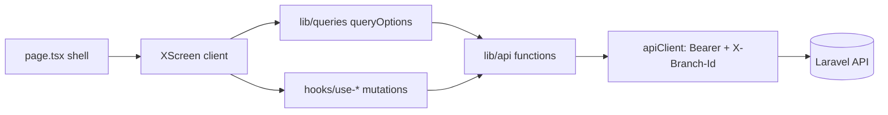
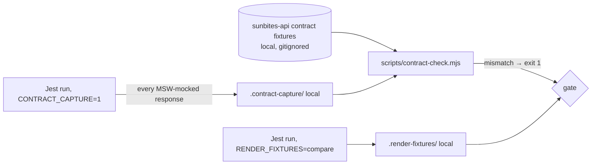

# Design Document: Spec 17, Frontend Code Quality and Backend Compliance

Every fact in this document was checked on 2026-10-31. The backend facts, installed versions and audit results were re-checked on 2026-11-07, after Spec 16 finished. Sources:
- **Code:** `~/sunbites-pos` (branch `bump-latest-upgrade-pos`) and `~/sunbites-portal` (branch `bump-latest-upgrade-portal`), both with the uncommitted 2026-10-31 upgrade.
- **Framework docs:** the docs bundled with Next 16.4.3 (`node_modules/next/dist/docs/`).
- **Package APIs:** the installed `.d.ts`/`.js` files of Zod 4.6.7, Zustand 5.0.16, TanStack Query 5.105 and `@types/react` 19.3.
- **Backend:** the Spec 16 contract fixtures in `~/sunbites-api/tests/Fixtures/contracts/` (471 files, digest `e3317d25315716f16fc7d419afba565b77d3d9cd018fbcc30449d3c38f06ed44`, at `sunbites-api` commit `8a708ff`, unchanged since `09c1955`).

Where this document says "verified", that check was run, not assumed.

## 1. Overview

This spec changes two Next.js apps and no backend file. The work runs in four PRs per app (Q3):

```
PR 1  Upgrade + green baseline        (Req 1)          bump-latest-upgrade-{pos,portal}
PR 2  Track B1: contract fixes        (Req 3, F-1..F-3) fix/spec17-contract-fixes
PR 3  Track A: refactor + compliance  (Req 2, 4–12)     refactor/spec17-code-quality
PR 4  Track B2: other fixes           (Req 14, F-4+)    fix/spec17-track-b2
```

**Track A must prove nothing changed.** It has three layers of proof:

1. **Characterization tests** (§6.1). Jest, React Testing Library and MSW pin what each screen shows, sends and does. They are written against unchanged code, before the refactor.
2. **Render fixtures** (§6.2). The normalised HTML of each recorded state is stored locally (gitignored) and compared byte for byte after each refactor commit.
3. **The local contract check** (§4.3). It proves the data those tests feed the screens is what the backend actually sends.

### 1.1 Decisions

| # | Decision | Source |
|---|---|---|
| Q1–Q8 | As approved in requirements (React Compiler on; 400-line limit; four PRs; `undici` fixed; Spec 16-style relay; render fixtures; former Spec 17 merged; read-only final review) | user, 2026-10-31 |
| D-1 | Contract check = **capture** every MSW-mocked response during the normal Jest run (`CONTRACT_CAPTURE=1`), then **compare** each against its backend fixture with a Node script. Comparison rule: "mock ⊑ fixture" (§4.3) | this design |
| D-2 | Render fixtures use `document.body.innerHTML` (dialogs and sheets render in portals outside the test container), normalised as in §6.2 | this design |
| D-3 | Query definitions live in `lib/queries/{domain}.ts` (key factory + `queryOptions()` factories). Mutations used by 2+ screens live in `hooks/use-{verb}-{noun}.ts`; single-use mutations stay in their screen | this design |
| D-4 | Role checks go through one capability map, `lib/permissions.ts`. Each capability names the backend route(s) whose `role:` middleware it mirrors | this design |
| D-5 | `undici` goes from `^5.29.0` to `^6.29.1` in the Jest polyfill (no new dependency). The fallback, only if MSW breaks on 6.x, is a 20-line custom Jest environment exposing Node's native `fetch` family | this design (Q4 spike) |
| D-6 | React Compiler config is `reactCompiler: { environment: { enablePreserveExistingMemoizationGuarantees: true } }`. The Next docs say to set this explicitly because defaults differ between versions; `true` keeps today's memo semantics | this design |
| D-7 | Error screens use Next 16.4's `error.tsx` props `{ error: unknown; retry: () => void }`. `retry` became stable in 16.3; the older `reset` still exists but the docs prefer `retry` | Next docs `error.md` |
| D-8 | `page.tsx` shells are typed with the global `PageProps<'/route'>` helper. `type-check` runs `next typegen` first, so the helper exists in CI | Next docs `page.md`, `next typegen` |

### 1.2 Verified framework and package facts

| Fact | Where verified |
|---|---|
| `next/jest` does not apply the React Compiler. Tests always run uncompiled code | `node_modules/next/dist/build/jest/jest.js` has no `reactCompiler` reference |
| `reactCompiler` is a stable top-level option. It needs devDependency `babel-plugin-react-compiler` (latest `1.0.0`) and can be opted out per component with `"use no memo"` | Next docs `reactCompiler.md` |
| `error.tsx` gets `error: unknown` and `retry()`. It does not wrap the `layout.tsx` of its own segment. `global-error.tsx` must render its own `<html>`/`<body>` and import its own styles | Next docs `error.md` |
| `PageProps<'/blog/[slug]'>` is global after `next dev`, `next build` or `next typegen`. Static routes resolve `params` to `{}` | Next docs `page.md` |
| `z.string().email(p)` is `this.check(core._email(ZodEmail, p))`, and `z.email(p)` is `core._email(ZodEmail, p)`: **the same check**. `err.flatten(m)` is `core.flattenError(err, m)`: **the same output** as `z.flattenError(err)` | `zod/v4/classic/schemas.js:256,363`, `errors.js:35` |
| Zod marks `.flatten()`, `z.string().email()` and the `message` param as deprecated. `superRefine` and `ctx.addIssue({ message })` are not deprecated | `zod/v4/classic/errors.d.ts:11`, `schemas.d.ts:113`, `core/api.d.ts:9` |
| Zustand persist exposes `hasHydrated()`, `onHydrate()` and `onFinishHydration()` (returns an unsubscribe function) | `zustand/middleware/persist.d.ts:83-86` |
| `queryOptions` is exported by `@tanstack/react-query` 5.105 | `build/modern/queryOptions.d.ts` |
| `undici@6.29.1`: `engines.node >=18.17`, **no dependencies**. `undici@5` depends on the vulnerable `@fastify/busboy`; `7.x` needs Node ≥20.18.1 and `8.x` needs Node ≥22.19, while CI runs Node 20 | `npm view` |
| `eslint-plugin-react-hooks` 7.1.1 already runs the compiler rules (`purity`, `refs`, `immutability`, `set-state-in-effect`, …), and both apps pass them | `npm ls`, `npm run lint` |
| Hosting is Vercel. PR CI (`pr.yml`) runs `npm ci`, `type-check`, `lint` and `test -- --ci --passWithNoTests` on Node 20, but **no build** | `.github/workflows/*.yml` (both) |
| Tests set `NEXT_PUBLIC_API_URL = "http://localhost:8000"` (no `/api/v1`). Production values include `/api/v1` (tech steering) | `jest.setup.ts` |
| MSW runs with `onUnhandledRequest: "error"`. `__tests__/test-utils.tsx` renders a `<Toaster />` inside the providers | `jest.setup.ts`, `test-utils.tsx` |

### 1.3 Baselines (recorded 2026-10-31)

| Item | POS | Portal |
|---|---|---|
| Tests | 325 (2 failing, 1 flaky; Req 1.4) | 102, all passing |
| Lint warnings | 7 | 1 |
| Coverage (loaded files only) | 82.85% lines | 84.97% lines |
| Files no test loads | 80 (73 in `app/`+`components/`, 7 in `hooks/`+`lib/`) | 26 (23 + 3) |
| `npm audit --omit=dev` (2026-11-07) | 0 high/critical (4 moderate, 2 low) | 0 high/critical (4 moderate, 2 low) |
| Backend fixtures | 471 files, digest `e3317d25…ed44`, `sunbites-api` `8a708ff` | same |

## 2. Architecture

### 2.1 Target structure (per app; new items in bold)

```
app/
  (group)/route/
    page.tsx                  ← Server Component shell: await params → <XScreen/> (§7)
    _components/              ← route-private Client Components (§8)
      x-screen.tsx            ← the screen: hooks, state, data
    **error.tsx**             ← per route group (FB-02, Track B2)
  **error.tsx**, **global-error.tsx**  (FB-02)
components/
  {domain}/                   ← components shared by 2+ routes (§9)
  **error-screen.tsx**        ← FB-02
  ui/                         ← shadcn-generated; not edited (H20)
hooks/
  **use-{verb}-{noun}.ts**    ← mutations shared by 2+ screens (§10)
lib/
  api/                        ← unchanged role: typed endpoint functions
  **queries/{domain}.ts**     ← key factories + queryOptions (§10)
  **validation/{domain}.ts**  ← Zod schemas (POS gains the folder; §11)
  **format.ts**               ← POS: peso/date helpers (portal already has it; §9)
  **permissions.ts**          ← POS: capability → roles map (§4.7)
  store/                      ← Zustand; + **use-auth-hydrated.ts** (§7.2)
__tests__/
  **render-fixture.ts**       ← §6.2
  **contract/**               ← capture listener, exceptions.json (§4.3)
scripts/
  **contract-check.mjs**      ← §4.3
```

### 2.2 Runtime data flow (unchanged by Track A)



### 2.3 Verification flow (new)



## 3. Behaviour-preservation hazards (read before every Track A task)

| ID | Hazard | Rule |
|---|---|---|
| H1 | **Decimal strings.** The API sends money and quantities as `"135.00"` (`string:decimal2`). Many types say `number` while the code converts with `Number()`/`parseFloat` | Change a type only when the runtime result is identical (§4.5). Never remove a conversion |
| H2 | **Query key values.** Invalidation uses prefix matching. `["students"]` matches `["students", "subscription"]` but never `["student", 5]` | Keys keep their exact values, including the inconsistent roots (§10.2) |
| H3 | **Copy.** Toasts, labels, placeholders, empty and error texts, `&apos;` and `…` | Copy every string byte for byte |
| H4 | **Element ids differ between copies.** The two `WalletTopUpModal`s use `detail-topup-amount` vs `topup-amount` | Merged components take an id prefix prop. Render fixtures catch any slip |
| H5 | **Generated ids** (Base UI `base-ui-_r_s_`, React `useId`) shift when the render order changes | Normalised in render fixtures (§6.2). Never assert them in tests |
| H6 | **Effect timing.** Replacing an effect with derived state removes an intermediate render | Tests assert the settled UI (`findBy…`, `waitFor`), never an intermediate frame |
| H7 | **Full-page redirect.** `lib/api/client.ts:56` sets `window.location.href = "/branch"`. The full reload drops all in-memory state (query cache, cart) | Keep the full reload. Single-line lint disable with the reason (Req 9.4) |
| H8 | **Auth gates render nothing until the session is restored.** Server HTML is empty for gated groups | `useAuthHydrated()` returns `false` on the server and during hydration (§7.2) |
| H9 | **Server page shells** cannot use hooks or browser APIs, and async shells can't be rendered by React Testing Library | Shells only await `params` and render the screen. Tests render the screen component (an allowed import change, Req 4.3) |
| H10 | **Dates.** `toLocaleDateString("en-PH")`, school-year helpers and "today" depend on the clock and time zone | New tests fix the clock (`jest.useFakeTimers({ now })` or `jest.setSystemTime`) and use noon UTC timestamps. Render fixtures are recorded and compared with `TZ=Asia/Manila` |
| H11 | **Zod error text and unions.** The portal email field is `z.union([z.string().email(…).max(150), z.literal("")])` | Swap APIs one for one (§11.1). Tests pin every shown message |
| H12 | **sonner in tests** (2.0.8) renders the toast text twice in jsdom (the feedback test failure) | Query toasts by role, or use `findAllByText(...)[0]`. This is a test-only concern (Req 1.4) |
| H13 | **Invalidation sets.** Each mutation's set of invalidated keys is behaviour | Identical in Track A. Only FB-03/FB-04.x change it, in Track B2 |
| H14 | **React Compiler is not exercised by Jest** (§1.2) | The compiler commit is proved by build, lint and a compile report, plus a staging smoke test (§12). A component the compiler can't handle gets `"use no memo"`, never a rewrite |
| H15 | **Authorised photo fetch** sends `Authorization`, `X-Branch-Id` and `Accept: image/*`, and revokes object URLs on cleanup | The shared function keeps all three headers. Callers keep the revoke (§9.3) |
| H16 | **Cross-app copies** (notification bell and item, api client, auth store) | Never import across repos. Each app keeps its own copy (Out of Scope) |
| H17 | **Print CSS depends on markup:** `#qr-print-root`, `[data-qr-card]`, `.no-print`, `.flex.h-screen` in `globals.css` | Keep these ids, attributes and classes exactly |
| H18 | **`onUnhandledRequest: "error"`** | Every request a new test triggers needs a handler. Never relax it to `"warn"` |
| H19 | **Role gates.** 74 `roles.includes(...)` expressions in the POS | `can()` must return the same boolean for every role and every multi-role user (§4.7) |
| H20 | **`components/ui/*` is shadcn-generated** | Not edited or merged in Track A. The portal's `dropdown-menu.tsx` coverage stays out of scope |

## 4. Backend compliance (Req 2)

### 4.1 Sources of truth

| Question | Read this | Never this |
|---|---|---|
| Response status and shape | `~/sunbites-api/tests/Fixtures/contracts/{slug}@{variant}.json` | the FE type, an MSW mock, memory |
| Enum **values** (fixtures record `"string"`, not the values) | The backend enum or model accessor, e.g. `InventoryItem::status` → `OK`/`LOW`/`OUT`/`OVER`, `app/Enums/*` | a FE union |
| Path and method | `vendor/bin/sail artisan route:list --path=api --except-vendor --json` (run from `~/sunbites-api`) | the FE `lib/api` path |
| Query and body keys, allowed values | The Form Request named on the controller method (`app/Http/Requests/{Kitchen,Portal,Public}/…`) | the FE form schema |
| Roles allowed | `role:` middleware in `route:list --json` (the `middleware` column) | the FE gate |
| Error bodies | `bootstrap/app.php` renderables; `abort()` texts in controllers and actions; Spec 16 Req 1.3 non-standard envelopes | — |

The backend is read-only for this spec. If `~/sunbites-api` is mid-change (another session committing), use the files at the recorded commit, and record `git -C ~/sunbites-api log -1 --format=%h` plus the fixture digest (§4.3.6) in the commit body.

### 4.2 Reading a fixture

- **File name.** `{slug}@{variant}.json`, where `slug = lowercase(method) + "__" + uri.replace(/[^a-z0-9{}]+/gi, "_")` trimmed of `_`, and `uri` is as `route:list` prints it. Example: `GET api/v1/portal/students/{student}/wallet` → `get__api_v1_portal_students_{student}_wallet@ok.json`. Source: `tests/Support/Contract/AssertsApiContract.php:60`.
- **Variants.** `ok` (the success case), plus error variants such as `422-validation`, `403`, `404`, `other-branch`, `422-no-branch`.
- **Content.**
  - JSON bodies: `{ "status": <int>, "body": <shape> }`.
  - File responses: status, `Content-Type` and the filename pattern.
- **Shape tokens** (Spec 16 design §4.1.1):

  | Token | Meaning |
  |---|---|
  | `"null"`, `"bool"`, `"number"` | as named (int and float are not distinguished) |
  | `"string:decimal2"` | `/^-?\d+\.\d{2}$/` |
  | `"string:date"` | `Y-m-d` |
  | `"string:datetime"` | `Y-m-d H:i:s` |
  | `"string:iso8601_micro"` | `…T…\.\d{6}Z` |
  | `"string:iso8601"` | `…T…±hh:mm` |
  | `"string"` | any other string |
  | `{ key: shape }` | object; keys sorted, so key order is ignored |
  | `{"__map__": s}` | an object keyed by data, not by fixed names |
  | `"list:empty"` | an empty list |
  | `{"__list__": s}` / `{"__list_union__": [s…]}` | a list whose elements share one shape / have several shapes |

### 4.3 Local contract check (Req 2.4, 2.5)

#### 4.3.1 Capture

`__tests__/contract/capture.ts` is imported from `jest.setup.ts` and does nothing unless `process.env.CONTRACT_CAPTURE === "1"`. When on:

- It registers `server.events.on("response:mocked", ({ request, response }) => …)` (MSW 2 life-cycle events).
- For each JSON response, it writes `{ method, url, status, body }` to `.contract-capture/<jest-worker-id>.jsonl`.
- It does this for both `__tests__/mocks/handlers.ts` and per-test `server.use(...)` overrides, because the event fires for every mocked response.
- Non-JSON responses (blobs, files) record `{ method, url, status, contentType }`.
- The directory is emptied at the start of each capture run (a Jest `globalSetup` only when the flag is set).

#### 4.3.2 Compare (`scripts/contract-check.mjs`, plain Node, no dependencies)

1. **Fixture directory.** `process.env.SUNBITES_CONTRACT_FIXTURES`, defaulting to `../sunbites-api/tests/Fixtures/contracts`, resolved from the app root.
   - Missing and `CI=true`: print `skipped: contract fixtures are local only (Spec 16 §4.1.7)` and exit 0.
   - Missing locally: print the same message and **exit 1**, because locally a skip is a failure.
2. **Index.** Load every fixture. For each slug, build a regex: escape the literal parts, turn each `{param}` into `([a-z0-9_]+?)`, and anchor both ends.
3. **Map each captured request to a fixture.**
   - `routePath = "api/v1" + new URL(url).pathname`. Tests use a base URL without `/api/v1`, so it is added back.
   - Build the slug of `routePath` with the same rule as §4.2, keeping concrete values. UUIDs become `a1b2_…`, which the param regex still matches.
   - Pick the fixture slugs of the same method whose regex matches. When several match, choose the one with the most literal characters (for example, `students_deleted` beats `students_{student}`).
   - No match is finding **K1**: "the frontend calls a route the backend doesn't have".
4. **Choose the variant.**
   - Status 2xx: the slug's `@ok*` fixtures.
   - Status 4xx: the variants whose recorded `status` equals the captured status. None is finding **K2**: "a status the backend never returns for this route".
   - Status ≥ 500: skipped. Tests simulate server failures, which backend fixtures don't record.
5. **Compare shapes**, mock ⊑ fixture. Compute the mock's shape with a JavaScript port of `ShapeExtractor` (same tokens, same check order: decimal2 → iso8601_micro → iso8601 → datetime → date → string), then:

   | Mock | Fixture | Result |
   |---|---|---|
   | same token | same token | ok |
   | object key | key absent | **K3** extra key the API never sends |
   | object key absent | key present | ok (subset; `satisfies` in §4.4 forces declared keys) |
   | `"null"` | any non-null token | **K4** null where the fixture has a value; needs an exception citing the nullable source |
   | `"number"` | `"string:decimal2"` | **K5** decimal sent as number (H1) |
   | `"string"` or a different string token | `"string:<format>"` | **K6** wrong string format |
   | non-null token | `"null"` | **K7** value where the fixture only saw null; needs an exception |
   | `"list:empty"` | any list | ok |
   | `{__list__: s}` | `__list__ f` / `__list_union__ [f…]` | `s ⊑ f` / `s ⊑` some `fᵢ` |
   | any list element | `"list:empty"` | **K8** the fixture has no element sample; needs an exception citing the Resource |
   | object | `{__map__: f}` | every value ⊑ `f` |

6. **Exceptions.** `__tests__/contract/exceptions.json` is committed. Each entry is `{ "fixture", "path", "kind", "reason", "backendRef" }`. `backendRef` is a `file:line` in `~/sunbites-api`, for example a nullable column in a migration or a `?->` in a Resource. Any finding without an exception exits 1.
7. **Output.** One line per finding: `K5 get__api_v1_portal_students_{student}_wallet@ok body.data[].amount mock=number fixture=string:decimal2 (test: wallet-tab.test.tsx)`.

#### 4.3.3 npm scripts (both apps)

```json
"test:contract": "CONTRACT_CAPTURE=1 jest --silent && node scripts/contract-check.mjs"
```

`.contract-capture/` goes into `.gitignore`.

#### 4.3.4 First run

The first run, task 4.2, will report every existing mock that drifted from the backend. Each finding is resolved in one of three ways:
- **Fix the mock data** (Track A): only when no existing test assertion has to change.
- **Fix the FE type** (Track A): only when the runtime is unchanged (§4.5).
- **Record it as an F-item** (Track B).

Where fixing a mock would break an existing assertion, that test was pinning wrong data. It becomes a proposed F-item, and the spec owner decides.

#### 4.3.5 What the check does not prove

The check covers response **shape** only. It does not cover:
- **Enum values:** read the backend (§4.1).
- **Request keys:** §4.6 audit.
- **Roles:** §4.7.

#### 4.3.6 Backend fixture digest

This is the same command as Spec 16, run from `~/sunbites-api`:

```bash
(cd tests/Fixtures/contracts && find . -type f -name '*.json' -print0 | LC_ALL=C sort -z | xargs -0 shasum -a 256) | shasum -a 256 | cut -c1-64
```

Every commit that runs `test:contract` records `Backend fixtures: <count> files, digest <digest> (sunbites-api <sha>)`. If the digest changes mid-spec, the backend moved: stop and report.

### 4.4 Typed MSW data (Req 2.5)

Every JSON body in `__tests__/mocks/handlers.ts` and in per-test `server.use` is typed with the frontend response type, using `satisfies`:

```ts
http.get(`${API}/portal/students/:id/wallet`, () =>
  HttpResponse.json({ balance: 1000, credit_balance: 0, data: [...], meta: {...} } satisfies WalletData),
);
```

Existing fixtures declared with a type annotation (`export const posMenuItemsFixture: PosMenuItem[] = …`) already comply. `satisfies` is a compile-time check only, and changes no test behaviour.

### 4.5 Compliance register (Req 2.8)

Appendix B is the register. It is seeded from `contract-gaps.md` §1–§2 (recorded 2026-10-09/12) plus this audit. Task 4.3 re-checks every row against the current fixtures and backend code, and fills in the last two columns. The spec owner then updates Appendix B and asks the user to approve any F-items. Resolution rules:

| Situation | Resolution | Track |
|---|---|---|
| The FE type is wrong, the code already converts the value or never reads the field (e.g. `total_revenue: string` but `parseFloat` is used) | Correct the type. Type-check must pass with no runtime edit except an explicit conversion the type forces where the code relied on implicit coercion with identical output | A |
| Correcting the type exposes wrong output (e.g. F-2's `toLocaleString` on a string) | F-item (F-4, F-5, …), failing test first | B2 |
| A Spec 16 Track B backend fix already makes the response match the existing FE type (B-07, B-13, B-16, B-21, B-22) | No FE change. Mark the row "resolved by Spec 16 B-xx" and add it to the deploy-dependency list (§4.9) | — |
| Only the backend can fix it | "Found, not fixed" as a proposed backend item (Req 2.11) | — |

### 4.6 Request compliance audit (Req 2.3)

Task 4.3 lists every function in `lib/api/*.ts`, both apps, with:
- its method and path;
- whether that route exists in `route:list`;
- its query and body keys;
- the Form Request's rule keys;
- any mismatch.

The known case is F-1: `log_type` and `history_page` against `type` and `page`. The table goes into Appendix B §B.2. The characterization tests (§6.1) assert the query parameters and bodies each screen sends, so a request mismatch fixed later is pinned by a test.

**Already checked (2026-11-07).** Spec 16's B-26 and B-27 tightened these request rules. Fixtures record responses, so the digest can't show this kind of change. Every sender already sends the new type, so neither app needs a change. Task 4.3 copies these rows into §B.2.

| Backend rule | Sender | What it sends |
|---|---|---|
| `CheckoutRequest` `student_id`: `nullable, integer` | POS `components/pos/cart-panel.tsx:223` | `student?.id`, a number (`post__api_v1_pos_students_lookup@ok.json`), omitted for walk-ins |
| `CheckoutRequest` `items.*.pos_menu_item_id`: `integer` | POS `components/pos/cart-panel.tsx:226` | `CartItem.id`, a number (`get__api_v1_pos_menu_items@ok.json`) |
| `InlineReloadRequest` `student_id`: `integer` | POS `components/pos/insufficient-funds-modal.tsx:50` | `student.id`, a number |
| `EnrollStudentRequest` `branch_id`: `integer` | POS `app/(kitchen)/enrollment/page.tsx:401` | a number (`z.number`) |
| `UpdateStaffStatusRequest` `user_id`: `integer` | POS `app/(kitchen)/dashboard/page.tsx:167`, through `lib/api/reports.ts:340` | `staff.id`, a number (`get__api_v1_dashboard@ok.json`, `staff_roster`) |
| `StorePublicPreRegistrationRequest` `branch_id`: `integer` | Portal `components/pre-registration/pre-registration-form.tsx:248` | a number (`z.number().min(1)`) |
| `ResetStaffPasswordRequest` `token`: `string` | POS `app/(auth)/reset-password/page.tsx:43` | a string from the URL |
| `StaffUserRules` `role`: `string` | POS `references/users/create/page.tsx:180`, `references/users/[id]/page.tsx:306` | a string (`z.string`) |

### 4.7 Role gates and `lib/permissions.ts` (Req 2.6)

The POS has 74 `roles.includes(...)` expressions in about 30 files, plus nav role lists in `lib/navigation.ts`. Task 4.3 builds the matrix, and task 6.5 moves the gates to one map:

```ts
// lib/permissions.ts
import type { AuthUser } from "@/types/auth";

type Role = "admin" | "manager" | "supervisor" | "cashier";

/**
 * What each role may do in the POS UI. Each entry mirrors the `role:` middleware of the
 * backend route(s) named beside it (`route:list --json`), so the UI never offers what the API refuses.
 */
const CAPABILITIES = {
  // PATCH api/v1/students/{student}/payments/{payment}: role:admin|manager
  "students.toggle-payment": ["admin", "manager"],
  // POST api/v1/students/{student}/credit/waive: role:admin
  "students.waive-credit": ["admin"],
  // …one entry per distinct gate found by task 4.3
} as const satisfies Record<string, readonly Role[]>;

export type Capability = keyof typeof CAPABILITIES;

export function can(user: Pick<AuthUser, "roles"> | null | undefined, capability: Capability): boolean {
  return user?.roles.some((role) => (CAPABILITIES[capability] as readonly string[]).includes(role)) ?? false;
}
```

- **Track A (task 6.5):** each gate keeps today's role list exactly (H19), even where it disagrees with the backend. A unit test asserts `can()` for every capability × every role, plus one multi-role user.
- **A mismatch with the backend** (in either direction, Req 2.6) is recorded in Appendix B §B.3 and fixed as an F-item in Track B2, where the visible change belongs.
- **Not role gates:** the cashier redirect in `(kitchen)/layout.tsx` and `lib/auth-utils.ts` decides routing, not a permission. They move into `can()` only as `"pos.cashier-only"` with identical logic.

### 4.8 Error bodies (Req 2.7)

| Backend body | FE handling today | Gap |
|---|---|---|
| 422 `{ message, errors }` | `apiClient` throws the body as `ApiError`, and forms read `errors` | — |
| 422 `{ errors }` with **no `message`** (enrollment subscription range, payment `addRange`, public pre-registration, portal change-password) | `ApiError.message` is typed `string` (POS `types/auth.ts:17`, portal `:13`). Callers do `err.message ?? "…"` | Type says required; backend can omit it. Task 4.3 checks each caller: type → `message?: string` (A) where every reader already falls back, otherwise an F-item |
| 401 `{"message":"Unauthenticated."}` | client logs out, throws "Session expired. Please log in again." | — |
| 403 `{"message":"Forbidden."}` / role middleware `"User does not have the right roles."` | shown via `err.message` toasts | — |
| 404 `{"message":"Not found."}` | shown via toasts / screen error states | — |
| 422 `{"message":"No active branch selected. Please set a branch first."}` | POS client clears branch, full reload to `/branch` (H7) | — |
| portal login 403 `{ message, error: "account_not_activated" \| "account_disabled" }` | portal `ApiError.error?: string` | Narrow to the two literals (A) |

### 4.9 Deploy dependency on Spec 16 (Req 2.10)

Spec 16 finished on 2026-10-31 on `bump-laravel-13-latest` (last commit `8a708ff`). On 2026-11-07 that branch was not on GitHub and had no PR, so `staging` still runs the pre-Spec 16 API. B-27 left the fixtures unchanged (same digest at `09c1955` and `8a708ff`), and §4.6 covers the request rules it tightened. The fixture digest rule (§4.3.6) catches any later backend change. These frontend behaviours depend on Spec 16 responses and must not reach `staging` before Spec 16's PR is merged there:

| Spec 16 item | FE effect | FE change in this spec |
|---|---|---|
| B-07 receipt cashier name | receipt shows the cashier | none (type already `string`) |
| B-12/B-13 report rows | sales report student name shows; fewer PII keys | type trims, if any (task 4.3) |
| B-16 archived inventory | Archived section fills, Unarchive reachable | none |
| B-21 `credit_balance` | portal dashboard "Credit owed" badge | none |
| B-22 birthday `Y-m-d` | POS pre-registration edit shows birthday | none |
| any type correction that matches a post-Spec 16 shape | — | lands in PR 3 or later |

PR 1 and PR 2 are independent of Spec 16: F-1 to F-3 match the API both before and after it. That was verified in the former Spec 17 and re-verified in §5.

## 5. Contract fixes F-1, F-2, F-3 (Req 3; Track B1, PR 2)

This section carries the former Spec 17 design (commit `6a333e8`, verified 2026-10-17). It was re-verified on 2026-10-31:
- The fixture `get__api_v1_reports_inventory@ok.json` still returns top-level `discrepancy`, `items`, `logs` and `summary`. `summary` includes `total_items`; `logs.meta` is `current_page`, `last_page`, `per_page` and `total`; `items[].status` is `string` (uppercase per `InventoryItem::status`).
- `get__api_v1_portal_students_{student}_wallet@ok.json` still sends `data[].amount` as `string:decimal2`.
- The FE lines below are unchanged since 2026-10-17.

### 5.1 F-1: POS inventory report

**What is wrong** (verified 2026-10-31):

| File:line | Today | Problem |
|---|---|---|
| `lib/api/reports.ts:163` | `InventoryReportStatus = "out" \| "low" \| "ok" \| "over"` | lowercase; the API sends uppercase |
| `lib/api/reports.ts:381` | `data: InventoryReportRow[]` | the API key is `items` |
| `lib/api/reports.ts:382-386` | `summary` without `total_items` | incomplete (harmless) |
| `app/(kitchen)/reports/inventory/page.tsx:236` | `const rows = data?.data ?? [];` | always `[]` |
| `page.tsx` `STATUS_BADGE_MAP` / `STATUS_LABEL_MAP` | keyed `out`/`low`/`ok`/`over` | no match, so the badge is blank |
| `page.tsx` `STATUS_FILTERS` | values `ok`/`low`/`out`/`over` | the filter never matches |
| `page.tsx:395-396` | `row.status === "out"` / `"low"` | the colour never applies |
| `page.tsx:228` | sends `log_type` | the API reads `type` |
| `page.tsx:230` | sends `history_page` | the API reads `page` (`paginate(25)`) |

**Change** (exactly these edits; nothing else in the file):

1. `lib/api/reports.ts`:
   - `import type { InventoryStatus } from "@/types/inventory";` and `export type InventoryReportStatus = InventoryStatus;`. `types/inventory.ts:1` already defines `"OK" | "LOW" | "OUT" | "OVER"`.
   - In the inventory response type, change `data:` to `items:` and add `total_items: number` to `summary`.
2. `page.tsx`:
   - `const rows = data?.items ?? [];`
   - Uppercase the keys of both maps and the `STATUS_FILTERS` values. Labels and classes stay the same.
   - Use `row.status === "OUT"` / `"LOW"`.
   - In the history query, `log_type:` becomes `type:` and `history_page:` becomes `page:`. Leave `include_logs`/`include_discrepancy` alone (ignored by the API).
3. Do **not** change `app/(kitchen)/dashboard/page.tsx`. Its widget reads `GET /dashboard`, which sends lowercase `out`/`low` (`DashboardController`).
4. `npm run type-check` flags any leftover lowercase comparison.

**Test.** New file `app/(kitchen)/reports/inventory/page.test.tsx`, modelled on `reports/credits/page.test.tsx` (same `next/navigation` mock, same native-`<select>` mock of `@/components/ui/select`, manager user, custom `render`). The MSW body follows the fixture: `items` with `Rice LOW`, `Eggs OUT`, `Oil OK`; `logs: { data: [], meta: { current_page: 1, last_page: 1, per_page: 25, total: 0 } }`; `discrepancy: []`. Seven tests:
1. lists the three items;
2. shows the `LOW ⚠` / `OUT ✕` badges;
3. the "Low" filter leaves only Rice, and "All Status" restores all three;
4. `items: []` shows "No inventory data found.";
5. a 500 response shows "Failed to load inventory data. Please try again.";
6. "Waste" plus Apply sends `type=waste` and no `log_type`;
7. with `last_page: 2`, Next sends `page=2` and no `history_page`.

Tests 1, 2, 6 and 7 fail before the fix.

### 5.2 F-2: Portal wallet amounts

**What is wrong:** `types/portal.ts:85` types `amount: number`, and the fixture says `string:decimal2`. `wallet-tab.tsx:51` calls `formatPHP(tx.amount)`, and `String.prototype.toLocaleString` ignores the options, so `"1500.00"` displays as `PHP 1500.00`. `wallet-tab.tsx:37` `tx.amount >= 0` works only through coercion. The existing test mocks `amount: 500`.

**Change:**
- `types/portal.ts` `Transaction.amount: string`, with the docblock "Decimal string from the wallet, e.g. "1500.00" or "-150.00". Convert with Number() before maths or formatting."
- In `TransactionRow`, `const amount = Number(tx.amount); const isCredit = amount >= 0;` and render `formatPHP(amount)`.
- `formatPHP` and its other callers are unchanged. They receive numbers per the fixtures.

**Test** (update `wallet-tab.test.tsx`):
- The mock amount becomes `"1500.00"`, and a withdrawal `"-150.00"` is added (`meta.total: 2`).
- The assertion `/\+PHP 500\.00/i` becomes `/\+PHP 1,500\.00/`, and a new assertion checks the withdrawal shows `PHP -150.00`.
- Other tests in the file are unchanged.

### 5.3 F-3: Clear the POS cart on a branch switch

**What is wrong:** `lib/store/cart.ts` is in memory (not persisted) and survives client navigation. `components/branch-cache-sync.tsx` resets the query cache on a branch change, but not the cart. Checkout then sends the old branch's item ids (422 after Spec 16 B-24).

**Change:** inside the existing `if (previousBranchId.current !== null && previousBranchId.current !== branchId)` block, call `useCartStore.getState().clearCart();` before the `clear()`/`resetQueries()` branch. Import it from `@/lib/store/cart` and add "also clears the POS cart" to the docblock.

**Test** (extend `components/branch-cache-sync.test.tsx`):
- A → B empties the cart.
- B → null empties the cart.
- null → B leaves it unchanged.
- `beforeEach` calls `clearCart()`, as `cart-panel.test.tsx:65` does. The existing three tests are unchanged.

### 5.4 Staging smoke (PR 2)

- **POS:** Reports → Inventory. The snapshot lists items with badges, and the status filter narrows the list. The History type filter narrows the log, and Next shows other rows when there are more than 25.
- **Portal:** a ₱1,000+ top-up shows `+PHP 1,000.00`, and purchases are red with a minus sign.
- **POS:** a multi-branch manager adds items, switches branch and returns to the POS: the cart is empty.

## 6. Behaviour freeze (Req 4)

### 6.1 Characterization tests

One test file per screen, next to it (`app/(group)/route/x.test.tsx`, as today), following `.claude/rules/testing.md`:
- the custom `render` from `@/__tests__/test-utils`;
- queries by role, label or text;
- MSW at the network boundary, with data shaped like the fixtures (§4.4);
- no snapshot tests.

Every characterization test file covers:

| Area | Minimum |
|---|---|
| States | loading (skeleton visible), empty, failed (the screen's own error text), loaded |
| Requests | for each query and mutation: method, path, query params (`new URL(request.url).searchParams`) and body (`await request.json()`) |
| Actions | each button, dialog and form: toast text, dialog open/close, navigation (`next/navigation` mock), and which requests are sent again afterwards (count MSW hits per path) |
| Roles | for POS screens with gates, one test per distinct role outcome (§4.7) |
| Render fixtures | `expectRenderFixture("<state-name>")` at each settled state above (§6.2) |

The clock and time zone follow H10. Characterization tests land in their own commit (`test(<area>): characterize … before refactor`) and must pass on unchanged code.

### 6.2 Render fixtures (Q6, Req 4.4)

**Helper.** `__tests__/render-fixture.ts`:

```ts
/**
 * Records or compares the normalised HTML of the whole document body for one settled UI state.
 * No-op unless RENDER_FIXTURES is "record" or "compare". Fixtures are local only (.gitignore),
 * never committed (Spec 17 Q6; testing.md bans committed snapshots).
 */
export function expectRenderFixture(name: string): void;
```

- **Path.** `.render-fixtures/<test file path relative to the app root>/<name>.html`. Names must be unique within a test file. Because the path includes the test file, **Track A never moves or renames a test file that has fixtures**, even when its screen moves to `_components/`.
- **Modes:**
  - `record`: write, overwriting.
  - `compare`: read and `expect(actual).toBe(stored)`, so Jest prints a diff. A missing fixture fails with "record it in the characterization commit".
  - unset: nothing. Normal runs and CI are unaffected.
- **Normalisation, in order:**
  1. Collect every `id` attribute value in document order and map it to `id-1…n`. Replace the same values wherever they appear in `for`, `aria-labelledby`, `aria-describedby`, `aria-controls`, `aria-owns`, `aria-activedescendant` and `headers` (space-separated lists), and in `href="#…"`.
  2. Replace `blob:` URLs with `blob:URL`.
  3. Nothing else. Classes, attributes, attribute order and whitespace stay exact, because they are what "looks the same" means.
- **Scope.** `document.body.innerHTML`, which includes portals (dialogs, sheets, popovers) and the sonner live region.
- **Commands:**
  ```bash
  TZ=Asia/Manila RENDER_FIXTURES=record  npx jest <files>   # characterization commits only
  TZ=Asia/Manila RENDER_FIXTURES=compare npx jest           # every Track A refactor commit
  ```
- **Digest.** Same idea as Spec 16 §4.1.7, run from the app root:
  ```bash
  find .render-fixtures -type f | wc -l | tr -d ' '
  (cd .render-fixtures && find . -type f -print0 | LC_ALL=C sort -z | xargs -0 shasum -a 256) | shasum -a 256 | cut -c1-64
  ```
  - Characterization commits record `Render fixtures: <count>, digest <d>`.
  - Refactor commits must show the same digest as the previous commit, because fixtures are never re-recorded in a refactor commit.
- **Ignore.** `.render-fixtures/` goes into `.gitignore`. The fixtures exist on one machine, shared by the spec-owner and implementer sessions. If they are lost mid-spec, re-record from the last characterization commit's code (`git stash`/worktree), never from refactored code.

### 6.3 Coverage (Req 4.5)

`jest.config.ts` gains:

```ts
collectCoverageFrom: [
  "app/**/*.{ts,tsx}", "components/**/*.{ts,tsx}", "hooks/**/*.{ts,tsx}", "lib/**/*.{ts,tsx}",
  "!**/*.test.{ts,tsx}", "!**/*.d.ts", "!components/ui/**",
],
```

- **Thresholds.** Counting all files lowers the measured numbers, so task 3.3 re-baselines the thresholds once to the new measurement, rounded down to the integer. From then on they are only raised. Task 8.2 sets them to the final measured values.
- The portal has no `hooks/` folder. The glob simply matches nothing there.

### 6.4 Untested files

Appendix A lists the 80 POS and 26 portal files no test loaded on 2026-10-31. Each belongs to one characterization task (tasks.md task 5), which must load it. `loading.tsx` skeletons are covered by rendering them once in their route's test file. Layouts and providers are covered by the layout tests (§7.2).

## 7. Route shells and layouts (Req 5)

### 7.1 `page.tsx` shells

Static route:

```tsx
// app/(kitchen)/reports/sales/page.tsx
import { SalesReportScreen } from "./_components/sales-report-screen";

export default function SalesReportPage() {
  return <SalesReportScreen />;
}
```

Dynamic route:

```tsx
// app/(kitchen)/students/[id]/page.tsx
import { StudentDetailScreen } from "./_components/student-detail-screen";

export default async function StudentDetailPage({ params }: PageProps<"/students/[id]">) {
  const { id } = await params;
  return <StudentDetailScreen rawId={id} />;
}
```

- **Rules:**
  - The screen file carries `"use client"`.
  - The shell imports nothing else.
  - Existing in-file names stay; the screen is the former default export, renamed `XScreen`.
- **POS student detail (Req 5.2):** `StudentDetailScreen` runs `parsePositiveInt(rawId)` exactly as today, and the `useParams()` fallback is deleted. Its tests render `<StudentDetailScreen rawId="5" />` instead of the page with a `params` object. That is an allowed render-target change (Req 4.3), and the assertions are unchanged.
- **`type-check` script:** `"next typegen && tsc --noEmit"` in both apps, so `PageProps` exists in CI (D-8).
- **Scope:** all 40 POS and 13 portal `page.tsx` files. `app/page.tsx` (5 lines, a redirect) keeps its current form if it is already server-safe; task 6.1 verifies this.

### 7.2 Auth layouts: `useAuthHydrated()`

Today `(kitchen)`, `(pos)` and portal `(portal)` layouts do `useEffect(() => startTransition(() => setMounted(true)), [])` and render `null` until mounted. The replacement:

```ts
// lib/store/use-auth-hydrated.ts
import { useSyncExternalStore } from "react";

import { useAuthStore } from "@/lib/store/auth";

/** True once the persisted session has been read from sessionStorage; always false on the server and during hydration. */
export function useAuthHydrated(): boolean {
  return useSyncExternalStore(
    (onChange) => useAuthStore.persist.onFinishHydration(onChange),
    () => useAuthStore.persist.hasHydrated(),
    () => false,
  );
}
```

- **The layout:** `const hydrated = useAuthHydrated();`, the `mounted` state and its effect are deleted, and the redirect effect checks `if (!hydrated) return;`.
- **Server and hydration render:** React uses the server snapshot (`false`), so the server HTML and the first client render are `null`, as today (H8). With `sessionStorage`, persist hydrates synchronously when the store is created, so the next render shows the children.
- **One difference, accepted as behaviour-neutral:** when a layout mounts on a client navigation (for example, `/branch` → `/dashboard`), the children now render in the first frame instead of after a blank frame. The settled UI is identical, and render fixtures compare the settled state.
- **Tests (layout characterization):**
  - no token redirects to `/login`;
  - no branch redirects to `/branch`;
  - a cashier in `(kitchen)` redirects to `/pos`;
  - otherwise the children render.

### 7.3 Other effect workarounds (Req 9.3)

| Site | Today | Replacement |
|---|---|---|
| POS `students/page.tsx:836-846` (QR print root) | effect creates `div#qr-print-root`, appends it to `<body>`, `startTransition(setPrintRoot)` | `open && createPortal(<div id="qr-print-root">{cardGrid}</div>, document.body)`. React owns the same element (H17). The render fixture proves identical DOM |
| Portal `wallet-tab.tsx:83-87` (alert input) | effect copies `data.wallet_alert_threshold` into `alertInput` while not editing | derive: `const alertValue = alertEditing ? alertDraft : String(data?.wallet_alert_threshold ?? "")`; starting an edit seeds `alertDraft` from the current value |
| Both `echo-provider.tsx:46` (`setEcho` in effect + disable) | effect creates `Echo`, sets it in state, disconnects on cleanup | a small module store (`lib/echo-store.ts`: `connect(token)`, `disconnect()`, `subscribe`, `getSnapshot`). The effect calls `connect`/`disconnect` only, and consumers read through `useSyncExternalStore`. Channel names and auth headers are unchanged |
| POS `reminders/page.tsx:349` | `startTransition` in an `onChange` handler | **unchanged** (correct use) |

## 8. File splits (Req 6)

- **Limit:** 400 lines for any non-test file outside `components/ui/` (Q2). Today 28 files exceed it (requirements FA-03).
- **Placement:**
  - used by one route → `app/(group)/route/_components/kebab-name.tsx`;
  - used by 2+ routes → `components/{domain}/kebab-name.tsx` (domains: `students`, `reports`, `pos`, `inventory`, `users`, `parents`, `notifications`, `pre-registrations`, `analytics`, `shared`).
- **Method:**
  1. Move one inline component or helper at a time, **verbatim**: same JSX, same strings, same class names.
  2. Export it by name.
  3. Add a props interface above it (most already have one).
  4. Change nothing else in that commit.
- **Order within a split task:** the screen component first (§7.1), then dialogs, tabs and tables, then helpers. Helpers that are also duplicated elsewhere wait for §9.
- **The largest file, `students/[id]/page.tsx` (3,276 lines), has 15 inline components today.** They map to `_components/`:
  - `info-row.tsx`, `detail-skeleton.tsx`, `edit-profile-form.tsx`
  - `wallet-top-up-modal.tsx` (merged in §9)
  - `downgrade-confirm-dialog.tsx`, `change-type-dialog.tsx`
  - `status-picker-dialog.tsx` (merged in §9)
  - `add-subscription-period-dialog.tsx`, `edit-amount-dialog.tsx`, `contact-form-modal.tsx`, `portal-status-badge.tsx`, `contacts-tab.tsx`, `void-payment-dialog.tsx`, `payment-tab.tsx`, `order-history-tab.tsx`
  - `camera-modal.tsx`
  - `student-detail-screen.tsx` (the former default export)

  `_components/` already holds `wallet-tab.tsx` and the three credit dialogs.
- **Size check (both apps):**
  ```bash
  find app components hooks lib -name '*.ts*' ! -name '*.test.*' ! -path 'components/ui/*' -exec wc -l {} + | grep -v ' total$' | awk '$1>400'
  ```
  It must print nothing at the end of Track A.

## 9. One copy per helper and component (Req 7)

### 9.1 Helpers

The POS gets `lib/format.ts`. The portal already has one; its `groupByDate` pair moves into `lib/relative-time.ts` or `lib/format.ts`.

| Helper (POS) | Copies | Canonical form | Notes |
|---|---|---|---|
| `formatPeso` | 8 | `(n: number \| null \| undefined) => "₱" + (n ?? 0).toLocaleString("en-PH", { minimumFractionDigits: 2, maximumFractionDigits: 2 })` | 6 copies already accept null; the dashboard and wallet-history-panel copies take `number` only. Identical output for numbers. **Verified 2026-10-31** |
| `formatDate` | 6 | `toLocaleDateString("en-PH", { month: "short", day: "numeric", year: "numeric" })` | null handling differs (`"—"` vs none). Keep two names if the null contract differs: `formatDate(iso)` and `formatDateOrDash(iso \| null)` |
| `formatDateTime`, `getDateRange`, `fmt`, `groupByDate`, `formatTime`, `getSchoolYear`, `getDefaultSchoolYear`, `getDefaultSchoolMonth`, `parsePositiveInt`, `historyRowClass` | 2–5 each | decided per helper in its task after a byte-for-byte diff of the copies | any copy whose output differs keeps its own name (Req 7.2); a defect goes to Track B |

### 9.2 Components

| Component (POS) | Copies | Plan |
|---|---|---|
| `WalletTopUpModal` | 2 | One `components/students/wallet-top-up-modal.tsx`. Props: `studentId`, `studentName?`, `currentBalance`, `creditBalance?`, `onSettleCredit?`, `idPrefix` (`"topup"` / `"detail-topup"`, H4), `resetOnSuccess` (list `true`, detail `false`), and the invalidation set via the shared mutation (§10.4). The list copy invalidates `["students"]` + `["student", id]` and the detail copy `["student", id]` only, both kept in Track A (FB-03 changes the detail one). The description text differs ("this student's" vs "{full_name}'s"), so it is kept per caller. The success footer differs (detail adds a Close button), so a prop is needed. **All differences verified 2026-10-31 (FA-06)** |
| `StatusPickerDialog` | 2 | Same approach. The 25 differing lines are recorded in its task before merging |
| `TableRowSkeleton` ×8, `StatusBadge` ×7, `SummaryCard` ×5, `FormField` ×5, `FieldError` ×4, `TableSkeleton`, `SectionCard`, `PaymentBadge`, `InfoRow`, `DetailSkeleton`, `CategoryBadge`, `StatusDot`, `SectionHeading`, `PaymentStatusBadge`, `NotificationDetailSheet`, `LogTypeBadge` | 2–8 | Diff the copies first. Identical copies → `components/shared/` (or a domain folder). Same name but different status sets (e.g. `StatusBadge` for inventory vs enrollment) → distinct names: `InventoryStatusBadge`, `EnrollmentStatusBadge`, … |

### 9.3 Authorised photo fetch

There are 4 copies (FA-07). `lib/api/photos.ts`:

```ts
/** Fetches an auth-protected image and returns an object URL. The caller must URL.revokeObjectURL it on cleanup. */
export async function fetchAuthorizedImageUrl(url: string): Promise<string>;
```

- It sends `Accept: image/*`, `Authorization: Bearer …` and `X-Branch-Id`, read from `useAuthStore.getState()` (H15).
- Callers keep their effect, `catch(() => {})`, and revoke on cleanup.

## 10. Data layer (Req 8)

### 10.1 Files

`lib/queries/{domain}.ts` per app. Each exports `{domain}Keys` (functions returning `as const` arrays) and `{domain}Queries` (functions returning `queryOptions({ queryKey, queryFn })`).

- **What goes into the factory:** `queryOptions` carries only the key, `queryFn`, and options that are identical at every call site.
- **What stays at the call site:** per-screen options such as `enabled`, `select`, `placeholderData` or `refetchInterval`, written as `useQuery({ ...studentQueries.detail(id), enabled: id !== null })`.

| App | Domain files (key roots today) |
|---|---|
| POS | `students` (`student`, `students`, `student-payments`, `student-ledger`, `student-orders`, `student-downgrade-preview`, `wallet-history`), `parents` (`parent`, `parents`, `parents-list`), `users` (`user`, `users`, `staff-list`), `inventory` (`references-inventory`, `pos-inventory`, `inventory-logs`, `inventory-history`), `menu` (`pos-menu-items`, `menu-item-ingredients`, `pos-subscription-config`), `notifications` (`staff-notifications`, `staff-unread-count`), `reminders` (`reminder-bell-count`, `eligible-parents`, `reminder-parent`), `pre-registrations` (`pre-registration`, `pre-registrations`, `pre-registrations-pending-count`), `branches` (`branches`, `branches-admin`, `branch-monthly-amounts`), `system` (`system-configurations`), `reports` (`reports-*`, `dashboard`), `announcements` (`announcement`, `announcements`), `feedback`, `meal-planner`, `transactions` (`pos-transactions`), `enrollment` (`enrollment-form-data`) |
| Portal | `notifications` (`notifications`, `unread-count`), `students` (`students`, `student-wallet`, `student-activity`, `payment-history`, `spending-summary`), `dashboard`, `feedback`, `profile`, `meal-plan` (`portal-meal-plan`) |

### 10.2 Keys stay identical (H2)

The factories reproduce today's arrays exactly, including objects inside keys. TanStack hashes object keys order-independently, so `{ search, gradeFilter }` and `{ gradeFilter, search }` are the same key. Example:

```ts
export const studentKeys = {
  all: ["students"] as const,                                   // invalidateQueries({ queryKey: ["students"] })
  deleted: (f: { search: string; gradeFilter: string }) => ["students", "deleted", f] as const,
  detail: (id: number) => ["student", id] as const,
  payments: (id: number) => ["student-payments", id] as const,
  ledger: (id: number) => ["student-ledger", id] as const,      // prefix of ledgerPage
  ledgerPage: (id: number, type: string, page: number) => ["student-ledger", id, type, page] as const,
};
```

Before writing a domain file, the task lists every literal key for that root (`grep -rn 'queryKey: \["<root>"'`) and every `invalidateQueries`/`setQueryData`/`removeQueries` on it. The commit body carries that before/after table, and it must be identical.

### 10.3 Invalidation sets are pinned by tests

After each mutation, the characterization tests count which GET paths MSW receives again (§6.1), so the invalidation set is proved behaviourally. That is the behaviour users see.

### 10.4 Shared mutations

These are used by 2+ screens and go into `hooks/`:
- `useWalletTopUp` (students list and detail);
- the status update used by both `StatusPickerDialog`s;
- any other mutation the dedupe tasks find called from two places.

Each hook takes the invalidation set as data, so each caller keeps its own (H13).

## 11. Current APIs (Req 9)

### 11.1 Zod

| Today | Replacement | Sites |
|---|---|---|
| `result.error.flatten().fieldErrors` | `z.flattenError(result.error).fieldErrors` | 24 (POS 16, portal 8) |
| `z.string().email("…")` | `z.email("…")` (same check, §1.2) | 6 |
| `z.union([z.string().email("Invalid email").max(150), z.literal("")])` | `z.union([z.email("Invalid email").max(150), z.literal("")])` | portal `lib/validation/pre-registration.ts:22` |
| `.refine(fn, { message: "Passwords do not match" })` | `.refine(fn, { error: "Passwords do not match" })` (keep `path`) | 5 |
| `ctx.addIssue({ code, message, path })` | **unchanged** (not deprecated) | portal pre-registration ×4 |

- **Schema location:** schemas move to `lib/validation/{domain}.ts`, exporting the schema and `type X = z.infer<typeof xSchema>`. Inline schemas today are in 11 POS files and 4 portal files.
- **Backend comparison:** where a schema mirrors a Form Request (enrollment, user create/update, contacts, inventory items, branches, password reset, profile, feedback, pre-registration), task 4.3 compares the rules. A FE rule stricter than the backend (rejecting input the API accepts) or looser on a required field goes to Appendix B §B.4. Changing a FE rule changes behaviour, so it becomes an F-item.

### 11.2 Lint to zero (Req 9.4)

- **The 6 `` warnings:** each gets `// eslint-disable-next-line @next/next/no-img-element -- <reason>`, where the reason is "blob: object URL; next/image does not accept blob URLs" or "print layout; next/image would change the markup", whichever applies.
- **`client.ts:56`:** `// eslint-disable-next-line @next/next/no-location-assign-relative-destination -- full reload on purpose: clears the query cache and cart when the API rejects the branch` (H7).
- **The portal `coverage/` warning:** goes away with the ignore (§13.1).
- **Final step:** `quality:validate` becomes `npm run type-check && eslint --max-warnings 0`, enabled in task 6.8 once warnings are 0.

## 12. React Compiler (Req 10)

- **Install:** `npm install -D --save-exact babel-plugin-react-compiler@1.0.0`.
- **Config (D-6):**
  ```ts
  reactCompiler: { environment: { enablePreserveExistingMemoizationGuarantees: true } },
  ```
  `experimental.turbopackRustReactCompiler` is **not** enabled, because it is experimental.
- **Proof (H14).** Jest runs uncompiled code, so the commit is proved by:
  1. `npm run build` passing;
  2. lint with the compiler rules at 0 warnings;
  3. a compile report from a throwaway script outside the repo (not committed). It runs the plugin over `app/`, `components/` and `hooks/` with its `logger.logEvent` option through Next's bundled Babel (`next/dist/compiled/babel/core`) and lists components that fail to compile. If this spike cannot run, the report is skipped, all manual memo stays (Req 10.3 allows that), and the commit says so;
  4. the staging smoke checklist in §20.
- **Memo removal:** `useCallback`/`useMemo` (POS 15 + 2, portal 1) are removed only from components the report shows compiling successfully.
- **Fixing a component the compiler breaks:** add `"use no memo"` with a one-line reason. Never rewrite it in this commit.

## 13. Tooling (Req 11)

1. **ESLint and validation:** the portal's `eslint.config.mjs` gains `"coverage/**"` in `globalIgnores`, as the POS has. `quality:validate` changes as in §11.2.
2. **`tsconfig.json`** (both apps):
   - `target`: `"ES2017"` → `"ES2022"`;
   - add `"noFallthroughCasesInSwitch": true`, `"noImplicitOverride": true` and `"forceConsistentCasingInFileNames": true`;
   - keep `strict` and `allowJs`;
   - **not added:** `noUncheckedIndexedAccess`, because it forces runtime edits across hundreds of index reads.

   `noEmit` and SWC mean there is no runtime change; type-check must pass.
3. **CI:** `pr.yml` (both apps) gains, after the test step:
   ```yaml
   - name: Build
     run: npm run build
     env:
       NEXT_PUBLIC_API_URL: http://localhost:8000/api/v1
   ```
   `staging.yml`/`production.yml` stay unchanged (Vercel builds there).
4. **`undici` (D-5):** `"undici": "^6.29.1"` in devDependencies. The polyfill keeps the same `require("undici")` exports (`fetch`, `Headers`, `Request`, `Response`, `FormData`).
   - Verify: the full suite passes, and `npm audit` (all deps) shows no high or critical.
   - If MSW fails on undici 6, stop and use the fallback: a `jest.environment.mjs` extending `jest-environment-jsdom` that copies Node's native `fetch`, `Headers`, `Request`, `Response`, `FormData`, the streams and `TextEncoder`/`TextDecoder` into the jsdom global. Then remove `undici`. Report which path was taken.

## 14. Standards documents and steering (Req 12)

Done in `~/sunbites-api` by the spec owner, each with the user's approval of the exact text.

| File | Change |
|---|---|
| `.claude/rules/frontend/frontend-standards.md` | Rewrite these sections:<ul><li>Server vs Client: client data fetching because the token is in the browser; server `page.tsx` shells with `PageProps`.</li><li>Hooks: `lib/queries` + `queryOptions`; shared mutations in `hooks/`.</li><li>Page structure: `_components/`, the 400-line limit, `error.tsx`.</li><li>Forms: Zod 4 `z.flattenError`, `z.email`, `error`.</li><li>Styling: inline styles allowed for print sizes and data-driven widths.</li><li>Error and loading states: the shared components that really exist.</li><li>**A new "Backend compliance" section**: Req 2.1/2.9 in plain words.</li><li>React Compiler.</li></ul>Remove the fictional `ErrorMessage`/`EmptyState` references (they don't exist in either app) |
| `.claude/rules/testing.md` (frontend part) | characterization tests; render fixtures (local); MSW data shaped like backend fixtures + `npm run test:contract`; `collectCoverageFrom` and thresholds |
| `.kiro/steering/tech.md` | Stack rows; frontend library table; D1 (below) |
| `.kiro/steering/structure.md` | "Auth token storage" line; POS/portal layout trees gain `lib/queries/`, `lib/validation/`, `_components/` |

**Proposed steering text (exact before/after).** Shown here for review. It is applied in task 10.3, only after the user approves it.

- `tech.md` Stack, POS row: `| POS & admin frontend | Next.js (App Router) | 16.2.6 |` → `… | 16.4.3 |`. The same change applies to the Parent portal row.
- `tech.md` Stack, React row: `| React | React | 19.2 |` → `| React | React | 19.3 |`.
- `tech.md` D1:
  - Before: `| D1 | POS staff token **is persisted** to `sessionStorage`; the code comment says it is kept in-memory only. Portal parent token is also in `sessionStorage` (intended). | … |`
  - After: `| D1 | *(Accepted 2026-10-31, Spec 17 FB-01.)* The POS staff token is persisted to `sessionStorage` (per tab), so staff stay signed in across a refresh; the code comment now says so. The portal parent token is also in `sessionStorage`. | … |`
- `structure.md`, Auth token storage:
  - Before: `…persisted to `sessionStorage` (see tech.md Known Discrepancies D1)…`
  - After: `…persisted to `sessionStorage` (accepted trade-off, tech.md D1)…`

## 15. Track B2 (Req 14; PR 4)

### 15.1 FB-01: POS token comment (option (a))

Replace the docblock on `token` in `lib/store/auth.ts` with:

```ts
/**
 * The Sanctum bearer token. Persisted to sessionStorage together with the user profile and
 * active branch (see `partialize`), so staff stay signed in across a refresh in the same tab.
 * sessionStorage is per tab and is cleared when the tab closes. Accepted trade-off: steering D1.
 */
```

- **Test** (`lib/store/auth.test.ts`): after `login(token, user)`, the `sunbites-pos-auth` entry in `sessionStorage` contains the token, and `useAuthStore.persist.rehydrate()` on a reset store restores it.
- There is no failing-first step, because behaviour doesn't change (Req 14.2).

### 15.2 FB-02: Error screens (designed with the frontend-design skill)

**Brief.** A cashier mid-lunch-rush, or a parent on a phone, hits a crash. The screen must say plainly that this screen failed, give one obvious way to recover, and keep the app's frame (sidebar, header) around it, so the user knows where they are. It's a utility moment, not a brand moment. Boldness is spent nowhere: restraint is the design.

**Token plan.** Only existing tokens; no new colours or fonts.

| Role | Token / value |
|---|---|
| Surface | `bg-background` (white), inside the existing layout |
| Text | `text-foreground` title, `text-muted-foreground` body |
| Signal | lucide `CircleAlert` 40px in `text-destructive` (the app's tomato `oklch(0.577 0.245 27.325)`), the only colour on the screen |
| Type | Poppins (already global): title `text-lg font-semibold`, body `text-sm` with a max width of about 60ch (`max-w-sm`) |
| Actions | existing `Button` (primary) "Try again"; existing `Button variant="outline"` "Reload page" |
| Layout | `flex min-h-[50vh] flex-col items-center justify-center gap-3 px-4 py-16 text-center`, centred, because there is one message and one decision |

**Layout:**

```
┌ sidebar / header stay ──────────────────────────────┐
│                                                     │
│                        (!)                          │
│            This screen stopped working              │
│     An unexpected error stopped this screen from    │
│     loading. Try again. If it keeps happening,      │
│     reload the page.                                │
│                                                     │
│          [ Try again ]   [ Reload page ]            │
└─────────────────────────────────────────────────────┘
```

**Review against the brief.** A centred block with an icon is the conventional error state. It's kept because the content really is one message plus one decision, and anything louder would alarm a cashier in front of a queue. Removed after review:
- an illustration;
- a "Go to dashboard" third button (the nav is still on screen);
- showing `error.digest` (client errors have none, and it means nothing to users).

**Copy** (frontend-design writing rules: plain, no apology, says what to do):

| Screen | Title | Body | Buttons |
|---|---|---|---|
| route-group `error.tsx` | This screen stopped working | An unexpected error stopped this screen from loading. Try again. If it keeps happening, reload the page. | Try again · Reload page |
| `global-error.tsx` | Sunbites stopped working | An unexpected error stopped the app from loading. Reload the page to start again. | Reload page · Try again |

**Files:**
- **POS:** `components/error-screen.tsx` (shared), `app/error.tsx`, `app/(kitchen)/error.tsx`, `app/(pos)/error.tsx`, `app/(auth)/error.tsx`, `app/(kiosk)/error.tsx`, `app/global-error.tsx`.
- **Portal:** `components/error-screen.tsx`, `app/error.tsx`, `app/(portal)/error.tsx`, `app/(auth)/error.tsx`, `app/(public)/error.tsx`, `app/global-error.tsx`.
- **Why the root `app/error.tsx`:** it catches errors thrown by group layouts (for example `KitchenLayout`, `EchoProvider`), because an `error.tsx` doesn't wrap its own segment's layout (§1.2).

**Component:**

```tsx
"use client";

interface Props {
  title: string;
  description: string;
  onRetry: () => void;
  primary?: "retry" | "reload";
  className?: string;
}

export function ErrorScreen({ title, description, onRetry, primary = "retry", className }: Props) { … }
```

- **Accessibility:** the container has `role="alert"`, and the heading is an `h1` with `tabIndex={-1}`, focused on mount so screen readers announce it. Focus rings come from the existing `Button`.
- **The `error` prop:** never rendered (`frontend-standards.md`). No `console.*` calls (tech constraint; no monitoring exists).
- **`global-error.tsx`:** renders `<html lang="en" className="light" style={{ colorScheme: "light" }}><body>…</body></html>`, mirroring the root layout, and imports `./globals.css` itself (§1.2), so Poppins and the tokens apply. Its inline `style` mirrors the root layout and is allowed.

**Tests** (failing first, because the modules don't exist yet), one file per app (`components/error-screen.test.tsx`), plus one per `error.tsx`:
- the title and body render;
- an `Error("SECRET-DETAIL")` passed as `error` is never shown;
- "Try again" calls `retry` once;
- "Reload page" calls `window.location.reload` (mocked);
- the heading has focus after mount.

**Smoke:** throw a test error from a page in a dev build. The app frame stays, and "Try again" recovers once the error stops.

### 15.3 FB-03: Detail-page top-up also refreshes the list

In the merged `WalletTopUpModal` (§9.2), the detail caller's invalidation set becomes `["student", id]` + `["students"]`, the same as the list caller.

**Test** (failing first):
- Seed a `QueryClient` with `["students", …]` list data showing balance ₱100.
- Top up ₱50 from the detail screen.
- Then mount the students list screen.
- MSW receives `GET /students` again and the list shows ₱150.

Before the fix, the list renders the cached ₱100 with no request (inside `staleTime`).

### 15.4 FB-04: Other refresh gaps

During tasks 6.3 and 6.4, any mutation found that doesn't refresh a screen showing the same data is recorded in Appendix B §B.5 with:
- the mutation;
- the stale screen;
- the keys involved;
- how to see it.

None is fixed until the user approves it as FB-04.n. Each approved item follows §15.3's test pattern.

### 15.5 New F-items (F-4+)

From the compliance register (§4.5–§4.8). Each one is proposed to the user with its evidence. After approval it's implemented in PR 4: failing test first, then the minimal change.

## 16. Delivery plan (Q3)

| PR | Branch (each repo) | Base | Contents | Depends on |
|---|---|---|---|---|
| 1 | `bump-latest-upgrade-pos` / `-portal` (existing) | `staging` | the upgrade commit; the green-baseline test fixes (POS) | — |
| 2 | `fix/spec17-contract-fixes` | `origin/staging` after PR 1 merges | F-1 + F-3 (POS), F-2 (portal); one commit each | PR 1 |
| 3 | `refactor/spec17-code-quality` | `origin/staging` after PR 2 merges | Track A, tasks 3–8; one commit per task | PR 2; Spec 16 merged before PR 3 reaches `staging` if any commit relies on §4.9 |
| 4 | `fix/spec17-track-b2` | `origin/staging` after PR 3 merges | FB-01, FB-02, FB-03, approved FB-04.n and F-4+; one commit each | PR 3 |

- **Commits:** `type(scope): description` under 72 characters, with **no AI attribution trailers** (memory rule, overriding any harness reminder). The body carries the tooling log (Req 13.7), plus the fixture and render digests where §4.3.6/§6.2 apply.
- **Who pushes:** the user pushes, opens and merges every PR. Implementers never push, open, merge, amend, rebase or force.
- **Before branching from `origin/staging`,** confirm the local ref equals GitHub's `staging` (`HANDOFF.md` §2). On 2026-11-07 the POS's local ref was `cef599c` while GitHub's was `4141382`, and `git fetch` failed with a publickey error in a Claude session.
- **After switching branches** in a repo, run `npm ci`. When an implementer leaves a repo, they tell the user to run `npm ci` again on their own branch.
- **Spec docs:** commits in `~/sunbites-api` (spec docs, standards and steering) go on the current `sunbites-api` branch with a pathspec (`git commit -- <paths>`), checking `git diff <path>` first (memory rule).

## 17. Process (Q5)

This spec uses the same relay as Spec 16:
- A **spec-owner** session reviews.
- An **implementer** session executes one task, verifies it, commits, stops and reports.
- The two talk directly via `SendMessage`.

`HANDOFF.md` in this folder holds the non-negotiables, the session start checklist, the commit order, the report format and the stop conditions, modelled on Spec 16's. The spec owner never runs the frontend test suites while the implementer is working in the same repo, because `.render-fixtures/` and `.contract-capture/` are shared.

## 18. Integration points

| Depends on | Contract |
|---|---|
| Spec 16 contract fixtures | `~/sunbites-api/tests/Fixtures/contracts/*.json`, format §4.2, read-only |
| Backend routes | `route:list --path=api --except-vendor --json` |
| Spec 16 Track B responses | §4.9 |
| `BranchCacheSync` | still resets the query cache on a branch change; F-3 adds the cart clear |
| Reverb channels | `staff.{userId}` / `parents.{parentId}` and the two `/broadcasting/auth` endpoints, unchanged (§7.3 keeps them) |

This spec exposes no new API. New internal contracts:
- `lib/queries/*` key factories;
- `lib/permissions.ts` capabilities;
- `__tests__/contract/exceptions.json` (format §4.3.2);
- `expectRenderFixture()`.

## 19. Security considerations

- **No change to auth handling in Track A.** The token stays where it is (FB-01 documents it); `Authorization` and `X-Branch-Id` are sent exactly as today, including by the shared photo fetch (H15).
- **Role gates** become one reviewable map that cites backend routes (§4.7). Mismatches surface as F-items rather than silent drift.
- **Error screens** never render error details (§15.2), so no stack or message leaks.
- **Dependencies:** PR 1 removes the Next critical advisories; §13.4 removes the dev-only `undici`/`@fastify/busboy` highs; React Compiler adds one exact-pinned devDependency. No runtime dependency is added.
- **Local-only artefacts:** contract and render fixtures are gitignored and never deployed. Contract fixtures hold shapes only, no values.
- **Out of scope:** narrowing image hosts (FB-05, left out); token storage hardening (FB-01 (b), not chosen).

## 20. Migration and rollout

- No schema or API change. Vercel deploys each PR's merge to `staging`, then `production` via `production.yml` (manual `DEPLOY`).
- **Ordering:** PR 1 (security) first, as soon as it is green. PRs 2–4 in order (§16). Spec 16 before any PR 3 commit that relies on §4.9.
- **Staging smoke after PR 3** (refactor and compiler), per app:
  - log in;
  - switch branch (POS);
  - for each top-level route, open it and run its main action: checkout with QR, top-up, settle credit, enrol a student, approve a pre-registration, run each report and export, edit inventory, edit a user, send reminders, post an announcement;
  - portal: dashboard, a student's four tabs, feedback, profile photo, notifications, meal plan, the public pre-registration form;
  - print a QR card (H17).

  Any visible difference blocks promotion to `production`.
- **Rollback:** revert the PR (or one commit: each task is one commit; the compiler is its own commit) and redeploy.

## 21. Error handling

- Error text, toasts and fallbacks are unchanged in Track A (H3).
- `apiClient` behaviour is unchanged: logout on 401, branch reset on the 422 no-branch error with a full reload (H7), `ApiError` thrown.
- The only new error UI is FB-02, and it catches only uncaught render errors. Query errors keep their in-screen error states.

## 22. Testing strategy and gates

**Per commit, in the app it touches (all must pass):**

```bash
npm run type-check          # next typegen && tsc --noEmit (from task 3.2)
npm run lint                # 0 errors; 0 warnings from task 6.8 (quality:validate)
npx jest --ci               # full suite
npm run build
npm run test:contract       # from task 4.1; when the commit touches lib/api, types, mocks or tests
TZ=Asia/Manila RENDER_FIXTURES=compare npx jest   # every Track A refactor commit
```

- **Flake gate:** full suite 3 consecutive runs for the baseline (Req 1.5) and before each PR is handed to the user.
- **Test types:**
  - component and screen tests (React Testing Library + MSW) for everything;
  - unit tests for `lib/format.ts`, `lib/permissions.ts`, `lib/queries` key factories (key equality with today's literals), `useAuthHydrated`, `fetchAuthorizedImageUrl` and the contract-check comparator (one test per K-rule in §4.3.2, run with plain Jest against small inline fixtures);
  - no end-to-end framework (none exists; adding one is out of scope).
- **Track B:** red-green per item (`superpowers:test-driven-development`).

## 23. Mandatory tooling (Req 13)

| When | Use |
|---|---|
| Any response or request code | §4.1 sources; cite the fixture or file in the commit body |
| Next-specific code (shells, `error.tsx`, `PageProps`, config) | the matching guide in `node_modules/next/dist/docs/` |
| TanStack Query, Zod, Zustand, Base UI APIs | the installed `.d.ts`/docs |
| Components | `react-component-expert` guidance; `frontend-design` skill as guard (Track A) or design lead (FB-02) |
| Tests | `.claude/rules/testing.md`; Track B: `superpowers:test-driven-development` |
| Final review (Q8) | `react-component-expert` agent, read-only, over the full Track A diff per app |

---

## Appendix A: Files no test loads (2026-10-31)

Measured with `jest --coverage` (a file counts as untested when no test imports it, directly or indirectly). Paths are relative to the app root; `app/(kitchen)/` and `app/(portal)/` are shortened to the route.

**POS (80 files, 12,059 lines; 73 in `app/` + `components/`, 7 in `hooks/` + `lib/`):** components/pos/menu-mgmt-tab.tsx (908) · pre-registrations/[id]/page.tsx (815) · reports/inventory/page.tsx (813) · reminders/page.tsx (512) · reports/billing/page.tsx (510) · dashboard/page.tsx (509) · reports/subscription/page.tsx (494) · reports/sales/page.tsx (455) · reports/activity/page.tsx (413) · announcements/create/page.tsx (388) · reports/wallet/page.tsx (388) · pre-registrations/page.tsx (386) · components/pos/inventory-tab.tsx (375) · reports/daily-summary/page.tsx (365) · references/system-settings/page.tsx (324) · components/pos/transaction-history-tab.tsx (303) · reports/wallet/wallet-history-panel.tsx (278) · components/pos/menu-grid.tsx (248) · components/pos/receipt-modal.tsx (210) · components/analytics/analytics-filter-bar.tsx (209) · components/analytics/section-sales.tsx (209) · app/(auth)/reset-password/page.tsx (194) · reminders/[parentId]/page.tsx (191) · announcements/[id]/page.tsx (190) · app/(pos)/pos/page.tsx (183) · components/analytics/section-billing.tsx (181) · components/analytics/section-students.tsx (155) · hooks/use-pos-keyboard-shortcuts.ts (126) · components/pos/void-modal.tsx (119) · components/analytics/section-inventory.tsx (118) · reports/analytics/page.tsx (113) · components/analytics/section-credits.tsx (109) · components/analytics/section-wallet.tsx (94) · app/(auth)/branch/page.tsx (81) · components/providers/echo-provider.tsx (64) · reminders/loading.tsx (54) · components/reminder-bell.tsx (49) · app/(kitchen)/layout.tsx (48) · reminders/[parentId]/loading.tsx (41) · components/analytics/kpi-card.tsx (40) · app/(pos)/layout.tsx (37) · lib/api/reminders.ts (37) · reports/credits/loading.tsx (33) · references/meal-planner/loading.tsx (32) · reports/sales/loading.tsx (31) · reports/activity/loading.tsx (31) · reports/students/loading.tsx (31) · reports/billing/loading.tsx (31) · reports/wallet/loading.tsx (30) · reports/inventory/loading.tsx (28) · app/providers.tsx (28) · reports/analytics/loading.tsx (27) · app/layout.tsx (27) · hooks/use-wallet-history.ts (26) · reports/subscription/loading.tsx (25) · references/inventory/loading.tsx (24) · lib/api/pos-menu-items.ts (23) · components/layouts/kitchen-layout.tsx (22) · announcements/[id]/loading.tsx (21) · dashboard/loading.tsx (20) · reports/daily-summary/loading.tsx (19) · references/subscription-config/loading.tsx (18) · pos/loading.tsx (17) · references/system-settings/loading.tsx (16) · announcements/loading.tsx (16) · notifications/loading.tsx (16) · components/analytics/section-wrapper.tsx (16) · references/branches/loading.tsx (14) · lib/api/analytics.ts (13) · hooks/use-debounce.ts (12) · hooks/use-analytics.ts (12) · students/loading.tsx (9) · pre-registrations/loading.tsx (9) · pre-registrations/[id]/loading.tsx (9) · app/(kiosk)/layout.tsx (9) · students/[id]/loading.tsx (8) · enrollment/loading.tsx (7) · app/page.tsx (5) · app/(pos)/page.tsx (5) · app/(kiosk)/kiosk/loading.tsx (3)

**Portal (26 files, 3,518 lines; 23 in `app/` + `components/`, 3 in `lib/`):** components/pre-registration/pre-registration-form.tsx (958) · feedback/page.tsx (390) · profile/page.tsx (385) · students/[id]/_components/student-qr-actions.tsx (274) · app/(auth)/reset-password/reset-password-form.tsx (216) · app/(auth)/activate/activate-form.tsx (205) · students/[id]/_components/student-header.tsx (155) · dashboard/page.tsx (149) · students/[id]/_components/student-detail-shell.tsx (146) · app/(auth)/forgot-password/page.tsx (111) · students/[id]/_components/payment-history-tab.tsx (105) · lib/validation/pre-registration.ts (86) · components/providers/echo-provider.tsx (64) · lib/utils/card-accent-colors.ts (37) · app/(portal)/layout.tsx (33) · app/(public)/pre-register/page.tsx (29) · app/layout.tsx (27) · app/(auth)/reset-password/page.tsx (26) · app/(auth)/activate/page.tsx (26) · app/providers.tsx (23) · app/(public)/pre-register/layout.tsx (17) · notifications/loading.tsx (16) · students/[id]/page.tsx (13) · app/(public)/layout.tsx (13) · lib/api/pre-registration.ts (9) · app/page.tsx (5)

## Appendix B: Compliance register

Seeded on 2026-10-31. Task 4.3 re-checks every row and fills in "Verified" and "Resolution". The spec owner then updates this appendix, and any F-item goes to the user for approval.

### B.1 Response shapes

| # | Route | Field | Backend (fixture) | FE type | Seed status | Verified | Resolution |
|---|---|---|---|---|---|---|---|
| 1 | `GET reports/inventory` | `items`, `items[].status`, `summary.total_items` | `items` list, status uppercase (`InventoryItem::status`) | `data`, lowercase union | F-1 | 2026-10-31 | F-1 (PR 2) |
| 2 | `GET portal/students/{student}/wallet` | `data[].amount` | `string:decimal2` | `number` | F-2 | 2026-10-31 | F-2 (PR 2) |
| 3 | `GET reports/sales` | `data[].student.full_name`; PII keys | fixed by Spec 16 B-12/B-13 | `string` | resolved by Spec 16? | | |
| 4 | `POST pos/checkout` (+ transactions, void, student orders) | `order.cashier.name` | fixed by Spec 16 B-07 | `string` | resolved by Spec 16? | | |
| 5 | `GET references/inventory` | archived rows | fixed by Spec 16 B-16 | page expects them | resolved by Spec 16? | | |
| 6 | `GET portal/dashboard` | `students[].credit_balance` | fixed by Spec 16 B-21 | read at `dashboard/page.tsx:78` | resolved by Spec 16? | | |
| 7 | `GET/PATCH pre-registrations/{preRegistration}` | `data.birthday` | fixed by Spec 16 B-22 (`Y-m-d`) | `string` | resolved by Spec 16? | | |
| 8 | many | decimal fields (`OrderResource` money, `StudentResource.total_spent`/`credit_balance`, inventory quantities, `BranchMonthlyAmount.amount`, report rows) | `string:decimal2` | `number` | document-only (H1) | | A or F |
| 9 | `GET pos/transactions` | `summary.total_revenue` | `number` | `string` | no visible effect | | |
| 10 | `GET students`, `GET students/{student}` | `contacts[].email` | `null` possible | `string` | no visible effect | | |
| 11 | `GET students/{student}` | `activity_logs[].properties` | `[]` when empty | `Record<string, unknown>` | no visible effect | | |
| 12 | `GET auth/user`, `POST auth/login` | `full_name` | absent | `AuthUser.full_name: string` | no visible effect | | |
| 13 | `PUT branches/{branch}` | `staff_count`, `student_count`, `orders_today`, `deleted_at` | absent | `AdminBranch` | no visible effect | | |
| 14 | `GET users`, `GET users/{user}` (non-admin) | `daily_rate` | absent | `string \| null` | no visible effect | | |
| 15 | `GET references/inventory`, `GET pos/inventory` (+ mutations) | `inventory_status` | absent | `InventoryItem.inventory_status` | no visible effect | | |
| 16 | `POST/PUT students/{student}/contacts…` | `portal_status` | absent | `PortalStatus` | no visible effect | | |
| 17 | `GET references/feedback` | `student_id`, `branch_id` | absent | declared | no visible effect | | |
| 18 | `GET reminders/parents/{parent}` | `payment_history[].status` | can be `"voided"` | `"paid" \| "unpaid"` | no visible effect | | |
| 19 | `PATCH pre-registrations/{preRegistration}` | `duplicate_warning`, `existing_student_name`, `approved_by`/`rejected_by` | absent / user ids | `PreRegistrationDetail` | no visible effect | | |
| 20 | `PATCH/POST students/{student}/payments…`, `…/void` | response body | partial objects | `MonthlyPayment` | no visible effect | | |
| 21 | `POST students/{student}/payments/range` | `payments[]` | raw models | `MonthlyPayment[]` | no visible effect | | |
| 22 | `POST/PUT branch-monthly-amounts…`, `GET branch-monthly-amounts` | body, `[].amount` | raw model; decimal string or number | `BranchMonthlyAmountConfig` | no visible effect | | |
| 23 | `GET reports/inventory` | `discrepancy[].net_change` | `number` | `string` | no visible effect | | |
| 24 | `GET/PATCH portal/profile`, `POST portal/auth/login` | `created_at` | absent | `AuthParent.created_at` | no visible effect | | |
| 25 | `GET portal/dashboard` | 9 student fields absent; `recent_orders[].payment_method` all methods | absent / wider enum | `StudentSummary`; `"wallet" \| "cash"` | no visible effect | | |
| 26 | `GET portal/students` | `data[].enrollment_status` | can be `"unenrolled"` | 4-value union | no visible effect | | |
| 27 | `POST portal/feedback` | `admin_reply`, `replied_at` | absent in 201 | `FeedbackItem` | no visible effect | | |
| 28 | 422 envelopes without `message` | `message` | absent | `ApiError.message: string` (both apps) | new (this audit) | | |
| 29 | portal login 403 | `error` | `"account_not_activated" \| "account_disabled"` | `string` | new (this audit) | | |

### B.2 Requests (task 4.3 fills in)

| # | FE function | Method + path | Route exists | FE keys | Form Request keys | Mismatch |
|---|---|---|---|---|---|---|
| 1 | `reportApi.inventory` (history) | `GET reports/inventory` | yes | `log_type`, `history_page` | `type`, `page` | F-1 |

### B.3 Role gates (task 4.3 fills in)

| Capability | FE roles (file:line) | Backend route(s) + `role:` | Match |
|---|---|---|---|

### B.4 Form schemas vs Form Requests (task 4.3 fills in)

| Schema | Form Request | Difference | Resolution |
|---|---|---|---|

### B.5 Refresh gaps (FB-04 candidates; tasks 6.3–6.4 fill in)

| Mutation | Stale screen | Keys | How to see it | Approved |
|---|---|---|---|---|
| detail-page wallet top-up | students list | `["students"]` not invalidated | top up on detail, go back within 60 s | FB-03 (approved) |
